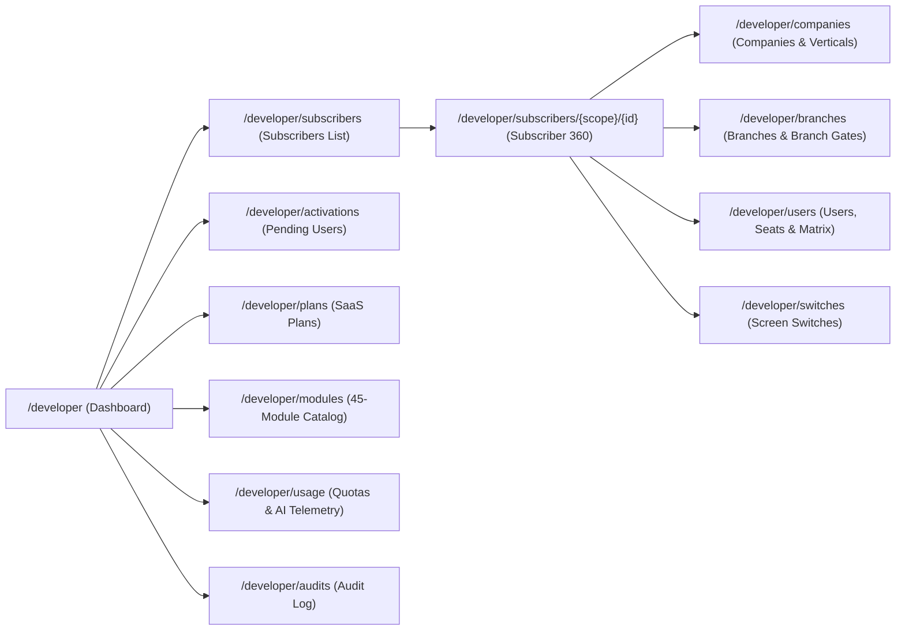
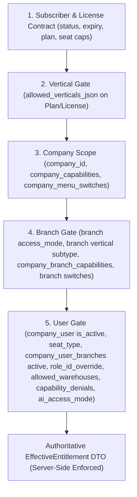
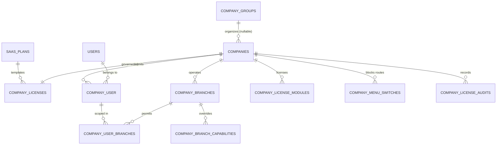
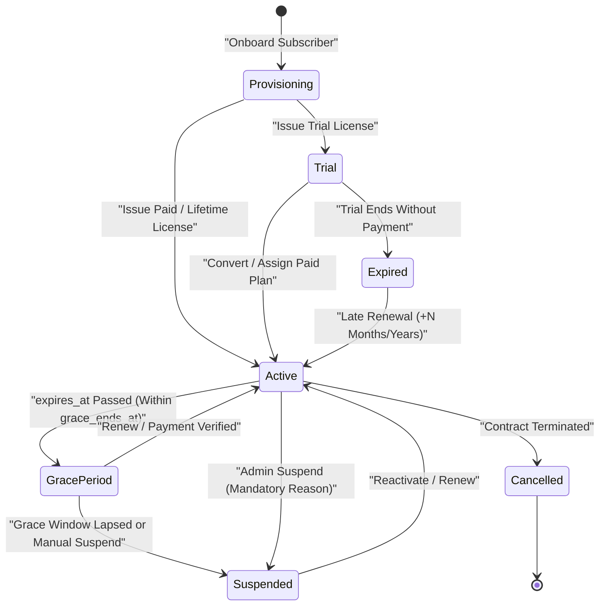

# zoloERP Pro — Industry-Standard Developer & SaaS Licensing Control Plane Architecture

> **Document Type:** Master Platform Architecture, Multi-Axis Gating Specification & Phased UI Redesign Plan  
> **Applies to:** Developer Portal (`/developer/*`), SaaS Subscriptions, Multi-Group & Independent Subscribers, Vertical Presets, Branch Isolation, User Seat & Role Matrix, Module & AI Entitlements  
> **Design System Standard:** 100% Canonical zoloERP UI (`public/css/zolo-tokens.css`, `public/css/zolo-components.css`, `.side-navbar`, `.comm-command-bar`, `.kpi-summary-strip`, `.desk-filter-card`, `.desk-card-wrapper`) — Zero Novel AI UI  
> **Repository:** `vigneshsinna/zolo-erp-pro` (Laravel 13.40 / PHP 8.5.12)  
> **Status:** Proposed Master Blueprint (Ready for Phased Execution)

---

## 1. Executive Summary & Current-State (`AS-IS`) Gap Audit

The **zoloERP Developer & SaaS Licensing Control Plane** governs commercial subscriptions, multi-company group hierarchies, industry vertical entitlements, physical branch boundaries, user seat assignments, all **45 platform capabilities** (`37 ERP + 8 AI` in `CapabilityCatalog::DEFINITIONS`), AI metering quotas, and screen-level route switches across a single-database multi-company deployment.

### 1.1 Architectural Audit of Current Implementation (`AS-IS`)

| Area | Current Implementation | Observed Limitation / Production Gap |
|---|---|---|
| **Portal Shell & Layout** | `resources/views/backend/developer/index.blade.php` (921 lines), `public/css/pages/developer.css` | Standalone top-tab layout with zero left navigation rail (`developer.css` line 1), bespoke `.dev-kpi` boxes instead of canonical `.kpi-summary-strip`, inline `<details class="dev-collapsible">` onboarding drawers, and a cramped `310px` left directory. |
| **Executive Dashboard** | Flat 5-metric strip mixed inside the `tenants` tab | No dedicated **Dashboard** home view highlighting MRR/ARR rollups, expiring trials/licenses, grace/suspended alerts, quota pressure hotlists (≥80%), vertical distribution, or pending self-registration approvals (`users.is_active = 0`). |
| **Subscriber Concept** | `DeveloperTenantService::listTenants()` lists flat `companies` rows | Conflates commercial **Subscribers** (`company_groups` enterprise accounts vs. standalone independent `companies`) with legal entities. Lacks billing owner metadata, contract rollups, consolidated Subscribers list, and standardized bulk/row action menus. |
| **Vertical Gating** | `IndustryCatalog` (`general_trading`, `fmcg`, `textile`, `timber`, `solar`, `opticals`) + `company_industry_settings` | Stored only per company. `saas_plans` and `company_licenses` do **not** declare `allowed_verticals_json`, allowing tenant admins to switch verticals arbitrarily. `company_branches` cannot specialize branch verticals (e.g., Opticals `lens_manufacturing` lab vs. `optical_retail` store). |
| **Branch Gating** | `BranchAccess` scopes query rows via `company_user_branches`; `CapabilityService` and `MenuSwitches` operate solely on `company_id` | Cannot enable/disable capabilities (e.g., `sales.pos`, `manufacturing.production`, `operations.job_work`) or screen switches per branch. |
| **User × Branch × Role Gating** | `DeveloperController::index()` loads `role_id IN (1, 2)` only; `syncCompanies()` attaches **all active branches** | Ignores operational roles (`role_id` 4, custom Spatie roles, `role_id` 5 portal users), per-branch role overrides (`Store Manager` vs `Auditor`), seat classifications, per-company user suspension, per-branch warehouse limits, and per-user AI execution policy. |
| **Quota & Concurrency Safety** | `LicenseService` (`assertCanAddUser`, `assertCanAddBranch`, `assertCanAddWarehouse`, `assertCanIssueInvoice`) | Self-registration activations, branch-level seat caps, and near-limit warning telemetry need unified transactional enforcement (`DB::transaction` + `lockForUpdate`) across every provisioning and activation path. |

---

## 2. Information Architecture & Left Side Panel Shell (`AGENTS.md` §4.4 Compliant)

To match the production zoloERP workspace (`resources/views/backend/report/stock_report.blade.php`, `public/css/zolo-tokens.css`, `public/css/zolo-components.css`) and comply strictly with **`AGENTS.md` §4.4 (Zero Novel AI UI)**, the Developer Portal adopts a dedicated two-part shell sharing the exact zoloERP component vocabulary.

### 2.1 Desktop & Mobile Workspace Topology

```text
+---------------------------------------------------------------------------------------------------+
| TOP COMMAND HEADER (56px, var(--z-surface), hairline bottom var(--z-border))                     |
| [Sidebar Toggle]  zoloERP Licensing & Control Plane   [Ctrl+K Jump Search]  [Theme] [ERP] [Exit] |
+--------------------------+------------------------------------------------------------------------+
| LEFT SIDE PANEL (250px)  | MAIN SCROLLABLE WORKSPACE (var(--z-bg) #f8fafc)                        |
| .side-navbar (Dark Navy  |                                                                        |
|  var(--zn-900) #021840)  |  1. .comm-command-bar (Page Title, Subtitle Badge, Primary CTAs)        |
|                          |  2. .kpi-summary-strip (.kpi-card + .z-icon-tile.z-tone-*)             |
|  [Search menu...       ] |  3. .desk-filter-card (Search + Multi-Axis Selectors + Filter/Reset)    |
|                          |  4. .desk-card-wrapper (.table-responsive > table.table.table-sm)      |
|  COMMAND CENTER          |                                                                        |
|   * Dashboard            |                                                                        |
|  SUBSCRIBERS             |                                                                        |
|   * Subscribers   [14]   |                                                                        |
|   * Pending Queue [ 3]   |                                                                        |
|  ACCESS & GATING MATRIX  |                                                                        |
|   * Companies & Verts    |                                                                        |
|   * Branches & Gates     |                                                                        |
|   * Users & Matrix       |                                                                        |
|  PLANS & ENTITLEMENTS    |                                                                        |
|   * SaaS Plans           |                                                                        |
|   * Module & AI Catalog  |                                                                        |
|   * Screen Switches      |                                                                        |
|  METERING & GOVERNANCE   |                                                                        |
|   * Quotas & AI Usage    |                                                                        |
|   * Immutable Audit Log  |                                                                        |
+--------------------------+------------------------------------------------------------------------+
```

### 2.2 Portal Route Navigation Flow



### 2.3 Complete Left Side Panel Menu Specification

Template structure: `resources/views/backend/developer/layout/main.blade.php` + `resources/views/backend/developer/layout/sidebar.blade.php` (mirroring `resources/views/backend/layout/sidebar.blade.php` search box `#dev-menu-search` and collapsible `.side-menu` items, rendered inside `.side-navbar`).

| Section Heading | Menu Item | Route Name | URI Path | Dripicon | Badge / Counter | Core Responsibility |
|---|---|---|---|---|---|---|
| **Command Center** | **Dashboard** | `developer.index` | `/developer` | `dripicons-meter` | Risk alert count | Platform KPIs, MRR/ARR, expiry watchlist, quota hotlist, vertical mix, live audit stream |
| **Subscribers** | **Subscribers** | `developer.subscribers.index` | `/developer/subscribers` | `dripicons-store` | Total Subscribers | Unified register of Enterprise Groups & Independent accounts + full action menu |
| **Subscribers** | **Pending Activations** | `developer.activations.index` | `/developer/activations` | `dripicons-user-id` | `is_active = 0` count | Approval desk for self-registered users (`/register`), enforcing company seat quotas before activation |
| **Access & Gating** | **Companies & Verticals** | `developer.companies.index` | `/developer/companies` | `dripicons-briefcase` | Total Companies | Legal company entities, GSTIN/state, group assignment, vertical lock & subtype presets |
| **Access & Gating** | **Branches & Location Gates** | `developer.branches.index` | `/developer/branches` | `dripicons-location` | Active Branches | Branch lifecycle (`active` / `read_only` / `suspended`), branch vertical subtype, per-branch capability gates |
| **Access & Gating** | **Users, Seats & Matrix** | `developer.users.index` | `/developer/users` | `dripicons-user-group` | Active Seats | Cross-tenant user directory (all roles), interactive `User × Branch × Role × Vertical` matrix, Access Simulator |
| **Plans & Entitlements** | **SaaS Plans & Vertical Packs** | `developer.plans.index` | `/developer/plans` | `dripicons-tags` | Active Plans | Tier templates, vertical allow-lists, ERP/AI/seat-tier limits, default capability bundles |
| **Plans & Entitlements** | **Module & AI Catalog** | `developer.modules.index` | `/developer/modules` | `dripicons-view-thumb` | `45` (`37 ERP + 8 AI`) | Authoritative capability graph, dependencies, Core vs Switchable vs Add-on classification |
| **Plans & Entitlements** | **Screen & Route Switches** | `developer.switches.index` | `/developer/switches` | `dripicons-toggles` | Active overrides | Sidebar & URL route gatekeeper scoped by Company, Branch, or Role |
| **Metering & Governance** | **Quotas & AI Telemetry** | `developer.usage.index` | `/developer/usage` | `dripicons-graph-bar` | Over-80% count | Seat, branch, warehouse, monthly invoice, AI credit, OCR media page & daily token telemetry |
| **Metering & Governance** | **Immutable Audit Log** | `developer.audits.index` | `/developer/audits` | `dripicons-document` | Latest events | Append-only `company_license_audits` ledger with actor, IP, before/after JSON diff & CSV/PDF export |

### 2.4 Strict UI Component Reuse Contract (`AGENTS.md` §4.4)

Every Developer Portal Blade view MUST reuse the existing zoloERP design tokens and layout primitives verified by `tests/Unit/DesignTokensTest.php`:

| UI Region | Canonical Component / CSS Class | Tokens & Icons Permitted | Strictly Forbidden |
|---|---|---|---|
| **Top Page Bar** | `<div class="comm-command-bar d-print-none">` | `.comm-title-group`, `.comm-title-badge`, `.comm-actions`, `.btn-primary`, `.btn-secondary` | Floating glass toolbars or custom hero banners |
| **KPI Metric Strip** | `<div class="kpi-summary-strip d-print-none">` → `.kpi-card` + `.kpi-label` + `.kpi-number` + `.kpi-subtext` | `.z-icon-tile` with `z-tone-primary`, `z-tone-success`, `z-tone-warning`, `z-tone-info`, `z-tone-danger`, `z-tone-neutral` | Custom left-border cards (`border-left: 3px solid ...`) or bespoke `.dev-kpi` metric boxes |
| **Filter & Toolbar Bar** | `<div class="desk-filter-card d-print-none">` | Standard `.form-control form-control-sm`, `--z-field-bg`, `--z-field-border` | Hardcoded hex accent borders or inline `style="background:..."` |
| **Tables & Panels** | `<div class="desk-card-wrapper">` → `<div class="table-responsive"><table class="table table-sm">` | Standard `.badge.badge-success`, `.badge-primary`, `.badge-warning`, `.badge-danger`, `.badge-secondary` | `#4f46e5`, `#6366f1`, `#7c3aed`, neon gradients, or bespoke SaaS UI cards |
| **Exports & Prints** | Reuse `GlobalReportExportService` (`global-print.blade.php` / `global-pdf.blade.php`) | Standard `<Company/Platform>_<Report>_<Date>` exports | Custom per-view PDF HTML wrappers |

---

## 3. Screen 1 — Executive Licensing Dashboard (`/developer`)

The Dashboard serves as the developer's daily operational cockpit, surfacing contract health, quota saturation, and pending onboarding without scrolling through module checkboxes.

### 3.1 Top Command Bar & 6-Card Canonical KPI Strip

- **Command Bar (`.comm-command-bar`):**
  - Title: `<i class="dripicons-meter text-primary"></i> Developer Licensing & Control Plane`
  - Actions: `+ New Subscriber`, `+ New SaaS Plan`, `Export Platform Snapshot (CSV / PDF)`
- **KPI Strip (`.kpi-summary-strip` using canonical `.kpi-card` + `.z-icon-tile`):**

| # | KPI Card Title | Metric Value Formula | Subtext Context | Icon & Tone |
|---|---|---|---|---|
| 1 | `TOTAL SUBSCRIBERS` | Count of `company_groups` + ungrouped independent `companies` | `G` Groups · `I` Independent (`+N` this month) | `dripicons-store` · `z-tone-primary` |
| 2 | `ACTIVE LICENSES` | `Active / Total` `company_licenses` | `T` Trial · `R` Grace · `B` Blocked/Suspended | `dripicons-checkmark` · `z-tone-success` |
| 3 | `CONTRACT MRR / ARR` | Normalized monthly recurring revenue across active/grace paid licenses (`yearly / 12 + monthly`) | Annualized ARR (`MRR × 12`) in base currency | `dripicons-wallet` · `z-tone-info` |
| 4 | `SEAT & BRANCH LOAD` | `Active Non-Dev Users / Sum(max_users)` | `Active Branches / Branch Cap` across tenants | `dripicons-user-group` · `z-tone-primary` |
| 5 | `RENEWAL & RISK ALERTS` | Count where `expires_at <= today + 15d` OR status in `grace`, `suspended`, `expired` | Expiring in 15d · Pending grace cutoffs | `dripicons-warning` · `z-tone-warning` |
| 6 | `MONTHLY OPS & AI CREDITS` | Sum of current-month `sales` invoices & `ai_credit_ledger` (`usage_debit`) | Active AI tokens today across subscribers | `dripicons-graph-bar` · `z-tone-neutral` |

### 3.2 Operational Dashboard Grid (4 Actionable Panels inside `.desk-card-wrapper`)

1. **Renewal, Trial & Grace Watchlist (Top Left):**
   - Sorted by nearest `expires_at` / `grace_ends_at`.
   - Columns: `Subscriber`, `Company`, `Plan`, `Status Badge`, `Expiry / Days Left`, `Quick Renew (+1M / +1Y / Suspend)`.
2. **Quota Saturation Hotlist (≥80% Utilization) (Top Right):**
   - Automatically flags any subscriber/company where `used / limit >= 0.80` for Users, Branches, Warehouses, Monthly Invoices, AI Credits, or OCR Media Pages.
   - Direct button: `Adjust Quota / Upgrade Plan`.
3. **Vertical & Plan Distribution Summary (Bottom Left):**
   - Groups active companies, branches, active user seats, and MRR by the 6 `IndustryCatalog` verticals (`General Trading`, `FMCG`, `Textile`, `Timber`, `Solar`, `Opticals & Eyewear`) and by `SaasPlan` SKU (`Trial`, `Starter`, `Growth`, `Industry Pro`, `Enterprise`).
4. **Pending Activations & Latest Audit Events (Bottom Right):**
   - Top sub-block: Latest `users` with `is_active = 0` and `is_deleted = 0` awaiting activation (`Approve & Bind Branch`).
   - Bottom sub-block: Latest 10 immutable entries from `company_license_audits` (`Timestamp`, `Actor`, `Target`, `Action`, `Summary`).

---

## 4. Screen 2 — Subscribers Menu (`/developer/subscribers`) & Subscriber 360° Console

### 4.1 Unified Commercial Subscriber Model

Rather than forcing single-company buyers into fake groups or mixing commercial owners with raw `companies`, the **Subscribers** menu presents one unified register combining:
- **Enterprise Group Subscribers** (`scope = group`, backed by `company_groups`): One commercial customer owning $N \ge 1$ legal `companies`, $M$ `company_branches`, and pooled/rolled-up quota & MRR metrics.
- **Independent Subscribers** (`scope = company`, backed by `companies` where `company_group_id IS NULL`): Standalone single-company tenants promoted to first-class subscribers in the exact same table (and seamlessly convertible to a Group Subscriber if they add a second legal entity later).

### 4.2 Subscribers List Filter & Toolbar Architecture

- **Segment Tabs (Inline Pill Bar):** `All`, `Active`, `Trial`, `Grace`, `Expiring <=15d`, `Suspended / Expired`, `Quota Alert >=80%`, `Enterprise Groups`, `Independent`
- **4-Card Filtered KPI Strip (`.kpi-summary-strip`):** `Filtered Subscribers`, `Filtered Active Seats`, `Filtered Active Branches`, `Filtered Contract Value (MRR)`
- **Structured Filter Card (`.desk-filter-card`):**
  - Search Input: Subscriber Name, Code, Primary Admin Name/Email/Phone, Company GSTIN, or License Key
  - Select Filters: `Vertical` (All / 6 verticals), `SaaS Plan`, `Billing Cycle`, `License Status`, `Expiry Window`, `Company Type (Group / Independent)`
- **Bulk Selection Action Bar (Revealed on Row Checkbox Selection):**
  - `Export Selected (Excel / CSV / PDF)` · `Bulk Extend Grace (+N Days)` · `Send Renewal Reminder`

### 4.3 Complete Subscribers Table Columns (10 Telemetry Columns)

Every row in the `.desk-card-wrapper` table surfaces complete commercial, vertical, branch, seat, and volume visibility cleanly without clutter:

| # | Column Header | Primary Content & Formatting | Secondary Sub-Line / Badge Telemetry | Authoritative Source |
|---|---|---|---|---|
| 1 | `Subscriber & Code` | **Subscriber Display Name** + `<code>` | Type badge (`Enterprise Group · 3 Co` vs `Independent`) + `Created` date + State/Country | `company_groups`, `companies` |
| 2 | `Primary Contact / Admin` | **Admin Name** + `Email` | `Phone` + total company admins badge + warning pill if `pending_users > 0` | `company_groups`, `company_user`, `users` |
| 3 | `Licensed Verticals` | **Vertical Badge(s)** (`Opticals`, `Textile`, etc.) | Active subtypes (e.g., `Rx Lab + Retail`) + lock indicator if plan restricts vertical switching | `saas_plans.allowed_verticals_json`, `company_industry_settings`, `company_branches` |
| 4 | `Plan & Billing` | **Plan Name** (`Growth`, `Industry Pro`, etc.) | Billing cycle pill (`Monthly`/`Yearly`/`Lifetime`) + Contract Rate (`₹4,999/mo`) + masked `ZOLO-••••-XXXX` key (click to copy) | `saas_plans`, `company_licenses` |
| 5 | `License Status & Validity` | Canonical status badge (`ACTIVE`, `TRIAL`, `GRACE`, `SUSPENDED`, `EXPIRED`) | `Expires: YYYY-MM-DD` (`12d left` / `Grace ends: ...` / `Reason: ...`) | `LicenseService::snapshot()` |
| 6 | `Entities & Locations` | **Companies:** `N` · **Branches:** `used / max` | **Warehouses / Godowns:** `used / max` + inactive/suspended branch alert if `>0` | `companies`, `company_branches`, `warehouses`, `LicenseService::quotaUsage()` |
| 7 | `User Seats` | **Active Seats:** `used / max` + compact progress meter | Tooltip/sub-line breakdown: `Admins` · `Staff` · `POS` · `Auditors` | `company_user`, `users` (`is_developer = 0`) |
| 8 | `Modules & Gating` | **Capabilities:** `licensed / 45` | Split pill (`32 ERP · 4 AI`) + `Branch Overrides: N` + `Switches Off: N` | `company_license_modules`, `company_branch_capabilities`, `company_menu_switches` |
| 9 | `Usage & AI Metering` | **Invoices (Mo):** `used / max` · **AI Credits:** `used / max` | AI Policy pill (`Read-Only` vs `Read+Write`) + OCR pages (`used/max`) + Last Activity date | `sales`, `ai_credit_ledger`, `ai_media_assets` |
| 10 | `Actions` | Quick inline buttons (`Manage 360°`, `Matrix`) + categorized `Actions v` dropdown | Standard left-aligned Bootstrap dropdown (`dropdown-menu`) with grouped headers | Route actions below |

### 4.4 Subscriber Actions Specification Matrix

| Action Label | UI Placement | Input / Confirmation Required | Authoritative Action & Audit Log Event | Cache Invalidation |
|---|---|---|---|---|
| **Manage 360°** | Primary inline button | None (navigation) | Opens `/developer/subscribers/{scope}/{id}` full tabbed workspace | — |
| **Access Matrix** | Secondary inline button | None (deep-link) | Opens `/developer/users?subscriber=...` pre-filtered to Subscriber's User × Branch × Vertical matrix | — |
| **Enter ERP Workspace** | Dropdown (Support) | Optional company/branch picker if `>1` | Sets scoped session `(company_id, branch_id, financial_year_id)` as developer; logs `developer_workspace_entered` | `BranchAccess::forget()` |
| **+ Provision Company** | Dropdown (Structure) | Company modal (`legal_name`, `industry`, `subtype`, `plan`) | Creates legal `Company` under Group (or promotes Independent to Group), grants developers access | `CompanyDirectoryService::clearCache()` |
| **+ Add Branch / Location** | Dropdown (Structure) | Branch modal (`name`, `code`, `branch_role_type`, `vertical_subtype`, quotas) | Enforces `LicenseService::assertCanAddBranch()` inside `DB::transaction`; inserts `company_branches` | Bump `entitlement_version` |
| **+ Add / Invite User Seat** | Dropdown (Users) | User drawer (`name`, `email`, `seat_type`, branch assignments, role overrides) | Enforces `assertCanAddUser()` inside `DB::transaction` + `lockForUpdate()`; creates user + memberships | `BranchAccess::forget()` |
| **Change Plan & Billing Cycle** | Dropdown (Contract) | Modal (`saas_plan`, `billing_cycle`, dates, `keep_overrides`) | Calls `LicenseService::assignPlan()`, syncs `allowed_verticals_json` & capabilities, logs `plan_assigned` | `LicenseService::forgetCompany()` + `CapabilityService::forgetCompany()` |
| **Edit Quotas & AI Limits** | Dropdown (Contract) | Modal for ERP quotas, seat-tier caps, AI credits/OCR/tokens, `ai_read_only` | Updates `company_licenses` overrides inside transaction, logs `quotas_updated` | Bump `entitlement_version` |
| **Configure Verticals & Modules** | Dropdown (Gating) | Opens Subscriber 360° Modules & Verticals tab | Saves `allowed_verticals_json`, `company_license_modules`, expiry dates; logs `modules_saved` | `CapabilityService::forgetCompany()` |
| **Manage Screen Switches** | Dropdown (Gating) | Opens Switches filtered to Subscriber Company / Branch | Updates `company_menu_switches`, logs `menu_switches_updated` | Bump `entitlement_version` |
| **Quick Renew (+1M / +1Y / Custom)** | Dropdown (Lifecycle) | Quick confirm or custom date modal | Calls `LicenseService::updateLifecycle(..., 'renew')`, recalculates `grace_ends_at` | `LicenseService::forgetCompany()` |
| **Extend Trial / Grace Period** | Dropdown (Lifecycle) | Modal with `days` (1–90) + mandatory audit `reason` | Extends `expires_at` (if `trial`) or `grace_ends_at`, logs `grace_extended` | `LicenseService::forgetCompany()` |
| **Copy / Rotate License Key** | Dropdown (Security) | Rotate requires confirm modal | Copies key or calls `updateLifecycle(..., 'regenerate_key')`, logs `key_rotated` | `LicenseService::forgetCompany()` |
| **Revoke Active Sessions** | Dropdown (Security) | Confirm modal + `reason` | Invalidates sessions & revokes Sanctum tokens for company users; logs `sessions_revoked` | Session / token store clear |
| **Export License Certificate (PDF)** | Dropdown (Compliance) | None (GET download) | Renders `GlobalReportExportService`-compliant A4 Certificate PDF detailing active plan, verticals, quotas, and modules | — |
| **Suspend / Reactivate** | Dropdown (Danger) | Mandatory `suspension_reason` when suspending | Sets `status = 'suspended'` (triggers `CompanyLicenseBlockedException` HTTP 403 for non-developers) or `'active'`, keeping all ledger data immutable | `LicenseService::forgetCompany()` |

### 4.5 Subscriber 360° Console (`/developer/subscribers/{scope}/{id}`)

Clicking **Manage 360°** opens a dedicated full-width workspace with 7 clean tabs:

1. **Overview & Contract:** Masked license key, billing details, MRR, lifecycle actions (`Renew`, `Extend Grace`, `Suspend`), and real-time quota progress bars.
2. **Companies & Verticals:** All legal entities belonging to this Subscriber, vertical preset & subtype locks, GSTIN/State code, FY status, and group transfer controls.
3. **Branches & Branch Gating:** Full list of `company_branches`, branch vertical specializations (`vertical_profile_key` / `vertical_subtype`), branch access mode (`active` / `read_only` / `suspended`), per-branch user/warehouse caps, and click-to-edit **Branch Capability Gate Matrix**.
4. **Users & Branch-Role Matrix:** Every non-developer user across the Subscriber (`Admins`, `Owners`, `Staff`, `POS Cashiers`, `Auditors`, `Customer Portal`), seat type badges, pending activations, and inline `Users × Branches` access grid.
5. **Modules & Add-ons:** Grouped grid of all `45` capabilities (`Core`, `Inventory`, `Sales`, `Manufacturing`, `Operations`, `Service`, `Printing`, `Communications`, `Integrations`, `HRM`, `AI`) with dependency auto-selection (`checked` dependency cascades) and optional add-on `expires_at` dates.
6. **Screen & Route Switches:** Inherit/block switches scoped at **Company**, **Branch**, or **Role** granularity.
7. **Usage & Audit Trail:** Historical monthly invoice volume, AI credit consumption breakdown, and filterable `company_license_audits` JSON diffs.

---

## 5. Multi-Axis Gating Architecture (`Subscriber → Company → Vertical → Branch → User`)

### 5.1 Monotonic Privilege Narrowing Principle

Every authorization decision in zoloERP resolves top-down through five deterministic gates. **A lower scope may restrict or specialize an entitlement, never expand it beyond its parent scope:**



Formally, for a request authenticated as `(userId, companyId, branchId)` requesting capability $k$ in vertical $v$:

$$\text{Allowed}(u, c, b, k, v) = \text{LicenseUsable}(c) \land \text{VerticalAllowed}(c, b, u, v) \land \text{CompanyCap}(c, k) \land \text{DepsSatisfied}(c, b, k) \land \text{BranchGate}(b, k) \land \text{UserBranchGate}(u, c, b, k)$$

And the **Effective Role** for Spatie permissions (`PermissionMiddleware`, `NavigationAccess`, `Common` middleware) resolves cleanly in priority order:

$$\text{EffectiveRole}(u, c, b) = \text{COALESCE}(\text{company\_user\_branches.role\_id\_override},\ \text{company\_user.role\_id\_override},\ \text{users.role\_id})$$

*(Note: Developer operators with `MenuSwitches::isDeveloper($user) === true` retain platform recovery/inspection visibility inside `/developer` and scoped developer actions, while standard company users never bypass any gate.)*

### 5.2 Vertical Gating (Plan, Company, Branch & User Levels)

Leverages `IndustryCatalog` (`general_trading`, `fmcg`, `textile`, `timber`, `solar`, `opticals`) and `IndustryCatalog::SUBTYPES` without duplicating business code (`IndustryProfileService` remains configuration-driven):

1. **Plan & License Vertical Allow-List:**
   - `saas_plans.allowed_verticals_json` and optional license override `company_licenses.allowed_verticals_json`:
     - `["*"]` allows all 6 verticals (Enterprise / Multi-Vertical plans).
     - Specific array (e.g., `["opticals"]` or `["textile", "general_trading"]`) locks the subscriber to contracted verticals.
   - Enforcement: `IndustryProfileService::apply()` validates `LicenseService::allowsVertical($companyId, $profileKey)` — throwing `AuthorizationException` if a tenant admin attempts to switch to an unlicensed industry vertical.
2. **Branch-Level Vertical Specialization:**
   - A company running multiple branches in different operational modes binds each branch via nullable `company_branches.vertical_profile_key` and `company_branches.vertical_subtype` (validated to belong to `allowed_verticals_json`).
   - **Real Multi-Branch Vertical Scenarios Supported:**
     - **Opticals & Eyewear (`LenzBreeze`):** `LB-MAIN-LAB` uses `vertical_subtype = lens_manufacturing` (exposes `manufacturing.bom`, `manufacturing.production`, `operations.job_work`, `Lab Dispatch`, `Bulk Lab Receipts`), while `LB-SHOWROOM-01` uses `vertical_subtype = optical_retail` (exposes `sales.pos`, `service.warranty_amc`, hides Production & Job Work menus).
     - **Textile Enterprise (`ZTEX`):** `TIRUPPUR-MILL` uses `vertical_subtype = manufacturing` (`Godown`, `Material DC`, `Job Work GRN`, `BOM/Production`), while `CHENNAI-DEPOT` uses `vertical_subtype = wholesale_distributor` (`Route Distribution`, `Wholesale Sales`, hides Manufacturing).
     - **Multi-Vertical Group (`MJ Group`):** Legal Company 1 (`fmcg`) and Legal Company 2 (`opticals`) remain 100% isolated at the database level (`company_id`), governed under one Commercial Group Subscriber card.
3. **User-Level Vertical Constraint:**
   - Optional `company_user.allowed_verticals_json` allows a group-level operator (who has membership in both FMCG and Opticals companies) to be blocked from entering companies or branches outside their permitted vertical list.

### 5.3 Branch-Level Gating (Operational Mode, Quotas, Capabilities & Screen Switches)

1. **Branch Lifecycle & Operational Modes (`company_branches.access_mode`):**
   - `active`: Full operational read/write access permitted by user role & capabilities.
   - `read_only`: Allows historical ledger, invoice, and stock queries (`GET`), blocks all write endpoints (`POST`/`PUT`/`DELETE` commercial & inventory mutations) — ideal for year-end branch closeout or store closure audit.
   - `suspended`: Immediately rejects branch selection and API/web context resolution (`AuthorizationException('Branch access is suspended by platform administrator.')`).
2. **Branch Sub-Quotas (`company_branches.max_users`, `company_branches.max_warehouses`):**
   - Optional ceiling per branch; strictly bounded so $\sum \text{branch limits}$ or actual usage never exceeds `company_licenses.max_users` / `max_warehouses`.
3. **Branch Capability Overrides (`company_branch_capabilities`):**
   - Tri-state toggle per `(branch_id, capability_key)`:
     - *Inherit (no row):* Follows company + branch vertical subtype defaults.
     - *Enable (`mode = 'enable'`):* Explicitly activates a company-licensed module for this branch (blocked if module is NOT licensed at company level).
     - *Disable (`mode = 'disable'`):* Suppresses a module only inside this branch (plus cascades to any capabilities depending on it).
4. **Branch- & Role-Scoped Screen Switches (`company_menu_switches`):**
   - Extends existing route switches (`EnforceMenuSwitches`, `MenuSwitches`) with optional `branch_id` and `role_id` specificity:
     - Precedence: `(company, branch, role)` → `(company, branch, null)` → `(company, null, role)` → `(company, null, null)`.
     - Guarantees both sidebar link hiding (`sidebar.blade.php`) and direct HTTP URL blocking (`EnforceMenuSwitches`) per branch and role.

### 5.4 User × Branch × Role × Seat Gating Matrix

Replaces the legacy `role_id IN (1, 2)` Admin list with a complete multi-tenant user access governance console:

1. **Seat Types (`company_user.seat_type`):**
   - `tenant_admin`: Full company administration within licensed capabilities & verticals.
   - `branch_manager`: Manages operational staff, approvals, and registers within assigned branches.
   - `standard_operator`: Billing, purchases, inventory, job work, accounting per Spatie role.
   - `pos_cashier`: Restricted to `sales.pos` and shift cash register screens.
   - `warehouse_clerk`: Inventory receipts, transfers, packing slips, lot counts.
   - `auditor_readonly`: Global or branch-scoped read-only financial & stock audit access.
   - **Quota Accounting:** `LicenseService::quotaUsage()` counts active non-deleted, non-developer members per company and optionally validates per-seat-tier allocations (`seat_limits_json`, e.g., `{"tenant_admin": 2, "pos_cashier": 5}`).
2. **Per-Company & Per-Branch User Controls:**
   - `company_user.is_active`: Suspends user access inside Company A without affecting their active access inside Company B.
   - `company_user_branches.is_active`: Pauses branch access while retaining historical role/warehouse metadata.
   - `company_user_branches.role_id_override`: Assigns distinct roles per branch (e.g., `Branch Manager` in Branch 1, `Read-Only Viewer` in Branch 2).
   - `company_user_branches.allowed_warehouse_ids_json`: When non-null, `BranchAccess::warehouses()` intersects the branch's warehouses with this explicit allow-list (isolating a counter clerk to one warehouse inside a shared branch).
   - `company_user_branches.capability_denials_json`: Denies specific capabilities (e.g., `["ai.actions", "core.accounting", "operations.job_work"]`) to an individual user inside a branch.
   - `company_user.ai_access_mode`: `inherit` | `none` | `read_only` | `governed_write` (clamped by `company_licenses.ai_read_only`; enforces `AGENTS.md` Core Tenet of **Zero Autonomous Financial Writes**).
3. **Interactive Matrix UI & Effective Access Simulator:**
   - **Matrix View:** Rows = Users (`Search / Filter by Role, Seat Type, Pending Activation, Branch`); Columns = Company Branches; Cells show compact status badge + active Role chip (`Admin`, `Cashier`, `Lab`, `Off`) + click-to-edit drawer for warehouse allow-list, capability denials, and AI mode.
   - **Effective Access Simulator (`/developer/simulate-access`):** Developer picks `(Company, Branch, User)` and receives an instant deterministic explain trace:
     - Effective Vertical & Subtype (with source: `Company Default` vs `Branch Override`)
     - Effective Role ID & Name (with override chain trace)
     - Permitted Warehouses within the branch
     - All 45 Capabilities showing `ALLOWED` or `BLOCKED` alongside exact reason (`Unlicensed in Starter Plan`, `Disabled on Branch LB-RET-01`, `Denied for User`, `Missing Dependency`)
     - Rendered Sidebar Links preview (evaluating `NavigationAccess` + `MenuSwitches`).

---

## 6. Authoritative Server-Side Enforcement & Caching Architecture

All UI hides in Blade are **presentational conveniences only**. Every web request, REST API call (`/api/v1/*`), queued job, and AI MCP tool execution validates entitlements server-side via a new service facade integrated cleanly into existing `App\Services\Platform\*` classes.

### 6.1 `App\Services\Platform\EffectiveEntitlementService`

```php
final readonly class EffectiveEntitlement
{
    public function __construct(
        public int $companyId,
        public int $branchId,
        public int $userId,
        public string $verticalKey,
        public ?string $verticalSubtype,
        public int $effectiveRoleId,
        public string $seatType,
        public string $branchAccessMode,      // active | read_only | suspended
        public string $aiAccessMode,          // none | read_only | governed_write
        public array $capabilityStates,       // capability_key => ['enabled' => bool, 'reason' => ?string]
        public ?array $allowedWarehouseIds,   // null = all warehouses in branch
        public int $entitlementVersion,
    ) {}
}
```

### 6.2 Existing Service Integration Contract (100% Backward Compatible)

| Existing Class | Method / Touchpoint | Enhanced Behavior | Backward Compatibility Guarantee |
|---|---|---|---|
| **`CompanyContextResolver`** | `resolve(...)` & `authorizedCompany(...)` | Rejects `company_user.is_active = 0`, `company_branches.access_mode = 'suspended'`, `company_user_branches.is_active = 0`, and users violating `company_user.allowed_verticals_json`. | Existing 403 `AuthorizationException` behavior on `/api/v1/*` and `CompanyContextTest` preserved intact; web inactive users handled cleanly by `Active` middleware (`Kernel::$middlewarePriority`). |
| **`LicenseService`** | `allowsVertical()`, `quotaUsage()`, `assertCanAddUser()` | Validates `allowed_verticals_json`, supports seat-tier limits (`seat_limits_json`), enforces branch caps (`company_branches.max_users` / `max_warehouses`), rolls up Subscriber MRR/metrics. | Null `allowed_verticals_json` / null `seat_limits_json` defaults to permissive so all legacy fixtures behave identically. |
| **`CapabilityService`** | `enabled()`, `snapshot()`, `assertEnabled()` | When passed `CompanyContext` (with `$context->branchId`) or resolved from request attributes, applies `company_branch_capabilities`, branch vertical subtype defaults, and `company_user_branches.capability_denials_json`. | Calling `CapabilityService::snapshot(int $companyId)` with an integer ID continues to return the pure company-level snapshot. |
| **`IndustryProfileService`** | `currentProfileKey(?CompanyContext $context)` & `apply()` | Checks `LicenseService::allowsVertical()` before applying; resolves branch-level `vertical_profile_key` / `vertical_subtype` when `$context?->branchId` has an override. | Falls back cleanly to `company_industry_settings` when branch override columns are `null`. |
| **`BranchAccess`** | `warehouses()`, `authorizedBranchIds()` | Excludes branches where `company_user_branches.is_active = 0` or `company_branches.is_active = 0` or `access_mode = 'suspended'`; intersects `allowed_warehouse_ids_json` when present. | Returns full branch warehouses when `allowed_warehouse_ids_json` is `null`. |
| **`MenuSwitches`** | `off()`, `blockedBy()` | Evaluates scoped rows matching `(company_id, branch_id, role_id)` in priority order with cache keying by `(companyId, branchId, roleId, entitlementVersion)`. | Existing company-wide rows (`branch_id IS NULL, role_id IS NULL`) continue matching all branches & roles. |
| **`Common` Middleware & `NavigationAccess`** | Role & Capability resolution | Uses `EffectiveEntitlementService::effectiveRoleId()` so branch role overrides seamlessly drive Spatie permissions and sidebar visibility. | Falls back to `company_user.role_id_override ?? users.role_id` when no branch override exists. |
| **`AiPrincipalAuthorizer` & `ErpToolExecutor`** | `authorize()` & tool pre-flight | Injects branch-resolved capabilities, `verticalKey`, and `aiAccessMode` (`none` blocks AI; `read_only` blocks write proposals) into `AiPrincipal`. | Upholds `AGENTS.md` Core Tenet: model never chooses tenant, branch, vertical, or write authority. |

### 6.3 Versioned O(1) Cache Invalidation

To guarantee zero stale entitlements across PHP-FPM workers and queues without global `Cache::flush()`:
- Add integer `entitlement_version` (`default(1)`) on `company_licenses`.
- Cache keys embed `v{$entitlementVersion}` (e.g., `entitlement:c{$companyId}:b{$branchId}:u{$userId}:v{$ver}`).
- Any mutation to plan, modules, verticals, branch gates, user-branch matrix, or screen switches atomically increments `company_licenses.entitlement_version` inside `DB::afterCommit(...)` and calls `LicenseService::forgetCompany($companyId)`, `CapabilityService::forgetCompany($companyId)`, and `BranchAccess::forget()`.

---

## 7. Additive Database Schema Specification (`AGENTS.md` Law 4)

All schema changes are strictly **additive migrations** (`database/migrations/2026_11_28_*.php`), never altering historical migrations. Foreign key types strictly match existing conventions (`users.id` is `unsignedInteger`, `companies.id` and `company_branches.id` are `unsignedBigInteger`).

### 7.1 Entity Relationship Architecture



### 7.2 Additive Table & Column Definitions

1. **Extend `company_groups` (Subscriber Metadata for Enterprise Groups):**
   - `primary_contact_name` (`string(150)`, nullable)
   - `primary_contact_email` (`string(255)`, nullable)
   - `primary_contact_phone` (`string(50)`, nullable)
   - `billing_gstin` (`string(30)`, nullable)
   - `billing_state_code` (`string(20)`, nullable)
   - `billing_notes` (`text`, nullable)

2. **Extend `saas_plans` & `company_licenses` (Vertical Locks, Seat Tiers, Versioning):**
   - `allowed_verticals_json` (`json`, nullable — `null` or `["*"]` = all verticals; `["opticals"]` = vertical-restricted)
   - `seat_limits_json` (`json`, nullable — optional per-seat-type ceilings, e.g., `{"tenant_admin": 2, "pos_cashier": 10}`)
   - On `company_licenses` only:
     - `entitlement_version` (`unsignedBigInteger`, default `1`)
     - `billing_contact_email` (`string(255)`, nullable)
     - `auto_renew` (`boolean`, default `false`)

3. **Extend `company_branches` (Branch Vertical Specialization, Operational Mode & Sub-Quotas):**
   - `vertical_profile_key` (`string(50)`, nullable — e.g., `opticals`, `textile`)
   - `vertical_subtype` (`string(50)`, nullable — e.g., `lens_manufacturing`, `optical_retail`, `manufacturing`)
   - `access_mode` (`string(20)`, default `'active'` — enum values: `active`, `read_only`, `suspended`)
   - `max_users` (`unsignedInteger`, nullable)
   - `max_warehouses` (`unsignedInteger`, nullable)
   - `suspended_at` (`timestamp`, nullable)
   - `suspension_reason` (`string(500)`, nullable)

4. **Create `company_branch_capabilities` (Branch-Level Module Gates):**
   - `id` (`bigIncrements`)
   - `company_id` (`unsignedBigInteger`)
   - `branch_id` (`unsignedBigInteger`)
   - `capability_key` (`string(100)`)
   - `mode` (`string(16)` — `'enable'` | `'disable'`)
   - `updated_by` (`unsignedInteger`, nullable)
   - `timestamps`
   - Indexes & FKs: `unique(['branch_id', 'capability_key'])`, composite FK `(['branch_id', 'company_id']) -> company_branches(['id', 'company_id'])`, FK `updated_by -> users(id)`.

5. **Extend `company_user` (Per-Company Activation, Seat Classification, AI & Vertical Lock):**
   - `is_active` (`boolean`, default `true` — company-scoped user suspension)
   - `seat_type` (`string(30)`, default `'standard'` — `tenant_admin`, `branch_manager`, `standard_operator`, `pos_cashier`, `warehouse_clerk`, `accountant`, `auditor_readonly`)
   - `ai_access_mode` (`string(20)`, default `'inherit'` — `inherit`, `none`, `read_only`, `governed_write`)
   - `allowed_verticals_json` (`json`, nullable)

6. **Extend `company_user_branches` (User × Branch × Role × Warehouse × Capability Gates):**
   - `is_active` (`boolean`, default `true`)
   - `is_default` (`boolean`, default `false`)
   - `role_id_override` (`unsignedInteger`, nullable)
   - `allowed_warehouse_ids_json` (`json`, nullable)
   - `capability_denials_json` (`json`, nullable)

7. **Extend `company_menu_switches` (Branch & Role Scoped UI Route Switches):**
   - `branch_id` (`unsignedBigInteger`, nullable, after `company_id`)
   - `role_id` (`unsignedInteger`, nullable, after `branch_id`)
   - Index updates: drop old `['company_id', 'menu_key']` unique if present; add `unique(['company_id', 'branch_id', 'role_id', 'menu_key'], 'cms_company_branch_role_key_unique')` plus lookup index `['company_id', 'branch_id', 'role_id']`.

8. **Extend `company_license_audits` (Richer Target Telemetry):**
   - `company_group_id` (`unsignedBigInteger`, nullable, after `company_id`)
   - `branch_id` (`unsignedBigInteger`, nullable)
   - `target_user_id` (`unsignedInteger`, nullable)
   - `ip_address` (`string(45)`, nullable)

---

## 8. Subscription Lifecycle, Quota Policy & Security Governance

### 8.1 Subscription Lifecycle State Machine



| State | Operational Access | Billing / Banner Behavior | Recovery Action |
|---|---|---|---|
| **`trial`** | Full access within trial plan verticals & quotas | Countdown banner shown when `<= 5 days` left | `Convert to Paid Plan` or `Extend Trial` |
| **`active`** | Full access within contracted plan & branch/user gates | Renewal reminder shown when `<= 15 days` left | `+1M`, `+1Y`, `Upgrade Plan` |
| **`grace`** | Full access preserved temporarily to avoid mid-shift lockouts | Persistent warning alert (`banner_warning`) shown in ERP top bar | `Renew` or `Extend Grace` |
| **`suspended`** | HTTP 403 (`backend.developer.blocked`) for all non-developers; API blocked | Displays `suspension_reason` & contact notice; ledger data preserved | `Activate` / `Renew` |
| **`expired` / `cancelled`** | HTTP 403 for all non-developers; read-only Developer Portal access retained | Prompts platform renewal | `Renew (+N Months)` |

### 8.2 Hard vs. Soft Quota Enforcement & Governance Laws (`AGENTS.md` §5)

1. **Transactional Concurrency (`Law 5`):** Every seat creation (`storeAdmin`, `DeveloperUserMatrixController::store`), self-registration approval (`/developer/activations/{user}/approve`), branch creation, warehouse creation, and invoice quota increment acquires a `DB::transaction()` lock (`lockForUpdate()` on `company_licenses`) before checking `used < limit`.
2. **Quota Policy:**
   - *Hard Stops:* `max_users` (including `seat_limits_json`), `max_branches`, `max_warehouses`, `ai_monthly_credits`, `ai_monthly_media_pages`, `ai_max_concurrent_runs`, `ai_daily_token_limit`.
   - *Threshold Telemetry:* `80%` amber dashboard hotlist + `95%` warning banner before hitting `100%` `max_monthly_invoices`.
3. **Immutable Audit Trail (`Law 3`):** Every licensing, plan, vertical, branch gate, user matrix, and session revocation change records `before_json`, `after_json`, `actor_id`, `ip_address`, and `summary` in append-only `company_license_audits`.
4. **Least-Privilege Support Diagnostics:** Developer entry into a tenant ERP workspace logs `developer_workspace_entered` and respects financial immutability — no direct table mutations or ledger bypassing.

---

## 9. Route Map & Controller Decomposition

Split the 531-line `App\Http\Controllers\DeveloperController` into clean, single-responsibility controllers under `app/Http/Controllers/Developer/`, while retaining named route compatibility for existing tests (`tests/Feature/DeveloperLicensingPortalTest.php`):

| Controller | Routes Owned | Responsibility |
|---|---|---|
| `DeveloperDashboardController` | `GET /developer` (`developer.index`) | Executive KPIs, MRR, expiry/grace watchlist, quota ≥80% hotlist, vertical breakdown, audit summary |
| `DeveloperSubscriberController` | `GET /developer/subscribers`, `POST /developer/subscribers`, `GET /developer/subscribers/{scope}/{id}`, `POST /developer/subscribers/{scope}/{id}/lifecycle`, `GET /developer/subscribers/{scope}/{id}/certificate` | Unified Group + Independent Subscribers list, onboarding wizard, Subscriber 360°, PDF Entitlement Certificate |
| `DeveloperCompanyVerticalController` | `GET /developer/companies`, `POST /developer/tenants/{company}/profile`, `POST /developer/tenants/{company}/group`, `POST /developer/tenants/{company}/plan`, `POST /developer/tenants/{company}/modules` | Company directory, vertical enforcement, plan assignment, 45-module licensing |
| `DeveloperBranchGateController` | `GET /developer/branches`, `POST /developer/branches`, `POST /developer/branches/{branch}/gates`, `POST /developer/branches/{branch}/access-mode` | Branch directory, vertical specialization, `access_mode`, branch capability matrix, sub-quotas |
| `DeveloperUserMatrixController` | `GET /developer/users`, `GET /developer/activations`, `POST /developer/activations/{user}/approve`, `POST /developer/users/matrix`, `POST /developer/users/{user}/revoke-sessions`, `GET /developer/simulate-access` | All-role user directory, pending activation queue, User × Branch × Role × Warehouse × AI matrix, Effective Access Simulator |
| `DeveloperPlanController` | `GET /developer/plans`, `POST /developer/plans`, `POST /developer/plans/{plan}`, `POST /developer/plans/{plan}/toggle` | SaaS Plan & Vertical Pack templates |
| `DeveloperModuleCatalogController` | `GET /developer/modules` | Authoritative 45-capability reference & dependency explorer |
| `DeveloperMenuSwitchController` | `GET /developer/switches`, `POST /developer/switches` | Company / Branch / Role route switchboard |
| `DeveloperAuditController` | `GET /developer/usage`, `GET /developer/audits`, `GET /developer/audits/export` | Usage/AI telemetry dashboard & immutable CSV/PDF audit exports |

*Compatibility Rule:* Preserve existing `developer.tenants.*`, `developer.groups.*`, `developer.plans.*`, `developer.admins.*`, and `developer.switches` route names/URIs (delegating cleanly to the new services/controllers or preserving exact redirects when `?tab=` is requested by automated tests).

---

## 10. Phased Delivery Roadmap & Acceptance Gates

| Phase | Story IDs | Scope & Key Deliverables | Target Files | Verification Gates |
|---|---|---|---|---|
| **Phase 1: Left-Sidebar Shell & Executive Dashboard** | `LP-01` | Extract `developer/layout/main.blade.php` + `sidebar.blade.php`; migrate from `.dev-kpi` to canonical `.kpi-summary-strip` / `.comm-command-bar` / `.desk-card-wrapper`; ship Executive Licensing Dashboard (`/developer`) with MRR, renewal watchlist, quota hotlist, vertical mix, pending activations, and latest audits. | `resources/views/backend/developer/layout/*`, `dashboard.blade.php`, `public/css/pages/developer.css`, `DeveloperDashboardController.php` | `DesignTokensTest` (`0` old accents/inline styles), `view:cache`, `route:cache`, Playwright desktop/mobile layout & dark-mode check |
| **Phase 2: Subscribers Master List, Actions & 360° Console** | `LP-02` | Ship `/developer/subscribers` unifying `company_groups` & independent `companies`; all 10 rich columns; full 16-action menu (`Manage 360°`, `Access Matrix`, `+ Company`, `+ Branch`, `+ User`, `Renew`, `Extend Grace`, `Rotate Key`, `Revoke Sessions`, `PDF Certificate`, `Suspend`); 7-tab Subscriber 360° detail view. | `DeveloperSubscriberController.php`, `DeveloperTenantService.php`, `subscribers/index.blade.php`, `subscribers/show.blade.php`, PDF certificate template via `GlobalReportExportService` | `DeveloperLicensingPortalTest` backward compatibility + new Subscriber CRUD, group promotion, PDF export & audit trail assertions |
| **Phase 3: Multi-Axis Vertical & Branch Gating Engine** | `LP-03` | Additive migrations (`allowed_verticals_json`, `company_branches` vertical/access_mode/sub-quotas, `company_branch_capabilities`, branch/role `company_menu_switches`, `entitlement_version`); build `EffectiveEntitlementService`; integrate `CapabilityService`, `IndustryProfileService`, `BranchAccess`, `MenuSwitches`. | `database/migrations/2026_11_28_*`, `EffectiveEntitlementService.php`, `LicenseService.php`, `CapabilityService.php`, `IndustryProfileService.php`, `MenuSwitches.php`, `DeveloperBranchGateController.php` | `CompanyContextTest`, `BranchIsolationTest`, `CapabilityEngineTest`, plus new unit/feature tests proving branch `read_only`/`suspended`, branch vertical switching (`Opticals Lab` vs `Retail`), and monotonic narrowing |
| **Phase 4: User × Branch × Role Matrix, Activations & Simulator** | `LP-04` | Extend `company_user` (`is_active`, `seat_type`, `ai_access_mode`, `allowed_verticals_json`) & `company_user_branches` (`is_active`, `role_id_override`, `allowed_warehouse_ids_json`, `capability_denials_json`); build Pending Activations approval desk, interactive `User × Branch × Role` matrix UI, Effective Access Simulator, and `AiPrincipalAuthorizer` wiring. | `DeveloperUserMatrixController.php`, `CompanyContextResolver.php`, `BranchAccess.php`, `Common.php`, `AiPrincipalAuthorizer.php`, `users/matrix.blade.php`, `activations/index.blade.php` | Concurrency seat-quota lock tests (`lockForUpdate`), cross-tenant/cross-branch/cross-vertical adversarial tests, role override & AI mode tests |
| **Phase 5: Metering Telemetry, Automated Lifecycle & CI Acceptance** | `LP-05` | Build `/developer/usage` AI & ERP metering workspace, scheduled Artisan job (`erp:license-lifecycle`) transitioning expired trials/contracts cleanly into `grace` → `expired` with audit logs, and full end-to-end Playwright + PHPUnit CI suite registered in `phpunit.company.xml`. | `DeveloperAuditController.php`, `LicenseLifecycleCommand.php`, `routes/console.php`, `phpunit.company.xml`, `tests/Feature/DeveloperGatingMatrixTest.php`, `tests/Browser/DeveloperPortalSpec.mjs` | Full `phpunit.company.xml` + `phpunit.ai.xml` + clean migration check across MySQL 8.0 / 8.4 in `.github/workflows/company-foundation.yml` |
