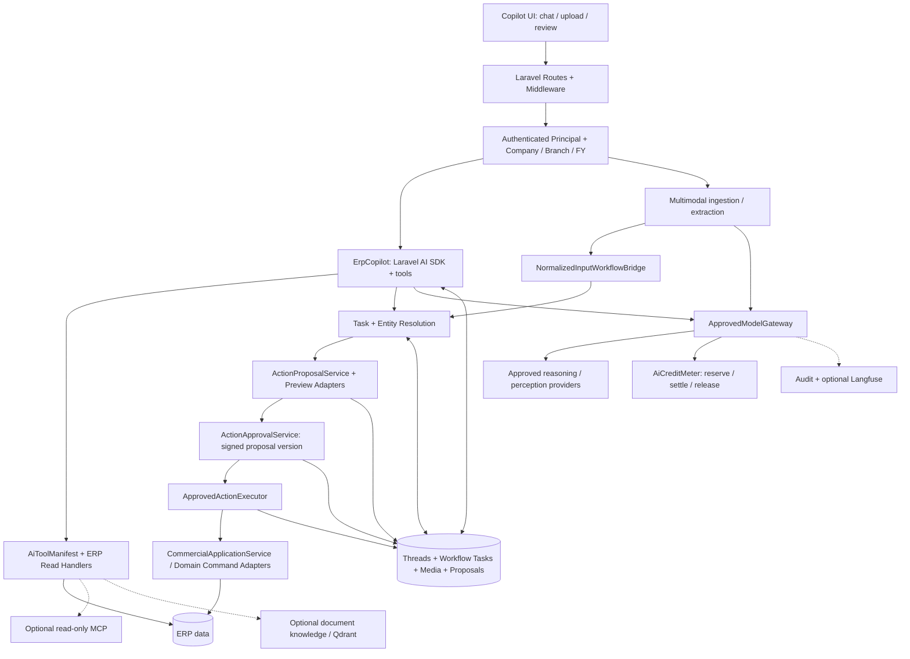
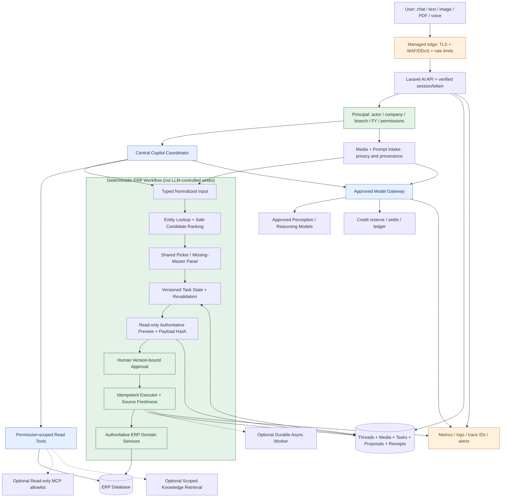

# 01 — Current vs Target ZoloERP AI Architecture

**Baseline:** `feature/ai-unified-input-clarification` at inspected commit `132cf772bcc5b499c376f73c8f346b53b17f60ba`. Code presence is not proof that a feature is enabled, deployed or functioning.

## 1. Honest mapping to the reference banking diagram

| Reference layer | ZoloERP code evidence | Verified assessment | Target |
|---|---|---|---|
| Chat interface | `resources/views/backend/ai/workspace.blade.php`, `public/js/ai-media-input.js` | Present | One accessible, responsive workflow card |
| API / edge | Laravel `routes/api.php`, `routes/web.php`, `deploy/nginx/...` | App API + HTTPS config present; WAF/DDoS not proven | Documented ingress, WAF, TLS, size/rate limits |
| Authentication | Auth middleware, `AiPrincipalFactory`, `AiPrincipalAuthorizer`, `ResolveCompanyContext` | App-side controls present | Verified company/branch/FY and action-level authorization |
| Coordinator agent | `app/Ai/Agents/ErpCopilot.php` | Central tool-enabled agent | One central coordinator with typed, deterministic workflow services |
| Specialized agents | `app/Ai/Tools/`, `Handlers/`, `Adapters/`, registries | Specialized domain **capabilities**, not multiple autonomous agents | Keep services, optionally expose logical domains |
| MCP servers | `McpController`, `McpClientGuard`, `OutboundMcpReadClient` | Read-only MCP features in code; feature flags | Scoped, allowlisted, opt-in integrations; never remote write delegation |
| Self-hosted / third-party LLM | `ApprovedModelGateway`, `NvidiaOmniPerceptionClient` | Approved provider gateway and model-purpose separation | Trace and meter each dispatched model call |
| PII redaction | `AiAuditRecorder`, `ModelTelemetry` | Partial at audit/export boundaries | Data classification, minimization and output hygiene across entire flow |
| Conversation/session | `ai_threads`, `ai_workflow_tasks`, `ai_media_assets` migrations/services | Durable state present | Clear state machine, expiry, ownership and recovery |
| Observability | `AiAuditRecorder`, `TelemetryDispatcher`, optional Langfuse | Instrumentation foundation | Traces, alerts, actionable SLOs and privacy-safe audits |
| Cost tracker | `AiCreditMeter`, reserve/settle services | Central credit metering in code | Reconciliation and billing accuracy proven under concurrency |
| Agent evaluation | `app/Ai/Evaluation`, `.github/workflows/ai-credit-evaluation.yml`, corpora | Fixture-driven suite plus CI workflow | Live and browser evidence, CI gates, real-provider quality |

## 2. Existing logical architecture (as coded)

Mermaid connectors indicate logical relationships, not verified physical network links.

## 3. Target production architecture

### What is *not* shown as already operational

- Managed WAF, DDoS response and internet-facing API gateway are **deployment requirements**, not inferred from Laravel routes or Nginx config.
- Qdrant, Langfuse, external MCP, scheduling and async execution are **configuration-dependent**; code paths exist but may be disabled.
- Multiple independent domain agents, each with an MCP server, are **not** proven and are not required for the next release.
- A single user approval for both dependent master creation and purchase bill is **not** available by assumption. Use separate governed approvals until a true composite action is designed and tested.

## 4. Design decisions

### ADR-001 — Keep one coordinator and deterministic domain capabilities

Use `ErpCopilot` for intent understanding, explanations and read-only tool selection. Use existing named tools, requirements providers, record resolution, proposals, adapters and ERP domain services for actions. Add logical grouping by Purchasing / Sales / Inventory / Accounting / Manufacturing / Setup **without granting agents independent database write access**.

### ADR-002 — Never invent tool or server paths from model output

`AiToolManifest`, `ActionCapabilityRegistry` and MCP allowlists remain authoritative. Tools are explicit, closed-schema, allowlisted and scoped. Model text is data, never authority.

### ADR-003 — Centralized financial policy

Tax, inventory, supplier, PO/GRN and ledger validation use domain services. Prevent a separate AI-specific financial rules engine.

### ADR-004 — Typed workflow state machine

Recommend: `intake → extracting → resolving → needs_input → ready_for_review → approved → executing → completed`, with `blocked`, `expired`, `cancelled`, `failed_retryable`, `failed_terminal`. Treat this as **target contract**; map safely from existing database statuses rather than blindly renaming them.

### ADR-005 — Read preparation is not approval

Automatic extraction, entity search and read-only proposal generation may be streamlined. `ActionApprovalService` and execution safety remain mandatory for writes. A user's choice of existing warehouse resolves a slot; it is **not** an authorization to create/modify ERP data.

## 5. Implemented vs unverified inventory — exact anchors

- `app/Ai/Agents/ErpCopilot.php`: central agent + Laravel AI SDK tools.
- `app/Ai/Gateway/ApprovedModelGateway.php`: approved models, purpose segregation, rate limits, credit reservations.
- `app/Ai/Infrastructure/McpController.php`, `McpClientGuard.php`, `OutboundMcpReadClient.php`: read-only scoped MCP surfaces.
- `app/Ai/Services/ActionApprovalService.php`, `ApprovedActionExecutor.php`: signed approvals and controlled actions.
- `app/Ai/Services/RecordResolutionService.php`, `BatchRecordResolutionService.php`: deterministic entity resolution.
- `app/Ai/Services/DependentMasterOrchestrator.php`: missing-master proposals and parent task resumption.
- `app/Ai/Telemetry/TelemetryDispatcher.php`: optional async export; `app/Ai/Telemetry/LangfuseTelemetrySink.php`: approved output format.
- `app/Ai/Billing/Services/AiCreditMeter.php`: central credits.
- `app/Ai/Documents/QdrantVectorStore.php`, `KnowledgeRetrievalService.php`: optional scoped knowledge.
- `.github/workflows/ai-credit-evaluation.yml`: CI test and evidence workflow.

## 6. Success measures

- **Safety:** zero cross-tenant reads; zero unsigned writes; no duplicate ERP bill on retries.
- **UX:** one evolving bill review; no extra extraction/staging approval; every ambiguous warehouse resolved by deliberate selection.
- **Quality:** 100% of release-critical tests pass; fixture and live-provider results reported separately.
- **Operations:** credit ledger reconciles; errors traceable by correlation ID without revealing invoice personal data.
- **Reliability:** retry safe across job, browser refresh, model timeout and double-submit.

See `09_CODEX_EXECUTION_TASKS.md` for the ordered implementation and `10_ACCEPTANCE_CRITERIA_AND_EVIDENCE.md` for the evidence matrix.
