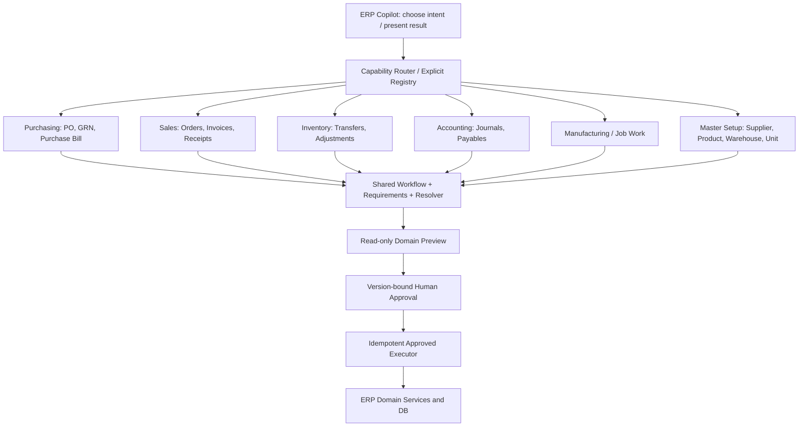

# 03 — Copilot Coordination, Tool Governance and Approval Workflow

## 1. Keep the current architecture, organize the responsibilities

**Current:** `app/Ai/Agents/ErpCopilot.php` uses the Laravel AI SDK; `AiToolManifest` and explicit tool registrations provide read capabilities; `PreparePurchaseBill`/other tools prepare action proposals; workflow and domain adapters validate and execute. This is not a set of autonomous agents sharing unrestricted APIs.

**Target:** A central coordinator delegates to **typed domain capabilities** without allowing model text to execute commercial writes.

## 2. Tool contract standard

Each action capability must have:

- Stable `action_key` and revisioned input schema.
- Permitted source modalities (`text`, `image`, `pdf`, `audio` as appropriate).
- Exact required permissions and tenant/branch/FY scope.
- Risk tier and read/write classification.
- Deterministic requirements + clarification fields.
- Read-only preview adapter and authoritative command adapter, or read-only handler for queries.
- Source-state freshness fingerprint, proposal TTL, approval requirement and idempotency key.
- Auditable result metadata and safe user-facing receipt.

Current anchors: `ActionCapabilityRegistry`, `ActionRequirementsRegistry`, `AiToolManifest`, `ActionProposalService`, `ActionApprovalService`, `ApprovedActionExecutor`.

Do **not** dynamically register a new PHP class, database mutation method, MCP URL or arbitrary tool based on a model response.

## 3. Work package AG-01 — Single source of truth for workflow state

### Required state model (conceptual target)

| State | Meaning | Write permitted? | UI |
|---|---|---|---|
| `received` | User submitted source/instruction | No | Attachment chip |
| `extracting` | Media validation/perception | No | Progress with retry |
| `resolving` | Normalization, entity matches, constraints | No | Preparing status |
| `needs_input` | Ambiguous/missing fields | No | Shared picker, master panel |
| `ready_for_review` | Authoritative preview created | No | Final editable review |
| `approved` | Exact proposal version signed | Not yet | Approved badge |
| `executing` | Executor claims action | Yes, guarded | Disable duplicate submit |
| `completed` | Authoritative receipt exists | No further edit | Receipt and ERP links |
| `failed_*` / `cancelled` / `expired` | Terminal or recoverable | No until new valid proposal | Retry/refresh guidance |

Reconcile names with **existing** persisted task statuses and proposal statuses. Introduce a state projection/DTO if needed; do not rewrite old rows or collapse independent proposal/execution states into one column.

### Implementation steps

1. Define a shared `AiWorkflowViewModel` (DTO/serializer) with `task_id`, `task_revision`, `media_id`, `source_revision`, `action_key`, `proposal_id`, `proposal_version`, `status`, `required_inputs`, `matched_entities`, `preview`, `approval_required`, `retryable`, `receipt`.
2. Make `POST /ai/media/prepare`, `PATCH .../inputs`, `POST .../prepare-proposal` and `approve` return consistent data (preserving compatibility where required). New clients must not infer the state from missing fields or hardcoded defaults.
3. Guarantee retries do not generate duplicate unresolved tasks or pending proposals. Use server-side idempotency (`source media ID + revision + company + actor + intent`) and reuse/revise the linked task/proposal.
4. Clarification edits use `expected_revision` and server-owned `corrections`; if 409, load latest state and show a conflict instead of replaying stale updates blindly.
5. Persistent UI should update a **single** card for the same task instead of appending multiple duplicate cards during media retry, changes or approval.

## 4. Work package AG-02 — Streamline confirmation without bypassing safety

**Current improvement already in newer inspected branch:** `AiMediaController::prepare()` and `NormalizedInputWorkflowBridge` support trusted read-only preparation. Keep this and maintain the explicit approval for the final write action.

User path:

1. Upload/input once.
2. Automatic extraction and normalized input generation.
3. Automatic deterministic lookup and read-only preview; only show questions for truly unresolved fields.
4. One **final purchase-bill approval** if no dependent master creation is needed.
5. Execution through signed approval and authoritative adapter.

When missing masters are involved, use **existing separate governed master approval** (`DependentMasterOrchestrator`) followed by the final bill approval. A future one-click *composite* approval is a separate architectural project that must bind all subactions, rollback/compensation and dependency graphs into a single immutable approval envelope. Do not silently chain unapproved writes now.

## 5. Work package AG-03 — Record resolution policy

**Observed gap:** `RecordResolutionService::resolveWarehouse()` calls `first()` after partial `LIKE` matching and sometimes defaults to the first active warehouse. This can choose the wrong stock destination.

Replace with deterministic rank + safe confirmation rules:

1. Validate explicit ID within authorized company/branch/action.
2. Try exact normalized name/code/alias matches among **eligible** records.
3. If exactly one eligible exact match, select and display a source label.
4. If an explicit configured default exists, use it only when valid for the transaction and show a “Change” option.
5. Partial/fuzzy hits are **candidates**, never an implicit exact selection, even if one result appears because the query was truncated or paginated.
6. If there are several eligible warehouses, show them all/search with branch/location details.
7. If no matches, offer authorized new-master workflow after a full duplicate check.

Extend matching to supplier (GSTIN/name), product (SKU/alias/HSN/UOM), customer and unit with domain-specific validation. Never use HSN or GST rate inferred from arbitrary unrelated products as an authoritative default.

## 6. Work package AG-04 — Action safety and lifecycle

- `ActionProposalService` creates read-only preview with hash and TTL; include source media revision and resolved IDs in provenance.
- `ActionApprovalService` signs exact proposal version; if UI edits supplier, product, quantity, warehouse, tax, discount or invoice number, create new proposal version and require reapproval.
- `ApprovedActionExecutor` rechecks approval, actor permissions, source state and idempotency in a transaction-safe manner; the domain adapter owns commercial mutations.
- For GRN-linked purchase bills, preserve zero duplicate physical stock movement; for unlinked direct bills, apply the authoritative stock/AP path. Verify via tests, not UI labels.
- Failure recovery: if execution completed but browser lost response, fetch existing receipt; do not create a second action.
- Async worker context: workers must reconstruct and reauthorize the exact scoped principal; do not rely on request session or cached permissions.

## 7. Concrete implementation touchpoints

| File | Task |
|---|---|
| `app/Ai/Agents/ErpCopilot.php` | Minimal intent/tool prompt; keep security in services |
| `app/Ai/Services/RecordResolutionService.php` | Fix first-match/fallback behavior, enforce eligibility |
| `app/Ai/Services/BatchRecordResolutionService.php` | Emit full candidate metadata |
| `app/Ai/Services/InputCompletenessEvaluator.php` | Distinguish unique/default/ambiguous/none results |
| `app/Ai/Services/ClarificationResponseBuilder.php` | Uniform UI field metadata |
| `app/Ai/Services/TaskCorrectionService.php` | Typed correction, revision conflict handling |
| `app/Ai/Services/DependentMasterOrchestrator.php` | Authorized create + rebind parent task |
| `app/Ai/Services/WorkflowTaskStateService.php` | Reusable task lifecycle and revisions |
| `app/Ai/Multimodal/Services/NormalizedInputWorkflowBridge.php` | Single task/proposal per source revision |
| `app/Ai/Services/ActionProposalService.php` | Versioned proposal uniqueness and preview |
| `app/Ai/Services/ApprovedActionExecutor.php` | Preserve signed execution safety |
| `app/Ai/Adapters/PurchaseBillPreviewAdapter.php` | ERP tax and inventory policy; read-only |
| `app/Ai/Adapters/PurchaseBillCommandAdapter.php` | Safe authoritative booking |

## 8. Test acceptance

- Exactly one eligible warehouse: selected with reason, user may change it.
- Multiple matching warehouses: cannot approve until user picks one.
- Wrong company / inactive warehouse: cannot be used even via forged API request.
- Missing warehouse: master proposal requires its own permitted approval; creating it resumes the same bill.
- Edited proposal: previously signed version cannot execute.
- Simultaneous approve or job re-delivery: one bill/stock/AP effect.
- Uploaded invoice with prompt injection: no direct action and no permission bypass.
- No unsafe impact of changes on normal non-AI ERP purchase-bill screens.
