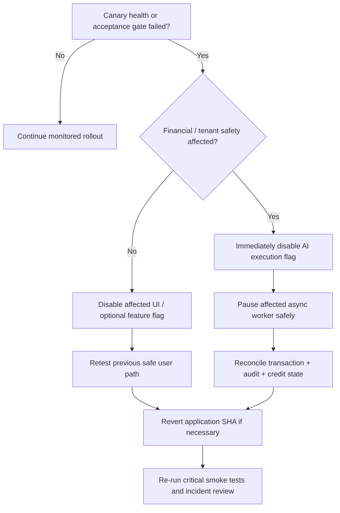

# 08 — Deployment, Staged Rollout, Operations and Rollback Runbook

**Release objective:** Introduce architecture enhancements without breaking current non-AI ERP purchasing, sales, stock, accounting or signed approval paths.

## 1. Existing deployment facts — confirm at runtime

- Repository contains `deploy/README.md`, `deploy/deploy.sh`, `deploy/nginx/erp.samuraibuiness.in.conf`, `.github/workflows/deploy.yml`, `config/horizon.php`, `config/queue.php`.
- `deploy/README.md` describes a manual **Deploy to VPS** workflow from `main`, preflight/deploy/rollback safeguards and a pinned commit.
- `config/ai_infrastructure.php`: `AI_ASYNC_EXECUTION_ENABLED` defaults false; queue connection is configurable (default `redis`); scheduling and optional MCP/Langfuse depend on flags.
- `config/ai_documents.php`: Qdrant and documents are conditional.
- `config/ai_multimodal.php`: multimodal features are conditional; direct purchase-bill handoff is a reviewed feature flag.

**Never assume:** current VPS is running latest branch, PHP 8.5, queue workers, CDN/WAF, Qdrant, Langfuse or the enabled AI action settings. Obtain live evidence via authorized operators. No production commands should be executed from a planning document without approval.

## 2. Required release inventory

Capture **without exposing secrets**:

- Deployed Git SHA and branch, PHP/Laravel versions, DB version/schema migration status.
- Nginx site and CDN/WAF configuration, DNS path, valid TLS cert and monitored renewal.
- Queue driver, actual worker service, queue backlog, retry and failed-job processing, scheduler.
- Active company feature flags: Copilot, foundation, execution, multimodal, AI credits, documents, MCP, Langfuse, scheduling, async.
- Model provider/approved model names, provider rate limits and company credit entitlements.
- Existing data backup/restore drill, rollback version and on-call owners.
- Staging companies/branches/FYs seeded for safe purchase-bill scenarios.

## 3. Recommended release breakdown

| Release | Scope | Feature flag / rollback | Exit criteria |
|---|---|---|---|
| R0 | Baseline + test fixes + correction API contract | No new user feature | Tests green; no regression |
| R1 | Warehouse resolver correction and candidate API | `AI_ENTITY_PICKER_ENABLED` new, default off | No wrong default; safe candidate contract |
| R2 | Shared EntityPicker UI + side-by-side review | UI flag | Desktop/mobile/keyboard pass |
| R3 | Missing-master panel and task resumption | `AI_DEPENDENT_MASTER_UI_ENABLED` new, default off | Scoped approved master + bill creation pass |
| R4 | Privacy/correlation/dashboard/credit verification | Independent telemetry flags | Traceable, redacted and reconciled |
| R5 | Edge controls + optional MCP/RAG/Scheduling enhancements | Per service flag | Infra/permission tests and production checks |

Avoid introducing all feature flags at once without ownership. `AI_ENTITY_PICKER_ENABLED` and `AI_DEPENDENT_MASTER_UI_ENABLED` are **proposed** flags, not verified existing settings.

## 4. Staging preflight

```text
[ ] Target SHA recorded and approved
[ ] No uncommitted changes in deployed package
[ ] Migrations reviewed for backwards compatibility; dry run/backup tested
[ ] PHP, Node and DB versions match release requirements
[ ] Feature flags default to off for new functionality
[ ] All static/unit/feature tests pass
[ ] Playwright responsive/accessibility tests pass
[ ] Tenant boundary and permission tests pass
[ ] Idempotency, source-state and approval tests pass
[ ] Credits reconciliation and concurrency tests pass
[ ] Model provider limits tested or explicitly noted unavailable
[ ] Private uploads and media cleanup tested
[ ] Nginx/proxy rules and TLS validated on staging
[ ] Worker and scheduler status verified if async required
[ ] Company-specific canary data and rollback owner defined
```

## 5. Staging smoke run

1. Create/test using **synthetic** supplier invoice, not live personal data.
2. Upload image and PDF and run read-only extraction; verify model/provider shown appropriately and credit entry recorded.
3. Correct a missing warehouse using the shared picker; verify candidate list belongs to current company/branch and actual ID persists.
4. Create missing warehouse via governed proposal and master approval; verify parent task resumes without duplicate bill.
5. Approve purchase bill; verify authoritative receipt and tax/stock/ledger totals.
6. Repeat the same browser submission, retry and request ID; verify exactly one bill and correct credit entries.
7. Switch company/branch/FY and verify old task, media and directory results cannot be reused.
8. Exercise a provider timeout and an unauthorized role; demonstrate safe UI response and zero writes.
9. Check admin observability with trace ID, no personal data leakage, and credit accounting.
10. Verify normal non-AI purchase/sales/stock flows are not affected.

## 6. Canary rollout (example policy)

- **Canary 1:** One internal test company with read-only AI and new entity-picker UI; financial execution disabled.
- **Canary 2:** Internal finance/QA users with signed purchase-bill approval enabled and strict per-company credit ceilings.
- **Canary 3:** Small set of approved pilot companies after evidence sign-off.
- **General rollout:** Only after monitoring and QA sign-off. Expand per-company rather than flipping every tenant at once.

Actual percentages and duration should be chosen from business risk, user traffic and operational capacity. No arbitrary rollout dates or success claims are assumed.

## 7. Operational controls and alerting

| Severity | Signal | First response |
|---|---|---|
| Critical | Cross-tenant exposure or unapproved financial write | Disable AI execution immediately, stop affected queue, preserve audit, incident response |
| Critical | Duplicate bill/stock/AP effect | Disable action execution, identify receipts, reconcile financially with authorized operators |
| High | Credit overspend or payment/top-up mismatch | Pause AI billable calls/top-ups as appropriate; reconcile ledger |
| High | Repeated model failures or widespread timeouts | Stop new dispatch, preserve tasks/media, activate provider incident response |
| Medium | Entity picker failing, no write risk | Disable UI feature flag, restore older safe clarification UI |
| Medium | Langfuse or Qdrant unavailable | Disable optional integration; preserve ERP operations |

Security/financial incidents require human handling. Don't auto-reverse posted accounting entries using a database update; use governed credit/debit/reversal mechanisms.

## 8. Rollback decision tree



### Rollback details

- Prefer **feature disable first** if safe; follow existing `deploy/README.md` rollback process for pinned release SHA/socket as authorized.
- **Never blindly roll back destructive database migrations**; design expand/contract migrations and maintain forward-compatible states.
- Before worker restart, inspect pending and completed idempotency keys to prevent replayed financial actions.
- Preserve audit and credit ledger history; do not delete suspicious records during rollback.
- Confirm prior version understands any newly persisted task/proposal statuses, or provide compatibility adapters.
- Document owner, timestamp, reason, affected tenants, lost work, restoration method and verification evidence.

## 9. Post-release verification

- Monitor p95 preview latency, provider errors, rate throttles, credit drift, queue lag, failed approvals and bill-creation duplicates.
- Sample real journeys only with approved, privacy-safe monitoring. Compare expected vs observed costs.
- Review customer feedback: selection confusion, unnecessary clarifications, failed warehouse creation, abandoned proposals.
- Confirm cleanup jobs delete expired media and temporary provider artifacts under the retention policy.
- Keep production incidents and corrections in an internal change log.

## 10. Sign-off fields

```text
Release SHA:
Environment:
Changed flags:
DB migration / backup reference:
Security reviewer:
Backend reviewer:
QA owner:
Finance/accounting reviewer:
SRE/DevOps owner:
Live provider test classification:
Open risks and explicit waivers:
Canary results:
Go / No-go decision:
Rollback owner and approach:
```
