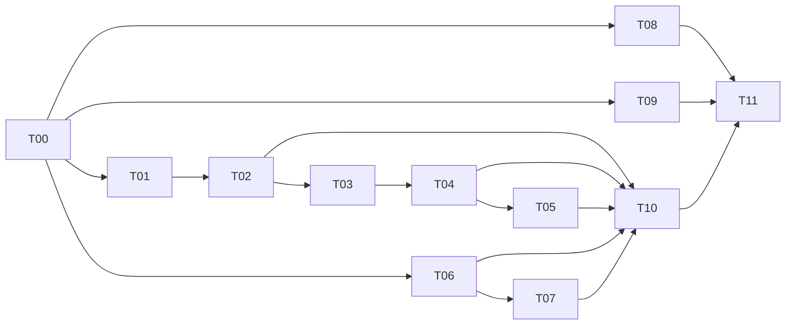

# 09 — Ordered Codex Execution Tasks for ZoloERP Pro

Use **one PR per independently reviewable task**. Each task begins with investigation and baseline tests, then targeted edits and evidence. Do not use a sweeping one-shot agent rewrite. The branch inspected was `feature/ai-unified-input-clarification` at SHA `132cf77`; Codex must rebase its findings on the current HEAD.

## Global instructions for every Codex task

```text
Repository: vigneshsinna/zolo-erp-pro
Target starting point: feature/ai-unified-input-clarification (verify remote HEAD)
Rules:
1) Inspect code, call graph, routes, migrations, permissions and tests before editing.
2) Report observed defects separately from inferred concerns.
3) Reuse Laravel 13 / PHP 8.5 domain services, Laravel AI SDK, current Blade/jQuery UI.
4) Keep auth, company/branch/FY, signed approval, idempotency, GST and stock logic intact.
5) No real API secrets, production writes or unnecessary model calls.
6) Add failing regression tests before fixing behavioral defects.
7) Run the smallest relevant suite, then full affected AI suite; capture artifacts.
8) Provide diff summary, exact tests/results, limitations and rollback method.
9) Never claim production verification from mocked tests.
10) When a design in these docs conflicts with current validated code, explain the conflict and choose the safest compatible implementation.
```

## Task T00 — Baseline and architecture inventory [P0, PR 0]

**Goal:** Make the implementation evidence-based and prevent accidental assumptions.

1. List current branch/head, clean working tree, framework/runtime versions.
2. Map routes `/ai`, `/api/v1/ai`, model gateway, read tools, action proposals, approvals, credit ledger, media flow, workers, MCP, document RAG, telemetry and flags.
3. Inspect `deploy/README.md`, `.github/workflows/ai-credit-evaluation.yml`, tests and test fixture manifests.
4. Produce `docs/ai/architecture/AS_IS.md` and a matrix of implemented code / enabled config / runtime verified / unavailable evidence.
5. Run baseline lint and relevant PHPUnit suites; report pre-existing failures without editing unrelated code.

**Touchpoints:** `ErpCopilot.php`, `ApprovedModelGateway.php`, `routes/api.php`, `routes/web.php`, `config/ai*.php`, `app/Ai/**`, `.github/workflows/*`.

**Done:** Current source/runtime map is documented, tests have baseline, no functionality changes.

## Task T01 — Fix correction API mismatch [P0, PR 1]

**Observed:** `public/js/ai-media-input.js` submits `slots_patch`, but `AiWorkflowTaskController::updateInputs()` requires `corrections` plus `expected_revision`.

```text
1. Add feature/API/browser regression test showing Submit Details and Update & Revalidate fail with old request shape.
2. Update both frontend paths to send corrections:[{field,value,confirmation?}] preserving typed field paths and current task revision.
3. Call prepare-proposal only if evaluation.is_ready; otherwise rerender remaining issues.
4. Handle 409 by loading latest task and showing conflict; no silent stale replay.
5. Test no duplicate proposal, no unapproved purchase writes and correct error display.
```

**Files:** `public/js/ai-media-input.js`, `app/Http/Controllers/Api/V1/AiWorkflowTaskController.php` (only if a documented compatible adaptation is needed), `TaskCorrectionService.php`, browser and feature tests.

**Done:** Both buttons work end to end; request contract matches server.

## Task T02 — Safe warehouse resolution [P0, PR 2]

**Observed:** `RecordResolutionService::resolveWarehouse()` uses first partial `LIKE` match/first active fallback.

```text
1. Write tests for exact/partial/multiple/inactive/wrong-branch/unknown warehouses.
2. Replace first partial match with deterministic candidates; only auto-select exact unique eligible or explicitly configured valid default.
3. Return why a warehouse was selected; never return a different company's data.
4. Revalidate selected warehouse in purchase bill preview and execution; remove hardcoded 'Main Warehouse' UI fallbacks.
5. Preserve existing code paths for valid unique branch defaults.
```

**Files:** `RecordResolutionService.php`, `BatchRecordResolutionService.php`, `PurchaseBillRequirementsProvider.php`, `InputCompletenessEvaluator.php`, `ai-media-input.js`, tests.

**Done:** Ambiguous warehouse never silently selected, no incorrect stock destination.

## Task T03 — Authorized ERP directory API [P1, PR 3]

```text
1. Add read-only, scoped entity search for warehouses, suppliers, products, customers and units (phase warehouse first).
2. Authenticate task owner + actor, tenant, branch/FY and action-specific eligibility server-side.
3. Return id/display/code/branch and eligibility with pagination and optional recommended_id/reason; never secrets.
4. Bound query length, response size and per-user rate limit; add normalized indexes only after query plan review.
5. Test all tenant/branch/role boundaries and search term injection.
```

**Files:** proposed `app/Http/Controllers/Api/V1/AiEntityLookupController.php`, new query service/DTO, `routes/api.php`, optionally `routes/web.php` for the browser, `RecordResolutionService.php`, tests.

**Done:** Picker can browse all eligible warehouses when invoice gives no name.

## Task T04 — Shared EntityPicker and responsive UI [P1, PR 4]

```text
1. Build AiEntityPicker, AiEntityOption, AiSelectionSummary and AiClarificationIssue in existing UI stack.
2. Integrate with unified bill card and older workspace clarification rendering via shared module.
3. Show actual branch and warehouse metadata, keyboard/select support, loading/error/empty states and bottom drawer on mobile.
4. On select, submit typed correction and revalidate; refresh same card (no appended duplicate chat card).
5. Remove all hardcoded entity names in review/edit/booked views. Preserve scroll and focus.
6. Add Playwright desktop/mobile/keyboard/slow-network tests.
```

**Files:** `public/js/ai-media-input.js`, `resources/views/backend/ai/workspace.blade.php`, `public/css/pages/ai-workspace.css`, new `public/js/ai-entity-picker.js`, optional Blade partials, browser tests.

**Done:** User who does not know warehouse ID can choose safely from visible real records.

## Task T05 — Governed missing-master UI + resumption [P1, PR 5]

```text
1. Reuse DependentMasterOrchestrator spawn/preview/approve-and-execute APIs.
2. Add AiMasterCreatePanel to the same bill card; show required master fields, duplicate alternatives, permission denial.
3. Master proposal must be signed/approved and executed by domain adapter, not a model-generated direct POST.
4. Bind created ID to the same parent task; update task revision; revalidate and prepare final purchase bill preview automatically when ready.
5. Master creation approval and final bill approval remain distinct until a separately reviewed composite transaction capability exists.
6. Test double click/retry/no-duplicate master and no unauthorized action.
```

**Files:** `DependentMasterOrchestrator.php`, `AiWorkflowTaskController.php`, `TaskCorrectionService.php`, `ai-media-input.js`, new master-panel module, tests.

**Done:** Missing warehouse can be added safely without restarting the original bill.

## Task T06 — Data privacy and request-boundary safeguards [P1, PR 6]

```text
1. Inventory outbound model inputs, document storage and sensitive tax/PII fields.
2. Add contextual data minimization and leak protection before model/MCP/telemetry boundaries.
3. Preserve tax-critical GSTIN/HSN when needed; never log credentials/personal data unnecessarily.
4. Test prompt injection in invoice, leaked token fields, unsafe markup and privacy-safe error responses.
5. Document data retention and deletion of media/extraction logs and provider response traces.
```

**Files:** `AiAuditRecorder.php`, `ApprovedModelGateway.php`, `MediaIngestionService.php`, `MediaExtractionService.php`, `DocumentAccess.php`, `ModelTelemetry.php`, privacy tests.

**Done:** Privacy controls cover the relevant outbound request boundary and no execution permissions are inferred from content.

## Task T07 — Observability, credit consistency and incident support [P1, PR 7]

```text
1. Propagate a correlation ID from API through model calls, media, tasks, proposals, approvals, execution and queues.
2. Reconcile provider attempt IDs against credit reservations, settlements, ledger, monthly grant and top-ups.
3. Add structured metrics for latency, provider errors, rate limits, candidate ambiguity, approvals, idempotent recoveries and queue lag.
4. Use optional Langfuse only with approved field allowlists and no raw prompts/PII.
5. Add privileged dashboard, alert runbook and concurrency tests (5/10/20 users).
```

**Files:** `RequestCorrelation.php`, `ApprovedModelGateway.php`, `AiCredit*`, `TelemetryDispatcher.php`, `ModelTelemetry.php`, `config/ai_infrastructure.php`, CI/tests.

**Done:** Support can trace a failed task and finance can reconcile credits without seeing raw invoice data.

## Task T08 — Edge/WAF infra rollout [P1/P2, infra-owned PR]

```text
1. Discover actual DNS, CDN/WAF, Nginx, TLS and origin path before writing provider-specific config.
2. Enable monitor-only edge rules, rate controls and origin protection with infrastructure approval.
3. Validate login, upload, entity search, MCP, API and webhook behavior with real ingress.
4. Document alerts, break-glass reversal and rollback. Do not claim deployment until verified by operator.
```

**Files:** deployment config/repo docs where owned; vendor dashboard changes tracked externally in infra change record.

**Done:** Actual edge protection evidence and rollback procedure exist.

## Task T09 — MCP and optional RAG hardening [P2, PR 8]

```text
1. Verify default-off inbound/outbound MCP and authorized read-only tool discovery.
2. Security-test allowlisted hosts, token abilities, scope binding, max payload, response and SSRF/redirect defense.
3. Test Qdrant indexing/retrieval tenant ACL, deletion/revocation and prompt-injection resistance.
4. Treat external knowledge as reference material, never ERP ledger truth or tool authority.
5. Do not introduce autonomous domain write agents or remote-write MCP.
```

**Files:** `app/Ai/Infrastructure/*`, `app/Ai/Documents/*`, `config/ai_infrastructure.php`, `config/ai_documents.php`, tests.

**Done:** Optional integrations work only in approved, scoped, read-only modes.

## Task T10 — CI quality gates and browser scenarios [P1, PR 9]

```text
1. Inspect existing evaluation workflow and fixture manifests; label execution evidence accurately.
2. Add regression tests for unique/ambiguous/missing warehouse, master resumption, edit, permission, invoice math, GRN and idempotency.
3. Run/record 100 Indian bill fixtures, 100 Copilot cases, 50 difficult cases with honest mocked/live separation.
4. Add browser tests for mobile picker, keyboard interaction, refresh and error recovery.
5. Add controlled load tests (5/10/20 users) and credit/bill concurrency assertions.
6. Gate release on actual test execution, not manifest counts or presence of test files.
```

**Files:** `.github/workflows/ai-credit-evaluation.yml`, `tests/Feature/Ai/**`, `tests/Browser/Ai/**`, `app/Ai/Evaluation/*`.

**Done:** Release artifact tied to exact SHA, no critical skipped/failed scenario hidden.

## Task T11 — Staging canary, production verification and rollback [P1, release change]

```text
1. Follow deploy/README.md, pin release SHA, backups and existing preflight/deploy/rollback process.
2. Enable new entity UI only for approved staging/canary company; leave financial execution separately gated.
3. Execute full end-to-end invoice + missing warehouse + approval + receipt smoke.
4. Monitor credit/latency/errors/queue and normal ERP regressions.
5. Expand per-company only after QA, security, finance and operations approval.
6. Revert feature flag/release SHA if safety thresholds fail; preserve financial/audit records.
```

**Files:** release checklist, runbook, feature-flag configuration, deployment workflow as allowed.

**Done:** Signed go/no-go, canary logs, rollback owner and production verification evidence.

## Dependency graph



T06/T07/T08/T09 may run in parallel with T03/T04 after T00 and with shared review for changes at auth/model boundaries. P0 safety changes must not be held back for UI redesign.

## Final Codex PR output template

```text
Task ID:
Exact base SHA and resulting commit:
Observed problem and root cause:
Files changed:
Public API/schema contract changes:
Auth/tenant/approval impacts:
Database migration:
Tests executed and pass/fail/skip counts:
Browser screenshots / test artifacts:
Mock/live-provider classification:
Latency and credit delta:
Open risks:
How to disable/rollback:
```
