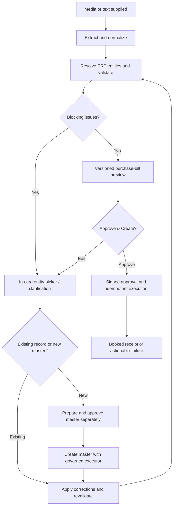

# ZoloERP AI Copilot — Intelligent ERP Entity Selection & Missing-Master Workflow

**Implementation specification for Codex**  
**Repository:** `vigneshsinna/zolo-erp-pro`  
**Inspected remote branch:** `feature/ai-unified-input-clarification`  
**Inspected head:** `1b4745da14fe7557a066e123f81be93cf805cd8a` (17 November 2026 review)  
**Requested branch:** `feature/ai-unified-input` — **not found** in the remote branch listing; use the verified branch above or confirm the local branch before coding.  
**Objective:** Make warehouse, supplier, product, customer and unit selection intuitive within a single AI Copilot workflow. Show real ERP choices side by side; collect only unresolved information; propose creation of missing master records with human approval; resume the original purchase-bill workflow automatically.

> **Status:** This is a code-grounded implementation plan, not a claim that the changes are already implemented. No GitHub code has been modified. Re-check the current Git head before editing; files may have changed since this review.

---

## 1. Product outcome and non-negotiable behaviour

A user uploads a purchase bill or gives a voice/text instruction, without knowing warehouse IDs or even which warehouses exist. The software must:

1. Extract or parse source information **without a preliminary human confirmation** for read-only preparation.
2. Retrieve eligible ERP records for the current company, branch, user and transaction context.
3. Auto-select an entity only when a **unique, defensible** match or an explicitly configured default is available. Never silently select the first partial match.
4. Display searchable existing records when multiple choices exist, including name and useful branch/location identifiers.
5. Offer **Create new with AI** only when the actor has the required master-creation permissions. Prefill available fields, check for duplicates, and preview the *exact* master record before any write.
6. On approved creation, bind the new ERP entity ID to the parent workflow, re-resolve dependencies, and continue the **same** purchase bill. No extra chat prompt or manual restart.
7. Display one evolving **Purchase Bill Review** card (preparing → needs details → ready for approval → executing → booked / failed).
8. Require a final signed, version-bound **Approve & Create** action before booking a purchase bill. Do not change approved payloads or stock/ledger data without a new approval.
9. In the current architecture, master creation remains a **separate authorization** from final bill creation unless and until a properly designed, transactional, composite approval is separately implemented. Do **not** fake a single approval by chaining unapproved writes.
10. Use authoritative ERP domain services for GST, prices, stock, AP and supplier/product validations. AI suggestions are never the source of truth.

**Example**: User says, “Create a purchase bill from this invoice. I don't know the warehouse.” If there is just one eligible branch warehouse, show it already selected with a reason. If multiple exist, render a searchable list. If none is suitable, allow “Create warehouse” through a governed side panel; then resume the same bill after approval.

---

## 2. Confirmed current implementation: code findings

### 2.1 What already exists — reuse, do not duplicate

| File / class | Current responsibility | What to change |
|---|---|---|
| `app/Ai/Services/RecordResolutionService.php` | Deterministic supplier, product, warehouse and unit resolution | Return safe, ranked, scoped candidates and match provenance; stop first partial warehouse match |
| `app/Ai/Services/BatchRecordResolutionService.php` | Resolves supplier, customer, warehouse, item products/UOMs, PO and GRN in one pass | Preserve candidate metadata and distinct `recommended`, `ambiguous`, `none` outcomes |
| `app/Ai/Services/InputCompletenessEvaluator.php` | Builds issues, confirmed fields and pending checks; already emits resolution options | Include inline picker metadata and selectable results; distinguish user-selected vs recommended |
| `app/Ai/Services/ClarificationResponseBuilder.php` | Returns `required_inputs`, `confirmed_fields`, `line_items`, `pending_checks`, task ID/revision | Extend, do not replace, response with standardized picker data and validation states |
| `app/Ai/Services/TaskCorrectionService.php` | Applies typed field corrections and re-evaluates task | Reuse for warehouse ID and name correction; implement safe optimistic concurrency |
| `app/Ai/Services/DependentMasterOrchestrator.php` | Spawns master requirements; prepares/approves master proposals; resumes parent task | Bind new ID back into same UI and recompute readiness without a manual next step |
| `app/Ai/Services/ActionProposalService.php` | Read-only action preview; version and source-state hashes | Continue using this for all proposals and edits |
| `app/Ai/Services/ActionApprovalService.php` and `ApprovedActionExecutor.php` | Signed approval and governed ERP execution | Never bypass or weaken |
| `app/Ai/Adapters/PurchaseBillPreviewAdapter.php` and `PurchaseBillCommandAdapter.php` | Authoritative bill preview and booking | Reuse; revalidate supplier, tax, products, warehouse, duplicate invoice, PO/GRN |
| `app/Ai/Multimodal/Services/NormalizedInputWorkflowBridge.php` | Builds a workflow task from a prepared/confirmed extraction | Keep a single task/proposal per work item; prevent duplicate preparation |
| `app/Http/Controllers/Api/V1/AiMediaController.php` | Contains `prepare()` and `prepareExisting()` routes | Keep the one-step preparation path; use its results to render the unified card |
| `public/js/ai-media-input.js` | Renders unified review, clarification, edit and booked views | Replace standalone text fields and simplistic selects with shared reusable picker |
| `resources/views/backend/ai/workspace.blade.php` | Other Copilot clarification UI already has select-existing/create-new/correct-name triad | Reuse the same picker/editor logic, not two competing UI implementations |
| `public/css/pages/ai-workspace.css` | Current page styles | Add responsive picker/panel styles with existing ZoloERP tokens |
| `tests/Feature/Ai/Clarification/*`, `tests/Feature/Ai/Multimodal/*`, `tests/Browser/Ai/*` | Existing backend and browser test suites | Add the cases in §12 |

### 2.2 Defects and gaps verified in the inspected head

**P0 — Mismatched correction request shape.** In `public/js/ai-media-input.js`, the unified clarification view (~line 742) and edit view (~line 863) submit `slots_patch`. But `AiWorkflowTaskController::updateInputs()` requires:

```json
{
  "expected_revision": 3,
  "corrections": [
    {"field": "warehouse_id", "value": 12, "confirmation": "user_selected"}
  ]
}
```

This is not a cosmetic issue: the current UI requests will fail validation when using the documented `PATCH /ai/workflow-tasks/{id}/inputs` endpoint. Update **both** code paths. Only call `prepare-proposal` when `evaluation.is_ready` is true. A 422 may legitimately contain a new clarification, not a ready proposal. For a 409, fetch the latest task and let the user reconcile changes; do not blindly replay a stale mutation.

**P0 — Unsafe warehouse first-match selection.** `RecordResolutionService::resolveWarehouse()` uses `LIKE '%query%' -> first()` and, without a query, falls back to the first branch warehouse or the first active company warehouse. `BatchRecordResolutionService::resolveWarehouseField()` likewise defaults to the first active branch warehouse. Multiple matches can therefore be silently collapsed to an apparently “exact” result. This is inappropriate for a financially material stock destination.

**P1 — No real entity directory in unified card.** `renderClarificationView()` in `public/js/ai-media-input.js` presents an HTML `<select>` only if candidates were already included; otherwise it presents a plain text input. It does not support browse-all/search, branch detail, create-new flow or uncertainty explanation within the unified card.

**P1 — Duplicate UI ownership.** The older `workspace.blade.php` clarification renderer has a three-way resolution UX and dependent-master actions, while the newer unified card has a smaller independent renderer. Refactor toward **one shared entity picker and master creation panel** used by both, avoiding inconsistent corrections.

**P1 — Warehouse fields are misleading.** The proposal preview falls back to hard-coded `Main Warehouse` when missing (~line 540); the edit view also falls back to `Main Warehouse` (~line 802); and the booked screen states that stock was updated in `Main Warehouse` (~line 660), regardless of the actual warehouse. Use authoritative result data; show `Not selected` if unresolved and contextual inventory impact from the receipt/GRN.

**P1 — Entity selection by raw text.** In `renderEditView()` the warehouse and supplier are plain text inputs, but the current PATCH payload does not include the edited supplier/warehouse values. Bind actual IDs and use the shared picker so changing these fields re-runs validation.

**P1 — Browser test coverage.** The existing browser multimodal test does not cover the new lookup/side-panel journey, choosing between multiple warehouses, creating a missing warehouse and resuming a purchase-bill review.

**P2 — Company-only fallback.** Some resolver methods scope to company but do not enforce every relevant branch/warehouse eligibility rule. Introduce explicit, action-aware eligibility checks rather than relying on a UI-side filter.

**P2 — Tax suggestions during product master creation.** `DependentMasterOrchestrator` currently pre-fills a tax category by name patterns (5% then 18%) and an available HSN fallback. Treat these as unverified suggestions at most; never silently approve HSN or GST values solely because they are the first available or resemble common tax rates.

**Existing improvements to preserve:** the inspected version already has `POST /ai/media/prepare`, trusted preparation, a single Purchase Bill Review card, `purchase_bill.create.v1` enabled by `ai_multimodal.allow_direct_purchase_bill` (default `true`), invoice number mapping into `supplier_invoice_no`, master proposal/resumption services, AI credit metering and versioned approvals. Do **not** undo these improvements.

---

## 3. Target UI: desktop + mobile component design

### 3.1 Desktop experience: show choices beside the bill

Use a two-column **bill review workspace** only when the user needs to resolve an entity. Keep the existing overall chat layout and ZoloERP purple styling.

```text
┌───────────────────────────── Purchase Bill Review ──────────────────────────────┐
│  Step: 2 of 3 • Resolve details                      1 item needs attention     │
├───────────────────────────────────────┬────────────────────────────────────────┤
│ PURCHASE BILL PREVIEW                 │ DESTINATION WAREHOUSE                  │
│ Supplier: ABC Traders                 │ [ Search warehouses...           🔎 ]   │
│ Invoice: INV-1001                     │                                        │
│ Date: 17 Nov 2026                     │ ○ lenz – Main                          │
│                                       │   Branch 61 · Main warehouse           │
│ Cotton Fabric  10 x ₹500             │ ○ lenz – Storage                       │
│ Cotton Thread   5 x ₹200             │   Branch 61 · Storage warehouse        │
│                                       │                                        │
│ Subtotal:                ₹6,000       │ ────────────────────────────────────── │
│ Tax (ERP verified):       ₹300       │ + Create new warehouse                │
│ Total:                   ₹6,300       │    Ask Copilot: “Add Lenz East”        │
│                                       │                                        │
│ [View original invoice]               │ [Cancel]       [Use selected]           │
├───────────────────────────────────────┴────────────────────────────────────────┤
│            Unresolved selections cannot be booked. [Approve & Create] disabled │
└─────────────────────────────────────────────────────────────────────────────────┘
```

The sample names/amounts above are **illustrative**, not records fetched from the user's ERP.

### 3.2 When there is exactly one safely eligible warehouse

Show an `EntitySelectionSummary` row:

- `Destination warehouse: lenz – Main`
- `Source: Configured default for Branch 61` or `Only eligible warehouse in this branch`
- `Change` link opens the searchable picker.

Do **not** auto-select just because a `first()` query returned one. Verify count and eligibility with the full unpaginated match set or an explicit configuration policy.

### 3.3 When there are multiple, zero, or ambiguous matches

| Condition | UI state | User action |
|---|---|---|
| Exactly one verified unique match | `Suggested / selected` | Change if needed; no extra confirmation |
| Multiple eligible warehouses | `Selection needed` | Search, select a radio row, click Use selected |
| Query matches multiple partially | `Ambiguous` | See all matches, none silently selected |
| No eligible warehouses | `No matching records` | Clear filters, request access or create new if permitted |
| User lacks create permission | `Create new` disabled with reason | Select existing or request assistance |
| Selected record becomes inactive | `Invalid selection` | Reopen picker, revalidate |
| Network error | `Could not load warehouses` | Retry; don't assume no warehouses exist |

### 3.4 Mobile layout

At widths under ~768 px, replace the side-by-side panel with a **bottom sheet or full-width drawer**. Keep the bill summary visible when the drawer closes. The search list must be scrollable and keyboard accessible. Use the existing framework (Blade + jQuery + Bootstrap), **not** a newly introduced React app unless the entire page is already being migrated.

---

## 4. UI components to build or refactor

Implement small reusable components with stable, testable class names and data attributes. Suggested files are **proposed**, not existing:

| Component | Proposed file / implementation | Required behaviour |
|---|---|---|
| `AiEntityPicker` | `public/js/ai-entity-picker.js` | Search/browse, debounce, pagination, keyboard support, single selection by ID, cancel/confirm |
| `AiEntityOption` | Internal renderer in picker | Name, code, branch/location, active state, match reason, selectable radio; no arbitrary labels |
| `AiResolutionPanel` | `resources/views/backend/ai/partials/entity-resolution-panel.blade.php` | Responsive side panel with choices and create-new action |
| `AiEntitySelectionSummary` | Shared JS renderer | Read-only selected name, source reason, `Change` control |
| `AiMasterCreatePanel` | `public/js/ai-master-create.js` or module in picker | Contextual fields, AI prefill, duplicate check, preview, approved creation, parent task resume |
| `AiWorkflowReviewCard` | Refactor `renderUnifiedWorkflowCard()` in `public/js/ai-media-input.js` | One stateful card; preserve task/proposal IDs, revisions and context throughout |
| `AiLineItemEntityPicker` | Reuses `AiEntityPicker` | Product search with SKU, unit, HSN and aliases, stable `client_line_id` |
| `AiValidationSummary` | Shared renderer | Blocking vs non-blocking issues, field links and reconciliation |
| `AiSourcePreview` | Reuse existing preview code | Show source invoice alongside resolved ERP records, never leak private media URLs |
| `AiActionApprovalFooter` | Existing approval mechanism | Disabled with reasons until latest preview is ready; pending/queued/completed states |
| `AiTaskStatusIndicator` | Shared status renderer | Preparing → Needs details → Preview ready → Awaiting approval → Executing → Complete / Failed |

### 4.1 `AiEntityPicker` contract

Inputs:

```js
{
  taskId, taskRevision, fieldPath, entityType,
  selectedId, searchTerm, branchId,
  disabled, canCreate, createDisabledReason,
  onSelect(entity), onCreate(), onClose()
}
```

`fieldPath` can be `warehouse_id`, `supplier_id`, `customer_id`, `items[line-0].product_id`, `items[line-0].unit_id`, etc. Use stable line identifiers, **not** visual row indexes.

The component must:

- Use `GET` on an authenticated, scoped **server-side** read endpoint; server decides allowed records.
- Debounce typing (~250–350 ms), cancel stale requests and ignore out-of-order results.
- Show loading, populated, no-results, error and permission-denied states separately.
- Show **at least** name + branch/code/location when available; never display a raw database ID as the only label.
- Support Tab, arrow keys, Enter, Escape, visible focus, `aria-label` and `aria-live` status.
- Preserve selection on rerender; prevent accidental submission of free text as an entity ID.
- Show a recommendation reason (e.g. “Only active warehouse in this branch”) only when backed by a deterministic rule.
- Make **Create new** visible only if creation capability and permission are confirmed by the backend. Do not rely solely on a disabled button for security.

### 4.2 `AiMasterCreatePanel` behaviour

On Create new:

1. Call existing `POST /ai/workflow-tasks/{id}/dependent-masters/spawn` to obtain required setup details and tenant defaults.
2. Prefill only fields grounded in invoice/task/company context; show source and uncertainty.
3. Before preview, query for duplicates with the same name/code/GSTIN (by entity type). Show matches; let user select an existing record instead.
4. Call existing `POST /ai/workflow-tasks/{id}/dependent-masters/preview` to build a governed master proposal.
5. Show final master setup fields and **Approve & Create Warehouse / Supplier / Product**, using existing `approve-and-execute` endpoint.
6. On successful execution, capture `newly_created.resource_id`, refresh task/revision and the picker; **re-resolve the parent bill** automatically. When ready, prepare or update the bill proposal and return to the same review card.
7. If creation fails after approval, retain accurate status and allow safe recovery; never book the dependent bill against a guessed ID.

Never silently substitute a product HSN, GST category, supplier GSTIN, UOM conversion or branch assignment. Review and validate those fields against authoritative rules.

### 4.3 Use a consistent style

- Reuse ZoloERP's current purple primary button, standard typography, neutral borders and `ai-workspace.css` layout tokens.
- Replace full-screen warning blocks with small field-level errors when possible.
- Put the recommendation row at the top; put full search results below it.
- Show only one primary action per state: `Use selected`, `Prepare master for review`, `Approve & Create`, `Retry`.
- Avoid multiple independent cards that say “Confirm extraction”, “Stage proposal”, “Confirm bill”.
- No misleading green “Verified” badges when only an AI extraction exists. Use `Extracted`, `Matched in ERP`, `Validation passed` separately.
- Use text-safe DOM insertion (`.text()` for user/ERP-sourced labels) rather than interpolating unchecked content into `html()`.

---

## 5. Proposed read API for entity options

The existing `InputCompletenessEvaluator::buildTriadOptions()` provides endpoint hints (`/api/v1/warehouses`, `/api/v1/products`, etc.) but an AI-specific, scoped directory endpoint is **not** present in the inspected AI routes. Do not assume an endpoint in a resolution-option hint exists or has all the needed permission safeguards.

Create a minimal **read-only** endpoint for the picker, for example:

`GET /ai/entity-options?type=warehouse&task_id=<uuid>&field=warehouse_id&q=lenz&page=1&per_page=20`

Optionally mirror under `/api/v1/ai/entity-options` for authenticated API users if needed. Use whichever route group matches the existing session-authenticated Copilot; enforce auth, `company.context`, actor, branch and FY on the server. Read the task to derive the action and allowed entity type. Query string and `X-AI-Scope` cannot override server context.

**Proposed response schema:**

```json
{
  "entity_type": "warehouse",
  "field": "warehouse_id",
  "task_id": "<uuid>",
  "task_revision": 3,
  "status": "selection_needed",
  "recommended_id": null,
  "recommendation_reason": null,
  "items": [
    {
      "id": 12,
      "name": "lenz - Main",
      "code": "LENZ-MAIN",
      "branch_id": 61,
      "branch_name": "lenz",
      "location": "Main Warehouse",
      "is_active": true,
      "match_kind": "name_contains"
    }
  ],
  "page": 1,
  "has_more": false,
  "can_create": true,
  "create_disabled_reason": null
}
```

All names and IDs in this response are **schema examples**. Use actual model properties after checking the schema and current warehouse/branch relationships. Return `recommended_id` only under the rules in §6. Never expose cross-tenant details in candidates, counts, total pages or error strings.

**Endpoint constraints:** limit `per_page` (e.g. 20 maximum), cap query length, escape LIKE wildcards where appropriate, use stable ordering, exclude inactive/unauthorized records, and throttle. Include only fields necessary for the picker; no broad company data dumps. Rely on the same permission service and context resolver used elsewhere in the AI layer. Use a structured error envelope for expired task, forbidden type, invalid field or missing context.

### 5.1 Correction API: **fix the existing frontend first**

`PATCH /ai/workflow-tasks/{id}/inputs`

```json
{
  "expected_revision": 3,
  "corrections": [
    { "field": "warehouse_id", "value": 12, "confirmation": "user_selected" },
    { "field": "supplier_invoice_no", "value": "INV-1001" }
  ]
}
```

Use the actual `expected_revision` from the latest task response. Follow the existing `TaskCorrectionService` semantics for numeric IDs vs corrected text. For product line edits use stable `items[line-0].product_id`, `items[line-0].qty`, etc., according to the service's supported field syntax; inspect/test each nested operation before wiring it.

**Controller response handling:**

```js
if (response.evaluation?.is_ready) {
  // Auto-call existing prepare-proposal once, then update the SAME card.
} else {
  // Replace the issues/picker state inside the SAME card.
}
```

If `prepare-proposal` returns HTTP 422 with `status: needs_input`, present its `clarification` inside the card. Do not treat all 422 responses as generic failures. On a 409, reload owned task state and show a conflict/review message.

### 5.2 Master-creation API (already present)

- `POST /ai/workflow-tasks/{id}/dependent-masters/spawn`
- `POST /ai/workflow-tasks/{id}/dependent-masters/preview`
- `POST /ai/workflow-tasks/{id}/dependent-masters/approve-and-execute`

These existing endpoints support separate approval and parent-workflow resumption. Use existing `AiWorkflowTaskController` and `DependentMasterOrchestrator`. Do not route master creation through unrestricted model tool output or a generic CRUD endpoint.

### 5.3 AI natural-language commands

Support commands such as:

- “Show me all warehouses in this branch.”
- “Use lenz – Main for this bill.”
- “Is there a warehouse called Lenz Finished Goods?”
- “Create a warehouse named Lenz Finished Goods and continue this bill.”
- “I don't know the product; show matching products.”
- “Use the existing supplier with GSTIN … instead.”

The Copilot may initiate **lookups**, switch the UI to the relevant picker, or **prepare** a creation proposal. It may not execute master creation, post a purchase bill or claim success without the user-approved execution result. Parse the instruction into a task-scoped entity intent; never treat the model's free-form ID/name as sufficient authorization.

---

## 6. Deterministic record-resolution policy

Implement a clear priority order for all entity types, with stricter rules for warehouse, supplier and product records.

### Warehouse

1. **User-selected authorized ID:** Verify company, branch eligibility, active status and action restrictions. Accept only if valid.
2. **Exact unique warehouse code/name:** Resolve only if exactly one eligible match. Show origin as “Matched by warehouse code/name.”
3. **Configured default:** Select if a real default marker/tenant policy exists and remains eligible. Do not infer “default” from `first()`.
4. **Unique eligible warehouse in active branch:** May be recommended/selected under a documented auto-selection policy; show a Change action.
5. **Multiple exact or partial candidates:** Return `candidates` and require user selection. Do not choose `first()`.
6. **No eligible match:** Return `none`, show browse options and governed create-new if permitted. Never fall back silently to an unrelated company's or branch's warehouse.

**Important:** Branch assignment rules may vary for purchase receiving vs PO vs transfer. Centralize action-specific eligibility and never let frontend row visibility be the only enforcement. If cross-branch warehouse use is allowed, apply the real ERP permission and workflow policy; otherwise block.

### Supplier/customer

Prioritize verified GSTIN/identifier or unique exact name; resolve ambiguous company names using a choice list with identifying details. A phone/name partial match alone is not enough to silently bind a financially material transaction. Verify GST registration and applicable tax profile separately. Never create duplicates on a typo.

### Product

Prioritize unique SKU/barcode/alias, then unique exact name with correct UOM. Show HSN, unit, variant/stock context and candidate scores as **advisory match signals**, never fabricated AI certainty. Do not select unrelated variants on a single substring match. Ask for confirmation where multiple valid products exist. A newly created product must pass required taxonomy/UOM/GST rules and its own approved creation.

### Unit

Resolve an exact valid unit or a configured product purchase-unit conversion. Never silently convert pieces/metres/kilograms without an explicit valid conversion rule.

### PO and GRN

Only offer relevant, active/open documents for the same authorized supplier/company; do not accidentally double-post inventory when a GRN already received stock.

---

## 7. Source data, status and security model

Suggested state machine for one workflow:



**Store or reconstruct**: parent task ID, task revision, action key, company/branch/FY, media/extraction ID and revision, selected entity IDs, selection origin/reason, dependent master proposal and execution ID, purchase bill proposal ID/version/hash, and final receipt. Avoid storing private invoice bytes in localStorage; respect current private media retention.

If adding database fields, create additive Laravel migrations, indices and rollback. Prefer existing `ai_workflow_tasks` provenance/events and proposal tables; only add a new entity decision audit table when current events cannot capture the required details. No change should confuse `prepared` (machine-generated) with `confirmed` (user action): the inspected workflow bridge sets `confirmed_by`/`confirmed_at` when marking trusted preparation as `prepared`; review this semantic and ensure audit fields accurately distinguish machine processing from human confirmation.

**Required controls:** actor and company/branch/FY isolation; field-specific authorization; master permissions and `ai.action.approve`; approval signature bound to exact proposal version/hash; freshness rechecks before command execution; idempotent retries and concurrency guards; sanitized UI data; audit of user selection and creation; financial domain services only for writes. AI credit metering should not multiply model calls for simple entity directory lookup. Prefer deterministic database queries without an LLM call.

---

## 8. Step-by-step implementation phases

### Phase 0 — Baseline and tests first (no product changes yet)

- Check out the verified feature branch and record SHA; inspect uncommitted changes.
- Run existing AI feature and browser tests; record failures.
- Reproduce current “Destination Warehouse” missing-field UI.
- Confirm warehouse schema, branch eligibility/permissions and existing `/api/v1/warehouses` actual availability before implementing a new endpoint.
- Add a regression test for the confirmed `slots_patch` vs `corrections` mismatch. Make it fail first.

**Exit:** Baseline documented; no data changes.

### Phase 1 — Correct contract and critical data safety

- Fix **both** unified UI `slots_patch` calls to send `corrections`.
- Use `evaluation.is_ready` and latest `task_revision` to decide whether to prepare the proposal.
- Replace every UI hard-coded `Main Warehouse` with verified source data or `Not selected`.
- Make `RecordResolutionService::resolveWarehouse` return candidates and a recommendation reason; never first partial match.
- Remove silent fallback to unrelated branch/company warehouse; preserve deliberate configured defaults.
- Recheck master creation default tax/HSN selection; do not auto-commit unverified values.

**Exit:** UI patch works; multiple warehouse matches remain unresolved until explicitly chosen.

### Phase 2 — Read-only entity directory and shared picker

- Implement `AiEntityOptionsController` (or an appropriately named read-only action) and task-scoped query service with tenant scoping.
- Build `AiEntityPicker` and `AiResolutionPanel` with responsive UI.
- Integrate into `renderUnifiedWorkflowCard()` clarification and edit modes.
- Move common picker rendering/selection into the shared component, reused by `workspace.blade.php`.
- Add accessible focus handling, retry, empty state, debounce and stable item identifiers.

**Exit:** Warehouse and supplier can be searched and selected by real ERP ID without knowing it in advance.

### Phase 3 — Governed missing-master creation

- Reuse `DependentMasterOrchestrator` spawn/preview/approve-and-execute.
- Build `AiMasterCreatePanel` with required fields, safe prefill, duplicates, permissions and errors.
- On master created, update parent task with actual resource ID and refresh the **same** review card.
- Auto-generate final bill preview when all blockers clear; do not automatically approve the bill.
- Protect retry/reload from duplicate master proposals/executions.

**Exit:** Missing warehouse created only after master approval; original bill resumes without reupload.

### Phase 4 — Extend to all dependent entities

- Supplier and customer picker with identifying tax/contact details.
- Product picker per stable line ID with SKU, alias, UOM, HSN and variant.
- Unit picker and conversions.
- PO/GRN selection and receipt/inventory rules.
- Preserve exact tax and accounting validation, source-of-truth pricing and duplicate detection.

**Exit:** All supported dependent master fields use a consistent pattern.

### Phase 5 — Polish, evidence and release gate

- Remove competing duplicate UI cards; restore correctly from saved task state.
- Add task status timeline and source-document toggle; use one primary action per state.
- Test desktop widths (1440/1280/1024 px), mobile 375/390/768 px, long names, no results and slow network.
- Run full AI, purchasing, tax, tenancy and browser regression suites.
- Ship behind a company-level feature flag, monitor errors and allow rollback. Do not bypass approvals via flag.

**Exit:** Product owner / QA approval and regression results attached to PR.

---

## 9. Minimum code-level requirements for Codex

### 9.1 Backend response: include authoritative candidate metadata

Return candidates for warehouse queries instead of always `exact` on the first match. Suggested abstract result contract:

```php
[
    'status' => 'exact' | 'candidates' | 'none',
    'selected_id' => null,             // ID only for safe unique match
    'candidates' => [],                // authorized records only
    'match_kind' => null,              // exact_code, exact_name, partial_name...
    'recommendation_reason' => null,   // deterministic and human-readable
    'selection_source' => null,        // user_selected, configured_default, unique_eligible
]
```

Use actual PHP-compatible string values rather than the union shorthand above in implementation. Existing methods have different return shapes; update all callers/tests together. Do not break existing supplier/product resolution behavior without updating their DTOs and tests.

### 9.2 Frontend: real ID versus display name

```js
const field = 'warehouse_id';
const selected = { id: 12, label: 'lenz - Main', branch_id: 61 };

await patchWorkflowTask(taskId, {
  expected_revision: currentTaskRevision,
  corrections: [{
    field,
    value: selected.id,
    confirmation: 'user_selected'
  }]
});
```

The exact `patchWorkflowTask` helper is **new pseudocode**; create it in the shared JS module or adapt your existing jQuery `$.ajax`. All field values must be checked against task-specific server-side eligibility; display name never substitutes for actual ID.

### 9.3 UI rendering strategy

`renderUnifiedWorkflowCard()` should own card state, not each nested editor. On correction/creation success, update state from the server response and rerender the **same DOM container**, rather than calling `appendMessage()` to add another unlinked card. Reuse one stable `task_id` and `data-media-id` for restoration. Keep scroll/focus anchored when switching states.

Do not hard-code `purchase_bill.create.v1` inside generic component labels: use the resolved action key. Never render the “Booked” view solely because the approve endpoint responded successfully with an `approved` or `queued` status; wait for an authoritative completed execution receipt, polling the existing async execution endpoint if configured.

---

## 10. Acceptance criteria (UI-focused, QA testable)

**AC1 — List warehouses.** Given a purchase-bill review requires a warehouse, when the user opens the Destination Warehouse picker, then they see the active authorized warehouses with name and branch/location information, without entering an ERP ID.

**AC2 — One safe match.** Given exactly one eligible warehouse (or a configured eligible default) exists, when the bill is prepared, then that warehouse is shown as a recommendation/selection with a clear Change option. A `first()` query is not accepted as evidence of uniqueness.

**AC3 — Multiple matches.** Given two or more warehouses match, when the bill is prepared, then no arbitrary warehouse is silently chosen, and the user can search/select one.

**AC4 — Search and correction.** Given the user types a warehouse name or code, when matching records are returned, then selecting an existing record binds its ID, updates the same review card and rechecks the bill.

**AC5 — No match.** Given no warehouse matches, when the picker finishes loading, then it shows “No matching warehouses” and offers an authorized Create new action; a network error instead shows Retry.

**AC6 — New master approval.** Given the user requests a new warehouse and has permissions, when they complete mandatory fields, then they see a separate master preview and must explicitly approve creation before a warehouse record is written.

**AC7 — Resume parent task.** Given the warehouse is created successfully, when the master action completes, then the existing bill task automatically uses its returned warehouse ID and updates its review without reuploading the invoice.

**AC8 — One bill approval.** Given all bill fields are valid, when the final preview is displayed, then the user approves the bill once; no Confirm Extraction or Stage Proposal click is required.

**AC9 — Never write on ambiguity.** Given the supplier/product/warehouse remains ambiguous or unauthorized, when the user tries Approve & Create, then posting is blocked with a field-level explanation.

**AC10 — Mobile and accessibility.** Given the user is on a narrow viewport or keyboard-only input, when they open the picker, then it is fully operable and does not overflow the screen.

**AC11 — Exact status.** Given the ERP action is queued, fails, or completes, when the status changes, then the UI shows the actual state, not a premature “Booked” confirmation.

**AC12 — No cross-company leakage.** Given two companies have warehouses with similar names, when a user searches, then only authorized current-context warehouses appear and foreign IDs are rejected by correction/approval APIs.

---

## 11. Failure and recovery matrix

| Condition | Expected response |
|---|---|
| Two warehouses share a name | Show both with branch and location; no first-match selection |
| Name typo (`lenzz`) | Search alternatives or Correct name; no implicit new warehouse |
| Unregistered/inactive warehouse | Do not select; show actionable error |
| User lacks `warehouse` / approval permission | No unauthorized creation, even through direct API |
| Two users edit one task | 409 and latest state reload; no blind overwrite |
| User changes selected warehouse | Revalidate tax, inventory and source-state snapshot as applicable; invalidate stale approval |
| Master creation completes but parent task update fails | Recover from linked execution receipt; never create another master during retry |
| User double-clicks Approve & Create | One idempotent purchase bill and one authoritative receipt |
| Invoice source references wrong company | Hard block on mismatch, not a soft warning |
| GRN already received inventory | Bill does not repeat physical receipt; settle according to ERP domain rules |
| Item has missing/incorrect GST / HSN / UOM | Blocking validation; no model-invented defaults |
| AI model unavailable but list lookup is possible | Allow deterministic entity search without another model call |

---

## 12. Required automated tests

### 12.1 PHP feature/unit tests

Extend existing relevant suites:

- `tests/Feature/Ai/Clarification/UnifiedInputClarificationTest.php`
- `tests/Feature/Ai/Clarification/DependentMasterResolutionTest.php`
- `tests/Feature/Ai/Multimodal/NormalizedInputWorkflowTest.php`
- `tests/Feature/Ai/Commercial/PurchaseBillActionTest.php`

Add tests for:

1. `PATCH` request with actual `corrections` array succeeds and updates task revision.
2. Old `slots_patch` request is not relied upon by the UI; malformed submissions are rejected clearly.
3. No warehouses, one eligible warehouse, two exact matches, and multiple partial matches.
4. Search pagination, inactive exclusions, wrong branch, other-company warehouse IDs and permissions.
5. Recommendation only when a true unique match/configured default exists.
6. Create warehouse denied for unauthorized user; preview alone produces zero writes.
7. Master approved and executed once; parent task resumes and binds returned resource ID.
8. Parent resumes safely after retry/partial failure without a second master record.
9. Bill proposal approval version and payload/source-state hashes prevent stale execution.
10. Product ambiguity, valid UOM, GSTIN/HSN/tax mismatch and duplicate bill detection.
11. PO/GRN-linked purchase bill never creates duplicate stock movements.
12. Every result is tenant-scoped, including records in suggestions and counts.

### 12.2 Browser / Playwright tests

Extend:

- `tests/Browser/Ai/multimodal-workspace.spec.mjs`
- `tests/Browser/Ai/workspace-merge.spec.mjs`

New suggested `tests/Browser/Ai/entity-picker.spec.mjs`:

- Upload invoice, confirm **one** Purchase Bill Review card appears.
- Picker displays active ERP warehouses from mocked authenticated scoped responses.
- Search by name/code; select a radio row; correction sends `corrections` and current revision.
- After successful patch, `prepare-proposal` runs only if `evaluation.is_ready`.
- Multiple matches cause a choice instead of automatic first selection.
- Create new panel opens only with permissions; duplicate suggestion shown before preview.
- Approved master resumes the original task; **no second upload or fresh thread**.
- Edit and revalidate supplier/warehouse/product selection (not just text values).
- 422, 403, 409, 500 and network error states are visible and recoverable.
- Queued action never shown as booked until execution confirmation.
- Keyboard navigation and mobile drawer layouts function.
- No hard-coded “Main Warehouse” after choosing another warehouse.

Use known test fixtures and mocked model outputs; do not depend on live provider API calls for CI.

### 12.3 Recommended commands (adjust to repository scripts)

```bash
php artisan route:list --path=ai
php artisan test --filter=UnifiedInputClarificationTest
php artisan test --filter=DependentMasterResolutionTest
php artisan test --filter=NormalizedInputWorkflowTest
php artisan test --filter=PurchaseBillActionTest
# Inspect package.json for Playwright command and installed browser setup before running.
# Example only if supported by this repo:
npx playwright test tests/Browser/Ai/
```

**Do not claim tests passed without running them in a suitable local/CI environment.**

---

## 13. Proposed file changes

**Existing files to update**

```text
app/Ai/Services/RecordResolutionService.php
app/Ai/Services/BatchRecordResolutionService.php
app/Ai/Services/InputCompletenessEvaluator.php
app/Ai/Services/ClarificationResponseBuilder.php
app/Ai/Services/TaskCorrectionService.php
app/Ai/Services/DependentMasterOrchestrator.php
app/Ai/Multimodal/Services/NormalizedInputWorkflowBridge.php  # only if needed for idempotency/status
app/Http/Controllers/Api/V1/AiWorkflowTaskController.php
public/js/ai-media-input.js
resources/views/backend/ai/workspace.blade.php
public/css/pages/ai-workspace.css
routes/web.php                   # add scoped session route
routes/api.php                   # optional v1 equivalent
```

**New files if justified**

```text
app/Http/Controllers/Ai/AiEntityOptionsController.php
app/Ai/Services/AiEntityOptionsService.php
public/js/ai-entity-picker.js
public/js/ai-master-create.js
resources/views/backend/ai/partials/entity-resolution-panel.blade.php
tests/Feature/Ai/Clarification/EntityOptionsTest.php
tests/Browser/Ai/entity-picker.spec.mjs
```

Check existing scripts/partial conventions before adding files. Avoid duplicate implementations. Prefer a small extraction from the existing code to a wholesale rewrite of the 1,700-line media JS.

---

## 14. Implementation instructions for Codex

> Work from `feature/ai-unified-input-clarification` (or the user's local equivalent only after verifying its exact head). Use **investigate-first**: inspect existing controllers, schemas, routes, task contracts and tests before editing. **Do not** refactor unrelated ERP modules.
>
> Implement Phase 1 first and run relevant tests before Phase 2. Build the shared entity picker, entity-options API and responsive side panel using the existing Blade/jQuery/Bootstrap patterns. Integrate them into **both** the unified Purchase Bill Review card and normal chat clarification flow. Reuse the current `TaskCorrectionService` and `DependentMasterOrchestrator` for selection/master creation; keep signed approval and domain execution unchanged. For missing master creation, preserve a distinct human-approved master action and automatically resume the original bill. Follow phases sequentially, keep migrations backward-compatible, and add security and browser coverage. Do not hide failures behind fake success UI.
>
> Deliver: (1) a branch/commit baseline, (2) implementation diff, (3) a UI screenshot on desktop and mobile, (4) API request/response examples, (5) test output and remaining failures, (6) a PR description with feature-flag rollout and rollback details. State exactly which scenarios were exercised and what remains untested.

## 15. Definition of done

- [ ] Current branch checked and existing tests baselined.
- [ ] `slots_patch`/`corrections` contract mismatch fixed in all unified-card paths.
- [ ] No `first()`-based partial warehouse auto-selection or misleading generic warehouse label.
- [ ] Searchable, accessible side-by-side desktop entity picker and mobile drawer available.
- [ ] Warehouse, supplier, product, customer and unit reuse the shared component where supported.
- [ ] Server-side candidate selection correctly scoped, permitted and paginated.
- [ ] Create-new master panel uses actual schema, duplicate checks and explicit approval.
- [ ] Approved dependent master creation automatically resumes same parent task.
- [ ] Single final purchase-bill approval remains mandatory; no duplicate proposals/executions.
- [ ] No fabricated tax, HSN, UOM, stock impact or booking status.
- [ ] All relevant backend/browser/security tests pass; screenshots and PR are available.

**Implementation principle:** Keep sophisticated preparation and ERP validation *behind* the UI. Ask the user only for decisions that actually require human judgment, and always require approval before financial or master-data writes.
