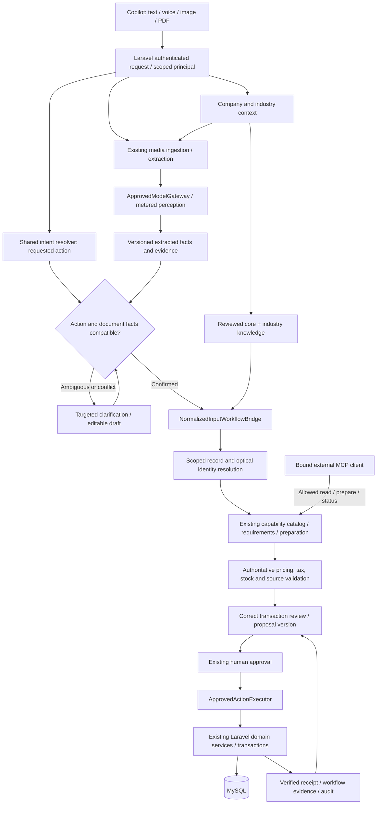

# zoloERP Pro — AI Completion, Optical Copilot UX and Production Readiness

**Specification:** v1.0 | **Date:** 27 November 2026 | **Target branch:** `main`  
**Repository:** `vigneshsinna/zolo-erp-pro`  
**Audited baseline:** [`f94f67fbe04a4af3075a9964bc8da317b1687cea`](https://github.com/vigneshsinna/zolo-erp-pro/commit/f94f67fbe04a4af3075a9964bc8da317b1687cea)  
**Merged AI foundation:** [PR #50](https://github.com/vigneshsinna/zolo-erp-pro/pull/50)  
**Target:** Laravel 13 / PHP 8.5 / MySQL; multi-store optical lens supplier first, reusable for other industries.  
**Delivery:** R01–R12 are proposed implementation work packages, not existing PR numbers. This document specifies work to perform; it is not a report that the work or tests have been completed.

## 0. Instructions to the implementation agent

Read this entire document and the current repository contracts before editing. Start from the latest `main`, compare against the audited SHA and record any changes in the baseline. Do not reimplement the previous AI-unified, PR8–PR16, U1/U2 or O01–O18 foundations. Reuse existing Laravel AI SDK tools, capability registry, requirements providers, task state, model gateway, governed proposal/approval/execution, pricing, tax, inventory, accounting, optical domain services, MCP and UI components. If a requirement is already satisfied, provide source and test evidence rather than adding duplicate code.

- Implement small dependency-ordered PRs with actual tests, precise source references and migration/rollback notes. Keep release flags off until relevant gates pass. Do not merge, deploy or activate production capabilities automatically.
- Natural language and media are untrusted input. Models interpret and extract candidate facts; deterministic PHP/MySQL resolves records, performs calculations, enforces permissions and business rules. All model attempts pass through the approved model gateway and meter. No direct model SQL, arbitrary tool dispatch or unapproved model fallback.
- Every governed write uses the existing exact-version proposal and human approval, rechecks current scope/source, and commits via the authoritative domain service with idempotency and durable receipt. Approval is never inferred from chat text, uploaded documents or model output. No external MCP approval or execution.
- No mandatory quotation, PO, SO or GRN for a direct transaction where the existing domain supports it. No invented physical receipt, dispatch, party, product, lens power, payment or official invoice number. Do not silently remove an invalid source link to make a transaction succeed.
- Missing or ambiguous information results in a targeted clarification or a safely blocked draft. Unsupported functionality remains explicit. No hidden dummy products or manual ledger shortcuts.
- All new optical behavior must be profile/permission gated. General trading, textiles and future industry packs reuse core contracts without inheriting optical fields or prompts. No clinical prescription decisions by AI.
- Run real MySQL tests with flags enabled and disabled. A test filename, synthetic corpus or green migration is not proof of an actual completed business journey. No real customer documents or production writes in tests. Report all skipped tests and blockers.

## 1. Baseline and release position

The previous read-only main audit established that the following foundations exist: Laravel AI SDK, text/voice/media intake, `ApprovedModelGateway`, centralized credit reservation/settlement, conversational tasks and corrections, unified capability discovery, proposal/approval/execution, scoped read tools, MCP read/PO prepare/status, business knowledge registry/planner, optical power catalog and matrix, optical schemas, transfer policy, lab job service, automation builder and metrics, and tenant licensing integration.

### Source-confirmed gaps

| ID | Finding at audited SHA | Priority | Work package |
|---|---|---|---|
| F01 | `NormalizedInputBuilder::resolveIntentKey()` matches generic `bill` as purchase before sales; `sales bill` is absent from the sales expression | P0 | R01 |
| F02 | `NormalizedInputBuilder::build()` explicitly disallows `sales_invoice.create.v1` media handoff even when its governed capability exists | P0 | R02 |
| F03 | `InvoiceExtractionV1` emits generic description, qty, price and tax lines, with no typed optical fields; `mapSlots()` maps description directly to product query | P0 optical | R03–R05 |
| F04 | Screenshot: user requests sales bill from image, displayed Purchase Bill Review, conflict banner, and RE/LE treated as item searches. Original attached invoice is not available for inspection; exact extracted amounts/powers cannot be verified | P0 | R01–R05 |
| F05 | 95 knowledge definitions (43 legacy + 36 core + 16 optical) are draft in inspected JSON; planner requires reviewed process and referenced actions | P0 for multi-step plans | R06 |
| F06 | `OpticalRxJobService::transition()` verifies posted dispatch document existence in company/branch/FY, not actual job/source line linkage; accepts supplied dispatch qty; cancellation checks nonempty reversal reference | P0 for lab activation | R07 |
| F07 | Direct invoice-before-goods, uncataloged expense AP, cross-GSTIN stock transfers remain deliberately unsupported/restricted | Scope-dependent | R08 |
| F08 | MCP exposure remains narrow; optical lookup and additional sales/purchase prepares not externally exposed in current policy | Optional expansion | R09 |
| F09 | Live NVIDIA benchmark skipped; staging concurrency and owner acceptance remain unverified | P0 release | R10–R12 |

### CI evidence at the pinned SHA

- [ERP completion acceptance](https://github.com/vigneshsinna/zolo-erp-pro/actions/runs/45937057793): passed all listed MySQL AI, commercial, operations, company, compliance, delivery, concurrency, legacy and clean MySQL 8.0/8.4 jobs.
- [AI credit metering and release evaluation](https://github.com/vigneshsinna/zolo-erp-pro/actions/runs/45937057671): static and automated 250-scenario corpus jobs passed; optional live NVIDIA Omni benchmark skipped.
- [Automated VPS deployment](https://github.com/vigneshsinna/zolo-erp-pro/actions/runs/45938533591): success. [Subsequent manual deployment](https://github.com/vigneshsinna/zolo-erp-pro/actions/runs/45941099311): failed at Verify release selection, before SSH deployment. This does not prove a runtime failure or the actual SHA/config on the user's local environment.
- Repository release reports record earlier local verification; use exact current CI rather than obsolete draft-branch status. Generic signoff titles in runbooks are not evidence of real named business approval. The optical report explicitly leaves live evaluation, staging load and knowledge approval pending.

**Decision:** NO-GO for unrestricted production AI activation. Individual existing features can remain within their already-authorized scope; this specification does not instruct a blanket shutdown. Prioritize confirmed defects and restrict unfinished lab/multimodal workflows until their gates pass.

## 2. Target architecture — no new parallel engine



Key boundary: document classification describes the source document; requested action describes what the user wants to do. The two are not interchangeable. A supplier invoice can be a reference for drafting a resale, but it cannot establish the resale customer, selling rate, tax or dispatch evidence. An outgoing invoice might already be posted. Verify these facts before preparing anything.

### Shared contracts and ownership

| Concern | Existing owner / target integration |
|---|---|
| User intent, clarification and active task | `ConversationTurnRouter`, `BusinessIntentInterpreter`, `VoiceIntentResolver`, `NormalizedInputBuilder` |
| Media perception | `MediaExtractionService`, `InvoiceExtractionV1`, `ExtractionRevisionService`, `NormalizedInputV1` |
| Industry-specific facts | `IndustryContextResolver`, `ScopedBusinessFactReader`, `OpticalCatalogService`, `OpticalSpecNormalizer`, `OpticalPowerMatrixService` |
| Tool/action availability | `CapabilityCatalog`, `CapabilityExposurePolicy`, `CapabilityDispatcher`, `ActionCapabilityRegistry`, `ActionRequirementsRegistry` |
| Task/proposal lifecycle | `ActionPreparationService`, `ActionProposalService`, `ActionApprovalService`, `ApprovedActionExecutor` |
| ERP correctness | Existing commercial, inventory, UOM, credit, tax, accounting and job-work services |
| Workflow state/evidence | `BusinessWorkflowPlanner`, `BusinessWorkflowProgress`, `OpticalRxJobService` |
| UI | Existing workspace blade, review cards, stream handler, optical desk, approval center, receipts |

## 3. R01 — Correct transaction intent across text, voice and media (P0)

**Goal:** eliminate purchase/sales misrouting. Keep deterministic handling for known commands, model-assisted interpretation only for genuinely ambiguous natural language.

### Source anchors

- `app/Ai/Multimodal/Services/NormalizedInputBuilder.php` (audited lines 104–165)
- `app/Ai/Conversation/VoiceIntentResolver.php`
- `app/Ai/Conversation/ConversationTurnRouter.php`, `BusinessIntentInterpreter.php`, `ActiveWorkflowTaskResolver.php`
- `app/Ai/Multimodal/Services/NormalizedInputWorkflowBridge.php`

### Implementation

1. Refactor duplicated intent mappings into one typed resolver/decision contract, reusing the existing intent interpreter rather than adding a competing agent. Expose supported aliases by canonical action key. Resolve exact explicit transaction phrases before generic terms. Recognize purchase bill/purchase invoice/vendor bill/supplier invoice, sales bill/sale bill/sales invoice/customer invoice, PO/SO and delivery/receipt actions. Treat `tax invoice` and generic `bill` as direction-neutral unless other verified context resolves them. Handle negation, corrections, multiple conflicting actions and reference-only text; do not use first regex match as authority.
2. Distinguish `requested_action`, `document_kind`, `document_direction` relative to active company, `active_task_action` and `decision_status`. Values are independently derived, not a model's single `intent_guess`. Explicit user intent wins over an inferred document label only when the resulting operation is authorized and its source role/required facts are compatible. If incompatibility, ask for confirmation or source-role correction; never silently turn a sales request into a purchase.
3. Validate any explicit override against the action allowlist, live scope, user-confirmed resolution and active task. It may choose the requested action but cannot waive mismatch, duplicate, profile, receipt or authorization checks. Conflicting spoken and typed commands require clarification. An existing active draft cannot swallow a new unrelated request; offer resume or start a new task without losing prior draft.
4. Determine issuer/buyer role using verified company names/aliases and valid GST registrations; exact validated GSTIN stronger than names. Do not treat substring-only names or a generic document title as proof. Distinguish own issuer, own buyer, both/ambiguous, neither/foreign and unknown. Outgoing/incoming classification should be symmetric. Check both parties. Company mismatch reason must be role-neutral and accurate. Keep historical extractor `document_type` for compatibility but do not use it as the sole routing authority.
5. Do not create a task or proposal with the wrong action. For unresolved intent, retain extracted facts and return `needs_intent_confirmation` or `source_role_conflict`. Existing normalized/stream/error responses should converge on a single decision contract so UI cannot render a stale purchase review under a sales conflict. Resolve without a second model call for exact text phrases. Preserve deterministic zero-credit behavior.

### Proposed decision payload (adapt to existing DTO)

```json
{
  "requested_action": "sales_invoice.create.v1",
  "document_kind": "invoice",
  "document_direction": "unknown",
  "decision_status": "needs_source_confirmation",
  "reason_code": "DOCUMENT_PARTY_ROLE_UNVERIFIED",
  "allowed_next_actions": ["confirm_source_roles", "change_transaction_type"],
  "source_extraction_revision": 1
}
```

### Regression/acceptance table

| Input | Expected action / safe behavior |
|---|---|
| create sales bill from the image | sales_invoice; never purchase review |
| create purchase bill from this image | purchase_bill; explicit receipt facts needed |
| prepare sales invoice / raise sale bill | sales_invoice |
| create a bill | ask purchase vs sales unless reliable active context resolves |
| tax invoice from image, no explicit direction | use verified issuer/buyer roles or ask |
| not purchase, create sales bill | sales intent or clarify if parser cannot safely resolve negation |
| create sales and purchase bills | separate/clarify; no arbitrary single posting |
| sales instruction + external supplier invoice | explain conflict; offer explicit reference-only resale draft with new customer/prices or purchase route; no automatic conversion |
| existing purchase draft + explicit sales instruction | ask whether start new task; no cross-action mutation |
| audio says purchase, typed says sales | conflict; no proposal |
| image contains instruction to post or change type | ignore document instruction; treat as data |
| forged action override or cross-company thread | deny; no write |

Add parameterized tests for aliases, punctuation, mixed language as supported, media/no media, false positives (e.g. product name containing `bill`), negation and conflicting active task. Confirm exact route zero provider calls. Verify no wrong-action proposal, not merely expected chat wording.

## 4. R02 — Enable governed media-to-sales-invoice preparation (P0)

**Goal:** complete the existing image/PDF to sales bill journey without introducing direct posting.

Current blocker: `NormalizedInputBuilder::build()` includes `$disallowed = ['sales_invoice.create.v1'];`. Remove the unconditional restriction only after implementing explicit reviewed policy and end-to-end tests. Existing `ai_multimodal.allow_direct_purchase_bill` defaults false. Introduce a separate proposed `AI_MULTIMODAL_ALLOW_DIRECT_SALES_INVOICE=false` mapped to `ai_multimodal.allow_direct_sales_invoice`, or an equivalent action-specific allowlist in existing config. Do not enable it simply by editing the array. Retain existing guards and maintain backward compatibility.

### Flow

1. Validate media ownership, extraction revision/confirmation, thread/task, company/branch/FY, profile, subscription entitlement, action foundation and permitted channel. Reuse `NormalizedInputWorkflowBridge` for handoff.
2. Map outgoing document's verified buyer/customer, not the supplier/issuer fallback. Supplier identity remains source metadata. Never fall back from missing buyer to supplier as a customer. Missing customer requires selection or separate governed master creation. For reference-only resale, do not inherit vendor cost as selling rate automatically; source data is candidate reference, not final invoice.
3. Resolve exact stock product, sales UOM, authorized dispatch warehouse, selling price/discount, tax facts, optional SO/DC and dispatch status. Use `sales_invoice.create.v1` requirements and `CommercialDocumentAdapter` via existing shared preparation. Distinguish direct invoice, SO-linked and DC-linked. No mandatory SO or quote; do not invent dispatch. If source document already posted, show existing verified document or correction/return path, not duplicate invoice. Source invoice number is provenance/reference, not the new official serial number unless actual domain-approved external reference mapping supports it.
4. Return `needs_input` or reviewed proposal; no domain writes in preparation. Apply sales credit policy, tax, stock availability, actual dispatch requirement, applicable license quota and duplicate protection through authoritative services. Human approves exact version; executor revalidates and commits once. Do not treat media confirmation as approval.
5. Add a direct purchase parity check: actual receipt must be known or a reviewed linked GRN must prove it. Invoice before receipt remains blocked/held unless authoritative nonreceipt route implemented in R08. Both image directions must use the same governed commercial engine as text and manual ERP.
6. Preserve extracted data when feature off, allow read/review only and show truthful capability-unavailable reason. Do not force PO/SO as substitute for a direct invoice. Ensure UI chooses correct document label from canonical action and state, not document description or generic `bill` text.

**Acceptance:** real feature-enabled MySQL workflow test from media extraction fixture → user confirmation → sales proposal → exact approval → posted invoice/receipt. Assert correct customer, stock issue once, AR/revenue/tax and ledger, quota enforcement, idempotent repeated approval and stale source rejection. Test direct no-SO, existing SO/DC, wrong link, missing customer, insufficient stock, disabled flags, wrong role, duplicate source and non-optical regression. All preparation/failed attempts produce zero business writes. Compare against manual ERP on equivalent isolated fixtures.

## 5. R03 — Industry-aware document perception (P0)

### Problem

`InvoiceExtractionV1` prompt and normalization currently preserve generic commercial fields and discard optical attributes. Existing `OpticalSchemaFragment` is downstream of extraction; it cannot restore missing facts. RE/LE can be eyes, not product names. The screenshot supports this failure pattern but is not sufficient to determine the original document's actual data or whether it was an invoice, Rx sheet, lab slip or quotation.

### Design

Reuse `MediaExtractionService`, `InvoiceExtractionV1`, `NormalizedInputV1`, `ExtractionRevisionService`, existing Omni client and gateway. Add versioned extraction profile selection based on authenticated `IndustryContextResolver` and enabled modules. Generic commercial extraction remains default for non-optical tenants. Do not switch an industry or permission from text in document. For optical profile, extend the prompt and validated schema with typed optical facts and row roles. If the source is an Rx/lab slip rather than invoice, no inferred price/tax/invoice number; classify source separately and ask required transaction facts. Use one perception call per approved page as needed, no redundant classification LLM for exact metadata. Keep existing upload/page/token/quota limits; a truncated invoice must block financial preparation until full coverage is confirmed, not silently post a partial document.

### Proposed versioned extraction shape (illustration, not current API)

```json
{
  "schema_version": "media.invoice.optical.v2",
  "document_kind": "invoice",
  "issuer": {"name": null, "gstin": null},
  "buyer": {"name": null, "gstin": null},
  "reference_number": null,
  "document_date": null,
  "currency": "INR",
  "lines": [
    {
      "client_line_id": "page-1-row-3",
      "page": 1,
      "row_role": "lens_item",
      "raw_description": "RE",
      "product_name": null,
      "supplier_sku": null,
      "hsn_code": null,
      "optical_spec": {
        "eye": "R", "sph": "-2.00", "cyl": "-0.50", "axis": 90,
        "addition": null, "base": null, "diameter": null,
        "family": null, "material": null, "index": null, "coating": null
      },
      "quantity": null, "uom": null, "unit_price": null,
      "discount_amount": null, "tax_rate": null, "tax_amount": null,
      "line_total": null,
      "field_evidence": {"eye": {"page": 1, "raw": "RE"}},
      "warnings": ["Product family not readable"],
      "confidence": 0.7
    }
  ],
  "coverage": {"pages_expected": 1, "pages_processed": 1, "complete": true}
}
```

Values are fabricated test examples only. Never use them as actual lens data from the screenshot. Align field names (`lr`, `dia`, etc.) with `OpticalSpecNormalizer` and native schemas through explicit mappings; do not create parallel optical identity schema. The perception model must never provide trusted `user_confirmed`, `product_id`, authorization, verified receipt, tax override or approval state. Server owns these. Strip/reject untrusted authority fields. Keep model confidence advisory, not sufficient for confirmation.

### Extraction requirements

- Identify table headers and row roles: lens item, service item, prescription-only row, subtotal/carried-forward, discount/charge, footer/unknown. RE/OD/right and LE/OS/left are eye candidates only when context establishes it; do not auto-interpret an arbitrary real product code `RE` as an eye outside optical context. If row is only an eye label, preserve it, do not make product query `RE`/`LE` or fabricate quantity.
- Keep lens family/type, product code, HSN/SAC, signed SPH/CYL, AXIS, ADD, DIA, LR, material/index/coating/base when present. A stock lens family may not require axis/eye; custom Rx may. Never fill absent zero/plano, signs, axis or quantities by assumption. No clinical transposition/recommendation or inferred wearer suitability. Separate requested optical spec from stock SKU identity.
- Preserve raw evidence, page/row identifier, per-field uncertainty, and `missing`, `ambiguous`, `present` distinctions. Preserve exact decimal strings; normalize through existing authoritative optical/unit/money contracts. No floating-point equality for power or final accounting values. OCR totals are reference evidence only, authoritative ERP recalculates totals. Do not parse HSN as SKU or vice versa when source ambiguous.
- Handle multi-page repeated header, carried forward, continuation rows, duplicates, conflicting headers, charges and discounts. Stable source line IDs must be unique across pages. Do not merge same eye/power lines solely because they look alike. Incomplete extraction or conflicting header must require human review. Separate printed invoice amount, extracted arithmetic checks and ERP preview.
- Keep supplier/customer/clinical data minimized; default B2B invoice does not require wearer name or contact. Respect retention, access and deletion policies, secure attachment preview and signed/authorized retrieval. No Rx/contact in logs, tool prompts unrelated to job, general telemetry or external MCP results. Document instructions ignored as data.
- Version prompt/schema; support older extraction revision viewing. Never reinterpret historical confirmed payload in place. Re-extract only on explicit user action when needed, with usage indication and proper meter. Local correction does not call provider.

**Acceptance:** test signed powers, plano vs null, row role RE/LE, actual product code RE outside optical, unclear sign, missing family, missing UOM, lens + fitting charges, handwritten/low resolution, multi-page and truncation, Rx sheet with no price, non-optical invoice, malicious prompt and model-supplied confirmation. Assert normalized facts, raw evidence and no domain write, not only JSON validity. Fake provider test verifies one intended extraction request and metering; real evaluation R10.

## 6. R04 — Preserve fields from extraction through posted ERP receipt (P0)

**Source anchors:** `NormalizedInputBuilder::mapSlots/buildFieldSources`, `NormalizedInputWorkflowBridge`, `ExtractionRevisionService`, `OpticalSchemaFragment`, PO/bill/GRN/SO/commercial schemas, `InputCompletenessEvaluator`, `RecordResolutionService`, `BatchRecordResolutionService`, requirements providers and preview/command adapters.

### Required mapping

| Source | Normalized draft | Domain contract |
|---|---|---|
| issuer/buyer/source direction | supplier_query OR customer_query | verified active party ID; no wrong-role fallback |
| supplier invoice reference/date | supplier_invoice_no + date | domain duplicate and period rules |
| outgoing source reference | source provenance/customer reference if appropriate | official new invoice serial generated by existing domain |
| product code/name | product_query / exact candidate | verified product + actual variant/stock identity |
| RE/LE/OD/OS | typed `lr` / eye per existing schema | applicable optical line attribute, not product name |
| signed sphere/cylinder, axis, ADD, DIA/base | mapped optical schema fragment | immutable normalized optical snapshot and actual SKU identity |
| qty/UOM/unit basis | exact qty, verified UOM | base quantity through UOM conversion |
| buy/sell unit amount | cost or price by requested action | authoritative pricing/tax; resale requires selling rate |
| discounts/charges/taxes | extracted reference + validated commercial inputs | approved pricing service, no double charge |
| source page/raw data | field lineage | safe metadata / audit reference, not executable authority |

1. Extend media and voice extraction mapping to the shared typed optical contract. Do not just add UI fields while adapters discard them. Inspect every mapping and explicit payload allowlist. Distinguish missing from zero, cleared from omitted. Preserve stable `client_line_id` across edits and existing task revision. Validate nested schema, reject unsupported keys or profile-specific fields. Don't trust model-supplied database IDs; resolve against actual authorized records.
2. Preserve identity and optical attributes in normalized task, completeness checks, candidate search, preview, canonical proposal hash, source snapshot, command adapter, persisted source line, invoice/voucher and execution receipt. Add missing persistence fields only after domain review; do not create duplicate tables/columns for data already supported. Test PO/GRN/bill/SO/DC/invoice and return paths where enabled.
3. Treat user corrections as new extraction/task revisions with per-field provenance (extracted, user-confirmed, authorized ERP resolution, deterministic calculation). Confirmation requires server-authenticated action and expected revision; model flags are discarded. Editing after proposal invalidates old approval and preview; keep unchanged confirmed fields. Concurrent edit returns conflict; do not overwrite another session. Corrections do not automatically re-run OCR.
4. Canonical payload binds action, profile/policy, scope, line identity, exact signed spec, money/unit, source document and relevant versions. Recheck current scope, source status, prices, stock, tax and approval before commit. Use existing decimal/money semantics, avoid injecting raw float values into canonical hash. If current domain uses a legacy type, define validated conversion and round-trip tests rather than rewriting all money handling in this PR.
5. A user-provided or extracted price/tax amount is not an authoritative posting result. Show source-vs-ERP comparison; require correction or approved discrepancy handling. No silent tax override or zeroing. Handle missing receipt/dispatch and linked document evidence through R02/R08.

**Acceptance:** automated round-trip for 2+ mixed-eye/power lines, exact SKU/variant, qty/unit and signed attributes. Compare extracted source → normalized slots → preview → approved payload → stored document → receipt. Test edit power/qty/price/source after preview, stale revisions, missing/invalid fields, duplicate line IDs and wrong profile. No optical attribute dropped silently; no stale approval accepted. Manual/AI commercial ledger and stock parity. If a field is not applicable, show explicit not-applicable instead of inventing it.

## 7. R05 — Copilot UX and exact optical resolution (P0)

### 7.1 Design objective

The workspace must feel like an intelligent assistant, not an enormous mandatory form. The existing screenshot shows a full-width purchase-bill review despite a sales request, with unresolved supplier and product selectors and a large amount of empty space. The revised experience should first resolve transaction direction, then display only the appropriate controls. The user must see what was extracted, what is missing, what the ERP has verified, and what will actually happen when approving.

Reuse existing `resources/views/backend/ai/workspace.blade.php`, `public/js/ai-workspace-stream.js`, `public/js/ai-conversation-po-workspace.js`, `public/js/ai-optical-workspace.js`, `public/js/ai-business-workflow.js`, optical desk partial, existing CSS/design tokens and Action Review Center. Inspect actual rendering functions in the workspace and media handoff handlers before making changes. Proposed UI component names below are conceptual, not claims that these classes/files exist. Do not introduce a second frontend framework or a parallel Copilot workspace.

### 7.2 Information architecture


The desktop layout uses a compact conversation rail and a central conversation area with a collapsible task-review panel. For document-heavy tasks the review panel may expand into a dedicated workspace within the same page. Avoid consuming the entire chat surface with unbounded lists of master records. Preserve a visible composer at all stages. Show optional details progressively. Use one primary next action per state; do not present multiple conflicting submit/approve buttons. Use consistent existing ERP branding, typography, spacing and accessible neutral/warning/success statuses. No permanent hard-coded green success label for unposted proposals.

### 7.3 Desktop wireframe — sales bill from image

Illustration only. All optical values below are synthetic and must never be presented as extracted from the user's actual invoice.

```text
┌──────────────────────────────────────────────────────────────────────────────┐
│ zoloERP Copilot  | Company ▾ | Branch ▾ | FY ▾   Model / credits (if used)    │
├────────────────┬─────────────────────────────────────────────────────────────┤
│ Conversations  │ You: Create a sales bill from this image.                   │
│ + New chat     │ [samplebill.png] [View source]                              │
│ Search         │ Copilot: I can prepare a sales invoice.                     │
│                │ Please confirm the customer and the lens family.           │
│ Sales bill ●   │                                                             │
│ Earlier PO     │ ┌─ Active task · SALES INVOICE ───── Needs details ──────┐  │
│ Stock lookup   │ │ 1 Source ✓    2 Details ●    3 Review    4 Approval    │  │
│ ...            │ │ Transaction: Sales invoice [Change type]              │  │
│                │ │ Route: Direct sale (no SO required) [Change route]      │  │
│                │ │ Customer [Search / select existing ▾] [New customer] │  │
│                │ │ Warehouse [Select authorised location ▾]              │  │
│                │ │ Dispatch status [Confirm actual status ▾]             │  │
│                │ │                                                       │  │
│                │ │ Lens lines                     [View source] [Expand] │  │
│                │ │ Eye | SPH   | CYL   | AXIS | Lens     | Qty | UOM      │  │
│                │ │ RE  | -2.00 | -0.50 | 90   | Select…  |  ?  | PCS ▾    │  │
│                │ │ LE  | -1.75 | -0.25 | 80   | Select…  |  ?  | PCS ▾    │  │
│                │ │ [ + Add line ] [Bulk paste]                            │  │
│                │ │ Missing: customer, lens identity, quantity, warehouse │  │
│                │ │                                                       │  │
│                │ │ Price/tax preview: pending ERP validation             │  │
│                │ │ [Save draft]                    [Generate preview ▸]  │  │
│                │ └───────────────────────────────────────────────────────┘  │
│                │                                                             │
│                │ [Ask or correct details…] [Attach] [Record] [Send]        │
└────────────────┴─────────────────────────────────────────────────────────────┘
```

For a source-role conflict, replace the transaction card with a targeted decision card and do not mount a Purchase Bill Review under it. Example wording: “You requested a sales invoice, but the document appears to be an incoming supplier invoice. Do you want to record the purchase, or use the document as a reference for a new sale?” Choices: `Record purchase instead`, `Use as reference for new sale`, `Review source`. Each choice revalidates against the current scope and task revision. No default selection that silently changes transaction direction. Reference-only resale opens sales details requiring actual customer, selling price and dispatch facts; do not simply rename the purchase form.

### 7.4 Source preview and correction panel

```text
┌─ Source document ─────────────┬─ Extracted facts ──────────────────────────┐
│ Page 1 / 1 [◀] [▶] [Zoom]    │ Issuer: [Extracted name]  [Review]         │
│                               │ Buyer:  [Unknown]         [Enter]          │
│ [Authorized image/PDF viewer] │ Document reference: [editable]            │
│                               │ Line 1 eye: RE  Source: page 1 / row 3    │
│ Select field → show evidence  │ SPH [-2.00] CYL [-0.50] AXIS [90]          │
│ if positional data available  │ Lens family [missing] [Select]            │
│                               │ [Confirm reviewed facts]                  │
└───────────────────────────────┴────────────────────────────────────────────┘
```

Show page/row evidence and raw source snippets where safe; highlight image region only if actual coordinates are available. Do not fabricate bounding boxes. If source is unreadable, clearly mark unknown. Support a new extraction revision after correction; do not re-upload or re-run the model when a human can edit. Show actual model and metered usage only from recorded invocation, not from assumed configuration. Do not show the model name as proof of verified facts. Access control for document preview must apply on every fetch and download; sanitize displayed text, enforce attachment type and retention.

### 7.5 Contextual resolution — dealer, lens and stock

- Sales uses customer/dealer search; purchases use supplier search. If a user asks to create a new party, infer direction only from clear language, otherwise ask whether they buy from or sell to that party. Use existing requirements providers to collect all relevant missing required fields together, with optional fields clearly distinguished. Use separate approved master proposals and re-resolve parent draft after actual creation. Do not invent a supplier/customer or copy issuer details into buyer fields.
- Optical product picker must use `OpticalCatalogService`, `RecordResolutionService`, `BatchRecordResolutionService` and approved scope. Search by explicit family/code/alias and normalized applicable specifications. A missing family plus eye labels is an incomplete lens description, not a failed generic search. Ask for family/index/coating/diameter only if relevant to the actual catalog. Return exact candidates and explain mismatches in signed power, material, index, coating, diameter and other stock dimensions. Never silently substitute +2.00 for -2.00 or nearby power. If ambiguous, present choices; if no verified identity exists, propose master creation separately or keep unresolved. For non-optical requests preserve generic behavior.
- Picker opens only on demand, not one huge list per line. Use bounded paginated search with debounce, cancel stale queries, stable line IDs and server authorization. Suggested records must be relevant; do not show unrelated textile products as replacements. If an explicit general search is requested, clearly label broad results and still validate exact required identity before use.
- Stock finder shows authorized stores, exact identity, available/reserved/held/in-transit if authoritative support exists, as-of timestamp, selected UOM and verified conversion. Never treat unknown stock as zero. If local shortage, offer partial fulfillment/backorder, authorized transfer proposal, direct purchase/PO or custom lab route according to policy. Cross-GSTIN or unauthorized stores blocked. Availability is not reservation; only approved domain operations allocate/move stock.
- Lens grid: edit stable rows, add/remove, bulk paste with row errors, signed decimal values, separate eye and actual product, stock identity, qty, unit and rate basis. Advanced fields (ADD/base/DIA/coating etc.) expand per applicable family; no clinical decisions. For mobile use one collapsible card per row with prominent eye/power, not a tiny horizontally clipped desktop table.

### 7.6 Review card — financial preview

```text
┌─ SALES INVOICE · Proposal v3 ────────────────────────── Awaiting approval ─┐
│ Customer: [Verified dealer]   Branch/warehouse: [Verified]                │
│ Route: Direct sale    Source: Uploaded reference, revision 2              │
│ Lens lines: [exact selected product / signed power / qty / UOM / rate]     │
│                                                                           │
│                       Source amount       ERP-calculated amount           │
│ Subtotal              [from document]     [authoritative preview]         │
│ Discount / charges    [from document]     [authoritative preview]         │
│ GST                   [from document]     [authoritative preview]         │
│ Total                 [from document]     [authoritative preview]         │
│ Difference: [explanation / requires correction if material]               │
│ Stock effect: [verified expected movement or no duplicate issue]          │
│ Accounting: [expected AR/revenue/tax; no posting has occurred]             │
│ Approval applies only to this version. Changes require a new preview.     │
│ [Edit details] [Reject]                       [Approve and create invoice]│
└───────────────────────────────────────────────────────────────────────────┘
```

Button wording must match actual existing approval/execution behavior. If approval and execution are separate, use distinct states/buttons; do not show “created” when only approved. Display authoritative domain preview and source mismatch, not AI arithmetic. No invented preview data, zero tax default or stock movement label. Show missing values as pending rather than zero. Disable approval until required inputs, validation, discrepancy policy and exact proposal version are ready. Any edit invalidates the current approval. If source state changed, retain draft and show refresh/new preview action. A verified posted receipt provides official document ID/number and authorized view/print link. Print official invoice only from persisted authorized document; draft preview clearly marked DRAFT.

### 7.7 UI state contract

Use server-derived task/action/status, extraction and proposal version as source of truth. Exact names should map to existing DTOs and response formats. Proposed normalized presentation states:

| State | UI primary action | Guard / behavior |
|---|---|---|
| `idle` | Send request | No previous task assumptions |
| `extracting` | View progress / cancel if supported | No review or approve while pending; real request state |
| `needs_intent_confirmation` | Choose transaction type | No draft action selection by generic document label |
| `source_role_conflict` | Confirm source / choose valid route | No stale review card or wrong-action proposal |
| `needs_extraction_review` | Confirm/correct facts | No trusted model confirmation; explicit revision |
| `needs_input` | Resolve missing fields | Show only relevant party, stock and commercial requirements |
| `validating` | Wait for current response / cancel if supported | No duplicate submit; preserve input |
| `blocked` | Review reason / correct / supported alternative | No hidden fallback to different transaction |
| `awaiting_approval` | Approve exact version or edit | Only authorized current version; no business write yet |
| `approved` / `executing` | View status | Prevent repeat submission; no premature posted label |
| `posted` | View/print receipt | Must have verified authoritative receipt; no optimistic success |
| `needs_reconciliation` | Check verified status / support | Never blindly retry uncertain financial commit |
| `rejected` / `cancelled` / `expired` | Resume eligible draft or start new | Preserve audit and posted records |

Suggested task-view model (design contract, not existing API):

```json
{
  "thread_id": "owned-thread",
  "task_id": "owned-task",
  "task_revision": 4,
  "action_key": "sales_invoice.create.v1",
  "presentation_state": "needs_input",
  "industry_profile": "opticals",
  "source": {"media_id": "owned-media", "extraction_revision": 2},
  "fields": {"required_missing": ["customer", "warehouse"], "optional": []},
  "lines": [],
  "validation": {"blocking": [], "warnings": []},
  "proposal": null,
  "allowed_transitions": ["correct_fields", "resolve_customer", "save_draft"]
}
```

Do not expose internal PHP class names, hidden prompts, other tenant data or credentials. Only allowed transitions may render controls; server must reauthorize regardless of UI state. Stream/reconnect responses carry task and revision; ignore stale asynchronous results or responses from prior company/thread. On network timeout show unknown/processing until verified status returns. On company/branch/FY switch clear cached candidates and review state; resume original task only when scope authorized. Keep keyboard focus, accessible form labels, status announcements, sufficient contrast, no color-only errors, responsive layout, and predictable back/close behavior. Reuse existing design tokens; CSS scoped to workspace and optical panel. Avoid unbounded nested scroll regions.

### 7.8 Interaction examples and acceptance

- User: “Create sales bill from this image.” Correct sales direction and customer picker, source conflict clarification if appropriate, optical row fields. No purchase review or supplier selector unless user explicitly changes route.
- User: “Use Store B, change RE power to -2.25 and quantity to 2.” Resolve authorized Store B, preserve LE row and other confirmed fields, revalidate exact SKU, issue new draft/proposal revision. No automatic posting.
- User: “I have no PO, just the supplier invoice.” Direct purchase route if goods received and domain permits. Ask actual receipt status if unknown; no dummy PO.
- User: “Find -2.00 HMC stock in all stores.” Scoped deterministic matrix lookup, no model call for fully resolved structured input. Show stock timestamp and exact SKU; transfer is separate proposal.
- User: “Create customer ABC Opticals.” Ask required customer fields with one concise grouped clarification, use existing selections/defaults only when authorized and shown, not a repeated single-name loop.

**UI acceptance:** run browser tests and manual desktop/mobile UAT for all states, source viewer, type switching, row correction, selection, missing master, source mismatch, disabled flags, timeout, reconnect, stale revision, company switch, duplicate approval, verified receipt, keyboard and optical/non-optical profiles. Assert actual action key and backend task/proposal state as well as screenshot. Test actual optical invoice attachment rather than only a manually entered lens grid. Preserve previous task on new request; no misleading warning plus unrelated review. No unrelated product recommendations when lens resolution is incomplete.

## 8. R06 — Complete reviewed knowledge and workflow activation (P0)

The registry now contains 95 draft definitions and 14 process definitions in the audited files. This is not equivalent to the earlier proposed 90 common modules plus 30 optical modules. The workflow planner correctly blocks unreviewed processes. Do not fix this by changing every `status` to `reviewed` or editing validation to allow drafts.

### Implementation

1. Inventory every definition and its action key, authoritative source, permission, effective profile/subtype, dependency, required facts, evidence validator and test. Build traceability against `docs/zoloERP_Optical_Lens_Supplier_Implementation/` and prior common/optical scope. Keep a coverage register with implemented/reviewed/deferred/unsupported rather than claiming full module coverage from number of JSON records. Reuse modular registry/validator, profile resolver and source manifest.
2. Select initial vertical slice: dealer/customer and supplier resolution, exact lens/product, warehouse/UOM, direct goods purchase, direct stock sale, PO/GRN, SO/DC/invoice, stock lookup and same-registration transfer. Add missing definitions for actual receipt/dispatch routes and correction/return/settlement where authoritative capabilities exist. Keep quotation and orders optional in direct paths. Add review evidence with real owner, date, effective version and linked tests. Finance, inventory and optical operations must approve actual policy; no fabricated signoff.
3. Review `resources/ai/knowledge/definitions.json`, `core/*`, `industries/opticals/*`, profile manifests and `governance/review-manifest.json`. Add missing optical action references only if actual registered governed action exists. Optical actions file is empty at baseline; do not manufacture action names for lab workflow. Map to existing registered capabilities or explicitly mark unsupported. Verify all reviewed actions/profile scopes/versions with `CapabilityCatalog` and `ActionSecurity`. Knowledge never grants a permission.
4. Exercise actual `BusinessWorkflowPlanner`/`BusinessWorkflowProgress` transitions, not preview alone. Read/clarify and read-only validation steps require verified facts and named validators. Reviewed action steps link exact task/proposal version and execution receipt. Physical steps require actual source records; relation and quantities verified, never a chat assertion. Direct route may omit predecessors; mark not applicable by route definition, not completed artificially. Support pause/resume, partial completion, correction, stale source, reversal/reconciliation, expiry, cancel. Knowledge/profile/hash changes trigger replan or safe block; preserve immutable audit and posted history.
5. Enforce reviewed process and action definitions before start and advancement. Review scope must be tied to effective profile and action, not any unrelated reviewed definition for same action key. Ensure withdrawn/deprecated/expired definition or flag/permission change cannot authorize stale progression. Tests with reviewed fixture are allowed; do not promote production data based on test fixture.

**Acceptance:** reviewed test direct purchase and direct sale workflows start, clarify, prepare, approve, post and reconcile. PO→GRN→bill and SO→DC→invoice verify actual source links, partial quantities, no duplicate stock. Draft/unsupported/wrong-profile/withdrawn/expired process blocked. Current-version evidence, role revoke, stale hash and receipt replay fail closed. Actual named owners approve exact reviewed production definitions before enabling pilot. A missing domain action remains explicitly unavailable.

## 9. R07 — Harden optical Rx lab workflow evidence (P0 for lab)

Source: `app/Services/Optical/OpticalRxJobService.php::transition()` (audited lines 157–252). Current existence check is insufficient for a job-specific dispatch; cancellation checks nonempty reversal string. Fix the service-level invariant even if only trusted UI calls the method. Do not assume this is an already demonstrated exploit.

### Required changes

- Identify actual persisted job-to-source relationships (job, dealer, order line, production/job-work record, exact lens identity, warehouse, quantities). Use existing IDs and relations if sufficient. If absent add reviewed additive line-level linkage and evidence allocation records, with scope, unique source-line constraints where appropriate and auditable idempotency. Do not allow arbitrary invoice ID to satisfy a job.
- Dispatch validation: authoritative posted and not reversed/cancelled DC or sales invoice only if actual domain movement proves dispatch; verify same company/branch/FY, customer, job/order/source line, exact optical identity, ownership and eligible actual dispatched quantity. A posted service invoice or unrelated stock invoice is not dispatch proof. For DC→invoice, recognize same stock event and do not allocate twice. Bind each allocated quantity to evidence and prevent reuse beyond actual remaining source line. Use authoritative base UOM conversion and exact quantities. Validate remaining accepted and packed quantities; no negative/zero or overdispatch from supplied evidence. Derive quantity from actual source allocation, not arbitrary `qty_dispatched`. Support partial shipments only with consistent status/remaining quantities.
- Cancellation after linked or posted operations requires verified actual reversal/return/compensation related to original job and affected source line; not merely nonempty reference. Determine required corrections for every already-posted movement or invoice; no destructive cancellation. If evidence reversed after a completed step, move to reconciliation or block dependents, preserve history.
- QC and packing: enforce actual authorized operator and qualified verification as required; accepted + rejected/loss cannot exceed eligible produced/received quantities. Reject release/packing without accepted qty and prevent overpacking. Validate remake lineage and source quantities. Distinguish delivered evidence from posted invoice and financial status. No fabricated prescription or clinical acceptance from AI.
- Maintain scoped server-derived actor/role, profile flag, CAS revisions, transaction locks and consistent lock order around job and evidence allocation. Verify existing routes/permissions; prevent direct endpoint bypass. Audit safe event source IDs, revision and actor; do not persist unrestricted raw evidence JSON or wearer PII in generic logs. Keep immutable source/reversal history. No autonomous write or approval via MCP.

**Acceptance:** unrelated invoice/DC same scope rejected; wrong dealer, wrong lens, wrong job line, reversed/cancelled source, service invoice without stock movement, overdispatch, negative qty, repeated/replayed evidence and wrong branch/FY rejected. Actual partial dispatch with correct exact identity progresses eligible qty; DC and subsequent invoice do not double count; race with source reversal is safe. Nonempty fake reversal ref rejected; actual reversal linked and audited. Cross-tenant and unauthorized actor denied. QC reject cannot pack, valid remake retains original. All with lab flag on and off, actual MySQL concurrency and domain records. Lab remains disabled until pass.

## 10. R08 — Remaining commercial scope and business knowledge (P1; P0 if included in pilot)

Use existing commercial/inventory/accounting services; add only missing authoritative capabilities. Do not make unsupported scenarios appear supported by a generic proposal. Review scope with Finance and optical operations.

| Work item | Required outcome |
|---|---|
| Direct purchase / sale | Fully support direct goods bill and sales invoice without PO/SO/quote, explicit actual receipt/dispatch or eligible domain route |
| Linked source variants | PO→bill with confirmed receipt where supported; GRN→bill without duplicate receipt; SO/DC→invoice without duplicate issue; partial qty/source matching |
| Invoice before goods | Current block intentional. If needed, implement finance-approved nonreceipt AP/accrual route with no stock increment, later actual receipt/reconciliation; else hold draft clearly |
| Expense-only AP | Dedicated approved GL/expense payable domain path; no dummy product/service, no invented tax/ledger; keep unsupported until reviewed |
| Service purchase/sales | Non-stock service item, applicable source/charge and tax, no physical inventory movement |
| Payment / advance / settlement | Actual receipt/payment evidence, account/open item, partial allocations, idempotency and separate approval; do not mark paid from terms alone |
| Return / credit / debit note | Original exact lens/qty/source, QC disposition, eligible tax/stock/financial compensation; no destructive posted record deletion |
| Pricing / credit | Authorized dealer rates, discounts, unit price basis, credit limit and reviewed override, all enforced by domain |
| Multi-store transfers | Same-registration supported path with actual source/destination authority; separate GST registrations or legal entities require reviewed commercial/tax route or remain blocked |
| Optical lab / warranty | Actual production/outsourcing/ownership, QC and remake/return linkage; no lab requirement for stock-only wholesaler |

Tax, GST registration, place of supply, HSN/SAC, RCM/ITC and exemptions are authoritative domain/Finance concerns. No hard-coded tax rates from knowledge or model. Do not equate unregistered party with non-GST transaction. Test actual manual vs approved AI paths on equivalent fixtures, exact stock movement count, journal balance, AP/AR/open items, tax, source links and reversal. Expand knowledge/action definitions only after real capability exists. P1 deferral requires explicit scope exclusion, disabled discovery and documented user guidance.

## 11. R09 — Extend MCP and automation selectively (P1)

Existing `/mcp/erp` offers restricted read, PO prepare and status. The shared capability catalog already exists. Do not rebuild MCP or expose SQL, arbitrary execute, approve, reverse or payment tools. Internal Copilot continues direct PHP tool dispatch without loopback MCP HTTP.

- After R01–R08 parity for each selected capability, consider reviewed optical exact lens candidates and power matrix reads, then purchase bill/SO/sales invoice prepare. Use existing `config/ai_capabilities.php`, `CapabilityExposurePolicy`, `CapabilitySchemaCompiler`, `McpClientGuard`, `McpClientBindingService`, `McpPreparationDeduplicator`, `ProposalStatusReader`. Default-off global/channel/action/profile/tenant flags and exact client operation grants. No blanket exposure for all registered actions.
- Discovery and invocation independently enforce authorization. Bind real actor, company, branch, FY and client, exact mode/ability/action, finite expiry and revocation. Reject wildcard/forged/nested authority, foreign task/proposal/media, unknown tool and unsupported schema. Do not expose clinical/wearer data. No media intake from external MCP unless separately reviewed; structured preparation zero model calls.
- Draft idempotency: stable client request ID + canonical request hash + scoped binding/action; same request replays same task/proposal status, different payload conflict. Correction expected revision and new request ID. Human review in authenticated ERP only; same current-version approvals, no MCP approve/execute. Status scoped to owner or explicit authorized delegation, minimal verified receipt only.
- Automation Builder: deterministic low-stock, unbilled GRN/DC, open order or overdue lab suggestions use actual scoped data, dedup, policy and bounded schedule. Draft only for initial pilot. No auto-post, auto-transfer, payment, send or clinical decision. Respect kill switch and revocation; do not widen existing autonomy policy through discovery. Measure actual receipts, exception outcomes and model use, not plan counts.

**Acceptance:** SDK/REST/MCP allowed channel schema and normalized proposal parity, old read clients compatible, token revocation between list/call denied, no financial writes before internal human approval, retries safe, redacted results and no unauthorized optical fields. Model usage zero for structured reads/prepares. Optional external expansion can be deferred without blocking internal Copilot pilot.

## 12. R10 — Live model and credit evaluation (P0)

The automated 250-scenario evaluation passed at the audited commit, but the optional live NVIDIA Omni benchmark was skipped. Do not treat mock responses or deterministic intent fixtures as evidence of actual model accuracy. Run the real approved configured model in isolated staging with authorized test documents, bounded provider spend and no real financial posting. Current provider names, model IDs and quotas must be read from approved runtime config, not inferred from historical plans.

### Evaluation corpus (minimum 250)

| Set | Count | Composition |
|---|---:|---|
| Supplier invoice images / PDFs | 100 | Stock lenses, multi-power matrices, mixed units, discount/charges, GST splits, direct/linked invoices, low-quality scan, handwritten text, multi-page, no goods received |
| Representative Copilot tasks | 100 | 25 procurement, 25 sales including image-to-sales and direct invoices, 20 stock/transfer, 15 master creation/correction, 15 lab/returns or relevant enabled scope |
| Difficult and negative cases | 50 | Sales vs purchase ambiguity, source-role conflict, RE/LE, signs/zero, SKU vs HSN, missing family/UOM, duplicate, malicious document, wrong store, stale approval, unsupported route |

For the sales media slice include actual authorized outgoing invoice and source-only Rx sheet/quotation/reference examples; do not benchmark sales solely on purchase documents. Include English, Tamil and mixed language representative of the pilot, with voice recordings where supported. Use synthetic or redacted records with proper authorization and privacy review; no uncontrolled transfer of end-wearer data. Freeze ground truth before tuning, separate held-out set from prompt development, label expected action, source role, exact optical fields, page evidence, required clarification/abstention, domain expected result and applicable policy. Document dataset version and source. Model is not the oracle for tax or accounting.

### Measures and proposed thresholds (ratify before testing)

| Measure | Proposed gate |
|---|---|
| Requested action direction | 100% of explicit supported purchase/sales aliases in deterministic regression; zero wrong-action proposal from conflicting input |
| Intent accuracy (held-out natural language) | ≥95%; report confusion matrix, abstention and correction rate separately |
| Exact readable required-field extraction | ≥98% precision; report recall and coverage, by field and source type |
| Optical signed power/eye | Report separately; zero unverified/wrong identity accepted into posted transactions; unclear values require clarification |
| Financial truth | Zero incorrect final totals, unbalanced journals or duplicate stock/financial postings in governed fixtures |
| Scope and approval | Zero unauthorized data exposure or execution; zero approved stale version |
| Deterministic cases | Zero actual provider calls and zero model credits for exact read, calculation, validation, known route and structured MCP preparation |
| Live usage | Actual provider model/version, invocation ID, latency, token/credit reservation and settlement reconcile to ledger |

Do not hide failures by excluding unreadable cases after results are known or counting every abstention as a correct extraction. Distinguish safe abstention from successful automation. Assess task completion, number of clarifications, wrong entity suggestion and user correction burden. Tune extraction prompt/schema with documented version, rerun frozen holdout. Hard safety invariant failure blocks activation regardless of averages. Report actual costs, p50/p95/p99 per modality and credit per completed task, not invented savings.

### Credit and provider verification

Reuse `ApprovedModelGateway`, existing credit meter/reservation/settlement/reconciliation services. Verify every provider attempt recorded once with appropriate reserve/refund/settlement, including 429, timeout, invalid output, retry, cancellation, monthly allowance and top-ups. Confirm actual provider quota and central throttling (35 RPM was earlier planning, not a verified current limit). No hidden model fallback. Don't re-run OCR on deterministic correction, approval or stock lookup. Model calls outside DB transaction locks. Use actual invocation and credit ledger evidence plus fake provider regression. Capture CI run, approved staging corpus and reviewer signoff; live credential absence remains a blocker, not a passing skip.

## 13. R11 — Staging concurrency, security and financial reconciliation (P0)

Run the complete CI matrix at final integrated SHA, enabled-feature suites and production-like migrations. Use separate authorized sessions in a disposable environment: optical company A with branch A1/A2 and inaccessible A3; another optical company B with duplicate names/SKUs; non-optical company C; current/closed FY; dealer/supplier, operator, finance, approver, read-only and revoked actor. Distinct authorized stock locations and tax registrations. Seed exact lens identities differing by sign, cylinder, coating and diameter, verified PCS/PRS/BOX factors, partial PO/GRN and SO/DC, reversed records and existing open items. All fixture accounting expectations independently reviewed by Finance.

### Concurrency and reliability

Extend existing `tests/k6/ai_business_workflow_concurrency.js` using the actual `optical_mixed` profile or supported equivalent. Run 5, 10 and 20 users separately, with read-only, deterministic preparation, media review/correction, approved writes and status checks. Use approved test harness for human approval identities; do not introduce production approval bypass to load test. Test targeted last-stock and duplicate-invoice races with real independent MySQL connections, not sequential mocks. Include stale revisions, concurrent approval, model 429/timeout, queue restart, crash before/after commit and response lost after commit. Recover from authoritative idempotency receipt before retry. Keep test usage bounded, don't target production.

Capture throughput, p50/p95/p99, error/denial counts, DB query count/locks/deadlocks, CPU/memory, queue lag, provider attempts/RPM, model credits, draft and posting counts and final stock/ledger reconciliation. Proposed initial staging SLOs: deterministic read p95 ≤500 ms, small clean draft prepare p95 ≤2 s, unexpected HTTP failure <1% excluding intentional negative test cases; confirm against actual environment and adjust by documented agreement before evaluation. Model-assisted latency separate by modality; no promise of sub-20 ms UI. Zero unauthorized/duplicate/wrong financial or optical identity outcomes. Prove current capability entitlement, invoice quota, feature and scope check under merged SaaS licensing as well as AI guards.

### Security matrix

- Tenant/branch/FY/actor isolation for chat, active task, documents/media, extraction revisions, candidates, optical stock, workflow, proposal/status/receipt, MCP, queue and metrics. Use valid-looking foreign IDs from another fixture, not merely nonexistent IDs. Deny without data/existence leakage.
- Prompt injection in invoices, OCR, transcripts, model result, supplier notes and product names; no arbitrary tool call or approval, SQL, or user-supplied authority. Reject nested authority fields and model claims of user confirmation. Validate size/type, malformed media/JSON, bounded lists, safe output escaping and retention.
- Authorization at discovery, preparation, approval and execution; permission/flag/license changes after proposal must not allow stale unauthorized commit. Exact current version/HMAC/source checks, replay, expired proposal, signature or payload modification. No direct endpoint bypass, external MCP approval or hidden posting. Scope query and caching audit.
- Lab evidence linkage, actual quantity, reversal and QC guards; no unrelated receipt reuse. Verify no double stock/ledger when DC/GRN consumed by later bill. Correction via approved reversal/return not hard delete.
- PII in logs, model context, document previews, metrics and external output; minimized and redacted. Ensure provider and private media access are permitted. Review security scan results, secrets and dependency advisories. No unresolved high/critical release-risk defect.

### Financial reconciliation report

For each approved test case record original and final stock by exact identity and base UOM, movement IDs/count, reservation, tax inputs/outputs, journal debit/credit, supplier/customer open items, receipt allocations, document IDs/status, source line balances, approval version and idempotency receipt. Compare manual ERP and approved AI operations from equivalent starting state. For direct goods and sales verify one correct movement; linked receipts/dispatches not duplicated; service no stock; invoice-before-goods held unless a reviewed nonreceipt path exists. Reversal preserves linked history. Finance and inventory owners must sign off actual expected vs observed. No discrepancy masked by an average or UI screenshot.

## 14. R12 — Configuration, UAT, release and rollback (P0)

### Configuration verification

Read actual config definitions and deployment/runtime settings; never assume local screenshot uses current main or all feature flags. Existing examples default off. Check `AI_ENABLED`, action foundation/execution, conversation, multimodal, purchase media handoff, shared discovery, business knowledge/semantic/planner/service/job-work, optical/optical lab/cross-store/MCP and tenant licensing/`ai_feature_settings`. Proposed sales media flag is new until implemented. The existing `AI_MULTIMODAL_ALLOW_DIRECT_PURCHASE_BILL` is not sufficient to enable sales. Verify actual `AI_MULTIMODAL_ALLOW_DIRECT_SALES_INVOICE` mapping or equivalent if R02 creates it. Check model provider purpose config, queue worker, migrations, media disk and access, token binding, caches, subscription quota and authorized company/branch roles. No broad copy/paste `.env` with every flag enabled; choose minimum approved slice.

Reconcile the failed manual deploy selection with release owner: inspect actual workflow/run logs and allowed release source, do not bypass selection verification. Verify actual deployed SHA and migration state separately, and test authorized local/staging workspace. Run backup/restore rehearsal on populated anonymized database, clean and upgrade migrations, asset build/syntax checks, config/route/view cache and queue restart procedure using repository-supported commands. Avoid destructive schema rollback or losing proposals, media lineage, posted stock/accounting or audit history.

### UAT scripts

| Journey | Operator flow | Required verified result |
|---|---|---|
| U01 Direct optical purchase from image | Upload, correct source/spec, choose supplier and warehouse, confirm actual goods receipt, preview, approve | No PO/quote fabricated; correct exact stock receipt and payable once |
| U02 Direct optical sales invoice from image | Ask sales bill, source role confirmation if needed, choose dealer/lens/warehouse, validate actual dispatch route, preview, approve | Sales review only, correct customer and exact optical stock/revenue/AR/tax; no duplicate source |
| U03 Conversation PO/SO | Natural language, missing masters, correction, separate approval | Correct type, missing fields grouped, prior approval invalidated, actual order receipt |
| U04 Multi-store availability and transfer | Exact signed power search, authorized store choice, separate transfer, actual receipt as supported | Scope and registration correct, no wrong-power substitute or double transfer |
| U05 Rx lab lifecycle (if enabled) | Real job, material/process/QC, linked dispatch, invoice, reversal/remake | Correct evidence, qty, customer and exact stock; no unrelated document accepted |
| U06 Non-optical regression | General purchase/sales, service, voice and existing chat | No optical-only fields, previous authorized behavior retained |
| U07 Failure and recovery | Disabled flag, source conflict, timeout, stale approval, duplicate click, role revoke | Safe state, no false posting, no duplicate credit or transaction |

Capture browser screenshots only from synthetic/authorized sanitized data, actual source/task/proposal/receipt IDs and validation outputs. Verify desktop/mobile, keyboard accessibility and role switching. Named pilot operators, Product Owner, optical operations, inventory, Finance/GST, security/privacy, engineering/QA and release lead approve actual evidence and exact SHA. Existing runbook generic titles do not establish signoff.

### Rollout sequence

1. Integrate R01–R05 and feature-off regression; R07 before any lab activation. Keep all proposed features off by default. Deploy migrations and assets after approval.
2. Enable authorized internal read/extraction review only; check source intent, candidate search, access and metering. No new posting during this gate.
3. Pilot guided direct purchase/sales drafts with optical supplier branch, existing approved action engine and verified knowledge where required; user can correct and preview. No autonomous transactions.
4. Permit approved direct/linked posting only for verified scope after R06, relevant R08, R10 and R11 gates pass. Expand to transfer and lab separately only when their own safety and domain gates are green. Optional MCP expansion after R09 acceptance, not prerequisite for internal release.
5. Observe pilot for agreed period (proposed 24–72 hours or approved equivalent), reconcile transactions and monitor privacy, optical mismatch, exceptions, model credits and latency. Expand only after explicit owner decision. Publish precise supported capabilities and blocked cases, not blanket full-industry readiness.

### Emergency stop and rollback

Disable affected tenant/channel/feature flags and revoke client tokens. Stop new execution/preparation as appropriate, preserve drafts and audit, drain/quarantine in-flight work and reconcile uncertain commits from authoritative receipts. Never retry unknown financial result blindly or delete posted records. For already posted errors use approved returns/reversals/compensating entries. Restore compatible code/asset version with additive schema, preserve records and revalidate worker/cache state. Stop immediately for unauthorized access, wrong lens identity accepted, financial mismatch, duplicate posting, privacy incident or uncontrolled provider spend. Re-enable only after fix, rerun affected gates and authorized signoff.

## 15. Consolidated regression matrix and release evidence

These scenarios are proposed minimum coverage in addition to all existing CI suites. Map each to actual test class/method, flag settings, fixture, and observed database result. A passed mock unit test does not replace the required integration or staging run.

| ID | Scenario | Expected invariant | PR |
|---|---|---|---|
| T01 | Exact `create sales bill from the image` | Sales intent, no purchase task/review | R01 |
| T02 | Generic `bill`, `tax invoice` ambiguous | Clarification or verified source role, no purchase default | R01 |
| T03 | Conflicting user/doc/audio/active task | Explicit choice, no wrong-action proposal | R01 |
| T04 | Incoming invoice used as resale reference | New actual buyer/rate/dispatch facts, no copied cost as selling rate | R01–02 |
| T05 | Own issuer vs own buyer; similar names | Verified role; ambiguous/foreign safely blocked | R01 |
| T06 | Forged override, old thread or foreign media | Deny, no writes | R01–02 |
| T07 | Sales media flag disabled | Review only, truthful message, no forced SO | R02 |
| T08 | Direct sales image happy path | Human-approved invoice, exact stock and balanced ledger once | R02 |
| T09 | SO/DC-linked sales image | Correct eligible qty, no second stock issue | R02 |
| T10 | Already posted source / duplicate request | Existing status or correction path, no duplicate | R02 |
| T11 | Missing customer and issuer available | Ask customer; never issuer fallback | R02 |
| T12 | No goods received on supplier bill | Hold or supported nonreceipt path, no phantom stock | R02/R08 |
| T13 | RE/LE optical rows | Eye field; no generic product query for labels | R03 |
| T14 | Actual product named RE in non-optical tenant | Generic product handling unaffected | R03 |
| T15 | -2.00, +2.00, -2.25, PL vs blank | Preserve exact sign and missingness | R03–04 |
| T16 | Missing family/index/diameter | Relevant clarification, no invented values | R03–05 |
| T17 | Rx sheet without price or tax | No fabricated invoice fields | R03 |
| T18 | Multi-page/truncated document | Complete coverage or blocked draft; no dropped items | R03 |
| T19 | SKU/HSN ambiguity and multiple charges | Preserve distinction, ERP recalculates; no double charge | R03–04 |
| T20 | Model says user_confirmed / injects authority | Discard or reject, server confirmation required | R03–04 |
| T21 | Optical source→task→proposal→receipt round trip | Exact applicable fields and stock identity preserved | R04 |
| T22 | Correction of only RE line | Stable LE data, new revision, old approval invalidated | R04–05 |
| T23 | Concurrent edit and stale response | CAS conflict, no overwriting newer draft | R04–05 |
| T24 | Optical fields in non-optical profile | Reject/hide by policy, no leakage | R04–05 |
| T25 | Missing supplier/customer/product | Separate governed master, parent re-resolved | R05 |
| T26 | Unrelated product suggestions | No incorrect substitution; scoped relevant candidates | R05 |
| T27 | Unauthorized other store | No stock/identity disclosure or transfer | R05/R11 |
| T28 | Preview source vs ERP totals discrepancy | Explicit mismatch, policy blocks/clarifies | R05 |
| T29 | Wrong review card, stale stream, scope switch | Correct action/state; old data cleared | R05 |
| T30 | Approve twice / lost response | Single actual receipt, no duplicate | R05/R11 |
| T31 | Mobile, keyboard, source view, row edits | Usable, accessible, state preserved | R05 |
| T32 | Draft/unsupported/wrong-profile knowledge | Workflow start denied | R06 |
| T33 | Reviewed direct and linked workflows | Actual steps verified; optional links not fabricated | R06 |
| T34 | Withdrawn policy / hash drift / reversal | Replan/block/reconcile, old evidence not reused | R06 |
| T35 | Unrelated invoice/DC same scope | Cannot dispatch Rx job | R07 |
| T36 | Wrong customer/power, overdispatch, negative qty | Block; actual source quantities and identity required | R07 |
| T37 | Valid partial dispatch + later invoice | No evidence reuse/double allocation | R07 |
| T38 | Fake nonempty reversal ref | Cancellation blocked | R07 |
| T39 | Actual reversal / QC rejection / remake | Related evidence, preserved audit and quantity | R07 |
| T40 | Expense-only AP unsupported | No dummy product or unsafe posting | R08 |
| T41 | Service bill / service sale | Zero physical inventory movement | R08 |
| T42 | GST/non-GST and different registrations | Authoritative tax route or block | R08 |
| T43 | Actual payment vs credit terms | Separate authorized receipt/open-item allocation | R08 |
| T44 | Exact-power return and credit/debit note | Original identity, eligibility and reversal correct | R08 |
| T45 | MCP list/call, revoked grant, replay | Same scoped policy, no posting | R09 |
| T46 | MCP attempts approval/execute / clinical data | Denied, no leakage | R09 |
| T47 | Structured deterministic tool/automation | Zero provider calls/credits, no autonomous write | R09–10 |
| T48 | Live OCR/voice/model corpus | Actual accuracy, latency and meter evidence | R10 |
| T49 | Provider quota/timeout and retries | Accurate settlement, safe draft/recovery | R10–11 |
| T50 | Parallel last-stock sale/reservation | Correct stock, no duplicate/negative unintended balance | R11 |
| T51 | License/permission revoke after preview | Reauthorization; no forbidden write | R11 |
| T52 | 5/10/20 users and worker crash | Reconciled outcomes and measured SLOs | R11 |
| T53 | Prompt injection and foreign media/status | Denial and redaction, no data leakage | R11 |
| T54 | Clean and existing-data migration | No lost domain/audit data, prior suites green | R11–12 |
| T55 | Actual staging desktop/mobile pilot | Owner-observed real journey, verified receipt | R12 |
| T56 | Kill switch and rollback rehearsal | Stop new unsafe work; posted history preserved | R12 |

### Suggested test organization (adapt to repository naming)

- Extend `tests/Feature/Ai/Multimodal/NormalizedInputWorkflowTest.php`, `InvoiceExtractionTest.php`, `tests/Unit/Ai/Multimodal/ExtractionSchemaTest.php` and `tests/Unit/Ai/Conversation/BusinessIntentInterpreterTest.php` for routing, extraction and media journey. Add actual sales counterpart to existing supplier invoice approved-execution test.
- Extend `tests/Feature/Ai/Optical/OpticalCommercialWorkflowParityTest.php`, `OpticalCatalogPowerMatrixAndTransferTest.php`, `OpticalLabCapabilityMcpAndSecurityTest.php`, `tests/Unit/Ai/Optical/OpticalLensIdentityAndClassifierTest.php` and `ModularKnowledgeRegistryTest.php`.
- Extend current workflow evidence/state machine, capability catalog, MCP, action approval and metering tests. Add browser-level tests for correct review rendering and state transition where existing UI harness permits; use actual browser UAT evidence otherwise.
- Use existing `phpunit.ai.xml` and other repository-defined suites. Example focused commands (confirm config/environment before running):

```bash
php vendor/bin/phpunit -c phpunit.ai.xml tests/Feature/Ai/Multimodal/NormalizedInputWorkflowTest.php
php vendor/bin/phpunit -c phpunit.ai.xml tests/Feature/Ai/Optical
php vendor/bin/phpunit -c phpunit.ai.xml
node --check public/js/ai-optical-workspace.js
```

Run only against isolated test DB and verify guards. These commands are proposed, not commands executed in this document. Follow repository-defined workflow for full commercial, operations, compliance, concurrency, delivery, company, legacy and clean MySQL matrix. Run actual staging k6 and live model evaluation separately with authorized secrets. Capture executed test counts and skips; fix environment dependency rather than weakening assertions.

## 16. PR sequence, dependencies and completion definition

| Order | Proposed PR | Deliverable | Dependencies |
|---:|---|---|---|
| 1 | R01 | Shared intent resolution and conflict contract | Audit baseline |
| 2 | R02 | Sales media governed prepare + direct route policy | R01 |
| 3 | R03 | Optical perception schema and extraction profiles | R01, can develop alongside R02 |
| 4 | R04 | End-to-end optical mapping and provenance | R02–03 |
| 5 | R05 | Complete Copilot UI and contextual lens resolution | R01–04; wireframes can begin earlier |
| 6 | R06 | Reviewed knowledge, workflow evidence and module coverage | Can parallel R01–05; integrate eligible actions |
| 7 | R07 | Rx job dispatch/reversal/quantity validation | Can parallel R01–06; mandatory before lab |
| 8 | R08 | Remaining supported commercial paths, tax/settlement/return | Relevant R02/R04/R06, owner policy |
| 9 | R09 | Optional external MCP and automation extension | Reviewed eligible R04–08 capabilities |
| 10 | R10 | Real model corpus and metering | Integrated enabled scope |
| 11 | R11 | Security, concurrency and finance reconciliation | Integrated enabled scope; can parallel R10 |
| 12 | R12 | Configuration, UAT, rollout and owner acceptance | All mandatory gates |

Prioritize R01–R05 to resolve the screenshot journey. Do not delay a fix for an optional external integration or other industry expansion. R06 mandatory for executable knowledge workflows, R07 mandatory for lab, R08 scope-dependent and R09 optional for internal optical pilot. R10–R12 mandatory for new production activation. Keep deferred features visibly unavailable. No additional agent, independent tool registry or model retraining is required merely to fix these integration gaps.

### Required report after every PR

```markdown
# Rxx Implementation & Verification Report
- Base SHA / head SHA / PR URL:
- Actual files changed and existing contracts reused:
- Confirmed defects addressed and changed behavior:
- API/schema/DTO/migration changes and compatibility:
- UI states and sanitized screenshots (if applicable):
- Feature flags, profile/role/license and default-off behavior:
- Approval, stock, ledger, idempotency and privacy invariants:
- Actual tests/commands/environment, counts, skips, CI URLs:
- Observed source-to-ERP parity and receipt evidence:
- Outstanding limitations / unsupported capabilities:
- Owner review and merge readiness (separate from release readiness):
- Rollback instructions and audit preservation:
```

### Final release checklist

- [ ] Current main + remediations pinned; all relevant CI jobs green at exact integrated SHA.
- [ ] Sales bill from image always routes correctly or clarifies; direct sales preparation allowed only under reviewed policy.
- [ ] Optical extraction, exact identity, fields and provenance preserved through approved execution.
- [ ] Correct responsive Copilot UI; no contradictory review, unrelated suggestions, premature posting or stale approval.
- [ ] Direct goods purchase and direct sales work without invented predecessor, with real receipt/dispatch policy and financial parity.
- [ ] Knowledge definitions needed for enabled workflows genuinely reviewed; unsupported routes disabled.
- [ ] Rx lab evidence fixed and validated if lab enabled; otherwise gated off.
- [ ] All required security and financial assertions pass, including actual MySQL concurrency and recovery.
- [ ] Live model/credit corpus and 5/10/20-user staging runs completed, results signed off.
- [ ] Deployed SHA, migrations, feature flags, licensing, workers, privacy and support runbook verified.
- [ ] Actual named owners approve pilot scope; rollback/reconciliation drill passed; documented GO/NO-GO.

## 17. Repository evidence and limitations

Source references pinned to the audited SHA:

- [NormalizedInputBuilder](https://github.com/vigneshsinna/zolo-erp-pro/blob/f94f67fbe04a4af3075a9964bc8da317b1687cea/app/Ai/Multimodal/Services/NormalizedInputBuilder.php) — generic bill precedence, sales block, generic line mapping.
- [InvoiceExtractionV1](https://github.com/vigneshsinna/zolo-erp-pro/blob/f94f67fbe04a4af3075a9964bc8da317b1687cea/app/Ai/Multimodal/Schemas/InvoiceExtractionV1.php) — prompt and normalization contract.
- [Multimodal config](https://github.com/vigneshsinna/zolo-erp-pro/blob/f94f67fbe04a4af3075a9964bc8da317b1687cea/config/ai_multimodal.php), [capability config](https://github.com/vigneshsinna/zolo-erp-pro/blob/f94f67fbe04a4af3075a9964bc8da317b1687cea/config/ai_capabilities.php).
- [Knowledge planner](https://github.com/vigneshsinna/zolo-erp-pro/blob/f94f67fbe04a4af3075a9964bc8da317b1687cea/app/Ai/Knowledge/BusinessWorkflowPlanner.php), [review manifest](https://github.com/vigneshsinna/zolo-erp-pro/blob/f94f67fbe04a4af3075a9964bc8da317b1687cea/resources/ai/knowledge/governance/review-manifest.json).
- [Optical Rx job service](https://github.com/vigneshsinna/zolo-erp-pro/blob/f94f67fbe04a4af3075a9964bc8da317b1687cea/app/Services/Optical/OpticalRxJobService.php#L157-L252), [optical catalog service](https://github.com/vigneshsinna/zolo-erp-pro/blob/f94f67fbe04a4af3075a9964bc8da317b1687cea/app/Services/Optical/OpticalCatalogService.php).
- [Optical implementation report](https://github.com/vigneshsinna/zolo-erp-pro/blob/f94f67fbe04a4af3075a9964bc8da317b1687cea/docs/ai/release/OPTICAL_LENS_SUPPLIER_IMPLEMENTATION_REPORT.md), [merge report](https://github.com/vigneshsinna/zolo-erp-pro/blob/f94f67fbe04a4af3075a9964bc8da317b1687cea/docs/ai/release/MERGE_AI_UNIFIED_TO_MAIN_REPORT.md), [unified MCP runbook](https://github.com/vigneshsinna/zolo-erp-pro/blob/f94f67fbe04a4af3075a9964bc8da317b1687cea/docs/ai/release/UNIFIED_CAPABILITY_AND_MCP_RUNBOOK.md).

This document uses the preceding selected-source main audit and screenshot. It does not claim exhaustive security testing or actual execution of a new test suite. The original invoice image attached inside the local ERP is unavailable here, so all wireframe lens values and JSON examples are synthetic. Proposed state names, flags, SLOs and UI layout are design choices to reconcile with existing contracts and business-owner requirements. The actual deployed/local configuration has not been accessed. No source code, GitHub PR, database or deployment has been changed by preparing this file.

**Definition of done:** The existing architecture is connected end to end, the five core optical journeys have actual verified outcomes, the user can review and correct inputs without confusion, all enabled financial writes use the shared governed engine, the live release gates pass, and the authorized owners approve the exact scope and release commit.
