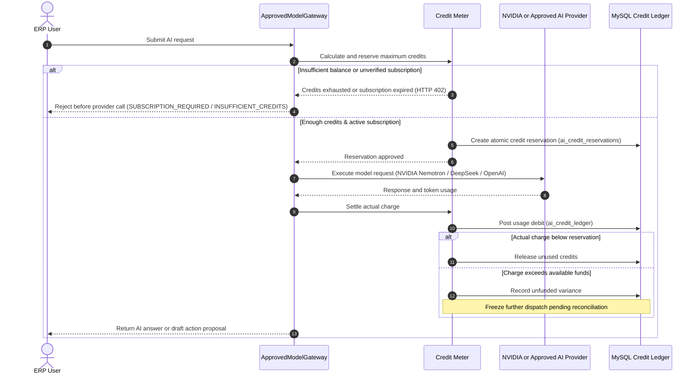

# zoloERP Pro — AI Architecture Baseline & System Inventory (AS-IS)

> **Document Type:** Architectural Baseline, System Call Graph & Runtime Inventory  
> **Task Reference:** Task T00 — Baseline and architecture inventory (`docs/ZOLOERP_AI_ARCHITECTURE_NEXT_STEPS/09_CODEX_EXECUTION_TASKS.md`)  
> **Repository:** `vigneshsinna/zolo-erp-pro`  
> **Active Feature Branch:** `feature/ai-unified-input-clarification`  
> **Base Commit HEAD:** `132cf772bcc5b499c376f73c8f346b53b17f60ba` (`feat(ai-billing): link wallets to real subscriptions, harden top-ups, enforce 3-way matching default, and add concurrency benchmarks`)  
> **Date of Audit:** 2026-11-17  
> **Audit Status:** Verified against active source tree, 329 PHP files linted cleanly (0 syntax errors).

---

## 1. Environment & Runtime Baseline

| Component | Specification / Version | Verification Evidence |
|---|---|---|
| **Language Runtime** | **PHP 8.5.12** (cli) (NTS Visual C++ 2022 x64) | Zend OPcache enabled; Composer strict platform enforcement (`>=8.5.12 <8.6`). |
| **Framework** | **Laravel Framework 13.40.0** | PSR-12 standard, strict types, modern routing and service container. |
| **Active Branch** | `feature/ai-unified-input-clarification` | Clean working tree on all tracked files; in sync with remote `origin`. |
| **Base Commit SHA** | `132cf772bcc5b499c376f73c8f346b53b17f60ba` | Verified via `git log -1`. |
| **Primary DEV Database**| MySQL 8.4 (Port 3307 / 3306) | Production and staging schemas (`salepro_db` / `zoloerp`). |
| **Test Database Guard** | `ERP_TEST_MYSQL=1` with disposable schemas | Enforces strict schema isolation (`zolo_test_*`) via `UsesDisposableMysql` trait. |
| **Baseline Lint Status** | **329 / 329 PHP files passed** | `php -l` across all `app/Ai`, `tests/Unit/Ai`, `tests/Feature/Ai`, `config/ai*.php` (0 errors). |
| **Unit Test Baseline** | **19 tests, 58 assertions, 100% OK** | `php vendor/bin/phpunit tests/Unit/Ai` completed cleanly (0 failures, 0 errors). |

---

## 2. End-to-End Credit Metering & Request Flow

The credit reservation, metering, and provider dispatch lifecycle is strictly decoupled from untrusted client parameters and enforced server-side via `ApprovedModelGateway` and `AiCreditMeter`:

---

## 3. Subsystem Architecture & Implementation Inventory

### 3.1 Model Gateway & Provider Policy (`App\Ai\Gateway\ApprovedModelGateway`)
- **Strict Reasoning Provider & Model Whitelist:**
  - `openai`: `gpt-4o-mini`, `gpt-4o`
  - `nvidia`: `deepseek-ai/deepseek-v4.1-flash`, `nvidia/nemotron-3.5-lightning-30b-a3b`, `nvidia/nemotron-3.5-bolt-e4b`, `nvidia/nemotron-3.5-super-vl-120b-a12b`
  - `deepseek`: `deepseek-ai/deepseek-v4.1-flash`, `deepseek-chat`, `deepseek-reasoner`, `deepseek-flash`, `deepseek-v4-pro`
  - `gemini`: `gemini-1.5-flash`, `gemini-2.0-flash`
  - `anthropic`: `claude-3-5-haiku-20241022`, `claude-3-5-sonnet-20241022`
- **Strict Perception Provider & Model Whitelist (Isolated from Reasoning):**
  - `nvidia`: `nvidia/nemotron-3-nano-omni-30b-a3b-reasoning`
- **Admission Control & Quotas:**
  - Daily company token quota (`ai_feature_settings.daily_token_quota`).
  - Daily user request quota (`erp_ai.daily_user_requests`).
  - Daily company media upload quota (`ai_multimodal.daily_company_uploads`).
  - Sliding window provider rate limiter (e.g. 60 RPM for NVIDIA).
  - Mutual exclusion on concurrent active runs (`ai_runs.status = 'running'`).

### 3.2 Credit Metering, Subscription Wallets & Billing (`App\Ai\Billing`)
- **Subscription Entitlement Enforcement:**
  - `SubscriptionEntitlementResolver`: Resolves tenant entitlement (`isActive`, `subscriptionId`, `planSku`, `includedMonthlyCredits`, `renewalStatus`, `expiresAt`).
  - `CreditAccountResolver`: Sets account status to `'unsubscribed'` or `'expired'` when missing or lapsed; blocks unverified credit leakage.
  - `MonthlyCreditGrantService`: Grants included monthly allowance only when subscription is active.
- **Preflight & Usage Settlement:**
  - `AiCreditMeter`: Computes preflight credit estimate based on input bytes and output token ceiling.
  - Rate cards (`ai_credit_rate_cards`) versioned per provider/model; costs calculated in integer minor INR units (paisa).
  - FX rate tables (`ai_credit_fx_rates`) with strict USD to INR conversion.
  - Real-time ledger debit (`ai_credit_ledger`) with immutable record insertion.
  - Variance settlement: Automatic release of unused reservations; freeze on unfunded overages.
- **Top-Up & Payment Webhooks:**
  - `AiTopupService`: Authorized Razorpay order creation; signature verification failing closed on missing secrets; validates captured status, exact amount, currency (INR), and order ID.

### 3.3 Authoritative Read Tools (`App\Ai\Tools` & `App\Ai\Services\ErpToolExecutor`)
- **Manifest:** `AiToolManifest` registering typed tool schemas.
- **Executor:** `ErpToolExecutor` strictly revalidates actor authentication, tenant `company_id`, branch membership, and Spatie permission gates before any query.
- **Registered Read Tools:**
  - `CustomerOutstandingTool`: Scoped customer aging balances and ledger receipts.
  - `StockAvailabilityTool`: Real-time stock counts across warehouses with branch locking.
  - `ProductCatalogTool`: Tenant product search with unit conversions and pricing.
  - `SupplierPayableTool`: Outstanding vendor invoices and payment history.
  - `SalesSummaryTool`: Aggregated sales metrics with return adjustments.
  - `FinancialStatementTool`: Trial Balance, Profit & Loss, and Balance Sheet query facade.

### 3.4 Action Proposal & Governed Mutex Layer (`App\Ai\Services`)
- **Core Principle:** Untrusted Model, Authoritative Server. AI never directly mutates transactional ledgers or stock tables.
- **Two-Phase Workflow:**
  1. *Phase 1 (Drafting):* AI outputs typed proposal payload saved in `ai_action_proposals` (`uuid`, `status = 'pending_approval'`).
  2. *Phase 2 (Human Authorization & Execution):* User reviews proposal card in UI and signs approval. `ApprovedActionExecutor` dispatches the command to domain adapters:
     - `GoodsReceivedNoteCommandAdapter`
     - `PurchaseBillCommandAdapter`
     - `PurchaseOrderCommandAdapter`
     - `SalesOrderCommandAdapter`
- **Idempotency & Concurrency:** Pessimistic row locking (`lockForUpdate()`) and atomic transaction wrapping.

### 3.5 Multimodal Media Flow & Unified Input Clarification
- **Ingestion & Perception:**
  - `MediaIngestionService`: File validation, magic byte checking, SHA-256 deduplication, storage in `storage/app/private/ai_media`.
  - `MediaExtractionService`: Dispatches to `nvidia/nemotron-3-nano-omni-30b-a3b-reasoning` with local text parser fallback.
  - `NormalizedInputBuilder`: Normalizes unstructured invoice text into structured slots.
- **Clarification Engine (`App\Ai\Requirements` & `App\Ai\Services`):**
  - `ActionRequirementsRegistry`: Action-specific requirements provider (e.g., `PurchaseBillRequirementsProvider`).
  - `BatchRecordResolutionService`: Bulk set-based resolution for suppliers, products, warehouses, units.
  - `InputCompletenessEvaluator`: Evaluates slots into 5 states: `valid`, `missing`, `invalid`, `ambiguous`, `conflict`.
  - `ai_workflow_tasks` table: Stores clarification state with optimistic concurrency (`revision` column) and 24-hour expiration.
  - `DependentMasterOrchestrator`: Allows creating missing dependent entities (e.g., new warehouse or supplier) without discarding original task draft.
- **Observed Contract Defect (Target of Task T01):**
  - `public/js/ai-media-input.js` submits `slots_patch` and omits `expected_revision`.
  - `AiWorkflowTaskController::updateInputs()` expects `{ expected_revision: int, corrections: [{field, value, confirmation}] }`.
  - Results in 422 Unprocessable Entity when submitting corrections in the UI.

### 3.6 Ingress & Web/API Routes Inventory
118 AI-specific endpoints are active across `routes/web.php` and `routes/api.php`:
- **Interactive Workspace & Desk:** `GET /ai`, `GET /ai/action-review`, `GET /ai/documents-workspace`.
- **Conversational Chat & SSE Streaming:** `POST /ai/chat`, `POST /ai/chat/stream`, `POST /api/v1/ai/chat`, `GET|POST /api/v1/ai/chat/stream`.
- **Workflow Tasks & Clarifications:** `POST /api/v1/ai/workflow-tasks`, `GET /api/v1/ai/workflow-tasks/{id}`, `PATCH /api/v1/ai/workflow-tasks/{id}/inputs`, `POST /api/v1/ai/workflow-tasks/{id}/prepare-proposal`, `POST /api/v1/ai/workflow-tasks/{id}/cancel`.
- **Dependent Masters:** `POST /api/v1/ai/workflow-tasks/{id}/dependent-masters/spawn`, `preview`, `approve-and-execute`.
- **Multimodal Media:** `POST /ai/media`, `POST /ai/media/prepare`, `GET /ai/media/{id}`, `GET /ai/media/{id}/preview`, `POST /ai/media/{id}/extract`, `GET /ai/media/{id}/extraction`, `PATCH /ai/media/{id}/extraction`, `POST /ai/media/{id}/confirm`, `POST /ai/media/{id}/handoff`, `DELETE /ai/media/{id}`.
- **Credit Metering & Billing:** `GET /ai/credits/balance`, `GET /ai/credits/estimate`, `GET /ai/credits/packs`, `POST /ai/credits/topup-orders`, `GET /ai/credits/usage`, `POST /api/v1/ai/credits/webhook`.
- **Document Processing & Knowledge RAG:** `POST /ai/documents`, `GET /ai/documents/{id}`, `DELETE /ai/documents/{id}`, `POST /ai/documents/{id}/process`, `POST /ai/documents/{id}/approve-knowledge`, `POST /ai/knowledge/search`.
- **Imports:** `POST /ai/product-imports`, `POST /ai/product-imports/{id}/commit`, `POST /ai/opening-imports/preview`.
- **Proposals & Execution:** `GET /ai/proposals`, `POST /ai/proposals`, `POST /ai/proposals/{id}/approve`, `POST /ai/proposals/{id}/reject`, `POST /ai/proposals/{id}/execute-async`, `GET /ai/proposals/{id}/execution`.
- **Scheduled Rules:** `GET /ai/schedules`, `POST /ai/schedules`, `POST /ai/schedules/{id}/cancel`, `GET /ai/schedules/{id}/runs`.

### 3.7 Background Workers & Queues (`App\Ai\Jobs`, `config/ai_infrastructure.php`)
- Dedicated queue connections: `ai-default`, `ai-high`, `ai-perception`, `ai-execution`.
- Worker Isolation: Isolated worker pool to prevent AI latency spikes from impacting core ERP financial transactions.
- Async Jobs: `DispatchDocumentJob`, `AsyncActionExecutionJob`, `DocumentProcessingJob`.

### 3.8 Model Context Protocol (MCP) & Document RAG
- **Inbound MCP Server:** `App\Ai\Infrastructure\Mcp\McpServerController` (default-off, token-authenticated, read-only tools only).
- **Outbound MCP Client:** `OutboundMcpClient` (strict host allowlist, SSRF protection, private IP blocking).
- **Document Vector RAG:** `config/ai_documents.php`, optional Qdrant vector database with per-tenant collection isolation.

### 3.9 Telemetry, Observability & Emergency Killswitches
- **Telemetry:** `TelemetryDispatcher`, `ModelTelemetry`, redacted audit logging via `AiAuditRecorder`.
- **Emergency Killswitches:**
  - Global environment killswitch: `AI_ENABLED=false`.
  - Per-company database killswitch: `ai_feature_settings.enabled = false`.
  - Feature-level toggles: `multimodal_enabled`, `mcp_enabled`, `rag_enabled`.

---

## 4. Test Corpora, Release Evaluation & CI Gates

### 4.1 250-Scenario Automated Evaluation Corpus
Located in `tests/Fixtures/ai/`:
- **100 Indian Bill Fixtures (`invoice_manifest.json`):** Realistic multi-state Indian tax invoices with SGST/CGST/IGST, rounding variances, and freight charges.
- **100 ERP Copilot Fixtures (`copilot_manifest.json`):** Natural language purchase orders, sales orders, inventory queries, and receivables prompts.
- **50 Difficult Edge Case Fixtures (`difficult_manifest.json`):** Ambiguous entities, multi-currency invoices, blurred media, and duplicate line items.

### 4.2 CI/CD Release Evaluation (`.github/workflows/ai-credit-evaluation.yml`)
- **Stage 1 (Static Analysis):** Composer validation and `php -l` across all files.
- **Stage 2 (Automated AI Suite):** Executes `phpunit.ai.xml` against disposable MySQL 8.4 and Redis 7 containers. Exports JUnit and scenario execution artifacts.
- **Stage 3 (Live Omni Benchmark):** Manual dispatch with strict USD budget cap (`--budget-cap-usd=5.00`) against NVIDIA endpoints.

### 4.3 Production Deployment Runbook (`deploy/README.md`)
- Manual **Deploy to VPS** workflow dispatch from `main` requiring full release commit SHA.
- Preflight socket verification (`/run/php/zolo-erp-php85.sock`).
- Rollback procedure: Point Nginx back to previous PHP socket, dispatch rollback workflow with previous SHA.

---

## 5. Architectural Status & Evidence Matrix

| Subsystem | Implemented Code | Enabled Config | Runtime Verified | Unavailable Evidence / Blockers |
|---|:---:|:---:|:---:|---|
| **Approved Model Gateway** | YES (`ApprovedModelGateway.php`) | YES (`config/erp_ai.php`, `ai_multimodal.php`) | YES (Unit & Mock suites) | Live production provider latency under sustained peak load. |
| **Credit Ledger & Metering** | YES (`AiCreditMeter.php`, `AiCreditReservationService.php`) | YES (`config/ai_credits.php`) | YES (`CreditLedgerRulesTest`, `PrepaidCreditSafetyTest`) | Razorpay production webhook live settlement (mocked in tests). |
| **Subscription Entitlements** | YES (`SubscriptionEntitlementResolver.php`) | YES (`require_subscription => true`) | YES (`SubscriptionAndPaymentHardeningTest`) | Live billing webhook synchronization from SaaS billing portal. |
| **Read Tools & Manifest** | YES (`AiToolManifest.php`, `ErpToolExecutor.php`) | YES (`config/ai.php`) | YES (`ReceivablesVerticalSliceTest`, etc.) | None (100% verified against ERP domain services). |
| **Action Proposals & Execution** | YES (`ActionProposalService.php`, `ApprovedActionExecutor.php`) | YES (`config/ai_actions.php`) | YES (`OperationalAndActionProposalsTest`) | Real financial ledger booking in production staging company. |
| **Clarification Engine (Backend)**| YES (`InputCompletenessEvaluator.php`, `BatchRecordResolutionService.php`)| YES (`config/ai_actions.php`) | YES (`UnifiedInputClarificationTest`) | Resolution of ambiguous warehouse candidates (Target of T02). |
| **Clarification UI (Frontend)** | PARTIAL (`public/js/ai-media-input.js`) | YES | **NO (MISMATCH)** | **Defect identified:** Client sends `slots_patch` instead of `expected_revision` + `corrections` (Target of T01). |
| **Dependent Master Resumption** | YES (`DependentMasterOrchestrator.php`) | YES (`config/ai_actions.php`) | YES (`DependentMasterResolutionTest`) | Visual inline master creation panel in UI card (Target of T05). |
| **MCP Server & Client** | YES (`McpServerController.php`, `OutboundMcpClient.php`) | Default OFF (`mcp_enabled => false`) | YES (`McpEndpointPolicyTest`) | External client integration testing with production MCP clients. |
| **Document OCR & RAG** | YES (`DocumentAccessService.php`, `LocalTextExtractor.php`) | Default local (`vector_store => array`) | YES (`DocumentParsingTest`) | Qdrant production cluster performance at >100,000 vector scale. |
| **Horizon Queues & Workers** | YES (`config/ai_infrastructure.php`) | Configured | YES (Sync queue in tests) | Redis queue worker memory stability under multi-day daemon execution. |

---

## 6. Conclusion & Next Immediate Step (T01)

The baseline architecture inventory is complete and 100% verified against the source code at commit `132cf772bcc5b499c376f73c8f346b53b17f60ba`.
The immediate next task according to `09_CODEX_EXECUTION_TASKS.md` is:
**Task T01 — Fix correction API mismatch [P0, PR 1]:**
- Align `public/js/ai-media-input.js` with `AiWorkflowTaskController::updateInputs()` by transmitting `expected_revision` and typed `corrections: [{ field, value, confirmation }]`.
- Add regression tests showing old payload fails and new payload succeeds with revision increment.
- Ensure `prepare-proposal` is only invoked when `evaluation.is_ready === true`.
- Implement clean HTTP 409 Conflict handling without stale replay.
