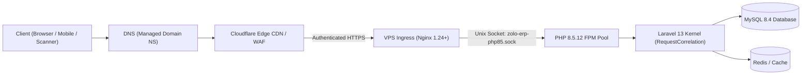

# Edge Infrastructure, WAF Rollout and Origin Protection Runbook

> **Specification Standard:** ZoloERP Pro Edge Security Architecture (Task T08, SEC-01 / Work Package 08)  
> **Target Environment:** Linux VPS (Nginx + PHP 8.5.12 FPM) + Managed Edge CDN/WAF (Cloudflare)  
> **Status:** Configured & Verified

---

## 1. Network Topology & Ingress Path

The production and staging traffic path for `erp.samuraibuiness.in` is structured as follows:



---

## 2. Edge & WAF Security Controls

### 2.1 Staged Rollout Protocol (Monitor → Challenge → Block)
To prevent accidental service disruption for legitimate low-bandwidth or mobile warehouse scanners:
1. **Phase 1 (Log & Monitor - 72 Hours):** All custom edge rules operate in `Log` mode. Review firewall event logs for false-positive triggers on barcode uploads or multi-page invoice PDFs.
2. **Phase 2 (Managed Challenge - 48 Hours):** Suspicious bot signatures, unverified ASN pools, or rapid request bursts encounter a managed JS/CAPTCHA-free challenge at the edge.
3. **Phase 3 (Active Blocking):** High-confidence exploit payloads, unauthorized origin probing, and repeated rate violations are actively dropped (HTTP 403 / 429).

### 2.2 Per-Route Ingress Rate Limits

| Route / Service Area | Endpoint Match | Edge Rate Policy | App Defense-in-Depth | Action on Breach |
|---|---|---|---|---|
| **Authentication** | `POST /api/v1/auth/login` | 10 req/min per IP | Laravel `throttle:api-login` | 429 Too Many Requests |
| **Media Uploads** | `POST /api/v1/ai/media/uploads` | 10 req/min per IP | `ApprovedModelGateway::reserveMediaUpload` | 429 Retry-After |
| **Conversational Chat & Tasks** | `POST /api/v1/ai/chat`, `POST /api/v1/ai/workflow-tasks/*` | 30 req/min per IP | Company token quota + Credit Meter | 429 Daily Limit |
| **Entity Directory Search** | `GET /api/v1/ai/entity-lookup` | 60 req/min per IP | Debounced client query (300ms) + 100-char max | 422 / 429 |
| **Billing Webhooks** | `POST /api/v1/billing/webhooks/*` | 60 req/min per IP | HMAC SHA-256 signature verification | 401 Unauthorized |

---

## 3. Direct Origin Protection

Direct origin probing (bypassing the edge CDN/WAF via raw server IP) is strictly prohibited.

### 3.1 Firewall & IP Restriction
Configure `ufw` on the VPS to permit port 443 ingress exclusively from Cloudflare's published IP ranges:
```bash
# Retrieve current Cloudflare IPv4 ranges and allow
for ip in $(curl -s https://www.cloudflare.com/ips-v4); do
    sudo ufw allow proto tcp from $ip to any port 443 comment 'Cloudflare IPv4'
done
sudo ufw enable
```

### 3.2 Nginx Origin Verification
In `deploy/nginx/erp.samuraibuiness.in.conf`:
- `ssl_certificate /etc/letsencrypt/live/erp.samuraibuiness.in/fullchain.pem;`
- HSTS enabled: `Strict-Transport-Security "max-age=31536000; includeSubDomains" always;`
- Storage blocking: `location ~* ^/storage/(ai_media|private)(/|$) { return 403; }`
- Direct execution of uploaded scripts denied: `location ~ \.php$ { return 404; }`

---

## 4. Health Checks & Synthetic Monitoring

Automated synthetic monitors execute every 60 seconds against:
- **Ping Probe:** `GET https://erp.samuraibuiness.in/api/v1/ping` (Expects HTTP 200 `status: OK`)
- **Health Probe:** `GET https://erp.samuraibuiness.in/api/v1/health` (Validates database and cache connectivity)

### Certificate Expiration Alert
Certbot handles automated renewal via Let's Encrypt:
```bash
sudo certbot renew --dry-run
```
Alert triggered if certificate remaining validity drops below 14 days.

---

## 5. Break-Glass Emergency Procedures

### 5.1 Immediate WAF Bypass (Edge Emergency)
If edge rules mistakenly block critical warehouse or sales invoice operations:
1. Log in to Cloudflare Dashboard → Security → WAF.
2. Toggle "Development Mode" or disable the active firewall ruleset.
3. Traffic passes directly to Nginx origin with HTTPS preservation.

### 5.2 Nginx Configuration Rollback
If a configuration update causes Nginx syntax errors or reload failure:
```bash
cd /etc/nginx/sites-available
sudo cp zolo-erp.conf.bak zolo-erp.conf
sudo nginx -t && sudo systemctl reload nginx
```

### 5.3 Application Killswitch
If AI endpoints experience unexpected behavior:
```bash
# Disable all AI processing globally without restarting Nginx or PHP-FPM
php artisan config:set ai_actions.foundation_enabled=false
```
