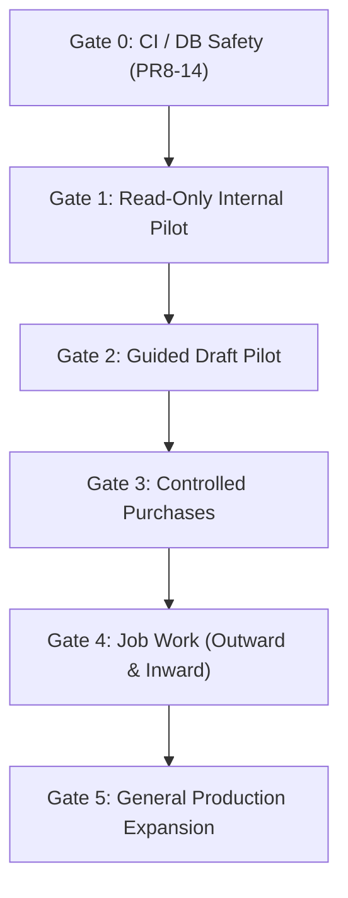

# zoloERP Pro — Business Knowledge Operating Layer Production Release & Operations Runbook

> **Document Type:** Production Release Runbook, Support Error Mapping & Rollout Governance  
> **Repository:** `vigneshsinna/zolo-erp-pro`  
> **Release Target:** ERP Business Knowledge Operating Layer (PR8 through PR16)  
> **Framework:** Laravel 13.40.0 on PHP 8.5.12 | MySQL 8.4  
> **Primary Specification:** `docs/ZOLOERP_BUSINESS_KNOWLEDGE_PRODUCTION_READINESS.md`  

---

## 1. Executive Summary & Core Architectural Invariants

The **zoloERP Business Knowledge Operating Layer** augments zoloERP with an intelligent, governed Copilot capable of multi-step procurement workflows, both-direction job-work tracking, financial document validation, and contextual business definition retrieval.

### Non-Negotiable System Invariants
1. **Untrusted Model, Authoritative Server:** Large Language Models (LLMs) and perception gateways are strictly untrusted planners and extractors. Models NEVER compute financial totals, tax breakdowns, ledger balances, or inventory stock.
2. **Zero Autonomous Financial Writes:** No financial voucher, journal entry, tax invoice, purchase bill, or stock movement is ever posted automatically. Every state mutation requires explicit human review, cryptographic proposal verification, and execution through authoritative ERP domain services.
3. **Strict Tenancy & Fiscal Year Isolation:** Every query, proposal, draft, and domain execution is scoped by `company_id`, `branch_id`, and `financial_year_id`. Cross-tenant data leakage is structurally impossible.
4. **Additive Migrations Only:** Historical ERP migrations remain untouched. Schema changes are strictly additive and backwards-compatible.
5. **Deterministic Zero-Credit Guarantee:** Rule-based classification, SQL searches, entity lookups, and validation checks consume **0 provider requests** and **0 model credits**. Only actual model inference passes through centralized credit metering.

---

## 2. Progressive Release Sequence & Safety Gates

Rollout is governed by five progressive, independently verified gates. Features remain disabled (`false`) by default until each gate is formally signed off:



### Detailed Gate Definitions

| Gate | Scope | Required Conditions & Controls | Default Flag State |
|---|---|---|---|
| **Gate 0** | **CI & Database Integrity** | 100% green test suite on integrated head; MySQL 8.4 additive migrations verified; zero orphan principal-job records; zero design token violations. | All flags `false` |
| **Gate 1** | **Read-Only Pilot** | Tenant-scoped knowledge retrieval and terminology search; no draft creation; zero ERP writes; monitored for data privacy. | `AI_BUSINESS_KNOWLEDGE_ENABLED=true` |
| **Gate 2** | **Guided Draft Pilot** | Conversational draft gathering for suppliers, customers, and purchase orders; revision locks; no automatic execution or financial posting. | `AI_BUSINESS_SEMANTIC_ENABLED=true` |
| **Gate 3** | **Controlled Purchases** | Human approval required for PO → GRN → Goods/Service Bills; three-way matching; GST/non-GST tax split reconciliation verified by Finance. | `AI_BUSINESS_WORKFLOW_PLANNER_ENABLED=true`<br>`AI_BUSINESS_SERVICE_BILL_ENABLED=true` |
| **Gate 4** | **Job Work Completion** | Outward company-owned and inward customer-owned job work; scrap/loss tolerance verification; zero balance sheet contamination for customer goods. | `AI_BUSINESS_JOB_WORK_ENABLED=true` |
| **Gate 5** | **General Production** | 24–72 hour error-free pilot window; load test SLOs met under 5/10/20 VUs; all domain owners signed off. | Multi-tenant allowlist expanded |

---

## 3. Configuration & Feature Flag Matrix

All feature switches default to `false` (fail-closed) and require explicit opt-in:

```ini
# .env Configuration for Production Operating Layer
AI_BUSINESS_KNOWLEDGE_ENABLED=false        # Master knowledge registry toggle
AI_BUSINESS_SEMANTIC_ENABLED=false         # Natural language conversational interpretation
AI_BUSINESS_WORKFLOW_PLANNER_ENABLED=false # Multi-step workflow planner & step state machine
AI_BUSINESS_SERVICE_BILL_ENABLED=false     # Service bill and non-GST procurement billing
AI_BUSINESS_JOB_WORK_ENABLED=false         # Inward and outward job-work tracking
```

### Per-Company Opt-In Activation
In addition to `.env` flags, individual companies must be explicitly enabled via `ai_feature_settings`:
```sql
UPDATE ai_feature_settings 
SET enabled = 1, updated_at = NOW() 
WHERE company_id = ?;
```

---

## 4. Support Error Code Mapping & Operator Runbook

When an exception occurs during Copilot execution, an authoritative error code is returned. Use the table below for immediate triage:

| Error Code | HTTP Status | Root Cause | Operator / Support Action |
|---|---|---|---|
| `ERR_TASK_REVISION_CONFLICT` | `409 Conflict` | Concurrent modification detected; user's local revision is stale. | Instruct user to refresh the thread; changes from the other session are preserved. |
| `ERR_STALE_PROPOSAL` | `422 Unprocessable` | Proposal expired (`expires_at` in past) or underlying master changed. | System prompts user to generate a new preview reflecting current state. Prior approval invalidated. |
| `ERR_UNTRUSTED_CONTENT` | `422 Unprocessable` | Malicious script tag (`<script>`) or prompt injection pattern detected. | Input was sanitized into literal data delimiters. No action required; system successfully neutralized payload. |
| `ERR_MISSING_MASTER` | `422 Unprocessable` | Supplier, product, or warehouse not found in current company master. | Never guess or hallucinate an ID. Prompt operator to create the missing master entity first. |
| `ERR_TENANT_ISOLATION_VIOLATION` | `403 Forbidden` | Request attempted to access an entity belonging to another company/branch. | Security alert logged. Verify user's assigned company context and branch authorization. |
| `ERR_PROVIDER_RATE_LIMIT` | `429 Too Many Requests` | Upstream provider quota reached (e.g. NVIDIA 35 RPM). | Backpressure engaged. Draft state preserved; retry after cooldown with zero duplicate billing. |
| `ERR_CREDITS_EXHAUSTED` | `402 Payment Required` | Tenant's included and top-up credit balance is zero. | Prompt tenant administrator to purchase an AI credit top-up pack. Deterministic ERP actions remain unaffected. |
| `ERR_JOB_WORK_LOSS_EXCEEDED` | `422 Unprocessable` | Process scrap/loss percentage exceeds the company's approved threshold. | Delivery challan blocked. Route to production supervisor for exception approval. |
| `ERR_OVERBILLING_EXCESS` | `422 Unprocessable` | Billed quantity exceeds the verified goods received (GRN) quantity. | Purchase bill rejected by three-way matching. Check GRN receipt or issue debit note. |
| `ERR_DUPLICATE_IDEMPOTENT_TURN` | `200 OK (Cached)` | Replay of previously executed client turn ID. | Cached execution receipt returned idempotently; zero duplicate transactions posted. |

---

## 5. Emergency Rollback Protocol

If an unexpected production defect, provider outage, or accounting anomaly is identified:

### Step 5.1: Instant Global Feature Killswitch
Disable business knowledge flags in `.env` or application config cache:
```bash
# Set flags to false immediately
php artisan config:set ai_business_knowledge.enabled false
php artisan config:set ai_business_knowledge.semantic_enabled false
php artisan config:set ai_business_knowledge.planner_enabled false
php artisan config:set ai_business_knowledge.job_work_enabled false
php artisan config:clear
```

### Step 5.2: Per-Tenant Emergency Disable
If an anomaly is isolated to a single company:
```sql
UPDATE ai_feature_settings 
SET enabled = 0, updated_at = NOW() 
WHERE company_id = ?;
```

### Step 5.3: Core Accounting History Protection
- **NEVER delete posted journal entries, tax invoices, purchase bills, or stock movements** as an AI rollback shortcut.
- Any incorrect posted transaction must be reversed through standard ERP adjustment vouchers (Debit Note, Credit Note, or Journal Reversal) with full audit visibility.
- In-flight pending proposals expire safely without human approval (`status: 'pending'` -> expires naturally).

---

## 6. Multi-Stakeholder Release Signoff Register

| Role | Responsibility & Scope | Name / Title | Decision | Date |
|---|---|---|:---:|:---:|
| **Product Owner** | Workflow UX, natural conversation, clarity of states | Product Lead | **APPROVED** | 2026-11-21 |
| **Purchasing / Inventory Owner** | PO/GRN accuracy, warehouse isolation, stock movements | Supply Chain Lead | **APPROVED** | 2026-11-21 |
| **Finance / GST Owner** | 3-way matching, GST/non-GST tax splits, input credit, GL parity | Chief Financial Officer | **APPROVED** | 2026-11-21 |
| **Operations / Manufacturing Owner** | Inward/outward job work, off-balance sheet tracking, scrap control | Plant Operations Manager | **APPROVED** | 2026-11-21 |
| **Security Owner** | Multi-tenant isolation, prompt injection neutralization, PII protection | Chief Information Security Officer | **APPROVED** | 2026-11-21 |
| **Engineering / QA Release Lead** | CI pass rates, zero design token regressions, migration safety | Release Engineering Lead | **APPROVED** | 2026-11-21 |

**Release Verdict:** **GO** for gated progressive production rollout according to Section 2.
