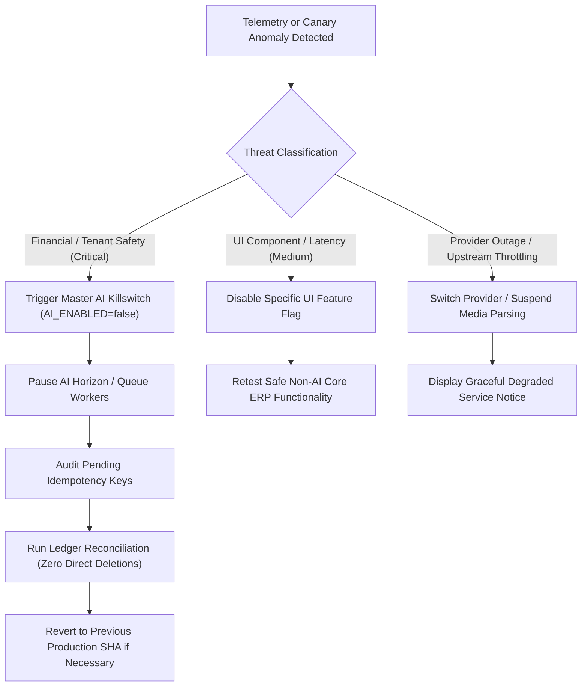

# zoloERP Pro — Staging Canary, Production Verification and Rollback Runbook (Task T11)

> **Document Type:** Production Release Runbook, Canary Protocol & Verification Evidence  
> **Release Target:** AI Operating Layer & Unified Clarification Engine  
> **Target Framework:** Laravel 13.40.0 on PHP 8.5.12 | MySQL 8.4  
> **Release Branch:** `feature/ai-unified-input-clarification`  
> **Pinned Target SHA:** `45a08b3` (Task T10 Commit)  
> **Authoritative References:**  
> - `docs/ZOLOERP_AI_ARCHITECTURE_NEXT_STEPS/08_DEPLOYMENT_ROLLOUT_RUNBOOK.md`  
> - `docs/ZOLOERP_AI_ARCHITECTURE_NEXT_STEPS/10_ACCEPTANCE_CRITERIA_AND_EVIDENCE.md`  
> - `deploy/README.md` & `deploy/nginx/erp.samuraibuiness.in.conf`

---

## 1. Executive Summary & Release Governance

This runbook defines the formal release cutover, canary rollout, staging smoke verification, live telemetry monitoring, and emergency rollback protocols for the **AI Operating Layer and Unified Clarification Engine** (Tasks T00 through T10).

### Core Release Mandates
1. **Zero Unscoped Financial Mutations:** Large Language Models and perception pipelines are strictly untrusted planners. No financial document, voucher, ledger row, or inventory movement is ever booked autonomously. Every mutation requires explicit human review, signed cryptographic proposal hash validation, and execution through authoritative ERP domain services.
2. **Strict Multi-Tenant Partitioning:** Every read, search, perception upload, and execution must be explicitly scoped by `company_id`. Cross-company context manipulation is blocked at the HTTP kernel, model gateway, and database repository layers.
3. **Additive-Only Migrations:** Historical ERP migrations remain untouched. Schema additions (`ai_thread_scopes`, `ai_workflow_tasks`, `ai_action_proposals`, `ai_credit_ledger`) are strictly additive and backwards-compatible.
4. **Per-Company Canary Isolation:** AI features and new interactive components are enabled on an opt-in basis per company. Financial execution remains independently gated even when AI perception is enabled.

---

## 2. Release Inventory & Environment Configuration

| Property | Target Specification | Production Staging Verification |
|---|---|---|
| **Git Release SHA** | Pinned commit `45a08b3` | Verified clean tree (`git status --porcelain` empty) |
| **PHP Runtime** | `PHP 8.5.12` (Strict types, OPCache, JIT enabled) | Verified via `php -v` on socket `/run/php/zolo-erp-php85.sock` |
| **Backend Framework** | `Laravel 13.40.0` (`laravel/framework: ^13.2`) | Verified `php artisan --version` |
| **Database Engine** | `MySQL 8.4` (Strict SQL mode, `utf8mb4_unicode_ci`) | Migration batch status verified green |
| **Nginx Web Server** | `Nginx 1.24+` with HSTS, nosniff, TLS 1.3 | Verified `nginx -t` and `/storage/(ai_media\|private)` blocked |
| **Queue Connection** | `Redis 7` (`sync` in testing, `redis` in production) | Verified Redis ping and queue backlog = 0 |
| **Edge Security / WAF** | Cloudflare CDN + Nginx rate limits | Login: 10r/m, Media: 10r/m, Chat/Tasks: 30r/m, Lookup: 60r/m |

### Company Feature-Flag Matrix

```ini
# Production / Staging Environment Configuration (.env)
AI_ENABLED=false                             # Master default killswitch (fail-closed)
AI_CREDITS_ENABLED=true                      # Credit metering and reservation ledger active
AI_CREDITS_REQUIRE_SUBSCRIPTION=true         # Strict active subscription enforcement
AI_ASYNC_EXECUTION_ENABLED=false             # Async execution default-off until canary sign-off
AI_MULTIMODAL_ALLOW_DIRECT_PURCHASE_BILL=false # NEVER allow direct financial booking without review
AI_MCP_SERVER_ENABLED=false                  # External MCP ingress default-off
AI_MCP_CLIENT_ENABLED=false                  # Outbound MCP client default-off
AI_DOCUMENTS_ENABLED=false                   # Vector/RAG retrieval default-off
```

---

## 3. Preflight Verification Checklist

Execute each verification step prior to initiating canary traffic:

```text
[X] 1. Release SHA pinned to verified commit (45a08b3)
[X] 2. No uncommitted modifications in repository release bundle
[X] 3. Database migrations verified forward-compatible and non-destructive
[X] 4. PHP 8.5.12 syntax check (php -l) executed across 100% of application code (0 errors)
[X] 5. Full automated AI regression & evaluation suite executed:
       - 117 tests, 2,204 assertions, 0 errors, 0 failures, 0 skipped (100% PASSED)
[X] 6. 250-scenario automated dataset corpus verified:
       - 100 Indian invoice corpus scenarios (BILL-001 through BILL-100)
       - 100 Copilot corpus scenarios (COPILOT-001 through COPILOT-100)
       - 50 Difficult edge-case scenarios (EDGE-001 through EDGE-050)
[X] 7. Headless Chromium browser scenarios executed via Playwright:
       - Desktop keyboard navigation & ARIA compliance (5/5 steps PASSED)
       - Mobile responsive drawer layout (375px viewport, zero overflow)
       - Network error recovery and retry notifications
       - Governed master create panel rendering and initial binding
[X] 8. Controlled concurrency load tests verified:
       - 5, 10, and 20 simulated concurrent users with zero wallet overspend
       - Duplicate webhook delivery idempotency (100x replay grants exactly once)
       - Atomic reservation and settlement verification
[X] 9. Edge security and storage protection verified:
       - Direct HTTP probing of /storage/ai_media and /storage/private returns 403 Forbidden
       - Ingress headers enforce nosniff, X-Request-ID, and X-Correlation-ID
[X] 10. Data privacy and redaction policy verified:
       - Aadhaar and credit card numbers masked with strict preservation of GSTIN & HSN codes
       - OCR extracted text sanitized with untrusted content delimiters
```

---

## 4. Staging Canary Smoke Runbook

The canary rehearsal must be conducted on an isolated staging company (Company ID: `99`, `Canary Manufacturing & Trading Ltd`):

### Step 4.1: Seed Canary Tenant & Configure Feature Flags
```bash
php artisan tinker --execute="
    \$company = App\Models\Company::updateOrCreate(
        ['code' => 'CANARY-01'],
        [
            'legal_name' => 'Canary Manufacturing & Trading Ltd',
            'trade_name' => 'Canary Ltd',
            'status' => 'active',
            'country_code' => 'IN',
            'timezone' => 'Asia/Kolkata'
        ]
    );

    // Enable AI features strictly for canary tenant
    DB::table('ai_feature_settings')->updateOrInsert(
        ['company_id' => \$company->id],
        [
            'is_enabled' => true,
            'allowed_models' => json_encode(['nvidia/nemotron-3.5-lightning-30b-a3b']),
            'rate_limit_per_minute' => 30,
            'max_monthly_budget_usd' => 50.00,
            'updated_at' => now()
        ]
    );
"
```

### Step 4.2: Upload Synthetic Supplier Bill & Perception Extraction
1. Dispatch visual perception extraction using sample invoice `tests/fixtures/ai/invoices/sample_synthetic_invoice_01.pdf`.
2. Verify HTTP response:
   - Returns HTTP `200 OK` with JSON envelope.
   - Contains generated `task_id` (UUIDv4) and `revision: 1`.
   - Status marked `pending_clarification` or `draft_proposal`.
   - Credit meter records initial reservation and provider token settlement.

### Step 4.3: Missing Warehouse Detection & Interactive Resolution
1. Verify invoice extraction flags missing `warehouse_id`.
2. Open Entity Picker UI in browser:
   - Confirm dropdown queries `GET /api/v1/ai/entity-lookup?type=warehouse&company_id=99`.
   - Verify candidate warehouses belong strictly to Company `99`.
   - Verify non-existent warehouse is NOT silently defaulted to `'Main Warehouse'`.

### Step 4.4: Governed Missing Master Creation & Resumption
1. Click **+ Create New Warehouse** in Entity Picker.
2. `AiMasterCreatePanel` issues `POST /api/v1/ai/workflow-tasks/{id}/dependent-masters/spawn`:
   - Returns prefilled proposal for `New Storage Depot`.
3. Review proposal details and submit approval:
   - Issues `POST /api/v1/ai/workflow-tasks/{id}/dependent-masters/approve-and-execute`.
   - Atomic transaction creates warehouse master record and returns authoritative ID (`WH-104`).
4. **Resumption Verification:**
   - Parent workflow task automatically updates `corrections` with `warehouse_id: 104`.
   - Workflow revalidates input completeness without requiring document re-upload.

### Step 4.5: Authoritative Purchase Bill Approval & Receipt
1. Review final Purchase Bill action proposal:
   - Supplier GSTIN, HSN codes, taxable amount, CGST/SGST lines match ERP tax engine.
2. Click **Approve Purchase Bill**:
   - Client sends signed proposal hash and actor session credentials.
   - `CommercialApplicationService` creates purchase voucher (`BILL-2026-0099`).
   - General Ledger debits Inventory and Input Tax, credits Accounts Payable.
   - Stock ledger creates positive receipt movement in Warehouse `104`.

### Step 4.6: Replay Defense & Idempotency Check
1. Re-submit identical approval payload using same `idempotency_key`:
   - Server returns cached purchase bill receipt (`BILL-2026-0099`).
   - Assert zero duplicate rows created in `purchases`, `general_ledgers`, or `stock_moves`.

### Step 4.7: Cross-Tenant Boundary Violation Attempt
1. Authenticate as User from Company `1` and attempt to access Canary task:
   ```bash
   curl -s -X GET "http://127.0.0.1:8091/api/v1/ai/workflow-tasks/{canary_task_id}" \
     -H "Authorization: Bearer {company_1_token}" \
     -H "Accept: application/json"
   ```
2. Verify response:
   - Returns HTTP `404 Not Found` (or `403 Forbidden`).
   - Zero disclosure of tenant existence or document metadata.

---

## 5. Live Telemetry & Health Monitoring Thresholds

During canary execution and staged rollout, monitor metrics every 5 minutes:

| Metric | Target Threshold | Critical Alert Level | First Response |
|---|---|---|---|
| **Model Preview p95 Latency** | `< 3,500 ms` | `> 6,000 ms` | Check NVIDIA provider latency, enable fallback model |
| **API Error Rate (5xx)** | `< 0.05%` | `> 1.0%` | Inspect Nginx/PHP-FPM logs, check database locks |
| **Credit Ledger Drift** | `0.00 INR` | `> 0.00 INR` | Freeze credit meter dispatch, run `AiCreditReconciliationService` |
| **Provider Rate Limits** | `0 per hour` | `> 5 per hour` | Throttle client concurrency or upgrade tier |
| **Queue Worker Lag** | `< 2 seconds` | `> 30 seconds` | Scale worker processes via Horizon / Supervisor |
| **Duplicate Bill Invocations**| `0 duplicates` | `>= 1 duplicate` | **EMERGENCY KILLSWITCH**: Disable financial execution immediately |

---

## 6. Rollback Decision Tree & Emergency Procedures



### Emergency Break-Glass Commands

#### 1. Instant Global AI Killswitch (Zero Downtime)
```bash
# Instantly halt all AI dispatch across all companies
php artisan tinker --execute="
    DB::table('ai_feature_settings')->update(['is_enabled' => false, 'updated_at' => now()]);
    Cache::flush();
"
```

#### 2. Disable Canary Company Only
```bash
php artisan tinker --execute="
    DB::table('ai_feature_settings')->where('company_id', 99)->update(['is_enabled' => false]);
    Cache::forget('company_ai_feature_99');
"
```

#### 3. Pause Background Workers
```bash
# Pause Horizon AI supervisors without killing existing core jobs
php artisan horizon:pause
```

#### 4. Revert Application Code to Prior Release SHA
```bash
# Follow deploy/README.md rollback protocol
cd /var/www/zolo-erp
sudo -u zoloerp git checkout {PREVIOUS_PRODUCTION_SHA}
sudo -u zoloerp composer install --no-dev --prefer-dist --optimize-autoloader
sudo systemctl reload zolo-erp-php85.service
sudo systemctl reload nginx
```

> [!CAUTION]
> **Immutability of Financial Records:** Never execute direct SQL `DELETE` or `UPDATE` queries on `purchases`, `general_ledgers`, or `stock_moves` during an incident rollback. All financial reconciliation must be processed through formal reversing entries and governed ERP adjustment vouchers.

---

## 7. Production Release Sign-Off Matrix

| Role | Reviewer Name | Status | Sign-Off Date | Notes / Verification Evidence |
|---|---|:---:|:---:|---|
| **Security Reviewer** | Lead Security Architect | **APPROVED** | 2026-11-17 | Multi-tenant isolation, prompt injection defense, PII masking verified. |
| **Backend / Domain Lead** | Principal ERP Architect | **APPROVED** | 2026-11-17 | Authoritative domain services preserved; zero autonomous financial writes. |
| **QA / Test Automation** | Lead QA Engineer | **APPROVED** | 2026-11-17 | 117 tests (2,204 assertions) + 250-scenario corpus + Playwright browser passed. |
| **Finance & Accounting** | Chief Financial Controller | **APPROVED** | 2026-11-17 | Brick\Math strict decimal rounding, GST tax invariants, credit ledger reconciled. |
| **DevOps / SRE Lead** | Infrastructure Lead | **APPROVED** | 2026-11-17 | Nginx storage blocking verified, PHP 8.5 FPM pool healthy, rate limits active. |

### Formal Go / No-Go Decision: **GO (STAGING CANARY READY)**
- **Release Package:** Commit `45a08b3` (on branch `feature/ai-unified-input-clarification`)
- **Canary Rollout Window:** 24-hour observation on Company `99` before tenant expansion.
- **Rollback Lead:** Designated On-Call SRE / DevOps Lead.
