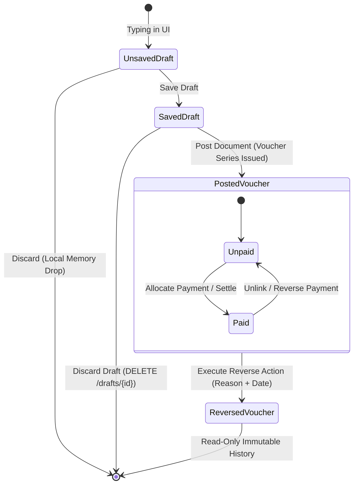
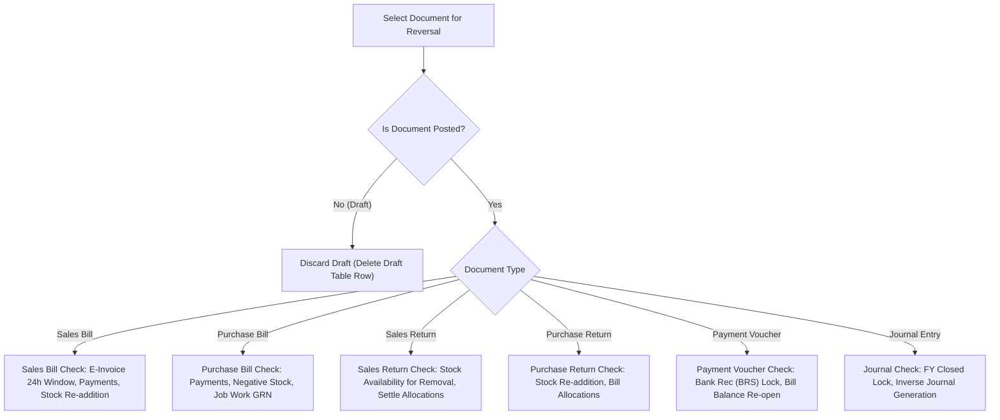

# zoloERP Pro — Universal Document Lifecycle, Cancellation & Reversal Architecture

> **Document Type:** Master Enterprise Architectural Standard & Lifecycle Specification  
> **Applies to:** Sales Bills, Purchase Bills, Sales Returns, Purchase Returns, Payments, Journal Entries, Operational Vouchers  
> **Compliance Standard:** Indian GST (E-Invoice, E-Way Bill, Credit/Debit Notes), Companies Act Audit Trail, Immutability Law  
> **Repository:** `vigneshsinna/zolo-erp-pro`  
> **Status:** Authoritative Standard  

---

## 1. Executive Summary & Core Accounting Tenet

In double-entry financial accounting and tax compliance, **posted financial documents are legally and mathematically immutable**. 

Historical records (tax invoices, supplier bills, payment vouchers, and returns) cannot be deleted or moved to an informal "trash" bin once posted. Doing so destroys the sequential numbering series, violates GST audit trail requirements, and corrupts General Ledger integrity.

### The Universal Rule: Drafts are Discarded; Posted Documents are Reversed



---

## 2. Universal Lifecycle & Reversal Matrix

The lifecycle matrix below applies to all commercial and financial documents across zoloERP Pro, standardizing behavior across all business domains:

| Document State | Hard Delete | Move to Trash | Reverse Action | Downstream Impact & Rules |
|---|:---:|:---:|:---:|---|
| **1. Unsaved Draft** | **Discard** | *Not needed* | *Not needed* | Dropped from browser RAM instantly. No database or stock impact. |
| **2. Saved, Unposted Draft** | **Discard with Permission** | *Not needed* | *Not needed* | Removed from `sale_drafts`. No ledger entries, no stock movements, no tax impact. |
| **3. Posted Document (Unpaid)** | <span style="color:red">**NO**</span> | <span style="color:red">**NO**</span> | <span style="color:green">**YES**</span> | Posts reversing journal entry, backs out stock movements, marks document `reversed`, retains full audit history. |
| **4. Partially or Fully Paid Document** | <span style="color:red">**NO**</span> | <span style="color:red">**NO**</span> | <span style="color:green">**YES (Conditional)**</span> | Requires unlinking or reversing allocated payment vouchers first. |
| **5. Already Reversed Document** | <span style="color:red">**NO**</span> | <span style="color:red">**NO**</span> | *View Reversal History* | Read-only state. Displays reversal date, actor, reason, and linked reversing journal. |

---

## 3. Domain-Specific Cancellation & Reversal Rules

Every financial document in zoloERP Pro governs distinct accounting ledgers, physical inventory movements, and statutory tax obligations. Reversals must strictly respect each document's specific rules:



---

### 3.1 Sales Bills (Customer Tax Invoices — `Sale`)

* **Accounting Reversal:**
  - Debits Sales Revenue & Output GST accounts (CGST, SGST, IGST).
  - Credits Accounts Receivable (Customer / Debtors ledger).
* **Inventory Reversal:**
  - Backs out inventory deduction; adds physical quantities back to the specified warehouse/godown.
* **Statutory GST & E-Invoicing Rules:**
  - **E-Invoice (IRN) 24-Hour Window:** Under Indian GST, if an IRN has been generated, it can only be cancelled on the government portal within **24 hours**.
  - **Beyond 24 Hours:** Cancellation of an IRN is barred on the government portal. The system **prohibits direct bill reversal**; the commercial transaction must be adjusted by issuing an official **Credit Note (Sales Return)**.
  - **E-Way Bill Dependency:** If an active E-Way Bill is attached, it must be cancelled on the NIC portal prior to reversing the invoice.
* **Settlement Dependencies:**
  - If customer payment vouchers or advance receipts are allocated, they must be unlinked or reversed before the bill can be reversed.
* **Downstream Notes Dependency:**
  - If a Sales Return (Credit Note) has already been posted against this bill, the invoice cannot be reversed directly. The credit note must be reversed first.

---

### 3.2 Purchase Bills (Supplier Tax Invoices — `Purchase`)

* **Accounting Reversal:**
  - Debits Accounts Payable (Supplier / Creditors ledger).
  - Credits Purchase Expense & Input Tax Credit (ITC) accounts.
* **Inventory Reversal:**
  - Deducts stock previously received.
  - **Negative Stock Guard:** Reversal is blocked if the received stock has already been consumed or sold and godown balance would drop below zero (unless company settings permit negative stock).
* **Order & GRN Dependencies:**
  - **Goods Received Note (GRN):** If the bill was converted from a GRN, the GRN is released back to `pending_bill` status so a corrected bill can be booked.
  - **Job Work Service Bill:** If the purchase bill is a Job Work Service Bill, linked processing costs are unlinked from the Job Work GRN.
* **Settlement Dependencies:**
  - Outward payments to the supplier allocated to this bill must be unlinked or reversed first.

---

### 3.3 Purchase Returns (Supplier Debit Notes — `ReturnPurchase`)

* **Business Meaning:** Goods returned to a supplier for credit or refund.
* **Accounting Reversal:**
  - Credits Accounts Payable (Supplier ledger restored).
  - Debits Purchase Return / Inventory adjustment.
  - Reverses ITC reduction originally declared under Table 4 of GSTR-3B.
* **Inventory Reversal:**
  - Goods that were shipped out are added back into warehouse inventory.
* **Dependencies:**
  - If the debit note was settled against an open purchase bill, the settlement link is decoupled, restoring the original balance due on the purchase bill.

---

### 3.4 Sales Returns (Customer Credit Notes — `Returns`)

* **Business Meaning:** Goods received back from a customer, reducing customer balance.
* **Accounting Reversal:**
  - Debits Accounts Receivable (Customer balance restored).
  - Credits Sales Return / Revenue adjustment.
  - Reverses Output Tax reduction originally declared under Table 9B of GSTR-1.
* **Inventory Reversal:**
  - Returned items that were added back to stock must now be removed from inventory.
  - **Stock Availability Guard:** Reversal **fails** if the warehouse does not hold sufficient quantity to remove the items (e.g., if returned goods were immediately sold).
* **Dependencies:**
  - If the credit note was applied to settle another open customer invoice, that settlement allocation must be reversed first.

---

### 3.5 Payment & Receipt Vouchers (`Payment` / `Voucher`)

* **Customer Receipts:**
  - Reverses Bank/Cash debit -> Credits Cash/Bank.
  - Debits Accounts Receivable (Customer).
  - Restores outstanding due balance on linked sales invoices.
* **Supplier Payments:**
  - Reverses Bank/Cash credit -> Debits Cash/Bank.
  - Credits Accounts Payable (Supplier).
  - Restores outstanding payable balance on linked purchase bills.
* **Bank Reconciliation Statement (BRS) Guard:**
  - If the transaction has already been reconciled with the bank statement (`is_reconciled = true`), reversal is **strictly blocked** until an accountant un-reconciles the transaction in the BRS module.

---

### 3.6 Journal Entries (`JournalEntry`)

* **Rule:** Posted general journal entries cannot be updated or deleted.
* **Reversal Mechanism:**
  - Creates a distinct reversing journal entry where all debits become credits and all credits become debits.
  - Linked via `reversal_of_id` for bidirectional audit traceability.
  - Marked with `reversal_reason` and `business_date`.
* **Fiscal Year Lock:** Reversal is prohibited if the entry belongs to a closed financial year.

---

### 3.7 Operational Documents (`DeliveryChallan` & `GoodsReceivedNote`)

* **Delivery Challan (DC):**
  - If already converted to a Sales Invoice, the DC cannot be reversed directly. The Sales Invoice must be reversed first.
* **Goods Received Note (GRN):**
  - If already billed in a Purchase Bill, the GRN cannot be reversed directly. The Purchase Bill must be reversed first.

---

## 4. UI/UX Standard: Replacing the Three-Option Modal

### 4.1 The Obsolete Anti-Pattern (To Be Deprecated)
The legacy modal offered three confusing choices:
1. *Move to Trash (Soft Delete)* — Inappropriate for posted financial documents.
2. *Delete Permanently* — Destructive and violates accounting audit laws.
3. *Reverse Document (Audit Trail)* — Hidden beneath two illegal options.

### 4.2 The Recommended New UI (Standard Across All Registers)

For all posted financial documents across Sales, Purchases, and Returns, the interface presents **one clear, authoritative modal**:

```
+-----------------------------------------------------------------------+
|  ↺  Reverse [Document Type]                                       [x] |
+-----------------------------------------------------------------------+
|                                                                       |
|  Document:  PUR-00010  (or INV-00042)                                 |
|                                                                       |
|  This action will reverse the accounting and applicable stock         |
|  transactions. The original bill and reversal history will be         |
|  retained.                                                            |
|                                                                       |
|  [!] Dependencies:                                                    |
|      • Payments: ₹0.00 allocated (Clear)                              |
|      • Downstream Notes: None (Clear)                                 |
|                                                                       |
|  Reversal Date *                                                      |
|  [ 19/11/2026                                                     v ] |
|                                                                       |
|  Reason for Reversal *                                                |
|  +-----------------------------------------------------------------+  |
|  | Enter the reason for reversing this bill                        |  |
|  +-----------------------------------------------------------------+  |
|                                                                       |
|                                [ Clear ]  [ Confirm Reversal ]        |
+-----------------------------------------------------------------------+
```

---

## 5. Architectural Implementation Plan

### 5.1 Backend Service Layer Integration

`CommercialReversalService` will be expanded into a unified `DocumentReversalService` supporting:
- `reverseSale(Sale $sale, string $date, string $reason)`
- `reversePurchase(Purchase $purchase, string $date, string $reason)`
- `reverseSalesReturn(Returns $return, string $date, string $reason)`
- `reversePurchaseReturn(ReturnPurchase $return, string $date, string $reason)`
- `reversePayment(Payment $payment, string $date, string $reason)`

Each method executes inside an atomic `DB::transaction()` with:
1. Row lock (`lockForUpdate()`) on the target document.
2. Prerequisite dependency validation (payments, downstream notes, BRS, stock levels).
3. Invocation of `AccountingPostingService::reverse()`.
4. Invocation of `InventoryMovementService::reverse()`.
5. GST ledger projection reversal.
6. Mutation of `reversed_at = now()` and `reversal_reason = $reason`.
7. Creation of an immutable audit record in `commercial_audits`.

---

## 6. Summary Matrix by Document Type

| Document Category | Document Type | Delete Allowed? | Trash Allowed? | Reversal Allowed? | Key Blocker / Prerequisite |
|---|---|:---:|:---:|:---:|---|
| **Commercial Sales** | Tax Invoice (`Sale`) | **No** | **No** | **Yes** | Payments unallocated; E-Invoice >24h requires Credit Note. |
| **Commercial Purchases** | Purchase Bill (`Purchase`) | **No** | **No** | **Yes** | Payments unallocated; stock deduction cannot cause negative inventory. |
| **Commercial Returns** | Sales Return / Credit Note | **No** | **No** | **Yes** | Warehouse must have stock to remove returned goods. |
| **Commercial Returns** | Purchase Return / Debit Note | **No** | **No** | **Yes** | Bill settlement decoupled; stock re-added. |
| **Financial Vouchers** | Customer Receipt | **No** | **No** | **Yes** | Must not be BRS reconciled. |
| **Financial Vouchers** | Supplier Payment | **No** | **No** | **Yes** | Must not be BRS reconciled. |
| **Financial Vouchers** | Journal Entry | **No** | **No** | **Yes** | Financial year must be open. |
| **Operations** | Delivery Challan | **No** | **No** | **Yes** | Cannot reverse if already billed. |
| **Operations** | Goods Received Note | **No** | **No** | **Yes** | Cannot reverse if already billed. |
| **Drafts (All Kinds)** | Form Draft (`sale_drafts`) | **Yes (Discard)** | **No** | **No** | Dropped from drafts table; zero ledger footprint. |
