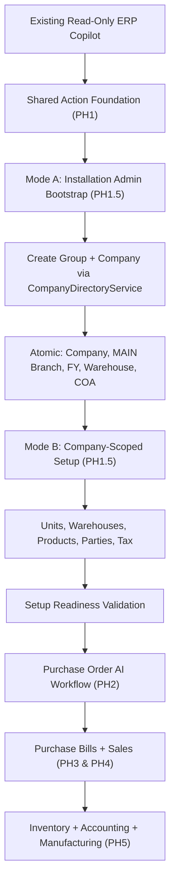
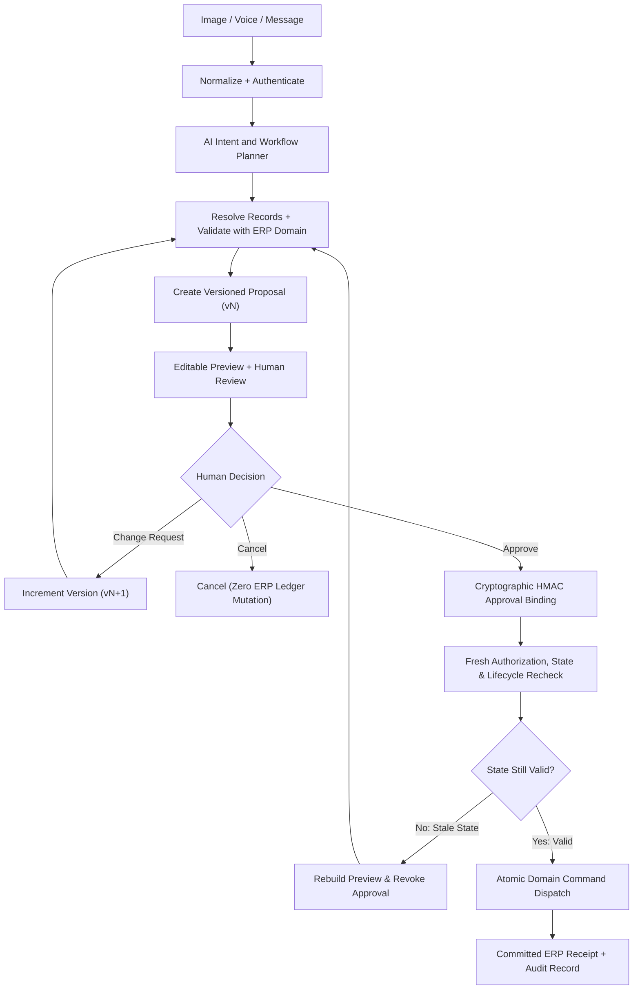
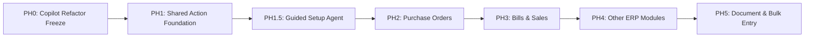

# zoloERP Autonomous AI Operating Layer — Technical Design Document

*   **Author:** vigneshsinna
*   **Status:** Finalized (Reviewed & Approved)
*   **Date:** 2026-11-11
*   **Predecessor Document:** `concepts_brief.md`
*   **Target Codebase:** `vigneshsinna/zolo-erp-pro` (`refactor/erp-copilot-stabilization` @ `14195d8`)

--------------------------------------------------------------------------------

## Overview

This technical design document specifies the architecture, data models, security boundaries, and execution protocols for the **zoloERP Autonomous AI Operating Layer**. The system transitions zoloERP Pro from its current read-only Copilot baseline (14 read tool families with zero write capabilities) into an enterprise-governed **AI Command Center** capable of multi-modal intake (text, voice, image/documents), entity resolution, governed transaction execution, and administrative setup.

The architectural foundation adheres to the principle of **Untrusted Model, Authoritative Server**: Large Language Models act strictly as probabilistic planners, slot-gatherers, and formatters. All ledger calculations, tax computations (GST), state validations, authorization checks, and database commits remain under the exclusive control of established Laravel domain services (`CompanyDirectoryService`, `CommercialApplicationService`, `OrderLifecycleService`).

Review and approval are delivered across two coordinated interfaces:
1. **AI Workspace (`workspace.blade.php`):** Interactive conversational surface for multi-modal intake, candidate disambiguation, live previews, and iterative change requests.
2. **Action Review Center (Dedicated Operational Desk):** Cross-module pending approval queue, multi-item approval, audit trail inspection, and execution receipts.

---

## The Problem

zoloERP Pro is currently a menu-driven transactional ERP. While the recent Copilot stabilization successfully shipped 14 read-only tool families, business operators still face significant friction in daily operations:
1. **Administrative Onboarding Overhead:** Creating a new enterprise company, its branches, chart of accounts, starter series, and industry configurations requires navigating numerous separate screens and manual seeders.
2. **Operational Entry Latency:** Generating commercial transactions (e.g. Purchase Orders) from external communication (supplier quotes, WhatsApp text, email PDFs) requires tedious manual data entry and multi-screen record lookups.
3. **The Autonomy vs. Compliance Dilemma:** Existing naive AI automation patterns (such as granting LLMs direct SQL access or automated tool execution) threaten financial integrity, violate multi-tenant isolation, risk double-entry accounting errors, and break statutory GST compliance.
4. **Lifecycle State Violations:** Direct mutations on submitted or posted vouchers corrupt stock ledgers and general ledger reconciliation. A governed mechanism is required to ensure AI-driven changes obey authoritative ERP document lifecycles.

The solution is an **Action Foundation** combining a two-tier identity framework (Mode A pre-company bootstrap vs. Mode B company-scoped setup), short-lived database transactions, cryptographic HMAC approval binding, and mandatory transaction lifecycle enforcement.

---

## Goals

*   **G-1 (Strict Mode Isolation):** Physically and logically segregate Mode A (Pre-Company Bootstrap under `BootstrapSetupPrincipal` via `/api/v1/ai/setup/bootstrap/*`) from Mode B (Company-Scoped Operations via standard `/api/v1/ai/*` routes), guaranteeing zero leakage or artificial tenancy bypasses (`company_id = 0`).
*   **G-2 (Single-Step Atomic Company Creation):** Reuse existing `CompanyDirectoryService::createCompany` to provision company, MAIN branch, first FY, main warehouse, chart of accounts, industry settings, and starter masters in a single atomic database transaction.
*   **G-3 (Short Database Transaction Lifetimes):** Enforce that no database transaction is held open during LLM inference, slot gathering, or user review pauses. At commit time, row locks and state revalidation occur inside a brief, atomic execution window delegating to domain service transaction ownership (`$domainOwnsTransaction = true`).
*   **G-4 (Cryptographic Approval Binding):** Hash canonical proposal payloads with SHA-256 and bind the approval record using an HMAC signature incorporating payload hash, action key, version, approver identity, company, branch, financial year, and source state hash.
*   **G-5 (Mandatory Lifecycle Enforcement):** Forbid direct `UPDATE` queries on submitted, posted, or paid ERP transactions. Route all modifications through formal, domain-supported amendment, Debit/Credit Note, or Reversal workflows.
*   **G-6 (Dual UI Ergonomics):** Provide live interactive previews and in-place "Change Request" editing in the AI Workspace, complemented by a dedicated Action Review Center for pending approvals, history, and receipts.
*   **G-7 (Autonomy Boundary):** Restrict system autonomy strictly to Levels A2 (draft preparation) and A3 (explicit human approval). Fully unattended financial or inventory posting (A4/A5) is prohibited.

---

## Non-Goals

*   **NG-1 (No Unattended Financial Posting):** The system will not autonomously post journals, tax returns, or stock adjustments without explicit human review and approval.
*   **NG-2 (No Direct ORM/SQL Writes):** The AI engine will never execute direct raw SQL, Eloquent `update()` / `delete()`, or `Sale::forceCreate()` / `Purchase::forceCreate()` bypassing domain services.
*   **NG-3 (No Expansion of Read Manifest):** The existing `AiToolManifest` will remain strictly read-only. Action capabilities will reside exclusively in `ActionCapabilityRegistry` and `SetupCapabilityRegistry`.
*   **NG-4 (No Multi-Profile Companies):** A company will not be configured with multiple simultaneous industry profiles unless supported by core ERP domain enhancements.

---

## Open Questions & Decisions

*   **Q-1 (Session Context Switching in SPA/Multi-Tab):** When `createCompany` commits in Mode A, how should multi-tab browser sessions handle the context switch to the new company without forcing a full page reload?
    - *Decision:* The Mode A completion response returns explicit transition metadata containing `transition_action: "switch_context"`, `context_switch_url: "/select-company"`, and `workspace_url: "/ai"`. The client performs an AJAX POST to `/select-company` with `company_id` to establish the authenticated session context before navigating to `/ai`.
*   **Q-2 (Batch Approval Gating in Review Center):** For bulk master data proposals (e.g. 50 imported products), what threshold should require individual confirmation modals versus single-click batch approval?
    - *Decision:* Single-click batch approval is permitted exclusively for low-risk tier (`r1_draft`) master data records up to a maximum limit of 25 items per batch. Any commercial, stock-moving, or financial transactions strictly require individual transaction previews and approvals.

---

## Critical User Journeys (CUJs)

### CUJ 1: Mode A Initial Company Provisioning & Onboarding
*   **Given:** An authenticated installation administrator accessing the dedicated bootstrap endpoint (`/api/v1/ai/setup/bootstrap/*`) under `BootstrapSetupPrincipal`.
*   **When:** The admin instructs: *"Set up ABC Textiles as a textile manufacturing company in Tamil Nadu with FY starting 2026-04-01."*
*   **Then:**
    1. The AI Intent Planner extracts slots (`name: "ABC Textiles"`, `industry_code: "textile"`, `state_code: "TN"`, `fy_start: "2026-04-01"`, `fy_end: "2027-03-31"`).
    2. `CompanyBootstrapPreviewAdapter` calculates simulated defaults (canonical uppercase code via `CompanyDirectoryService::code()`, financial year naming via `yearName()`, default warehouse name, and tax configuration) using `IndustryCatalog` without executing database writes.
    3. An immutable proposal (`setup.company.create.v1`, version 1, `actor_id`, `task_token`) is generated with a canonical SHA-256 payload hash and presented as an editable preview card.
    4. The admin clicks "Approve", generating an HMAC approval signature with colon-delimited null-safe context (`payload_hash:setup.company.create.v1:1:actorId:0:0:0:sourceStateHash:timestamp`).
    5. The executor calls `CompanyDirectoryService::createCompany` once in a single transaction.
    6. Company, MAIN branch, first FY, main warehouse, COA, and starter masters are atomically provisioned.
    7. The client receives an authoritative receipt with transition metadata (`context_switch_url: "/select-company"`, `company_id: 12`, `workspace_url: "/ai"`), re-anchoring the session into standard `CompanyContext` (Mode B).

### CUJ 2: Interactive Change Request on Commercial Proposal
*   **Given:** An authenticated sales operator in an active company workspace.
*   **When:** The operator asks the AI to prepare a Purchase Order for 100 units of Fabric X, but then decides to change the quantity to 150 units before approval.
*   **Then:**
    1. The initial proposal (v1) is displayed with calculated taxes and totals.
    2. The operator submits a change request via either:
       - **Conversational Intake:** User sends natural language ("change quantity to 150") to `POST /api/v1/ai/chat`. The planner detects active thread proposal and delegates to `ActionProposalService::applyChangeRequest()`.
       - **Direct Card Edit:** User edits quantity directly on the Fact Card / Review Center and clicks "Update Preview", sending structured JSON to `POST /api/v1/ai/proposals/{id}/change-request`.
    3. The proposal increments to version 2 (v2), discarding the prior preview hash and revoking previous approvals.
    4. Records and pricing are re-validated through `CommercialApplicationService`.
    5. A refreshed preview card is rendered requiring fresh human approval.

### CUJ 3: Rejected Direct Mutation on Posted Supplier Bill
*   **Given:** A purchase bill (PB-1025) has already been submitted and posted with inventory and general ledger effects.
*   **When:** A user instructs the AI: *"Change supplier bill PB-1025 quantity from 50 to 60."*
*   **Then:**
    1. The AI planner resolves the bill and queries `DomainLifecyclePolicy`.
    2. The policy detects `status = 'posted'`, rejecting direct update.
    3. The AI refuses direct field mutation and generates a proposal for a formal **Purchase Debit Note** with predicted ledger and stock adjustments.
    4. The proposal is routed to the Action Review Center for finance approval.

---

## Technical Plan (Architecture)

### 1. Architectural Overview & Security Plane Segregation

The system establishes three independent architectural planes:
1. **Experience Plane:**
   - **AI Workspace (`workspace.blade.php`):** Multi-modal conversational interface, slot disambiguation, live fact cards, and in-place proposal editing.
   - **Action Review Center (`resources/views/backend/ai/action_review_center.blade.php`):** Dedicated operational screen for pending approvals queue, audit trail inspection, and execution receipts.
2. **Intelligence Plane:**
   - Intent classification, slot extraction, and schema normalization.
   - Bound by strict JSON schemas; zero authorization privileges or database write access.
3. **Execution Plane:**
   - `AiToolManifest` (14 strictly read-only tool families).
   - `SetupCapabilityRegistry` (Mode A bootstrap write actions).
   - `ActionCapabilityRegistry` (Mode B company-scoped operational write actions).



---

### 2. Governed Two-Phase Execution Lifecycle

Every operational action follows an immutable state machine:



---

### 3. Component Architecture & Class Responsibilities

#### A. Security & Bootstrap Identity
*   `App\Ai\Security\BootstrapSetupPrincipal`:
    - Immutable DTO representing an authenticated installation administrator.
    - Fields: `int $actorId`, `int $roleId`, `array $allowedCapabilities`, `string $taskToken`, `CarbonImmutable $expiresAt`.
    - Does **not** require `company_id` or `financial_year_id`.
*   `App\Http\Middleware\VerifyBootstrapAdminContext`:
    - Restricts access to `/api/v1/ai/setup/bootstrap/*` endpoints.
    - Asserts `CompanyDirectoryService::isInstallationAdmin($actor)` or valid group management rights.
    - Rejects regular tenant tokens with HTTP 403.
*   **Mode A Proposal Scoping Contract:**
    - For Mode A proposals (`company_id = NULL`), standard tenant queries are completely bypassed.
    - Mode A proposals MUST be queried strictly via:
      `where('actor_id', $bootstrapPrincipal->actorId)->whereNull('company_id')->where('task_token', $taskToken)`
    - This guarantees strict isolation between concurrent installation administrators and prevents cross-admin leakage.

#### B. Registries, Action Descriptors & Adapter Interfaces
*   `App\Ai\DTOs\ActionDefinition`:
    ```php
    final readonly class ActionDefinition
    {
        public function __construct(
            public string $key,
            public string $businessModule,
            public string $riskTier,
            public array $requiredPermissions,
            public string $inputSchemaClass,
            public string $previewAdapterClass,
            public string $commandAdapterClass,
            public bool $domainOwnsTransaction = true,
            public bool $requiresApproval = true,
            public bool $requiresFreshSnapshot = true,
            public bool $enabledByDefault = false,
        ) {}
    }
    ```
*   `App\Ai\Contracts\ActionPreviewAdapterInterface`:
    ```php
    namespace App\Ai\Contracts;

    use App\Ai\DTOs\ActionDefinition;
    use App\Ai\DTOs\ActionPreviewResult;
    use App\Ai\Security\BootstrapSetupPrincipal;
    use App\Services\Platform\CompanyContext;

    interface ActionPreviewAdapterInterface
    {
        public function preview(ActionDefinition $definition, array $slots, CompanyContext|BootstrapSetupPrincipal $context): ActionPreviewResult;
    }
    ```
*   `App\Ai\Contracts\ActionCommandAdapterInterface`:
    ```php
    namespace App\Ai\Contracts;

    use App\Ai\DTOs\ActionDefinition;
    use App\Ai\DTOs\ActionExecutionReceipt;
    use App\Ai\Security\BootstrapSetupPrincipal;
    use App\Services\Platform\CompanyContext;

    interface ActionCommandAdapterInterface
    {
        public function execute(ActionDefinition $definition, array $payload, CompanyContext|BootstrapSetupPrincipal $context, int $actorId): ActionExecutionReceipt;
    }
    ```
*   `App\Ai\Adapters\CompanyBootstrapPreviewAdapter`:
    - Implements `ActionPreviewAdapterInterface` for `setup.company.create.v1`.
    - Computes simulated company code via `CompanyDirectoryService::code()`, financial year naming via `yearName()`, default warehouse name, and starter chart structure directly using `IndustryCatalog` without executing `CompanyDirectoryService::createCompany()`, ensuring zero database mutations occur during preview generation.
*   `App\Ai\Registries\SetupCapabilityRegistry`:
    - Code allowlist for Mode A (`setup.group.create.v1`, `setup.company.create.v1`).
*   `App\Ai\Registries\ActionCapabilityRegistry`:
    - Code allowlist for Mode B (`setup.branch.create.v1`, `purchase_order.create.v1`, etc.).

#### C. Proposal & Approval Engine
*   `App\Ai\Services\ActionProposalService`:
    - Handles slot parsing, calls the preview adapter, computes the canonical SHA-256 payload hash, and manages the proposal state.
    - Supports atomic version increments: when a user submits a change request (via chat or card edit), increments `version` (`vN -> vN+1`), invalidates any prior approval, and stores the updated payload.
*   `App\Ai\Services\ActionApprovalService`:
    - Authenticates the approver and independently verifies Spatie permissions.
    - Computes a cryptographically secure HMAC approval signature using colon-delimited null-safe context parameters:
      ```php
      $contextScope = (string) ($companyId ?? '0') . ':' . (string) ($branchId ?? '0') . ':' . (string) ($fyId ?? '0');
      $approvalSignature = hash_hmac(
          'sha256',
          $payloadHash . ':' . $actionKey . ':' . $version . ':' . $approverId . ':' . $contextScope . ':' . $sourceStateHash . ':' . $timestamp,
          config('app.key')
      );
      ```
*   **`source_state_hash` Computation Contract:**
    - For new record creations (Mode A company creation, Phase 2 Purchase Order creation):
      `source_state_hash = hash('sha256', 'NEW_RECORD')`.
    - For existing record modifications (amending draft vouchers, Debit Notes, Reversals):
      `source_state_hash = hash('sha256', $record->getTable() . ':' . $record->id . ':' . $record->updated_at->timestamp . ':' . $record->status)`.
    - During execution revalidation, `ApprovedActionExecutor` re-computes this hash from the database row and strictly aborts with `STATE_STALE_INVALIDATED` if the hash has changed.

#### D. Short-Transaction Execution Adapter
*   `App\Ai\Services\ApprovedActionExecutor`:
    - Verifies the HMAC approval signature.
    - Re-validates the live ERP state, checks optimistic row locks (`lockForUpdate()`), and checks fiscal year status.
    - If `$definition->domainOwnsTransaction === true`, delegates directly to the domain service without an outer `DB::transaction()`.
    - Records the committed receipt and returns the resulting ERP record ID.

#### E. Transaction Lifecycle Guard
*   `App\Ai\Policies\DomainLifecyclePolicy`:
    - Evaluates target record status (`status`, `sale_status`, `is_posted`).
    - If `status === 'draft'`, permits draft amendment command.
    - If `status in ['submitted', 'posted', 'paid']`, rejects direct update; routes request to generate a Debit/Credit Note or Reversal proposal.

---

### 4. Database Schema (Additive Migrations)

In strict accordance with **Tenancy Law 4 (Additive Migrations Only)**, the system will not modify historical migrations. The existing tables created by `2026_11_10_000005_create_ai_action_proposals_tables.php` will be updated via a dedicated additive migration:

**Migration File:** `database/migrations/2026_11_11_000001_upgrade_ai_action_proposals_schema.php`

```php
use Illuminate\Database\Migrations\Migration;
use Illuminate\Database\Schema\Blueprint;
use Illuminate\Support\Facades\Schema;

return new class extends Migration
{
    public function up(): void
    {
        Schema::table('ai_action_proposals', function (Blueprint $table) {
            // Make tenancy columns nullable for Mode A Pre-Company Bootstrap
            $table->unsignedBigInteger('company_id')->nullable()->change();
            $table->unsignedBigInteger('branch_id')->nullable()->change();
            $table->unsignedBigInteger('financial_year_id')->nullable()->change();

            // Mode A Scoping & Integrity
            $table->unsignedBigInteger('actor_id')->after('id');
            $table->char('task_token', 64)->nullable()->after('actor_id');
            $table->string('action_key', 64)->after('financial_year_id');
            $table->unsignedInteger('version')->default(1)->after('action_key');
            $table->string('payload_hash', 64)->after('payload_json');
            $table->string('source_state_hash', 64)->nullable()->after('payload_hash');

            // Compound index for Mode A Bootstrap Queries
            $table->index(['actor_id', 'action_key', 'status'], 'idx_proposals_bootstrap');
            $table->index(['payload_hash'], 'idx_proposals_hash');
        });

        Schema::table('ai_action_approvals', function (Blueprint $table) {
            $table->unsignedInteger('version')->default(1)->after('proposal_id');
            $table->string('approval_signature', 64)->after('approver_user_id');
            $table->index(['proposal_id', 'version'], 'idx_approvals_proposal_ver');
        });

        Schema::table('ai_action_executions', function (Blueprint $table) {
            $table->unsignedInteger('version')->default(1)->after('proposal_id');
            $table->string('domain_service', 128)->after('executed_by_user_id');
            $table->string('domain_method', 64)->after('domain_service');
            $table->string('erp_resource_type', 64)->after('domain_method');
            $table->unsignedBigInteger('erp_resource_id')->after('erp_resource_type');
            $table->unsignedInteger('duration_ms')->after('receipt_json');
            $table->index(['erp_resource_type', 'erp_resource_id'], 'idx_executions_resource');
        });
    }

    public function down(): void
    {
        // Safe additive rollback
    }
};
```

---

### 5. API Contracts & Endpoint Specifications

#### Mode A Bootstrap Routes (`routes/api.php`)
*   `POST /api/v1/ai/setup/bootstrap/tasks`: Initiates a setup task; returns `task_id` and token.
*   `POST /api/v1/ai/setup/bootstrap/tasks/{id}/preview`: Normalizes slots; calls `CompanyBootstrapPreviewAdapter` to calculate simulated defaults without database writes; returns calculated preview.
*   `POST /api/v1/ai/setup/bootstrap/tasks/{id}/approve`: Validates HMAC signature; invokes `CompanyDirectoryService::createCompany` atomically. Returns:
    ```json
    {
        "status": "completed",
        "company_id": 12,
        "company_code": "ABCTX",
        "main_branch_id": 15,
        "first_fy_id": 8,
        "main_warehouse_id": 14,
        "coa_seeded": true,
        "transition_action": "switch_context",
        "context_switch_url": "/select-company",
        "workspace_url": "/ai"
    }
    ```

#### Mode B Company-Scoped Routes
*   `POST /api/v1/ai/chat`: Multi-modal chat endpoint. If a user message requests a revision on an active proposal, the intent planner detects it and routes to `ActionProposalService::applyChangeRequest()`.
*   `POST /api/v1/ai/proposals/{id}/change-request`: Direct endpoint for in-place Fact Card or Review Center slot adjustments; increments proposal version (`vN -> vN+1`) and returns updated preview.
*   `POST /api/v1/ai/proposals/{id}/approve`: Signs proposal version; triggers immediate execution or queues for background worker.
*   `POST /api/v1/ai/proposals/{id}/reject`: Cancels proposal without database writes (`Cancel (Zero ERP Ledger Mutation)`).
*   `GET /api/v1/ai/review-center/pending`: Returns pending proposal queue filtered by user's permitted modules.
*   `GET /api/v1/ai/review-center/history`: Returns immutable audit history and receipts.

---

## Alternatives Considered

### Alternative 1: Wildcard Tenant Middleware (`company_id = 0` or Nullable Scope)
*   **Description:** Modifying existing tenant middleware to treat `company_id = 0` or `null` as a special bypass flag, allowing Mode A pre-company setup to pass through standard `/api/v1/ai/chat` endpoints.
*   **Pros:** Requires no new bootstrap routes or controller classes; reuses existing chat pipelines directly.
*   **Cons:** Directly violates Tenancy Law 1 ("Zero Unscoped Reads or Writes"). If any controller method fails to verify that the actor is an installation admin, a regular tenant user could craft requests that read or mutate cross-company data.
*   **Reason for Rejection:** Rejected by author. Tenancy boundaries must be physically isolated. Mode A must use dedicated bootstrap endpoints (`/api/v1/ai/setup/bootstrap/*`) guarded by an explicit `InstallationAdminGate` and `BootstrapSetupPrincipal`.

### Alternative 2: Direct Model Tool-Calling for Financial & Inventory Writes
*   **Description:** Registering action execution tools directly in `AiToolManifest` and allowing the LLM to call `createPurchaseOrder()` or `createCompany()` autonomously during tool loops.
*   **Pros:** Simpler developer experience; agent appears faster and more autonomous.
*   **Cons:** Probabilistic models are prone to hallucinations, duplicate invocations, and parameter guessing. Lacks cryptographic proof of user intent, violates statutory double-entry accounting auditability, and bypasses segregation of duties.
*   **Reason for Rejection:** Rejected by author. Large language models are untrusted planners. Financial and inventory mutations require a strict two-phase protocol: (1) preview calculation via domain services, followed by (2) explicit human approval bound to an immutable HMAC payload hash.

### Alternative 3: Long-Lived Database Transactions Spanning Inference & Human Review
*   **Description:** Opening a database transaction (`DB::beginTransaction()`) at the start of intent planning or preview generation, locking affected inventory rows, and committing only after the human reviews and clicks "Approve".
*   **Pros:** Guarantees that inventory stock levels or prices cannot diverge between preview calculation and execution.
*   **Cons:** Human reviews take minutes or hours. Holding database connections and table row locks open across network requests exhausts MySQL connection pools, blocks other users from transacting, and causes system-wide deadlocks.
*   **Reason for Rejection:** Rejected by author. Database transactions must remain strictly short-lived. The orchestrator never holds an open transaction across model inference or human review pauses. Live state re-validation occurs under brief locks at execution time, delegating transaction boundaries directly to domain services (`$domainOwnsTransaction = true`).

### Alternative 4: Universal `is_posted` Boolean Check on All Records
*   **Description:** Checking a single boolean column `is_posted` across all ERP models to decide whether a record can be edited by the AI.
*   **Pros:** Highly uniform, simple database condition across all tables.
*   **Cons:** zoloERP Pro uses heterogeneous lifecycle models across modules (`status`, `sale_status`, `payment_status`, allocation linkages). In commercial sales, an order may be unbilled but partially dispatched; in job work, materials may be issued with GST Section 143(3) liabilities without an `is_posted` flag.
*   **Reason for Rejection:** Rejected by author. Requires a domain-aware `DomainLifecyclePolicy` that evaluates module-specific business rules and transitions.

### Alternative 5: Implementing Commercial Transactions (Purchase Orders) Before Guided Setup
*   **Description:** Building Phase 2 (Purchase Order AI workflow) first in the active development company before building the Initial Setup Agent.
*   **Pros:** Immediate demonstration of transactional AI on existing seed data.
*   **Cons:** Commercial transactions require valid company groups, branches, warehouses, units of measure, chart of accounts, tax registrations, and starter series. Developing commercial actions without a verified setup engine produces brittle, mock-dependent implementations that fail in fresh tenant onboarding.
*   **Reason for Rejection:** Rejected by author. Following the roadmap, the Guided Initial Setup Agent (PH1.5) provides the prerequisite tenant foundation and Mode A bootstrap boundary needed for commercial workflows (PH2).

---

## Phasing & Milestones

The roadmap enforces strict gate dependency: no subsequent phase may be merged before the predecessor phase satisfies its automated CI and verification exit gate:



### Phase 1: Shared Action Foundation (Branch: `feature/ai-action-foundation`)
*   **Scope:** Common registries, versioned proposal schema, cryptographic HMAC approval binding, short-transaction execution adapter, and Action Review Center desk.
*   **Deliverables:**
    - Additive database migration `2026_11_11_000001_upgrade_ai_action_proposals_schema.php`.
    - `ActionCapabilityRegistry` and `ActionDefinition` with `$domainOwnsTransaction = true`.
    - `ActionPreviewAdapterInterface` and `ActionCommandAdapterInterface`.
    - `ActionProposalService` (canonical SHA-256 payload hashing, version increments).
    - `ActionApprovalService` (server HMAC signature binding with colon-delimited context).
    - `ApprovedActionExecutor` (row locks, revalidation, receipt persistence).
    - Action Review Center Blade view (`resources/views/backend/ai/action_review_center.blade.php`).
*   **Exit Gate:** Passing test suite on disposable MySQL proving zero open transactions during pauses, HMAC signature tamper detection, and idempotent duplicate approval handling.

### Phase 1.5: Guided Initial Setup Agent (Branch: `feature/ai-guided-setup-agent`)
*   **Scope:** Mode A pre-company bootstrap and Mode B company-scoped master configuration.
*   **Deliverables:**
    - Mode A dedicated endpoints (`/api/v1/ai/setup/bootstrap/*`) guarded by `VerifyBootstrapAdminContext`.
    - `BootstrapSetupPrincipal` security DTO with actor-token scoping.
    - `CompanyBootstrapPreviewAdapter` computing simulated defaults using `IndustryCatalog`.
    - Command adapter calling `CompanyDirectoryService::createCompany` once in a single transaction.
    - Context transition handler returning structured switch token (`context_switch_url: "/select-company"`).
    - Mode B master adapters (branches, warehouses, UOM, products, parties).
*   **Exit Gate:** End-to-end test provisioning a fresh legal company from natural language, verifying all 11 starter entities, transitioning context, and creating products without cross-tenant contamination.

### Phase 2: Commercial Action Vertical Slice: Purchase Order (Branch: `feature/ai-purchase-orders`)
*   **Scope:** Natural-language item/supplier disambiguation, pricing preview via `CommercialApplicationService`, approved PO creation.
*   **Deliverables:**
    - `PurchaseOrderCapabilityAdapter` and JSON schemas.
    - Live fact card in AI Workspace with "Change Request" line-item editing.
    - Routing to Action Review Center for manager sign-off.
*   **Exit Gate:** 100% test coverage asserting that PO creation affects neither inventory stock levels nor general ledger balances.

### Phase 3 through Phase 7: Subsequent Operational Workflows
*   **Phase 3:** Goods Receipts (`OrderLifecycleService::receivePurchase`) and Supplier Bills (`PurchasePostingService`).
*   **Phase 4:** Sales Quotations, Sales Orders, and Tax Invoices with payment allocations.
*   **Phase 5:** Inventory stock transfers, journal adjustments (restricted A3), and manufacturing production plans.
*   **Phase 6:** OCR/document extraction, spreadsheet bulk import dry-runs.
*   **Phase 7:** Opt-in low-stock alerts, Redis Horizon queue workers, distributed tracing.

---

## Verification & Testing Plan

### 1. Disposable Testing Environment Guarantee
All AI feature tests **MUST** adhere to Tenancy Law 6:
- Tests must never run against active development database (`zoloerp` on port 3307) or production.
- Tests enforce `ERP_TEST_MYSQL=1` and use `UsesDisposableMysql` against ephemeral schemas (`zolo_test_*`).

### 2. Concrete Acceptance Test Classes & Assertions

| Test Class | Core Verification Scenarios | Assertion Criteria |
|---|---|---|
| `tests/Feature/Ai/ActionFoundation/HmacApprovalBindingTest.php` | 1. Canonical payload hashing.<br>2. HMAC signature verification with colon-delimited context.<br>3. Tamper detection on payload/user/company. | Any altered field invalidates signature with `APPROVAL_SIGNATURE_MISMATCH` (HTTP 422). |
| `tests/Feature/Ai/ActionFoundation/ShortTransactionLifetimeTest.php` | 1. Zero DB transactions during slot extraction.<br>2. Zero DB transactions during preview wait.<br>3. Execution uses single brief domain transaction. | Query listener asserts `DB::transactionLevel() === $baseFixtureLevel` (1 under `UsesAiMysql`) during all non-commit phases. |
| `tests/Feature/Ai/ActionFoundation/IdempotencyAndReplayTest.php` | 1. Duplicate approval submissions.<br>2. Network timeout retries.<br>3. Concurrent approvals on same proposal. | Second request returns identical receipt with HTTP 200; exactly one domain record created. |
| `tests/Feature/Ai/Setup/BootstrapCompanyCreationTest.php` | 1. Mode A endpoint isolation.<br>2. Atomic `createCompany` invocation.<br>3. Non-admin access denial.<br>4. Re-anchoring session to Mode B. | Provisions company, MAIN branch, first FY, main warehouse, and COA in 1 transaction; non-admins get 403. |
| `tests/Feature/Ai/Lifecycle/TransactionLifecycleEnforcementTest.php` | 1. Draft bill editing permitted.<br>2. Posted bill direct update rejected.<br>3. Automatic Debit Note proposal generation.<br>4. Closed FY blocks execution. | Modifying posted records throws `LIFECYCLE_MUTATION_FORBIDDEN`; routes to formal correction flow. |
| `tests/Feature/Ai/Security/CrossTenantProposalIsolationTest.php` | 1. Cross-company proposal queries.<br>2. Foreign company approval attempts.<br>3. Stale tenant token execution. | Tenancy Law 1 strictly enforced; foreign proposals return 404/403 with audit alarm. |

---

## Rollout, Telemetry & Operational Runbook

### 1. Feature Flagging Architecture
Action capabilities are governed by a multi-tier feature flag hierarchy stored in `ai_feature_settings`:
*   `global_actions_enabled`: Master switch controlling all write endpoints.
*   `company_actions_enabled`: Per-company opt-in toggle.
*   `company_setup_enabled`: Controls Mode A bootstrap and Mode B initial setup capabilities.
*   `capability_overrides`: Per-capability JSON array (e.g., `["purchase_order.create.v1": true, "purchase_bill.post.v1": false]`).

### 2. Emergency Cutoff & Killswitch Runbook
If anomalous behavior, quota spike, or unauthorized access is detected:
1. **Instant Web Killswitch:**
   - Execute: `php artisan ai:killswitch --company=all --action=disable`
   - Immediately terminates all non-read AI routes with HTTP 503 (`AI_ACTIONS_TEMPORARILY_DISABLED`).
2. **Worker Queue Draining:**
   - Execute: `php artisan horizon:pause` / `php artisan queue:clear --queue=ai-actions`
   - Halts all background execution workers without affecting core ERP operational queues.
3. **Audit Trail Inspection:**
   - Query `ai_action_proposals` and `ai_action_approvals` by `run_id` or `approver_user_id` to inspect affected records.

### 3. Redacted Observability & Telemetry
- All proposal payloads, approvals, and execution logs redact sensitive PII (passwords, bank account numbers, secret keys, full PAN numbers) before writing to disk or dispatching telemetry.
- Telemetry records run duration, model input/output token counts, and domain command execution time without exposing business data.

