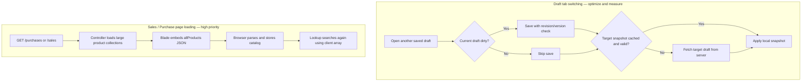
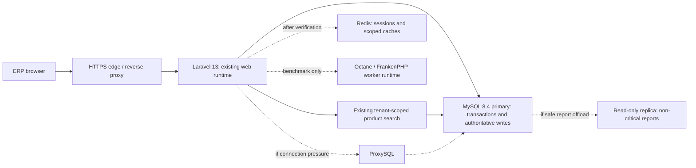
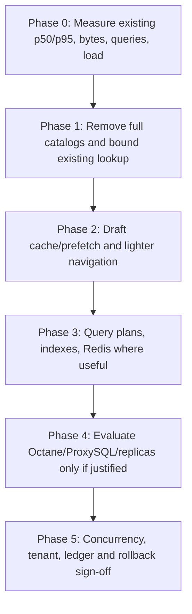

# zoloERP Pro — High-Concurrency Multi-User Performance Architecture

> **Document type:** System architecture, performance improvement specification and production rollout blueprint  
> **Target stack:** Multi-tenant ERP SaaS; PHP 8.5.12, Laravel 13.x and MySQL 8.4 (subject to deployment verification)  
> **Repository:** [`vigneshsinna/zolo-erp-pro`](https://github.com/vigneshsinna/zolo-erp-pro), `main` branch  
> **Revision:** 2.0 — 19 November 2026  
> **Status:** **Recommended for engineering review and staged implementation**. Not a verified production benchmark or deployment approval.  
> **Scope:** Purchase Bills, Sales Bills, Purchase Orders, Returns, suppliers, product search, shared draft workspaces, navigation, caching, database, and high-concurrency infrastructure.

## Revision notes: what changed from the original

1. Corrected the claim that all draft payloads are already preloaded and switching takes under 10 ms. The inspected `main` branch still loads draft metadata separately and can make network requests when switching.
2. Corrected the inlined product array name and logic: the Purchase Bill view builds `var allProducts = @json($jsProductList)`, with standard and variant catalogs loaded by the controller. The previous `window.lims_product_array` description did not match this screen.
3. Reused the **existing** `/commercial/{kind}/search/products` endpoint and `ProductQueryService` instead of prescribing a second competing search API.
4. Identified both remaining search inefficiencies: the browser filters its full local `allProducts` array, and the service fetches all matching products into PHP before ranking and taking 50.
5. Replaced unverified page-size, response-time, bootstrap, and 500-user capacity claims with targets and a mandatory baseline/benchmark process.
6. Made Redis, Octane/FrankenPHP, ProxySQL, read replicas, OPcache preloading, and PHP JIT conditional on measured need, operational readiness, and isolation tests.
7. Replaced blanket indexing and fixed MySQL memory settings with query-plan-driven tuning and server-specific sizing.
8. Added tenant isolation, safe cache invalidation, draft revision protection, ledger and stock integrity, load testing, rollback criteria, and implementation acceptance criteria.

---

## 1. Executive Summary & Root Cause Diagnosis

**Goal:** Reduce user-visible latency and improve concurrency without changing authoritative ERP financial, inventory, security, or approval rules. Work first on unnecessary data transfer, redundant processing, and slow queries; consider infrastructure upgrades only after profiling.

### 1.1 Verified code findings vs. hypotheses

| Area | Finding from the inspected `main` branch | Confidence / verification needed |
|---|---|---|
| Purchase page hydration | `PurchaseController::index()` calls `productWithoutVariant()` and `productWithVariant()` and passes both collections to the view. The Blade view builds `$jsProductList` and embeds `var allProducts = @json($jsProductList)`. | **Confirmed code pattern**; actual product count, payload bytes and latency are **not measured**. |
| Sales page hydration | `SaleController::index()` also builds standard and variant product collections. | **Confirmed code pattern**; measure impact independently. |
| Product lookup | `public/js/commercial-product-lookup.js` can fetch the existing commercial search endpoint, yet filters and ranks against the full client-side product array. | **Confirmed** in the inspected JS. |
| Search service | `ProductQueryService::search()` uses tenant-scoped product selection, aliases and `LIKE` prefix matching, then calls `get()` before ranking and `take(50)`. | **Confirmed**; matched-row counts and query plans still need measurement. |
| Draft tabs | `document-drafts.js::loadList()` loads metadata; `openTab()` can call `fetchDraft()`. It also calls `leaveActive()`, which may save changes. | **Confirmed**; no evidence of an implemented `CommercialDraftService::metaWithPayload()` in the inspected code. |
| Performance tests | An opt-in `CommercialPerformanceTest` has a 50,000-product/50,000-party fixture and service-level budgets. | **Confirmed test code**; no claim that this test currently passes in the user's deployment. |
| Runtime and production infrastructure | `composer.json` targets Laravel 13 and PHP 8.5, but does not list `laravel/octane`; session config defaults to `file` unless deployment environment overrides it. | **Repository configuration only**; production environment, PHP extensions, traffic and server sizing were not inspected. |

**Do not present the original figures** (5–15 MB HTML, 1.6–3 seconds draft switch, 40 ms bootstrap, 500+ users per node) as measured facts. They are hypotheses or examples until captured with real production-like data.

### 1.2 The two principal improvement opportunities



**Priority order:** remove large catalog hydration; fix and bound server-side lookup; profile the page and SQL; optimize draft workflows; then evaluate Redis and production infrastructure.

---

## 2. Target Performance Service Level Objectives (SLOs)

Targets are **proposed p95 thresholds**, measured end-to-end on representative staging hardware. They are **not current-state measurements or guaranteed results**. Report p50, p95, p99, bytes transferred, error rate, and throughput. Separate warm/cold paths and include realistic client-network latency.

| Metric | Current baseline | Initial target | Measurement boundary |
|---|---|---|---|
| Cached draft-tab switch | **To measure** | p95 **< 50 ms** | Click to editable target form; only when a valid snapshot is already available and no save is needed |
| Uncached draft switch | **To measure** | Improve on baseline; no fixed sub-50 ms claim | Includes necessary save, network fetch, permissions and conflict validation |
| Product autocomplete | **To measure** | p95 **< 200 ms** | Keystroke (after debounce) to results rendered; network included, debounce excluded and separately reported |
| Warm Bills workspace navigation | **To measure** | p95 **< 500 ms** | Click to usable view on agreed staging network |
| Initial Purchase Bills load | **To measure** | p95 **< 1,000 ms** | Navigation start to usable entry screen; track LCP/long tasks separately |
| Standard 20-line purchase posting | **To measure** | p95 **< 1,000 ms**, subject to validation | Request to confirmed durable transaction; never trade correctness for latency |
| Error rate under agreed load | **To measure** | **< 0.5%** unexpected errors | Exclude expected validation and intentional 409/422 business errors from server-error rate; report separately |
| Supported concurrent users | **To measure** | Capacity discovered through stepped load tests | No fixed 500-users-per-node assumption |

Define test hardware, tenant mix, row counts, browser/network, cache state and measurement window before declaring an SLO met.

---

## 3. High-Concurrency SaaS Architecture Blueprint

Prefer the simplest architecture that meets the measured load. Solid links are baseline/early-stage; dashed links are optional later enhancements.



**Non-negotiable boundaries:**

- Resolve company, branch, financial year, actor and permissions for each request. Never trust a caller-provided company ID as authorization.
- Keep bill posting, reversal, payment, stock movement, GST projection, and approval flows on authoritative services and on the primary database.
- Do not introduce stale caches into stock availability, credit checks, ledger balances, tax calculations, document numbering or approval decisions unless a business-safe consistency protocol is explicitly designed and verified.
- Preserve atomic database transactions, idempotency, optimistic draft versioning, and concurrency locks.

---

## 4. PHP 8.5 Runtime & Process Architecture

### 4.1 PHP-FPM baseline before Octane / FrankenPHP

PHP-FPM is an acceptable production baseline. Optimize database queries, response sizes, OPcache and client work **before** replacing the runtime.

**Measure first:** web-request wall time, PHP CPU time, route/controller/service durations, database duration and query count, memory peak, worker utilization, FPM queue/waiting requests and long-lived sessions.

**Optional later evaluation:** Deploy Laravel Octane with a supported server such as FrankenPHP in staging, using an explicit compatibility plan. It can reduce repeated framework boot work, but the benefit cannot be inferred from the original document's unsupported 40 ms → 1.5 ms estimate.

**Required Octane/worker audit:**

1. Eliminate tenant, user, branch, request and permission state from mutable static properties, long-lived singletons, global variables and cross-request service caches.
2. Resolve current authenticated actor and `CompanyContext` per request; exercise alternating requests from different companies **on the same reused worker**.
3. Audit database transaction cleanup, connection lifecycle, tenancy switching, middleware, session handling, queues, PDF exports, payment SDKs and third-party packages.
4. Add worker recycling and memory-growth monitoring; test memory leaks over prolonged mixed workloads.
5. Benchmark on identical hardware using PHP-FPM as the control, with verified server restart/reload and rollback.

**Do not introduce Octane just to achieve a declared response-time target.** Roll it out only if measured throughput or CPU improvements justify the added operational risk.

### 4.2 OPcache, preloading, and JIT

Start with ordinary **production OPcache**, verify its hit rate and memory pressure, and use framework route/config/view caching where deployment-compatible.

Illustrative settings to tune to the actual runtime, **not copy-and-paste production defaults**:

```ini
; Example only: verify PHP-FPM vs Octane/FrankenPHP configuration and host RAM
opcache.enable=1
opcache.memory_consumption=256
opcache.max_accelerated_files=30000
opcache.save_comments=1
; Set only with a reliable atomic deployment / worker restart strategy:
; opcache.validate_timestamps=0
```

- `opcache.preload` is optional: preloading an entire ERP class graph without profiling can raise startup cost and memory usage, and needs deployment-specific restart handling.
- PHP JIT is **not** the preferred accelerator for typical I/O-bound Laravel ERP workloads. Do not claim it makes decimal accounting arithmetic faster or safer; monetary precision depends on correct numeric handling, not JIT.
- A worker reload command such as `php artisan octane:reload` applies **only when Octane is actually installed and running**. With PHP-FPM, use the appropriate PHP-FPM/OPcache deployment procedure.

---

## 5. In-Memory Layer: Redis Architecture

### 5.1 Sessions: evaluate, do not assume lock removal

`config/session.php` defaults to `SESSION_DRIVER=file` in the repository; the effective production value may differ.

A migration to Redis can make sessions shared across web nodes and reduce file I/O. It **does not guarantee non-blocking behavior for every request**: explicit session blocking, application-level locks, storage latency and write patterns still matter. Laravel supports optional session blocking with several lock-capable drivers, including Redis.

**Safe rollout:** verify installed Redis/PhpRedis support; choose a dedicated session connection/prefix, TTL, credentials and failover; test login/logout, CSRF, multi-tab sessions, session regeneration and tenancy switching; deploy behind a feature/config switch. Monitor latency and session-related errors.

### 5.2 Tenant-partitioned master-data caching

Cache only suitable **read-mostly, non-authoritative** data, with scoped identities and explicit invalidation. Prefixes/tags are organization tools, not replacements for authorization.

```php
// Illustrative pattern. Resolve $context and $actor from the server on every request.
$scope = implode(':', [
    'company', $context->companyId,
    'branch', $context->branchId,
    'fy', $context->financialYearId,
]);
$key = "{$scope}:masters:units:v1";

$units = Cache::remember($key, now()->addMinutes(10), function () use ($context) {
    return app(UnitMasterReadService::class)->visibleForContext($context);
});
```

**Important:** `UnitMasterReadService` is illustrative, not a class confirmed to exist in `main`. Use the actual repository master service. Add actor/role identity to the cache key **when response visibility differs by actor**. Always authorize the request before returning cached data.

**Invalidation contract:** after a successfully committed write, invalidate only affected company/branch/FY/resource keys; use versioned keys or supported tags with a proven Redis-compatible store; account for multi-instance deployments, concurrent writers and failed invalidations. Ensure changes to product, tax, UOM, warehouse, supplier, permissions and company settings are not served stale in transactional contexts.

**Do not cache:** bill posting outcomes, journal posting eligibility, available-to-promise stock or financial balances as stale truth. Read them authoritatively when executing a transaction.

---

## 6. MySQL 8.4 Database Optimization

### 6.1 InnoDB buffer pool and I/O tuning

The original fixed **80% RAM rule** is inappropriate for mixed application/database hosts and is not a universal guarantee. On dedicated database hosts, a high buffer-pool allocation may be reasonable, but only after reserving memory for MySQL connections, sorts, temporary tables, OS, backups and observability.

**Collect first:** host RAM, MySQL memory/CPU, current buffer pool size and hit ratio, read/write IOPS and storage characteristics, disk latency, slow query log, lock waits, deadlocks and replication requirements.

```sql
-- Read-only inspection examples. Validate privileges and production policy.
SHOW VARIABLES LIKE 'innodb_buffer_pool_size';
SHOW VARIABLES LIKE 'innodb_io_capacity%';
SHOW GLOBAL STATUS LIKE 'Innodb_buffer_pool_read%';
SHOW GLOBAL STATUS LIKE 'Threads_connected';
```

Do not impose `innodb_buffer_pool_size=12G`, `max_connections=500`, or fixed I/O settings on unknown hardware. MySQL 8.4 calculates several defaults differently from older versions; benchmark before overriding them.

### 6.2 ProxySQL and replicas: conditional capacity upgrades

**ProxySQL is optional**, not a necessary prerequisite to hundreds of active ERP users. It can help manage connection pressure, routing and pools, but multiplexing is restricted by transactions, session state, prepared statements and other connection-pinning conditions. It cannot turn arbitrary long-lived write transactions into a tiny pool of connections.

Introduce it only if dashboards show expensive connection churn, excessive MySQL connections or server saturation **after** query and web-worker tuning. Test connection/session semantics and failure recovery carefully.

**Read replicas** may host suitable historical reports. They must **not** be used for immediate read-after-write validation, ledgers requiring current balances, posting, reversal, stock allocation, transaction approvals or other correctness-sensitive paths unless an explicit consistency policy exists. Record replica lag and define fallback.

### 6.3 Query-plan-driven tenant indexing

Queries should be tenant-scoped where applicable; indexes should follow actual `WHERE`, `JOIN`, `ORDER BY` and cardinality patterns, not a blanket rule that **every index must begin with `company_id`**. Some indexes are global, primary-key, foreign-key or single-row lookups; duplicating them wastes write capacity.

**Workflow:**

1. Capture slow queries from `/purchases`, `/sales`, `/commercial/{kind}/search/products`, `/commercial/{kind}/drafts` and reporting endpoints.
2. Inspect existing schema/indexes and verify company/branch/financial-year conditions.
3. Run `EXPLAIN ANALYZE` on representative data and identify scans, sort cost and row estimates.
4. Propose minimal composite indexes based on observed predicates. Avoid duplicate indexes and redundant wide keys.
5. Measure read benefits **and** bill posting, reversal, inventory, and bulk-import write costs before deployment.

```sql
-- Example read-only query plan; adapt names and predicates to actual schema.
EXPLAIN ANALYZE
SELECT id, code, name
FROM products
WHERE company_id = ? AND is_active = 1 AND code LIKE 'COT%'
ORDER BY code
LIMIT 20;
```

Possible index *candidates* (not approved SQL migrations): `(company_id, is_active, code)` for product prefix lookup, `(company_id, branch_id, status, created_at)` for a frequently filtered purchase register, and query-specific journal-date indexes. Validate the actual `journal_entries`/`journal_items` schema before proposing DDL.

### 6.4 Avoid unbounded product-search materialization

The current `ProductQueryService::search()` calls `get()` on matching products and only then applies ranking and `take(50)`. This can load a large number of records for common prefixes.

Improve it by using indexed candidate retrieval, bounded query stages and deterministic ranking while retaining all existing semantics:

- Exact SKU/code match first, then party-specific and company-wide aliases, followed by exact/prefix name and other permitted matches.
- Preserve **ambiguity**: if multiple equally ranked products match, require selection; do not silently pick one.
- Preserve item type, permissions, selected supplier/customer aliases, tenant scope and product eligibility.
- Bound candidate sets and response size **before** PHP collection materialization; for broader searches, use an appropriate supported indexed strategy.
- Do not blindly change to MySQL `FULLTEXT`/boolean mode: minimum token sizes, stopwords, punctuation, barcodes, SKU codes, prefix behavior and multilingual names can change outcomes. Compare a representative golden search fixture first.

---

## 7. Decoupling Monolithic Payloads: Asynchronous Product Autocomplete

### 7.1 Current vs. target flow

```mermaid
sequenceDiagram
    autonumber
    actor User as Browser user
    participant View as Sales/Purchase Blade
    participant Search as Existing commercial search endpoint
    participant DB as MySQL

    Note over User,DB: Current code path (verified pattern)
    User->>View: Open /purchases
    View->>DB: Controller loads standard + variant catalog
    DB-->>View: Product collections
    View-->>User: HTML with allProducts JSON
    User->>Search: Type search term (when shared engine enabled)
    Search->>DB: Query product/alias matches
    DB-->>Search: Candidate rows
    Search-->>User: Result IDs and metadata
    User->>User: Filter full allProducts array again

    Note over User,DB: Target — use existing endpoint as the authoritative search result
    User->>View: Open /purchases
    View-->>User: No full catalog embedded
    User->>Search: GET /commercial/purchase/search/products?q=Cotton
    Search->>DB: Tenant-scoped, bounded, ranked candidates
    DB-->>Search: Limited valid products
    Search-->>User: Complete display metadata for top matches
    User->>User: Render results directly; exactness and ambiguity retained
```

### 7.2 Endpoint and frontend implementation contract

**Reuse, do not duplicate:**

- `GET /commercial/purchase/search/products?q=...&party_id=...`
- `GET /commercial/sale/search/products?q=...&party_id=...`
- `CommercialController::search()` → `ProductQueryService::search()`

**Required changes:**

1. Remove eager standard/variant product reads from Sales/Purchase `index()` once **all** dependent page functions have been migrated to on-demand data. Do not break edit, duplicate, scan, quick-create, manual line entry, variants, barcode, UOM, taxes, batch/serial, or default rate resolution.
2. Remove the full `var allProducts = @json($jsProductList)` payload from relevant Blade views and refactor `CommercialProductLookup.search()` to consume authoritative server response directly. Preserve the existing exact-match and ambiguity behavior.
3. Return the required stable display fields, permissions-safe prices/costs, product type, variant identity, selected-party alias rank, UOM/tax metadata, and other line-entry fields actually used by the page. **Never expose cost fields to users lacking permission.**
4. Apply a short input debounce (initial candidate: 200–300 ms), cancel stale requests with `AbortController`, and ignore out-of-order responses. Exact barcode/scanner actions may use a separate fast path.
5. Use a bounded default (e.g., 20) and max results (e.g., 50), validated server-side. Return a clear “more matches; refine search” state rather than scanning an entire catalog locally.
6. For product detail selected by ID, fetch any missing required detail through an authorized server request. Recheck the authoritative product record and business rules before **posting** even if the UI has cached display metadata.
7. Handle failure visibly: no silent fallback to a partial local catalog, stale data, invented product, or automatic selection.
8. Add schema/index improvements only after query-plan analysis. Preserve company, branch/warehouse eligibility, party scope and permission checks.

### 7.3 Acceptance criteria for this change

- The initial Sales/Purchase HTML contains no serialized full product catalog.
- Type-ahead returns correct company-owned matches with expected supplier/customer aliases and required metadata.
- Search terms including short SKU, barcode, punctuation, mixed case, whitespace, duplicate names and variants produce deterministic, QA-approved results.
- Users with no cost permission never receive hidden cost through the API or the page.
- Item entry, edit, duplicate, quick-create, and scanner workflows work with no `allProducts` dependency.
- Switching company/branch/financial year cannot reuse results from another context.
- A failed search produces a visible error; it does not silently choose or fabricate an item.

---

## 8. Frontend Navigation: Fast Workspace Without Unsafe Global Turbo Migration

The original document recommended installing Turbo Drive over all navigation. **Do not adopt it globally as an immediate change.** The current application uses Blade, jQuery, Bootstrap modals, autocomplete, global event handlers and multiple page-specific scripts. Automatic DOM replacement can cause repeated handlers, missing initialization, lost form state, stale CSRF/auth context or broken modals.

### 8.1 Staged navigation approach

**First:** make the existing full-page loads lightweight: reduce SQL count, remove catalog hydration, defer nonessential registers and large secondary panels, serve versioned static assets, and measure payload/paint cost.

**Then:** pilot partial navigation for one self-contained view if it materially improves latency. Define a lifecycle for controller teardown, event handler unbinding, UI initialization, modal cleanup and navigation cancellation. Preserve browser history and accessibility. Reinitialize only components owned by the newly mounted view.

**Always:** retain a normal full-navigation fallback *for transport/navigation failure only*, not a fallback that bypasses business validation or authoritative posting.

### 8.2 Navigation acceptance criteria

- Draft content is not lost on navigation, and unsaved-change prompts work.
- Sidebar, bill list, product search, keyboard shortcuts, modals, print, permissions and context switching remain correct.
- Repeatedly entering/exiting the same workspace does not duplicate network calls or JavaScript handlers.
- Back/forward navigation and direct deep links work.
- Browser responsiveness and p95 route-to-usable time improve against the measured baseline.

---

## 9. Phased Execution Roadmap

The phases below are **dependencies**, not calendar promises. Each stage needs a baseline, tests, an owner, a rollout switch where possible and a rollback path.



| Phase | Deliverables | Gate to proceed |
|---|---|---|
| **0 — Baseline & observability** | Route traces, request/query profiles, HTML/JSON sizes, JS long tasks, 50k-item fixture, baseline 5/10/20/50 users | Repeatable baseline and agreed p95 measurement protocol |
| **1 — Product data decoupling (P0)** | Existing endpoint optimized; direct server-backed autocomplete; no eager catalog hydration; regression tests | Entry/search/edit/variants/barcodes and company isolation pass |
| **2 — Drafts and navigation (P0/P1)** | Bounded recent-snapshot cache; version-aware save/prefetch; avoid redundant reloads; optional partial navigation pilot | No lost updates, conflict bypass, missing events or broken back/forward |
| **3 — SQL and Redis (P1)** | Slow-query remediation, justified indexes, selected tenant-scoped caches, optional Redis session migration | Query latency improved; no stale financial decisions, tenant leaks or session regressions |
| **4 — Optional infrastructure (P2/P3)** | A/B benchmark PHP-FPM vs Octane; tune MySQL; ProxySQL/read replica only if triggered by metrics | Load/soak/tenant switching and failover prove a net benefit |
| **5 — Release validation** | Mixed-traffic load, financial/stock/GST reconciliation, dashboards, canary rollout and rollback rehearsal | Signed-off p95/error, integrity and operations criteria |

### 9.1 Mandatory implementation constraints

- Keep code changes on a feature branch and review via a PR; do not silently change `main` or production server configuration.
- Use a single authoritative product query/selection and commercial posting model, not parallel legacy/modern business rules.
- Preserve existing purchase/sale reversals, double-entry accounting, inventory movements, GST projections, approvals and audit history.
- No new search or cache path may bypass company/branch/financial-year, warehouse, actor or permission checks.
- New migrations must be forward/backward compatible where practical and avoid long blocking index builds during business hours.
- Every performance assertion in the PR must include measured test conditions and before/after numbers; do not claim an improvement from code inspection alone.

---

## 10. Conclusion & Action Items

**Yes, the architecture can improve speed.** The strongest **verified** quick win is to stop eagerly serializing Sales/Purchase product catalogs and to make the **existing** tenant-scoped search fully server-driven and bounded. Draft switching can then be improved with safe local snapshots and server-side version checks. Tune SQL and add selective Redis caching next. Leave the more complex runtime and proxy changes behind a measurement gate.

**Success means:** faster navigation and item lookup **without** missing required fields, inventing product matches, leaking data between companies, losing draft changes, duplicating stock postings or disturbing the double-entry ledger. No guaranteed sub-100 ms response or 500-user capacity claim should be made until demonstrated in staging and confirmed operationally.

### Immediate PR-ready work items

1. Add route-level baseline telemetry and frontend performance measurements for Sales/Purchase and draft switching.
2. Refactor Purchase and Sale Blade/controller catalog hydration, but only after mapping and covering every `allProducts` consumer.
3. Improve existing `ProductQueryService` so candidate selection is bounded before materialization, while preserving alias rank and ambiguity rules.
4. Change `commercial-product-lookup.js` to use server results directly, with debounce, cancellation and correct details.
5. Add UI and backend tests for large catalogs, item entry, draft conflicts, permissions, tenant scope and no silent fallback.
6. Optimize draft cache/prefetch, then revisit navigation and Redis using before/after metrics.
7. Run stepped load tests; evaluate Octane/ProxySQL only when the results justify them.

---

## 11. Load, Security and Financial-Integrity Test Plan

### 11.1 Test dataset and scenarios

Use synthetic, production-shaped fixtures: at least 50,000 products and 50,000 parties in the performance fixture, with normal, variant and service items; enough purchases, sales, GRNs, draft tabs, allocations, payments and journals to exercise real query plans. Include **multiple companies** and at least two branches/years where supported. Measure both a small tenant and a large tenant.

| Scenario | Concurrent user steps | What to check |
|---|---|---|
| Product lookup | 5, 10, 20, 50, 100; higher if stable | p95 autocomplete, request count, result correctness, HTTP error rates, CPU/DB cost |
| Bill entry | Open Sales/Purchase, search product, change UOM/rate, add 20 lines, save draft | p95 navigation, browser long tasks, SQL count, response bytes |
| Draft switching | 10 drafts, cross-tab edits, concurrent windows | No stale writes, correct 409 conflict handling, no lost changes |
| Posting | Concurrent purchase/sales postings and payments | Idempotency, journal balance, stock correctness, source ownership |
| Reversal/correction | Concurrent edit and reverse, with linked documents | Exactly-once effects, audit history, valid stock and GST projection |
| Context switching | Interleave company A/B requests on same session and worker | No cross-company data exposure, caching and permission correctness |
| Soak/chaos | Sustained mixed operations, Redis outage, DB restart/replica lag as applicable | Memory growth, retries, locks, failover and graceful degradation |

**Important:** 5/10/20/50/100 users are test stages, not a capacity promise. Only increase load while response times, error budgets and correctness remain acceptable.

### 11.2 Measurement methodology

- Report p50/p95/p99, requests per second, CPU, RSS/heap, database connections, lock waits, slow SQL, HTML/JSON payload, transferred bytes, and browser long tasks.
- Keep 30+ repeated observations for microbenchmarks and sufficiently long steady-state runs for concurrent scenarios; disclose sample size and confidence limitations.
- Separate cold and warm cache states; control test seed and environment across before/after comparisons.
- Record the PHP runtime, MySQL settings, server sizing, network profile, selected company and record counts.
- Do not hide client-side delay by measuring only controller/service response time.

### 11.3 Hard correctness and safety checks

- **Tenant:** cross-company/branch/FY isolation is always enforced on product/party searches, master caches, draft reads, bill reads, and write commands.
- **Authorization:** prices/costs and sensitive fields respect the actor's permissions before the server responds.
- **Drafts:** stale revisions are rejected with a visible recovery action; no auto-overwrite of another window's changes.
- **Accounting:** journals balance exactly; linked supplier open items and payments are consistent; no new destructive deletion route for posted bills.
- **Inventory:** accepted receipts/issues and reversals reconcile at product, warehouse and lot level; no phantom stock or duplicate effects.
- **GST:** posted tax projections, reversals, and adjustments retain immutable source relationships and financial-period policy.
- **Transactions:** any timeout/retry cannot silently duplicate a bill, stock movement, credit or journal posting.
- **Performance failure:** cache unavailable, lookup timeout or replica lag must fail safely, not return guessed/stale transactional decisions.

### 11.4 Deployment / rollback exit gates

1. Canary release shows measurable p95 improvement and no increase in unexpected errors or financial/stock reconciliation discrepancies.
2. No company isolation, permission or draft-conflict regressions in automated and browser tests.
3. Cache invalidation and company-switch workflows pass.
4. Rollback procedure returns the UI/API/runtime to the prior stable path without corrupting drafts or financial records.
5. A responsible reviewer signs off each optional infrastructure change separately.

---

## 12. Source-of-Truth References and Verification Notes

**Repository code paths inspected on `main` during the November 19, 2026 review** (links are to the moving `main` branch; verify the commit SHA when implementation begins):

- [`app/Http/Controllers/PurchaseController.php`](https://github.com/vigneshsinna/zolo-erp-pro/blob/main/app/Http/Controllers/PurchaseController.php)
- [`app/Http/Controllers/SaleController.php`](https://github.com/vigneshsinna/zolo-erp-pro/blob/main/app/Http/Controllers/SaleController.php)
- [`resources/views/backend/purchase/index.blade.php`](https://github.com/vigneshsinna/zolo-erp-pro/blob/main/resources/views/backend/purchase/index.blade.php)
- [`public/js/commercial-product-lookup.js`](https://github.com/vigneshsinna/zolo-erp-pro/blob/main/public/js/commercial-product-lookup.js)
- [`app/Services/Commercial/ProductQueryService.php`](https://github.com/vigneshsinna/zolo-erp-pro/blob/main/app/Services/Commercial/ProductQueryService.php)
- [`app/Http/Controllers/CommercialController.php`](https://github.com/vigneshsinna/zolo-erp-pro/blob/main/app/Http/Controllers/CommercialController.php)
- [`app/Services/Commercial/CommercialDraftService.php`](https://github.com/vigneshsinna/zolo-erp-pro/blob/main/app/Services/Commercial/CommercialDraftService.php)
- [`public/js/document-drafts.js`](https://github.com/vigneshsinna/zolo-erp-pro/blob/main/public/js/document-drafts.js)
- [`tests/Feature/CommercialPerformanceTest.php`](https://github.com/vigneshsinna/zolo-erp-pro/blob/main/tests/Feature/CommercialPerformanceTest.php)
- [`config/session.php`](https://github.com/vigneshsinna/zolo-erp-pro/blob/main/config/session.php), [`composer.json`](https://github.com/vigneshsinna/zolo-erp-pro/blob/main/composer.json)

**Official platform documentation used for guardrails:**

- [Laravel 13.x — Octane](https://laravel.com/framework/docs/octane) — worker lifecycle, state safety and reloads.
- [Laravel 13.x — Sessions](https://laravel.com/framework/docs/session) — session storage and optional blocking.
- [Laravel 13.x — Cache](https://laravel.com/framework/docs/13.x/cache) — Redis and cache tags.
- [MySQL 8.4 — InnoDB options](https://dev.mysql.com/doc/refman/8.4/en/innodb-parameters.html) — server-variable behavior.
- [MySQL 8.4 — Changes from earlier versions](https://dev.mysql.com/doc/refman/8.4/en/upgrading-from-previous-series.html) — defaults and compatibility.

**Verification status:** This document is a **source-based design review**, not a deployment or measured runtime audit. The user's production server configuration, network traces, actual payload size, query plans and load-test results were not available. Any performance target must be verified against those inputs before being treated as achieved.
