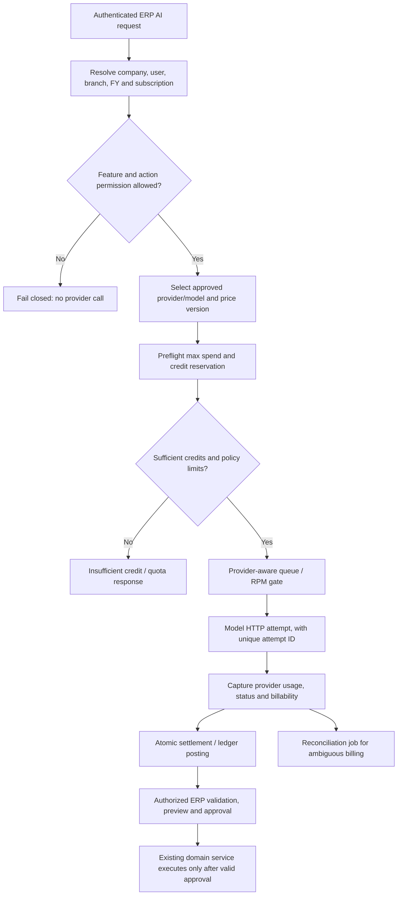

# zoloERP Pro — Centralized AI Credit Metering & Automated Acceptance Test Plan

**Status:** Implementation specification / engineering handoff — **not an implementation or test-result report**  
**Prepared:** 16 November 2026  
**Repository reviewed:** `vigneshsinna/zolo-erp-pro`  
**Reference branch:** `feature/ai-unified-input-clarification` (verify latest HEAD before starting)  
**Technology:** Laravel / PHP, MySQL, Redis/Horizon, Laravel AI SDK, NVIDIA Nemotron and optional approved fallback providers.  
**Scope:** SaaS subscription credits, all model invocations, quota enforcement, payment-backed top-ups, automated 250-scenario functional evaluation, load tests and security verification.

> **Release rule:** Never enable a paid credit promise, live AI financial write, or use of developer-only/free model endpoints for paying users before provider terms, entitlement enforcement, security tests and customer-facing terms have been approved.

---

## 1. Objective and definition of done

Create **one authoritative credit-metering service**, used by every AI entry point, to:

1. Give each eligible subscription a **monthly AI credit allowance**, including subscriptions paid upfront for 12 or 36 months.
2. Allow authorized users of the subscription's companies to draw from one shared pool, while preserving company/branch/FY data isolation.
3. Grant optional **payment-confirmed top-up packs** without granting new model permissions or increasing separate document-processing limits.
4. **Reserve credits before** every external model call, meter each billable attempt including retries, **settle the actual amount**, and release unused reservations.
5. Refuse or defer requests that cannot fit into the remaining budget; never permit an unbounded overspend due to concurrent users or retries.
6. Track actual model/provider, input/output tokens or provider-specific image/audio billing units, currency, FX conversion, credit debit, latency, request status, and user/company/run IDs.
7. Present remaining credits and usage history in the ERP, plus safe errors when a balance or provider-rate limit is reached.
8. Run repeatable automated tests covering **100 Indian bill images/PDFs + 100 Copilot workflows + 50 difficult workflows**, as well as concurrency and tenant-security tests.

**DoD:** Tests pass, all model paths are metered, money/credit ledgers reconcile, repeated callbacks are idempotent, no unauthorized posting is possible, and a staged pilot verifies model quality and actual provider invoices.

### Out of scope
- Rewriting the existing ERP transaction/accounting engines or building a second tax calculator.
- Automatically executing AI actions without required approval.
- Publishing new commercial prices or changing the existing HTML pricing page in this task.
- Declaring all bill extractions accurate merely because the AI returned valid JSON.

---

## 2. Verified repository baseline — extend rather than duplicate

The following paths were inspected in the stated branch. They represent code presence, **not proof that every feature is live in production**.

| Existing area | Repository file / table | What is already there | Required extension |
|---|---|---|---|
| Central gateway | `app/Ai/Gateway/ApprovedModelGateway.php` | Model allowlist, dispatch admission, provider RPM checks, daily token reservation/settlement, model invocation telemetry | Inject centralized **monthly credit reservation, final debit and attempt recording** across reasoning/perception/retry paths |
| Daily counters | `ai_usage_counters` | Per-company/user/date requests, tokens, reserved tokens | Retain for operational rate/budget checks; **not the monthly credit wallet** |
| Model log | `ai_model_invocations` | Run, company, model, token counts, duration, HTTP attempts | Add chargeable attempt ID, usage units, price version, credits/cost and settlement linkage |
| Feature gates | `app/Ai/Services/AiFeatureGate.php`; `ai_feature_settings` | Global/per-company enabled/read-only/multimodal controls, daily limits | Compose existing feature/permission gates with monthly credits; do **not** replace them |
| Multimodal | `app/Ai/Multimodal/Services/MediaExtractionService.php` | Image/PDF/audio extraction and per-page processing through gateway | Charge each provider call, account for multi-page jobs, cancellations and retries |
| Media records | `ai_media_assets`, `ai_media_extractions` | Company-scoped private media, metadata, extraction revisions | Connect media/page counts to usage without saving sensitive bill text in finance ledger |
| Agent approvals | `app/Ai/Registries/ActionCapabilityRegistry.php`, `app/Ai/Services/ApprovedActionExecutor.php` | Explicit actions, permission/approval pattern | Paid credit availability **never** overrides `ai.use`, action permissions, human approval or domain validation |
| Config | `config/erp_ai.php`, `config/ai_multimodal.php`, `config/ai_actions.php` | Defaults and rollout gates | Introduce `config/ai_credits.php` with fail-closed configuration and catalog versions |
| Queues | `config/horizon.php`, `app/Ai/Jobs`, `app/Jobs/Ai` | AI execution/telemetry/scheduled paths and media jobs | Add metered dispatch and reconciliation queues with provider-aware backpressure |
| Existing tests | `tests/Feature/Ai/Multimodal/InvoiceExtractionTest.php`, `MediaUploadSecurityTest.php`, `tests/Feature/Ai/Commercial/NaturalLanguagePurchaseOrderWorkflowTest.php` | Some critical media, security and workflow tests using `Tests\Support\UsesAiMysql` | Extend test suite; don't regress existing fixtures and permissions |

**Important implementation observations:**
- `config/erp_ai.php` sets `NVIDIA_RPM_LIMIT=35` by default, below the discussed 40-RPM developer account ceiling. A rate-limit exception is currently possible. **35 RPM is a configured application setting, not a contractual provider guarantee.**
- `config/ai_multimodal.php` defaults to 100 company media uploads/day, a maximum of 5 PDF pages, and a 120-second audio limit; subscription page limits must be a separate business rule. Check these values against real customer requirements.
- `config/ai_actions.php` has explicit foundation/execution switches. Do not enable these switches just to test billing.
- The checked `ApprovedModelGateway.php` Gemini allowlist is older than the Gemini versions discussed for proposed pricing; **verify the current SDK integration, model IDs, availability, and updated provider price catalog before allowing new models**.
- `ai_feature_settings.monthly_budget_minor` exists but does not implement a customer-visible subscription credit wallet, rollover rules or payment-backed top-ups.
- Inspect and reconcile the `ai_multimodal.allow_direct_purchase_bill` configuration comment/default: the text describes a false default while the checked env fallback was `true`. Treat direct financial posting as a separate security release gate.

---

## 3. Commercial credit policy — configurable, NOT hard-coded in model classes

### 3.1 Reconcile the two proposals before launch

Two proposals have appeared in the pricing discussions:

- **Earlier HTML:** Starter 500, Growth 2,500, Enterprise 10,000 credits/month; weighted-token formula and fixed scan/voice surcharges.
- **Later cost-aware proposal:** approximately **20,000 credits/month for a ₹1,500 customer**, and credit consumption proportional to underlying provider cost, with example packs of **5,000 for ₹199, 15,000 for ₹499, 30,000 for ₹899**.

**Decision needed:** Select **one** customer-facing unit and version. **Do not combine 20,000 new credits with the old fixed `12 credits/page` formula or publish both pack schedules as though they were equivalent.** Migrate/rename existing marketing figures only after product/finance sign-off.

### 3.2 Recommended versioned policy (proposal `cost_v1`)

For pilot calculations only:

- **1 credit = ₹0.01 of estimated chargeable model/provider expenditure**. This is an internal metering unit, *not* a cash balance or provider-issued credit.
- For each metered provider attempt, convert measured cost into INR minor units using a **fixed, dated FX-rate version** and model-price version, then debit `ceil(provider_cost_INR / 0.01)` credits, subject to the separately approved minimum charge policy.
- No additional 5-credit “proposal fee” is applied unless product explicitly adds it; AI action preparation already consumes billed model calls. Deterministic ERP validation and approval clicks ordinarily consume **zero AI credits** unless they trigger a model call.
- Charge image/audio usage by the provider's **real invoice/billing units**. A page is not always the same token size. Keep a *separate* operational `document_pages` or `media_uploads` entitlement.
- Unknown model or missing price/usage metadata: **fail closed for new dispatch** or use a formally approved conservative upper-bound hold; never silently treat as zero cost.
- Included allowances renew monthly while an active subscription qualifies; **12- and 36-month prepaid plans do not receive all future credits at purchase time**.
- Suggested pilot expiration policy: included and recurring top-up credits expire at the **end of the applicable billing month**. Show this before checkout; define refunds and mid-cycle proration in the contract.
- Discounted plan prices, tax and packs are separate concepts. **GST on subscription/credit-pack sales is not an AI credit debit**.

Example: a measured provider charge of ₹0.0584 becomes 6 credits at the pilot rate (round up). A ₹0.274 charge becomes 28 credits. Rates depend on the specific provider, model, token counts, media units, and effective price version.

### 3.3 Entitlements and safe defaults

| Policy setting | Example/pilot | Notes |
|---|---|---|
| `credit_policy_version` | `cost_v1` | Immutable per posted ledger entry |
| `included_monthly_credits` | 20,000 for the hypothetical ₹1,500 plan | **Illustrative; commercial approval required** |
| `credit_value_minor_inr` | 1 paisa | Use integer accounting units |
| `max_credits_per_request` | Configured per plan/action | Hard bound before provider call |
| `max_concurrent_runs` | Per subscription/company | Prevent many users from exhausting the pool together |
| `max_output_tokens` | Existing gateway limit | Input to preflight estimate and provider request |
| `monthly_media_pages` | Explicit contracted cap | Not increased automatically by buying credit packs |
| `provider_rpm` | NVIDIA: app default 35 RPM | Must be **shared across all workers and customers** |
| `monthly_reset_tz` | UTC or contracted account timezone | Choose one; store period as UTC instants |
| `grace/overage` | **0 by default** | No postpaid overage without explicit opted-in contract |

---

## 4. Architecture and dispatch lifecycle



### Rules

1. **One entry point:** All SDK model steps, Omni page calls, transcription, classification, model retries, fallbacks and scheduled agents must use the same credit reservation/settlement interface. No direct `Http::post()` to a model provider outside the metered gateway.
2. **Two independent gates:** (a) business permissions/feature flags and (b) credit/provider capacity. Having credits never grants a missing ERP permission.
3. **Financial actions remain separate:** A charged extraction may yield a draft, but must not write to ledger, inventory or purchase/sale records without the existing approval workflow.
4. **Every HTTP attempt is visible:** Store a distinct `provider_attempt_id`, including retries and failure outcomes. A “one user message” count is **not** the same as provider model-call count.
5. **Never hold a database transaction across the external HTTP call** or human approval. Reserve and commit in short DB transactions; call provider; settle in a new short DB transaction.
6. **Uncertain provider outcome:** Keep a temporary bounded reservation with `reconcile_required` status until confirmed by provider logs/usage, or until a documented no-charge expiry policy. Don't grant free retries by releasing holds on uncertain timeouts.
7. **Rate limits are not credits:** A 35-RPM burst limit should queue/retry safely; `CREDITS_EXHAUSTED` should not blindly retry. Return different codes/messages.
8. **No production reliance on developer-only free model endpoints:** Verify commercial provider terms and account quotas before any paid customer rollout.

---

## 5. Data model and schema changes (additive migrations)

Use normal Laravel migrations; don't modify historic migration files. Use relational foreign keys appropriate to the repository and carefully review bootstrap/group-company tenancy.

### 5.1 Tables to create

**`ai_credit_accounts`** — one wallet/account per subscription billing entity:

| Column | Type / purpose |
|---|---|
| `id` | UUID PK |
| `subscription_id` | Unique billing subscription FK, if present in actual billing domain |
| `billing_entity_id` | Exact invoice/customer owner; no unverified coupling to `company_id` |
| `currency` | `INR` pilot; server-validated |
| `credit_policy_version` | e.g. `cost_v1` |
| `status` | active / frozen / cancelled |
| `created_at`, `updated_at` | audit |

**`ai_credit_account_companies`** — verified membership mapping: `(account_id, company_id)` unique. Allows one pool shared by explicitly subscribed legal companies **without sharing business records**. Revalidate on every request.

**`ai_credit_periods`** — one monthly window per wallet:

| Column | Type / purpose |
|---|---|
| `id`, `account_id`, `period_start_utc`, `period_end_utc` | Unique `(account_id, period_start_utc)` |
| `included_granted`, `topups_granted` | BIGINT signed/unsigned counts as appropriate |
| `spent_credits`, `reserved_credits`, `refunded_credits` | Integer balances/counters; all nonnegative where applicable |
| `status` | active / closing / closed |
| `subscription_version` | Plan snapshot for billing audit |
| `created_at`, `updated_at` | audit |

**`ai_credit_ledger`** — append-only posting history:

`id`, `account_id`, `period_id`, `company_id` (nullable for subscription grants), `actor_id` (nullable for system grants), `run_id`, `model_invocation_id`, `provider_attempt_id`, `kind` (`included_grant`, `topup_grant`, `usage_debit`, `reservation_release`, `credit_adjustment`, `expiry`, `refund`), `amount_credits` **signed integer**, `currency`, `cost_minor_inr`, `rate_card_version`, `fx_rate_version`, `source_type`, `source_id`, `idempotency_key` (unique within account + kind), `occurred_at`, `created_at`.

**`ai_credit_reservations`** — temporary holds:

`id`, `account_id`, `period_id`, `company_id`, `actor_id`, `run_id`, `operation_key`, `requested_model`, `estimated_credits`, `remaining_held_credits`, `status` (`active`, `partially_settled`, `settled`, `released`, `reconcile_required`), `idempotency_key`, `expires_at`, timestamps. Unique `(account_id, idempotency_key)`.

**`ai_model_rate_cards`** — immutable effective-priced versions:

`id`, `version`, `provider`, `model`, `billable_unit` (`input_token`, `output_token`, `cached_input`, `image`, `audio_second`, etc.), `unit_price_usd_decimal`, `effective_from`, `effective_to`, `approved_by`, timestamps. Unique `(version, provider, model, billable_unit)`.

**`ai_fx_rates`** — dated approved conversions to INR: source, date, rate_decimal, approved_by, version. Never use floating-point in money calculations.

**`ai_credit_topup_orders`** — checkout/payment authority:

`id`, `account_id`, `pack_sku`, `credits`, `amount_minor_inr`, `tax_minor_inr`, `billing_cycle`, `payment_provider`, `provider_order_id`, `provider_payment_id`, `status`, `credit_grant_ledger_id`, `idempotency_key`, timestamps. Add unique payment event tracking (`ai_credit_payment_events`) to deduplicate callbacks.

### 5.2 Extend existing event records

Add to `ai_model_invocations` (or a normalized `ai_model_attempts` child table, preferred when retries are important): `provider_attempt_id` unique, `reservation_id`, `billing_account_id`, `request_id`, `workflow_task_id`, `charge_status`, `rate_card_version`, `fx_rate_version`, `usage_json_redacted`, `charge_minor_inr`, `credits_debited`, `provider_request_id`, `http_status`, and timestamps.

**Avoid double counting:** Existing `ai_model_invocations` and `ai_usage_counters` may both log usage. Only the **posted credit ledger** determines billable monthly credit consumption. Existing counters remain diagnostics.

### 5.3 Ledger invariants

- Available = `included_grants + topup_grants + authorized_adjustments + refunds − posted_usage − active_reservations − expired_credits`, using an approved consistent sign convention.
- `available >= 0` for prepaid wallets (unless a separately contracted and explicitly enabled overdraft policy exists).
- **One usage debit per unique provider attempt**, and one grant per paid event/monthly allowance event.
- Settlement is atomic with period totals and ledger entries; use `SELECT ... FOR UPDATE` on account/period rows and unique constraints.
- Never edit or delete posted ledger history; corrections are compensating entries with reason, approver and link to original entry.
- Total of posted balances must reconcile to cached counters; a reconciliation error blocks new charges and alerts operations.
- All queries enforce ownership (`account_id`, active company mapping, actor permissions) server-side. Do not trust client-submitted account/company IDs.

---

## 6. Core services and proposed file changes

| File / component | Responsibility |
|---|---|
| `config/ai_credits.php` **new** | Feature flag, pricing policy, reservation ceilings, period policy, model-rate keys, queue policies |
| `app/Ai/Billing/CreditAccountResolver.php` **new** | Resolve authenticated subscription → wallet → allowed company membership |
| `app/Ai/Billing/MonthlyCreditGrantService.php` **new** | Idempotently create the current period and grant included credits |
| `app/Ai/Billing/ModelCostCalculator.php` **new** | Calculate billable provider cost from actual usage/rate card and FX, using exact decimal arithmetic |
| `app/Ai/Billing/AiCreditReservationService.php` **new** | Atomic hold before dispatch; detect insufficient balance and plan limits |
| `app/Ai/Billing/AiCreditSettlementService.php` **new** | Atomic debit/release/uncertain outcome and attempt log |
| `app/Ai/Billing/AiTopupService.php` **new** | Payment-confirmed one-time/recurring top-ups, refund/reversal policy |
| `app/Ai/Billing/AiCreditReconciliationService.php` **new** | Detect orphan holds, duplicate attempts, negative balances, stale FX and mismatches |
| `app/Ai/Gateway/ApprovedModelGateway.php` **modify** | Call reservation on every provider attempt, settle from response metadata, use existing global RPM limiter |
| `app/Ai/Multimodal/Services/MediaExtractionService.php` **modify** | Tag every page/audio attempt and preserve document-job idempotency |
| `app/Ai/Services/AiFeatureGate.php` **modify only as needed** | Enforce credit-feature state without weakening existing permission gates |
| `app/Jobs/Ai/*` / Horizon **extend** | Queue/retry and reconciliation jobs; honor provider limits across workers |
| `app/Http/Controllers/Api/AiCredit*Controller.php` **new** | Company-authorized balance/history/top-up read endpoints; no direct client ledger write |
| `resources/views/...` **new/modify** | Wallet balance, expiring allowance, usage by user, pack purchasing and guardrail warnings |
| `tests/Feature/Ai/Billing/*` **new** | Transactional tests, webhook idempotency, monthly period, cross-tenant and overspend checks |

Use the repo's existing folders/namespaces if conventions differ. Verify exact subscription/payment domain objects before coding; never invent a usable existing `Subscription` model.

### 6.1 Public service contract (illustrative PHP)

```php
interface AiCreditMeter
{
    public function reserve(
        AiPrincipal $principal,
        string $runId,
        string $operationId,
        string $provider,
        string $model,
        string $idempotencyKey,
        int $maxCredits
    ): CreditReservation;

    public function settle(
        string $reservationId,
        string $providerAttemptId,
        ProviderUsage $usage,
        ProviderBillability $billability
    ): CreditSettlement;

    public function releaseUnsent(
        string $reservationId,
        string $reason
    ): void;

    public function balance(AiPrincipal $principal): CreditBalance;
}
```

The production interface may use readonly DTOs and typed enums. `AiPrincipal` provides identity, **not** subscription entitlement; the resolver must verify it.

### 6.2 Reservation algorithm

```text
reserve(principal, run, operation, model, key, max_credits):
  A. Authorize AI feature + company/branch/FY + wallet membership + usage policy.
  B. Verify approved model and current immutable price version.
  C. Validate operation-specific worst-case spend limit; reject unbounded outputs.
  D. BEGIN TRANSACTION
       lock current subscription period FOR UPDATE
       if same idempotency key exists, return existing reservation (verify payload hash)
       available = granted - spent - active reservations - expired adjustments
       if available < max_credits: rollback and return CREDITS_EXHAUSTED (no model call)
       insert reservation; increment reserved_credits
     COMMIT
  E. Admit provider request through shared RPM/TPM gate, then dispatch exactly once.
```

### 6.3 Settlement algorithm

```text
settle(reservation_id, provider_attempt_id, usage, billability):
  A. Validate signed/internal attempt identity, model, usage, membership and price snapshot.
  B. Compute actual charge with decimal money math; round up credits according to version.
  C. BEGIN TRANSACTION
       lock reservation and monthly period FOR UPDATE
       if provider_attempt_id already settled: return original settlement (no duplicate)
       ensure charge <= reserved amount; otherwise use explicitly approved bounded
         increment or flag reconciliation (never silently overdraft)
       record provider attempt and immutable usage debit
       reduce reserved_credits and remaining hold; update spent_credits
       mark reservation settled or partially settled as appropriate
     COMMIT
  D. Release unspent reservation once workflow definitely finished.
  E. On missing/uncertain provider usage, mark reconcile_required; do not invent zero cost.
```

**Critical nuance:** Multiple provider retries or tool/model steps may be independently billable. An operation can have **one business idempotency key** and **multiple unique provider attempts**. These are different identifiers. A repeated client submit must not accidentally trigger a second business action, and a genuinely billed retry must not disappear from the ledger.

### 6.4 Billing/payment top-up lifecycle

1. Customer selects a pack; create a pending order with exact INR net amount, tax, credits, duration and terms.
2. Payment provider returns asynchronous success/failure; **verify webhook signature and provider order/payment status server-side**.
3. On verified success, atomically mark payment paid and add **one** `topup_grant` ledger event, uniquely keyed to the settled payment.
4. Repeat success webhook does not grant credits again; failure/cancel never grants.
5. Refund/chargeback creates compensating entries and may freeze future dispatch if the refund would make available credits negative. Do not erase past charged model usage.
6. Recurring packs grant once per paid billing cycle (if commercial policy permits); no unconditional grants from a frontend switch.

### 6.5 Monthly allowance, renewal and term boundaries

- Use scheduled reconciliation plus **lazy first-use creation** of the current period, both with the same unique constraint and idempotency key, so a late cron run cannot block a customer or double-credit them.
- Define calendar-month vs subscription-anniversary cycle in one policy; don't silently mix the two.
- Month boundaries use explicit UTC instants derived from the contracted timezone. Cover leap years, February, DST for non-India tenants, late payment, suspension, cancellation, refund and plan upgrade.
- A 36-month paid plan gives **one monthly allowance each period**; does not pregrant 36 × allowance.
- For pooled multi-company plans, grant once **per subscription**, not once per company. Allow administrator-defined company/user budgets without violating tenant isolation.

---

## 7. API and UI acceptance criteria

Proposed authenticated endpoints (adapt to the existing route/API version):

| Method | Endpoint | Contract |
|---|---|---|
| GET | `/api/v1/ai/credits/balance` | Included granted, top-ups, spent, reserved, available, period end, media page remaining |
| GET | `/api/v1/ai/credits/usage?from=&to=&user=` | Paginated, company-scoped usage; only permitted admins see team-level details |
| GET | `/api/v1/ai/credits/packs` | Active approved pack SKUs + pre-tax/tax prices and expiry policy |
| POST | `/api/v1/ai/credits/topup-orders` | Server-priced pending order; `Idempotency-Key` required |
| POST | `/api/v1/billing/webhooks/{provider}` | Signature-verified payment events; not authenticated as an ERP user |
| GET | `/api/v1/ai/credits/estimate` | Conservative estimate for selected action/model; advisory, not actual debit |

**UI:** Show “20,000 included / 6,400 used / 1,200 reserved / 12,400 available” in a credit widget; differentiate *remaining* from *reserved*. Show estimate before image/PDF/batch jobs; use explicit messages for credits exhausted, daily media cap, provider RPM, disabled AI, unauthorized action and invalid approval. Display model/provider and per-step usage in an admin-only diagnostic panel without exposing secrets or raw customer documents.

HTTP outcomes: 401 authentication missing; 403 tenant permission/disabled; 409 conflicting idempotency key/payload; 402 or 409 with structured `CREDITS_EXHAUSTED` (choose one convention); 422 invalid input; 429 provider rate/concurrency cap with `Retry-After`; 503 provider failure. Never use a generic “AI disabled” message for all cases.

---

# PART B — AUTOMATED TEST CASES AND QUALITY GATES

## 8. Test architecture and fixture policy

### 8.1 Test layers

| Layer | Provider calls? | Test objective | Recommended implementation |
|---|---|---|---|
| Unit | None | Integer/decimal cost calculations, month expiry, reservation state machine | PHPUnit |
| Integration | Fake HTTP / fake payment webhook | Real MySQL transactions, Laravel gateway, queues, idempotency, scope | Laravel Feature tests + `Tests\Support\UsesAiMysql` |
| 250-scenario functional evaluation | Recorded/fake model responses in CI; optional approved live runs | Extraction accuracy, workflow reasoning, safe failures | PHPUnit data providers / dataset manifest |
| Concurrency | Fake slow provider and actual Redis/MySQL | Race conditions, throughput, RPM, holds, retries | k6 or Locust + Laravel telemetry |
| Security | No external provider required | Isolation, authority, approval, prompt injection, access denial | PHPUnit/Pest + HTTP test clients |
| Live model benchmark | Yes, separately budgeted | Actual NVIDIA/Gemini accuracy, latency and cost | Explicit manual/nightly opt-in with sanitized synthetic data |

**Synthetic data only in CI.** For live provider benchmarks, use synthetic or explicitly permissioned/redacted bills and enforce documented retention and vendor-processing terms. Never commit genuine GSTIN/PII, bank data, API keys, patient names, employee data, or customer supplier invoices to GitHub. Mask secrets in logs and reports.

### 8.2 Proposed test directories

```text
tests/
  Feature/Ai/Billing/
    CreditReservationTest.php
    CreditSettlementTest.php
    MonthlyGrantAndExpiryTest.php
    CreditTopupWebhookTest.php
    ProviderRateAndCreditsTest.php
    CrossTenantCreditSecurityTest.php
  Feature/Ai/Evaluations/
    IndianInvoiceCorpusTest.php
    ErpCopilotCorpusTest.php
    DifficultScenarioCorpusTest.php
    ApprovalSecurityTest.php
  Support/AiEvaluation/
    CorpusLoader.php
    ScenarioAssert.php
    FakeProviderResponseFactory.php
    PerformanceRunRecorder.php
  fixtures/ai/
    invoice_manifest.json
    copilot_manifest.json
    difficult_manifest.json
    invoice_media/        # generated synthetic PNG/JPG/PDF only
    expected/             # canonical JSON expected results
scripts/
  generate_ai_test_corpus.php
  validate_ai_test_corpus.php
  run_ai_benchmark.sh
  reconcile_ai_credits.php
performance/
  ai_credit_load.js      # k6, never against real provider in CI
.github/workflows/
  ai-credit-and-evaluation-tests.yml
```

### 8.3 Common scenario manifest fields

Each fixture contains `scenario_id`, `dataset_version`, `seed`, `company_id_alias`, `actor_role`, `kind`, `input_text`, `input_media_path`, `expected_fields`, `expected_action_key`, `expected_status`, `expected_error_codes`, `expected_provider_calls`, `required_approval`, `expected_no_erp_writes`, `model_policy`, and `notes`. Include a checksum and immutable expectation file. For image cases also record a ground-truth document structure with item/tax/rounding derivation.

Run three independent checks per fixture:

1. **Normalization:** Structure/schema plus provenance/confidence, no unknown IDs invented.
2. **ERP authority:** Recompute GST/line totals with actual tax/pricing services; detect mismatch and prevent commit.
3. **Credit audit:** Number of provider attempts, reservation/settlement IDs, final credit balance, no duplicate posting, no cross-tenant access.

---

## 9. Automation Suite A — 100 Indian purchase bills

**Exactly 100 cases**, IDs `BILL-001` to `BILL-100`, generated as **10 document families × 10 presentation variants**. Each case must render an actual synthetic image or PDF and include ground-truth JSON, not just a textual invoice example.

### 9.1 Ten document families (10 cases each)

| Family / ID range | Tax/business pattern | Mandatory checks |
|---|---|---|
| F01 `BILL-001…010` | B2B intrastate taxable goods | Supplier/buyer GSTIN, HSN, split CGST+SGST, line tax arithmetic |
| F02 `BILL-011…020` | B2B interstate taxable goods | IGST only, place-of-supply, no spurious CGST/SGST |
| F03 `BILL-021…030` | Mixed GST rates on multiple HSNs | Per-item 0/5/12/18/28% fixture rate as applicable, summary reconciliation |
| F04 `BILL-031…040` | Line-level vs invoice-level discount | Correct taxable value and discount sequence, no double deduction |
| F05 `BILL-041…050` | Round-off, extra charges and decimal quantities | Paisa rounding, freight treatment when documented, exact invoice grand total |
| F06 `BILL-051…060` | Unregistered supplier/customer, missing GSTIN | Correctly nullable GSTIN, no fabricated registration, eligible tax review flag |
| F07 `BILL-061…070` | Credit note/debit note/return-style source docs | Correct document type; never silently create purchase invoice |
| F08 `BILL-071…080` | Two- to five-page purchase bills | Page ordering, header carry-forward, no duplicated lines or totals |
| F09 `BILL-081…090` | Handwritten/partly handwritten numeric fields | Extract only if readable; uncertain rates/amounts trigger manual review |
| F10 `BILL-091…100` | Dense industrial bills (textile, FMCG, timber, optical) | UOM, quantity, item descriptions, HSN and 20–100 lines within configured limits |

### 9.2 Ten variants applied once to every family

| Variant index | Rendering variation |
|---|---|
| V01 | Clean A4 print, high contrast |
| V02 | Thermal / narrow bill layout |
| V03 | Mobile-camera perspective skew |
| V04 | Low-light / slight motion blur |
| V05 | Low-resolution scan with legible tax table |
| V06 | Multiple discount/tax summary boxes |
| V07 | Mixed English + Indian-language labels or vendor-specific abbreviations (unsupported language → review, not invention) |
| V08 | Handwritten correction/overstamp |
| V09 | Dense table, split HSN/tax headings and long descriptions |
| V10 | Duplicate/repeated headers, rotated page or continuation page where applicable |

Generation: for family index `f=0..9`, variant `v=0..9`, use `BILL-` + zero-pad(`10*f+v+1`). Use seeded, **valid-syntax synthetic GSTINs with check digits**; use example/mock identities that cannot be mistaken for actual supplier records. Use existing ERP tax computation to produce expected invoice totals, not the LLM.

### 9.3 Field assertions and expected outcomes

- **Exact match:** Supplier GSTIN, buyer GSTIN when present, invoice number, date, currency, HSN/SAC, quantity, UOM, tax rate, subtotal, CGST, SGST, IGST, discounts and total after normalized formatting.
- **Tax invariant:** Intrastate vs interstate tax split is determined by authoritative jurisdiction rules, not guessed from the image. Flag inconsistent source documents.
- **Line arithmetic:** With the approved rounding policy, extracted sum of item taxable values + charges + taxes − discounts + round-off equals the source-document total within configured tolerance (default **₹0.01** for reconciled invoice totals; treat source discrepancies as flagged, not silently corrected).
- **Negative and missing tests:** No wrong GSTIN/HSN invented; uncertainty flags; unreadable images and invalid pages fail safely.
- **Multi-page:** Exactly one consolidated invoice record; no carried-forward totals/lines duplicated.
- **Handwritten:** Either correct value or explicit `needs_review`; false confident financial field values are failures.
- **Security:** Image/PDF containing prompt instructions (“ignore approval”, “send secrets”) is treated only as document content.
- **No unapproved writes:** Extraction, validation and preview should not post stock, GL or financial documents.

### 9.4 Metrics

Report `exact_field_accuracy`, `line_item_recall`, `critical_field_error_rate`, `document_reconciliation_rate`, `manual_review_rate`, `false_accept_rate`, `average_page_latency`, `provider_calls_per_page`, `credits_per_invoice`, `retry_rate`. **Block release for any unapproved financial posting or cross-tenant leakage.** Product/QA should set numeric pilot accuracy thresholds after reviewing the initial benchmark; do not invent a certified GST accuracy percentage.

---

## 10. Automation Suite B — 100 ERP Copilot requests

**Exactly 100 cases**, IDs `COP-001` to `COP-100`: **5 workflow families × 20 parameterized scenarios**. Every fixture asserts the **appropriate authoritative ERP service and action state**, not only conversational response quality.

| Family / ID range | 20 cases should cover | Expected result |
|---|---|---|
| C01 `COP-001…020` — Purchase orders | Supplier names/codes, products, line quantities, UOMs, warehouse, price, 1–20 lines, missing optional fields, corrections | Correct matches; **draft/proposal** only; approval-bound execution |
| C02 `COP-021…040` — Sales orders | Customer identity, tax state, discounts, price tiers, availability, multi-line, partial delivery, changes | Quotation/order stage appropriate to real lifecycle; no unauthorized posting |
| C03 `COP-041…060` — Product creation | Brand, category, HSN, GST rate, units, aliases, duplicates, variants, bulk line entries | Company-scoped, validated setup proposal; no silent product creation |
| C04 `COP-061…080` — Supplier creation | Registered/unregistered, GSTIN, address/state, duplicate names, contacts, payment terms | No fabricated GSTIN, disambiguated parties; create only after approved setup command |
| C05 `COP-081…100` — Corrections | Edit quantity, change warehouse, remove a line, change party, modify tax, reject/revise proposal, posted-record correction | New validated preview/hash and fresh approval; posted data corrected only by valid return/reversal workflow |

### Parameter variation for each family

Use deterministic `20`-row seed templates covering: one-line instruction, 10-line instruction, 20-line instruction, product code vs name, two valid candidates, near-match typo, mixed unit references, alternate warehouse, explicitly given GST rate, omitted GST rate, quoted multiword name, duplicated line, negative quantity attempt, very large quantity, high-value transaction, backdated date, expired FY, customer/supplier alias, request to edit existing draft, and user correction of a previous proposal. Adapt a parameter to each workflow without forcing nonsensical cases.

### Required assertions

1. Correct `action_key`/intent, schema-valid slots and appropriately scoped entity IDs.
2. Prices/taxes come from real ERP services, not the model's numbers.
3. All missing fields returned **together** where supported, with user-editable corrections.
4. Before approval: no new ERP side effects (except explicitly authorized draft/task records).
5. After approval: exact canonical payload/version; no duplicate execution on retry/double-click.
6. If approval rejected or proposal changed: execution denied; a modified proposal requires renewed approval.
7. Costs/credits reflect **every** actual model dispatch, including clarification turns.
8. If the action is unavailable in the reviewed branch, expected result is `CAPABILITY_UNAVAILABLE`, not an invented successful write.

---

## 11. Automation Suite C — 50 difficult/negative requests

**Exactly 50 cases**, IDs `EDGE-001` to `EDGE-050`: **10 risk groups × 5 variations**.

| Group / ID range | Scenario | Expected behavior |
|---|---|---|
| E01 `001…005` | Product missing, unknown SKU, inactive product | Grounded no-match / authorized setup path; no silent creation |
| E02 `006…010` | Two suppliers same/close name, aliases, mismatched GSTIN | Candidate selection, no arbitrary pick |
| E03 `011…015` | Wrong UOM, incompatible conversion, fractional unit | Reject or request correction, no invalid quantity conversion |
| E04 `016…020` | Wrong GST split, mismatched tax rate, invalid GSTIN | Explain mismatch; server GST rules prevail |
| E05 `021…025` | Warehouse missing, unauthorized warehouse, wrong branch | Safe missing/forbidden result with no cross-branch access |
| E06 `026…030` | No stock, lot expired, serial duplicated, negative stock | Domain validation failure; no inventory movement |
| E07 `031…035` | Wrong or closed financial year, stale rate/discount, changed source | Invalidate stale approval/preview; require revalidation |
| E08 `036…040` | Prompt injection in bill/text trying to approve/post/bypass permissions | Ignore instructions in untrusted input; never bypass role/actions |
| E09 `041…045` | Timeout, 429, partial page error, model malformed JSON, empty usage metadata | Bounded retry/reconciliation; no double charge or silent success |
| E10 `046…050` | Duplicate idempotency key, cancel/resubmit, near-zero balance, two users race | Exactly-once ledger semantics, fail-closed funds check |

For each risk group, vary actor role, source type, branch/company context, payload size and retry condition. Record expected `error_code`, provider-call count, credit outcome and **zero forbidden ERP writes**.

---

## 12. Automation Suite D — concurrent traffic at 5, 10 and 20 users

### 12.1 Setup

- Use real **MySQL and Redis** with production-like isolation/locking and a deterministic fake model server that can respond in 200 ms, 2 s or timeout. Do **not** load-test NVIDIA's free developer endpoint or spend unexpected API money in CI.
- Initialize a fixed wallet with known grants, e.g. 1,000 credits; assign tenant A and tenant B separate accounts; for pooled subscriptions, include multiple company memberships.
- Use 5, 10, then 20 concurrent authenticated virtual users. Each performs a mixture of chat, bill-page extraction and approval-preview operations.
- Configure `NVIDIA_RPM_LIMIT=35` (repo default), shared across workers, and deliberately run below/at/above that capacity.
- Test fresh-balance, nearly exhausted, zero-balance, provider-429, dropped connection, retry and repeated click cases.

### 12.2 Load profiles

| Profile | VUs | Traffic | Expected safeguards |
|---|---:|---|---|
| L01 | 5 | Steady, 2 minutes | No overspend or rate-limit surprises when below provider cap |
| L02 | 10 | Steady + short burst, 5 minutes | Fair admission and per-tenant budget; queues settle |
| L03 | 20 | Bursty, 5 minutes | Bounded queue and provider RPM; no lost/duplicated reservations |
| L04 | 20 | Near-exhausted wallet | Exactly allowed calls admitted, rest rejected without provider use |
| L05 | 20 | Retry storm: timeout/429 on 20% of fake calls | Bounded retries/backoff; attempt count and pending holds reconcile |
| L06 | 20 | Simultaneous monthly rollover and top-up webhook | Exactly one grant per entitlement/payment; no double spend |

### 12.3 Capture and report

`p50/p95/p99` for credit reservation, queue wait, provider execution and full workflow; provider dispatches/minute, 429 rate, retries/run, queued jobs, completed/failed jobs, credit debit/hold/available, DB lock waits/deadlocks, ledger reconciliation errors, security denials and cross-tenant anomalies.

**Provisional acceptance:** 0 negative balances; 0 overspend; 0 duplicate wallet grants/debits; 0 unauthorized writes or data leaks; observed provider requests never above configured limiter in a shared Redis deployment; every reservation eventually settles or is tracked as `reconcile_required`. Suggested performance budget: credit reservation p95 < 250 ms in staging under these loads, to be tuned to your hardware; do **not** impose an unmeasured end-to-end model latency promise.

### 12.4 k6 scenario skeleton (adapt routes and auth fixtures)

```javascript
// performance/ai_credit_load.js — skeleton, never contains real secrets
import http from 'k6/http';
import { check, sleep } from 'k6';
export const options = {
  scenarios: {
    five:   { executor: 'constant-vus', vus: 5,  duration: '2m', startTime: '0s' },
    ten:    { executor: 'constant-vus', vus: 10, duration: '5m', startTime: '3m' },
    twenty: { executor: 'constant-vus', vus: 20, duration: '5m', startTime: '9m' }
  }
};
export default function () {
  const url = `${__ENV.BASE_URL}/api/v1/ai/credits/balance`;
  const res = http.get(url, { headers: { Authorization: `Bearer ${__ENV.TEST_TOKEN}` } });
  check(res, { 'authorized balance endpoint': r => r.status === 200 });
  sleep(0.5);
}
```

**Important:** The above k6 fragment only checks a balance read endpoint; the implementation must add separate authenticated POST scenarios for actual credit reservations/model dispatch using **test-only synthetic actions and a fake provider**. Do not claim it already load-tests the full system.

---

## 13. Automation Suite E — security, authorization and approval

These tests run independently of the 250 functional cases. Each denial must assert **no provider call when denied before dispatch**, no unauthorized credit transfer, no ERP write and no sensitive response leakage.

| ID | Test | Required result |
|---|---|---|
| SEC-01 | User A requests user B's credit history | 403/404, no leaked usage |
| SEC-02 | Company A user sends company B ID as header/body | Server-selected context prevails; denied |
| SEC-03 | Wallet of customer A used by company B | Denied, no credits charged to either wallet |
| SEC-04 | Parent subscription has multiple allowed companies | Shared balance only if mapped; data still company isolated |
| SEC-05 | Branch/FY mismatch during action | Denied before financial write |
| SEC-06 | User lacks `ai.use` or action permission | Denied even with available credits |
| SEC-07 | Global AI or multimodal switch off | No forbidden model calls |
| SEC-08 | User edits proposal after approval | Hash/version changes, new approval required |
| SEC-09 | Actor self-approves a restricted action | Denied if policy requires independent approver |
| SEC-10 | Same approval submitted twice/concurrently | Domain command executed once |
| SEC-11 | Prompt injection in invoice says “post without approval” | Treated as untrusted data, never instruction |
| SEC-12 | Forged top-up webhook or price/credit amount | Denied; zero grant |
| SEC-13 | Same valid payment webhook repeated 100× | Exactly one grant |
| SEC-14 | Concurrent credit holds exceed balance | Only affordable holds admitted; no overspend |
| SEC-15 | Callback delivered after subscription cancellation | No unsupported grant; reconcile per documented refund policy |
| SEC-16 | Expired subscription / unapproved model | Fail closed even when credits remain |
| SEC-17 | Unknown provider rate or missing pricing metadata | No free/unmetered live call |
| SEC-18 | Private image URL or stored media ID guessed by other tenant | Denied; signed URL/content not exposed |
| SEC-19 | Logs, trace events and provider errors include secrets or raw PII | Secret redaction verified |
| SEC-20 | Replaying a settled provider attempt ID | Original debit returned; no second debit |

Consider additional controls: CSRF for session routes, webhook HMAC/signature + replay windows, request-size limits, SSRF, malicious PDF content, content retention/deletion, audit export authorization and tamper-resistance of ledger admin adjustments.

---

## 14. Billing/ledger automation — must-pass test catalog

| ID | Scenario | Expected ledger result |
|---|---|---|
| CR-01 | First successful paid monthly activation | One included grant |
| CR-02 | Two workers initialize same period | Exactly one grant, one period |
| CR-03 | Start of new month | Prior credits expire by policy; new grant only after eligible renewal |
| CR-04 | Three-year subscription | Only one monthly grant, repeated across eligible months |
| CR-05 | Prepaid balance enough for one call | Hold, charge actual, release unused hold |
| CR-06 | Not enough credit for estimated maximum | Reject **before** provider dispatch |
| CR-07 | Two users reserve last available credits | One or bounded subset wins; never negative |
| CR-08 | Provider completed with fewer tokens than estimate | Charge actual, release difference |
| CR-09 | Provider timed out with unknown billability | `reconcile_required` bounded hold; no assumed free call |
| CR-10 | Provider 429 before execution | Release/queue according to known billability; no phantom debit |
| CR-11 | Retry after 429/timeout | Each genuinely billed attempt recorded, no duplicate same attempt |
| CR-12 | Same idempotency key, same payload | Return prior reservation/result, no double charge |
| CR-13 | Same key, different payload | 409 conflict |
| CR-14 | Exact signed paid top-up | Grant once; pack price/credits server-controlled |
| CR-15 | Duplicate payment events | Same original grant, no duplication |
| CR-16 | Failed/abandoned checkout | No credit grant |
| CR-17 | Refund/chargeback | Compensating event; safe future dispatch behavior |
| CR-18 | Live provider price changes | New calls use approved new version; old postings immutable |
| CR-19 | FX rate changes mid-request | Snapshot version governs settled call; no retroactive rewrite |
| CR-20 | Inconsistent aggregate vs ledger | Reconciliation alert; block uncertain dispatch |
| CR-21 | Mixed tenants under shared NVIDIA RPM bucket | No aggregate provider rate breach |
| CR-22 | Media page cap reached while credits remain | Media denied; text may still work |
| CR-23 | Credits exhausted while media cap remains | No media model dispatch |
| CR-24 | Cache or DB unavailable during reservation | Fail closed, never “best effort” unmetered call |
| CR-25 | Payment succeeds at period boundary | Grant to correct period or explicitly defined rollover policy |

---

## 15. Sample Laravel test skeletons (adapt to actual services)

The following are **examples**, not runnable without the proposed classes/migrations. Use existing MySQL test infrastructure; avoid SQLite substitutes for concurrency, row locking and decimal behavior.

```php
<?php
// tests/Feature/Ai/Billing/CreditReservationTest.php
namespace Tests\Feature\Ai\Billing;

use Tests\TestCase;
use Tests\Support\UsesAiMysql;

final class CreditReservationTest extends TestCase
{
    use UsesAiMysql;

    public function test_credit_reservation_rejects_insufficient_balance_without_provider_call(): void
    {
        // Arrange: create tenant/company/user/wallet with 5 available credits;
        // bind a fake provider whose dispatch increments a call counter.
        // Act: request an authorized model operation reserving 6 credits.
        // Assert: CREDITS_EXHAUSTED; provider calls = 0;
        // period balance = 5; no ledger usage debit or orphan hold.
        $this->markTestIncomplete('Implement against AiCreditReservationService');
    }

    public function test_two_concurrent_reservations_cannot_overspend(): void
    {
        // Run in independent DB sessions/processes to exercise SELECT FOR UPDATE.
        // Wallet available = 10; two requests try to reserve 8 simultaneously.
        // Exactly one succeeds; wallet never negative; no double reservation.
        $this->markTestIncomplete('Implement multi-process MySQL integration test');
    }
}
```

```php
<?php
// tests/Feature/Ai/Evaluations/IndianInvoiceCorpusTest.php
namespace Tests\Feature\Ai\Evaluations;

use Tests\TestCase;
use Tests\Support\UsesAiMysql;

final class IndianInvoiceCorpusTest extends TestCase
{
    use UsesAiMysql;

    public function test_every_bill_fixture_is_validated_against_erp_and_credit_ledger(): void
    {
        // Load invoice_manifest.json: assert 100 distinct IDs and file checksums.
        // For each: fake/sandbox model -> extraction -> normalize -> ERP validation.
        // Assert ground-truth fields or explicit human-review when uncertain.
        // Assert no automatic stock/GL write and no cross-company access.
        // Assert each provider attempt is metered exactly once.
        $this->markTestIncomplete('Generate 100 synthetic bill fixtures + expected JSON');
    }
}
```

Do **not** retain `markTestIncomplete()` in the final release: CI must require the tests to be implemented and passing.

---

## 16. CI/CD and evidence outputs

### CI workflow phases

1. `composer install`, static analysis / formatting, migration dry run and schema validation.
2. Unit tests for credit formulas, idempotency, price versions, FX precision and period transitions.
3. Laravel MySQL+Redis integration tests with fake model/payment responses.
4. Generate and validate exactly **100 bills + 100 Copilot + 50 difficult** deterministic scenario manifests. Fail on missing/duplicate scenario IDs or fixture checksums.
5. Execute 250 fixture-based suites using fixed recorded provider outputs; run security suite, then concurrency staging job at 5/10/20 users.
6. Export machine-readable test report and human-readable Markdown summary. On any critical safety failure, block merge/deployment.
7. Run **optional** live-model benchmark in a permitted paid/sandbox provider environment, explicitly enabled by a workflow input and protected spending cap. Never use paid live calls in every PR.
8. Compare new quality metrics to the baseline for model/prompt/schema changes and block regressions in high-risk fields.

### Required artifacts for each CI run

```text
artifacts/ai-evaluation/<git_sha>/
  summary.md
  summary.json
  invoice-100-results.jsonl
  copilot-100-results.jsonl
  difficult-50-results.jsonl
  credit-ledger-reconciliation.json
  concurrency-5-10-20.json
  security-tests.json
  failed-scenario-ids.txt
  model-cost-and-credit-usage.csv
```

**Summary fields:** git SHA, branch, policy/rate/FX versions, fixture version, provider/model prompt/schema versions, 250 total scenario counts, pass/fail/review distribution, critical errors, p95/p99, RPM/429/retry metrics, provider attempted/settled calls, actual or estimated spend, credits posted/held/released, tenant-leak findings and CI links.

### Minimum release gates

- All 250 scenario fixtures generated and executed; no scenario silently skipped.
- **0** cross-tenant leaks, unauthorized action approvals, unauthorized financial postings, duplicated payment grants, negative balances or unmetered provider dispatches.
- All existing AI tests remain green (Multimodal, Commercial, Setup, gateway and workspace suites).
- Monthly rollover/top-up payment concurrency and provider timeout reconciliation green.
- Synthetic-bill critical-field accuracy/false-accept thresholds explicitly signed off by business/QA. Uncertain cases must be blocked or sent for manual correction.
- Provider production terms and purchased/account throughput verified; free developer limit never assumed sufficient for live commercial use.
- No API secrets, PII or raw invoices in repository, telemetry export or CI artifacts.

---

## 17. Delivery order and PR breakdown

| PR | Scope | Required signoff |
|---|---|---|
| **PR-01: Audit + rules** | Confirm active branch and billing domain; decide credit-unit version, pack prices, month boundaries, invoice/page caps; add architecture decision record | Product + Finance + Security |
| **PR-02: Schema** | Additive wallet, periods, ledger, reservations, price/FX snapshots, top-up events, constraints and migrations | DBA + backend |
| **PR-03: Gateway metering** | Atomically reserve/settle every provider attempt; maintain current `ai_usage_counters` and `ai_model_invocations` | AI + backend + Security |
| **PR-04: Entitlements** | Monthly grants, 12/36-month plans, company mapping, top-up webhooks, refund/reconciliation | Billing + QA |
| **PR-05: UI + API** | Balance/usage, credit estimation, separate media cap, error messages, admin controls | Product + UX + Security |
| **PR-06: 250-scenario automation** | Synthetic fixture generation, assertions, GitHub Actions reporting, non-live model mocks | QA + AI |
| **PR-07: Load/security** | 5/10/20 VU tests, concurrency races, injection/tenant/approval checks | Security + SRE |
| **PR-08: Pilot + rollout** | Live permitted model benchmark, usage-cost reconciliation, staged tenant rollout with kill switch | Product + Finance + Operations |

**Suggested deployment:** additive tables first (feature disabled) → shadow usage recording with no customer debit → reconciled pilot wallet → internal users → small paid cohort on a properly licensed provider → broader rollout. Roll back charging through the feature switch without destroying the immutable usage ledger.

---

## 18. Checklist for coding agent / engineer

- [ ] Inspect `AGENTS.md`, current HEAD, existing subscription/payment/webhook models and migrations before adding classes.
- [ ] Confirm a **single** commercial credit version: old HTML credits vs cost-based 20,000-credit pilot.
- [ ] Implement account, company membership, periods, immutable ledger, reservations and price/FX snapshots.
- [ ] Use decimal/integer accounting and atomic MySQL transactions; verify with real multi-process tests.
- [ ] Meter **all** reasoning, perception, transcription, fallback, retry and queued model HTTP attempts.
- [ ] Preserve existing global/per-company AI gates, permissions, action approval and domain-service boundaries.
- [ ] Never bill a duplicate callback twice; never release uncertain billed holds as though they were free.
- [ ] Implement monthly renewal and top-ups only after verified payment/eligibility; preserve prepaid 3-year monthly grants.
- [ ] Expose current balance, usage audit, estimated request charges and distinct error responses in the ERP.
- [ ] Generate and execute all **100 / 100 / 50** synthetic cases and publish metrics.
- [ ] Exercise **5 / 10 / 20** concurrent users with MySQL+Redis and fake provider.
- [ ] Prove cross-tenant boundaries and approval integrity under malicious input and concurrency.
- [ ] Reconcile internal credits with provider invoices and approve safe launch margins.
- [ ] Update `pricing.html` only after final pricing limits, page caps, top-ups and terms are approved.

---

## 19. Source map and limitations

**Inspected code:**
- [`ApprovedModelGateway.php`](https://github.com/vigneshsinna/zolo-erp-pro/blob/feature/ai-unified-input-clarification/app/Ai/Gateway/ApprovedModelGateway.php)
- [`AiFeatureGate.php`](https://github.com/vigneshsinna/zolo-erp-pro/blob/feature/ai-unified-input-clarification/app/Ai/Services/AiFeatureGate.php)
- [`MediaExtractionService.php`](https://github.com/vigneshsinna/zolo-erp-pro/blob/feature/ai-unified-input-clarification/app/Ai/Multimodal/Services/MediaExtractionService.php)
- [`ActionCapabilityRegistry.php`](https://github.com/vigneshsinna/zolo-erp-pro/blob/feature/ai-unified-input-clarification/app/Ai/Registries/ActionCapabilityRegistry.php)
- [`config/erp_ai.php`](https://github.com/vigneshsinna/zolo-erp-pro/blob/feature/ai-unified-input-clarification/config/erp_ai.php)
- [`config/ai_multimodal.php`](https://github.com/vigneshsinna/zolo-erp-pro/blob/feature/ai-unified-input-clarification/config/ai_multimodal.php)
- [`config/ai_actions.php`](https://github.com/vigneshsinna/zolo-erp-pro/blob/feature/ai-unified-input-clarification/config/ai_actions.php)
- [`ai_usage_counters` migration](https://github.com/vigneshsinna/zolo-erp-pro/blob/feature/ai-unified-input-clarification/database/migrations/2026_11_10_000001_create_ai_operating_tables.php)
- [`ai_model_invocations` migration](https://github.com/vigneshsinna/zolo-erp-pro/blob/feature/ai-unified-input-clarification/database/migrations/2026_11_10_000003_create_ai_model_invocations_table.php)
- [`InvoiceExtractionTest.php`](https://github.com/vigneshsinna/zolo-erp-pro/blob/feature/ai-unified-input-clarification/tests/Feature/Ai/Multimodal/InvoiceExtractionTest.php)
- [`MediaUploadSecurityTest.php`](https://github.com/vigneshsinna/zolo-erp-pro/blob/feature/ai-unified-input-clarification/tests/Feature/Ai/Multimodal/MediaUploadSecurityTest.php)
- [`NaturalLanguagePurchaseOrderWorkflowTest.php`](https://github.com/vigneshsinna/zolo-erp-pro/blob/feature/ai-unified-input-clarification/tests/Feature/Ai/Commercial/NaturalLanguagePurchaseOrderWorkflowTest.php)

**Pricing context:** The previously generated India three-year pricing page and subsequent cost-based ₹1,500/customer discussion are proposals, **not finalized backend subscription entitlements**.

**Not claimed:** No migration, credit wallet, pricing change, test fixture set, executable load test suite, CI workflow, PR or GitHub commit has been created in the repository by this document. Illustrative test skeletons and the k6 snippet are starting points and require implementation. Real invoice recognition accuracy and model cost cannot be certified without running the benchmark on licensed production-equivalent endpoints.
