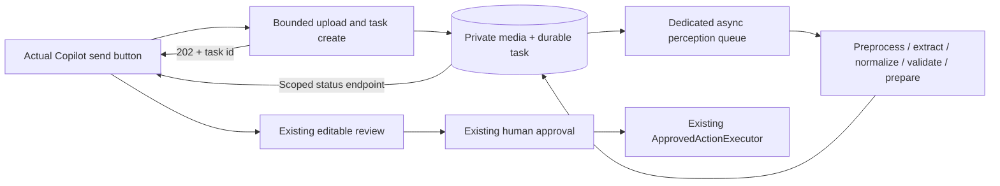

# zoloERP — Remaining AI completion and actual Copilot UI implementation

**Branch:** `feat/developer-licensing`  
**Pinned baseline:** [`2359b6449f76059310b968f2d17d9b792cc95ced`](https://github.com/vigneshsinna/zolo-erp-pro/commit/2359b6449f76059310b968f2d17d9b792cc95ced)  
**Reviewed:** 27 November 2026  
**Scope:** implementation specifications; no code changed, no new tests run. Recheck HEAD before editing. Existing R01–R09 code is not a guarantee of operational acceptance.

## 1. The actual problem

The user's earlier ERP screenshot reports HTTP 500, maximum execution time of 120 seconds exceeded, after submitting `create a sales bill` with `samplebill.png` (5.6 MB). The new screenshot supplied with this request is the desired multi-stage progress-card reference, NOT evidence that this card exists in the application. Its six stages, green completed icons, purple active stage and muted pending steps are the UI acceptance reference. The user reports only a single model-name/loading line appearing despite previous changes.

The branch head remains unchanged from the previous review. Confirmed source:

| Source | Finding |
|---|---|
| `public/js/ai-media-input.js:392–516` | `submitStagedAttachment()` creates one spinner message at 410–411, calls `mediaUrl('/prepare')` with `prepare_now=1`, removes placeholder on success/error, restores staged file on many errors. No live processing-card state feed in this path. |
| `AiMediaController::prepare():440–530` | Ingest, extract, normalize/handoff and prepare happen synchronously in the request. Existing extraction reused when present, but first request still blocks. |
| `AiMediaController::store():73–156` | Supports `async` extraction via `ExtractMediaJob`, but not a complete async prepare-and-review lifecycle for the actual chat submit path. |
| `MediaIngestionService` | Preprocesses and stores media in ingestion; moving only the provider call does not bound upload latency. |
| `NvidiaOmniPerceptionClient.php:175–245` | 75 s default per HTTP attempt, 2 retries (up to 3 attempts), retryable failures loop; 429 handled separately. Up to ~225 s provider budget per page under defaults. |
| `MediaExtractionService` | Calls provider separately per visual page; partial failures handled; existing extraction revisions and asset state. Must preserve existing optical and confirmation behavior. |
| `ExtractMediaJob` | `ShouldQueue`, `$tries=2`, scoped principal recreation; no explicit job timeout in inspected class. Extracts only. |
| `config/queue.php` | Default `sync`; existing DB/Redis retry_after 90 s. Incompatible with longer job budget unless dedicated async connection configured. |
| `workspace.blade.php:269,2211` | Loads `versioned_asset('css/pages/ai-workspace.css')` and `versioned_asset('js/ai-media-input.js')`. Verify actual served asset and real send-handler wiring, not just source file changes. |
| `ApprovedModelGateway` | Existing token reservation, credit reserve/settle and failure cleanup. Fatal timeout or worker kill needs durable recovery tests, not another meter. |

Exact failure phase, effective local config, actual provider attempts/charges and runtime deployment revision are NOT established without local logs and runtime access. No workflow runs were returned for pinned commit in previous check. Existing knowledge process definitions remain draft. Do not claim the 120 s was solely NVIDIA or 5.6 MB size. Do not increase PHP execution time as the permanent solution.

## 2. Non-negotiable architecture

Keep Laravel SDK, approved model gateway, metering, existing action registry, optical services and human approval. No new agent, billing engine, parallel review or direct database posting. The worker prepares only. Explicit stage transitions are persisted and delivered to the actual UI, not invented by timers. All entry points including retry, existing media, audio, PDF, direct API and workspace use one policy and orchestration path. Structured ERP checks do not call a model or consume model credits. No undocumented model fallback. Default-off rollout and per-tenant permissions; local test enablement only after setup.

## 3. Files and implementation order

| File | Work | Dependencies |
|---|---|---|
| [01_ASYNC_MEDIA_PIPELINE.md](01_ASYNC_MEDIA_PIPELINE.md) | R13: durable task, API, queue orchestration, actual phase transitions | Baseline |
| [02_TIMEOUT_RETRY_IDEMPOTENCY_AND_CREDITS.md](02_TIMEOUT_RETRY_IDEMPOTENCY_AND_CREDITS.md) | R14–R16: time budgets, image processing, provider retries, recovery, metering | 01 |
| [03_ACTUAL_COPILOT_UI_IMPLEMENTATION.md](03_ACTUAL_COPILOT_UI_IMPLEMENTATION.md) | R17: real frontend integration, stage card, retry, review, assets, browser acceptance | 01–02; develop against status contract |
| [04_LOCAL_WINDOWS_AND_DEPLOYMENT_RUNBOOK.md](04_LOCAL_WINDOWS_AND_DEPLOYMENT_RUNBOOK.md) | Queue setup, runtime diagnosis, release configuration and asset verification | 01–03 |
| [05_REMAINING_AI_VALIDATION_AND_PR_ROADMAP.md](05_REMAINING_AI_VALIDATION_AND_PR_ROADMAP.md) | R18 + outstanding R06/R10–R12; automated/live tests, reconciliation, rollout | All |

First build a vertical slice of R13+R14+R17 together (one real uploaded invoice, queued state and live UI). Do not postpone visible progress until another general UI redesign. R15/R16 harden before enabling users beyond test tenant. Work can be split into reviewed PRs, but release only integrated, tested behavior. A status card must never be declared complete based on a screenshot of a static prototype or a changed string.

## 4. Required coding-agent deliverables

For every PR: base/head SHA, changed file list, actual command/test output, migrations, flags, before/after real browser screenshots from `/ai`, sanitized Network response evidence, remaining blockers, review status. For UI PR specifically attach a screen recording or sequential screenshots from actual browser showing upload, queued, active extraction, resolved details, preview, retry and refresh. Compare with supplied reference. Test with actual worker and a controllable fake provider, then live NVIDIA in approved staging. No generated UI mock as evidence. No fabricated progress, CI counts or owner approval. Do not automatically merge or deploy.

Reopen source at pinned commit: [frontend](https://github.com/vigneshsinna/zolo-erp-pro/blob/2359b6449f76059310b968f2d17d9b792cc95ced/public/js/ai-media-input.js), [controller](https://github.com/vigneshsinna/zolo-erp-pro/blob/2359b6449f76059310b968f2d17d9b792cc95ced/app/Http/Controllers/Api/V1/AiMediaController.php), [queue job](https://github.com/vigneshsinna/zolo-erp-pro/blob/2359b6449f76059310b968f2d17d9b792cc95ced/app/Jobs/Ai/ExtractMediaJob.php), [perception client](https://github.com/vigneshsinna/zolo-erp-pro/blob/2359b6449f76059310b968f2d17d9b792cc95ced/app/Ai/Multimodal/Clients/NvidiaOmniPerceptionClient.php), [workspace view](https://github.com/vigneshsinna/zolo-erp-pro/blob/2359b6449f76059310b968f2d17d9b792cc95ced/resources/views/backend/ai/workspace.blade.php). All class names/routes/config keys introduced below are proposals unless identified as existing. Check actual code contracts first.
