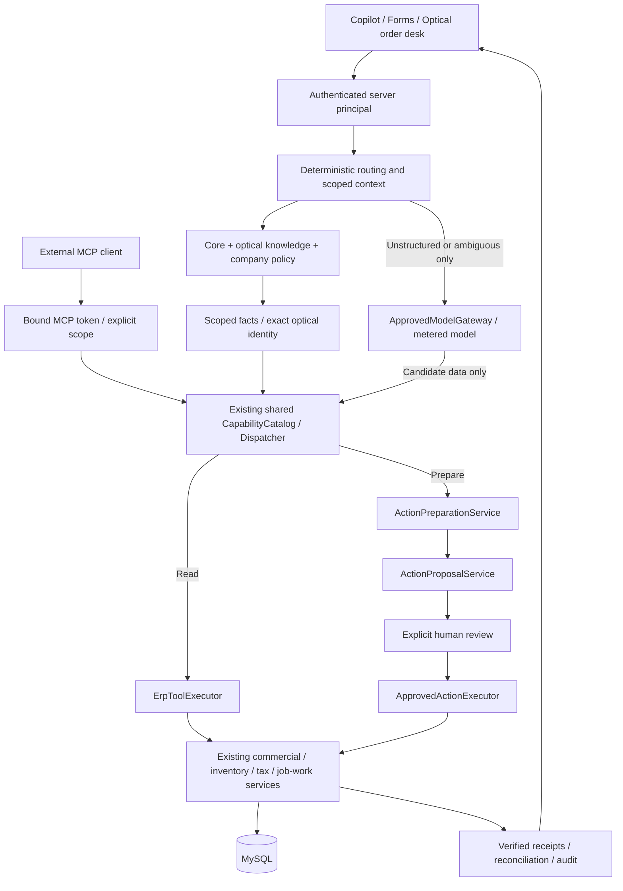

# zoloERP Pro — Multi-store optical lens supplier: implementation pack

**Repository:** `vigneshsinna/zolo-erp-pro`  
**Reviewed branch:** `feature/ai-unified-input-clarification`  
**Pinned source:** `e299b862c33f70cff8f86cfcbb36c1326da6dde5`  
**Review date:** 25 November 2026  
**Decision:** Not production-certified. This pack is an incremental implementation specification, not executed code or a test report.

## Purpose and scope

The first target is a B2B optical lens supplier with a head office/central stockroom, multiple stores or distribution branches, and optionally an internal Rx laboratory or an external lens processor. Customers are typically optical dealers, shops or labs. The billed customer and the end wearer are distinct. Prescription-based manufacturing and retail/clinic workflows are optional extensions, not prerequisites for stock lens wholesale. A store can mean a branch, warehouse, or both; resolve the actual mapping before implementation. Do not invent a business structure from the word "store".

Use the existing ERP capabilities. Do not build a second ERP, action engine, tax engine, stock ledger, approval system or MCP server. The new knowledge layer gives the existing engine enough reviewed business context to choose valid transaction paths, collect correct optical specifications, and coordinate verified steps. A missing authoritative ERP feature needs a separate domain implementation before AI exposure.

## Read the files in this order

| File | Deliverable | Dependencies |
|---|---|---|
| [01 — Baseline audit](01_BRANCH_BASELINE_AND_GAP_REGISTER.md) | Source-backed evidence, gaps, status and decisions | None |
| [02 — Core knowledge architecture](02_CORE_AND_INDUSTRY_KNOWLEDGE_ARCHITECTURE.md) | Modular registry, profile routing, knowledge governance, fact readers and complete module catalog | 01 |
| [03 — Optical catalog and inventory](03_OPTICAL_LENS_CATALOG_AND_MULTISTORE_INVENTORY.md) | Product identity, power matrix, units, procurement replenishment, stock and transfers | 02 |
| [04 — Commercial workflows](04_DIRECT_AND_LINKED_PURCHASE_SALES_WORKFLOWS.md) | Direct PO-less purchase and SO-less sales billing, linked alternatives, settlements, returns, GST, accounting | 02–03 |
| [05 — Optical Rx lab and fulfillment](05_OPTICAL_RX_LAB_ORDERS_AND_FULFILLMENT.md) | Stock vs Rx supply, lab slip, physical evidence, packing, special orders, warranty and privacy | 03–04 |
| [06 — AI tools, UI and automation](06_SHARED_AI_CAPABILITIES_MCP_AND_COPILOT.md) | Reuse U1/U2, complete missing profiles, optical-aware tool schemas, UI, event rules | 02–05 |
| [07 — Verification and release](07_PRODUCTION_VALIDATION_AND_UAT.md) | Executable test plan, finance fixtures, live model and load evaluation, security, staging gates | All |
| [08 — PR backlog and traceability](08_INCREMENTAL_PR_ROADMAP.md) | Ordered implementation PRs, owner acceptance, definition of done, handoff instructions | All |

## Architecture

## Non-negotiables

- Deterministic PHP/MySQL first; no LLM call or credit charge for exact lookup, stock, UOM, tax, pricing, arithmetic, matching, or policy gates. Model output is untrusted candidate data.
- Direct bills are legitimate. Neither a quotation nor an order nor a GRN is universally required. Require the actual facts relevant to the chosen route, not dummy documents.
- No direct AI SQL, unreviewed PHP method invocation, fabricated SKU, automatic customer/supplier creation, simulated receipt presented as real, or hidden financial posting. All mutations require existing permission and exact-version human approval.
- Inventory identity is not the same as an Rx prescription. Never use a sale line's Rx metadata as proof of power-level stock. Never make up a prescription, lens power, sign, eye or clinical recommendation.
- Use current company/branch/FY and authorized locations. Inter-store transfer across GST registrations or legal entities is not automatically a simple internal stock transfer; use approved tax/accounting routes.
- Keep features default-off. Owner-reviewed knowledge references are not authorization. All channels share the same business validations. MCP can prepare/status only, never approve or execute.
- Every proposed new name or JSON shape in this pack is illustrative until reconciled with actual contracts. Extend in place; no silent compatibility fallback. Fail closed when an authority or source is missing.

## Baseline changes compared with earlier packs

U1/U2 shared discovery and restricted MCP preparation are already present on the requested branch, and customer-owned job-work adapters have progressed. Do not replay older PRs #40–#46 or PR8–PR16 blindly. First reconcile their commits, code and acceptance evidence against the pinned head. The remaining work is optical-specific coverage, commercial completeness, verified workflow integration and release evidence. Earlier documents remain references for general governance; this pack supersedes their optical scope and outdated completion claims.

## Final release gates

Code inspection and commit-message claims are not proof of production behavior. The commit reports 47 focused tests / 311 assertions and a passing formerly failing textile test. No PR-triggered workflow runs were returned for this exact SHA by the connector. Full CI, live model evaluations, staging write concurrency and named signoffs remain gates. No staging environment or production database was accessed in this review. See file 07 for criteria. Do not enable new flags or expose MCP write preparation beyond reviewed allowlists merely because a unit suite passes.
