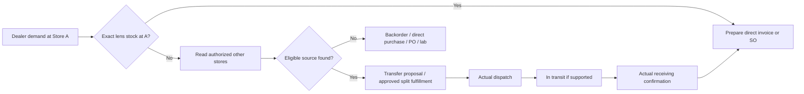

# 03 — Lens catalog, power-wise stock and multi-store inventory

## Business scope

A wholesale supplier sells lens products to optical dealers and labs. The same series may contain hundreds of power combinations, and some orders are custom Rx. A lens name is not a sufficiently precise item identity. Distinguish commercial family, stock SKU, physical stock identity, and requested optical specification. Never identify stock by a clinical prescription alone. No clinical recommendation or prescription conversion is an autonomous ERP task.

## 1. Reuse and verify the optical model

Existing `IndustryCatalog`, `IndustryProfileService`, `OpticalsMasterSeeder`, `Product`, `ProductType`, `ProductPurchase`, `Product_Sale`, `product_attribute_definitions/values`, product aliases, variant/batch and `product_warehouse` infrastructure form the base. The product contains `base`, `addition`, `lr`, `dia`, `product_type_id`; product-sales rows have `sph`, `cyl`, `axis`, `base`, `addition`, `lr`, `dia`, `prescription_json`. Purchase getters expose corresponding values from attributes or `stock_details_json`. These do not prove stock segregation by lens power. Audit actual seeded SKU, master, variants, stock balances, purchase/sale item storage and stock movement dimension usage before selecting the mapping.

### Optical-specific module catalog

| ID | Module | Required knowledge and outcome |
|---|---|---|
| OLS01 Dealer / channel | Customer vs end wearer; customer reference, bill-to/ship-to, channel |
| OLS02 Lens family | Brand, series, product type (SV, bifocal, progressive etc.) from catalog |
| OLS03 Stock lens identity | Exact power-specific SKU/variant/stock identity; unique validated combination |
| OLS04 Rx specification | SPH, CYL, axis, ADD, base, eye/LR, DIA; provenance and required fields by product |
| OLS05 Lens material / index | Existing profile attrs; approved values not free-text assumptions |
| OLS06 Coating / tint | Approved treatment code, charge and stock versus lab distinction |
| OLS07 Lens form | Finished stock vs semi-finished blank vs custom Rx vs service |
| OLS08 Units and pack | PCS/PRS/BOX, product-specific factors and pricing basis |
| OLS09 Product aliases | Supplier/dealer part numbers and barcode, exact alias mapping |
| OLS10 Power matrix | Sparse actual stock by canonical identity and permitted warehouse |
| OLS11 Availability | Physical, reserved, free, QC hold, in transit, ownership |
| OLS12 Replenishment | Min/max/reorder per identity/store, lead time, demand and draft suggestions |
| OLS13 Multi-store fulfillment | Source store candidates, transfer vs split sale, explicit authorization |
| OLS14 Transfers | Dispatch, transit, receipt, discrepancy, return |
| OLS15 Dealer pricing | Effective lists, volume breaks, rate history and discounts |
| OLS16 Supplier catalog | Supplier aliases, costs, lead time, pack sizes, purchase history |
| OLS17 Direct optical purchase | Supplier invoice without mandatory order, exact lens and confirmed stock receipt |
| OLS18 Linked procurement | PO, GRN, partial receipts, invoice matching |
| OLS19 Direct dealer invoice | No mandatory SO/quote; precise stock identity and tax |
| OLS20 Sales order allocation | Order line, exact power, partial shipment/backorder |
| OLS21 Rx job | Customer order reference, requested specifications, job route and promised date |
| OLS22 Lab sourcing | Internal manufacturing or external processor; ownership and costing |
| OLS23 Process events | Surfacing, coating, tinting, fitting; actual recorded completion |
| OLS24 Quality control | Reviewed tolerances, qualified verification, hold/release |
| OLS25 Packing / shipping | LAB, packing slip, DC and invoice link; scan and POD |
| OLS26 Advances / settlement | Actual money evidence, credit terms, allocation |
| OLS27 Warranty / remake | Original lens/document, defect, eligibility, separate replacement |
| OLS28 Returns | Exact power/lot and original line, QC disposition, debit/credit |
| OLS29 Store analytics | Power ageing, stockouts, fill rate, margin, service SLA |
| OLS30 Data governance | Restricted Rx/end-user data, access, audit and retention |

OLS01–20, 25–26, 28–30 are first-pilot scope subject to existing domain support; optional OLS21–24/27 require lab/warranty review. No automatic clinic profile.

## 2. Canonical identity contract (proposed)

Use stable product ID plus existing variant/batch/identity dimensions, not a new duplicate catalog. Store one approved normalized specification signature associated with the actual stock key. The signature may include family/product type, material, index, coating, lens form, sphere, cylinder, axis if materially stocked by axis, addition, base curve, diameter, eye if distinct, and package configuration. Applicability is SKU-family-specific. Keep raw supplied text separately from canonical value. Do not impose a universal power-grid range, clinical tolerance, or decimal increment. Do not conflate `base` field with base curve versus prism direction; confirm semantics with catalog owner. Use exact decimal strings or scaled integer representation, preserve sign and distinguish missing from zero; no float equality. Normalize display zero only when value truly zero; preserve supplier designation such as PL/plano via approved alias. Axis 0 vs 180, cylinder transposition and optical equivalence are not silently interchangeable; approved catalog policy required. No model-generated SKU.

Example input (illustrative, not existing schema):

```json
{
  "product_query": "SV 1.56 HMC",
  "optical_spec": {"sph":"-2.00","cyl":"-0.50","axis":null,"dia":"70","lr":null},
  "quantity":"10",
  "uom":"PCS",
  "source":"supplier_invoice_line",
  "client_line_id":"l-001"
}
```

If axis matters for custom Rx, require it. If the stock family does not distinguish axis, preserve customer job axis separately and do not manufacture axis-specific stock. Candidate matches must show exact differing fields, SKU, UOM, authorized availability and approved price. Resolve exact ID and signature or ask; fuzzy match is suggestion only. Two powers differing by 0.25 or sign must never be selected as substitutes.

## 3. Implementation tasks

- Audit `RecordResolutionService`, `ProductQueryService`, product aliases and catalog queries. Add typed optical lookup to existing services: company-scoped, active catalog, applicable family fields, exact normalized identity first. Avoid broad catalog dumps and per-line N+1; batch multi-line power matrix queries.
- Add reusable validated optical schema fragment and resolver to existing requirements providers. Candidate fields must not be accepted as authoritative IDs. Verify supplied ID matches approved specification; otherwise return `needs_input` with difference. For new SKU, prepare separate product proposal with approved attributes, base unit and tax category; no auto-creation during lookup or preview. Existing hidden setup product/unit providers must be completed first (file 06).
- For existing product dimensions, map all document paths consistently: quote, SO, PO, GRN, DC, purchase bill, sales invoice, transfer, return, reversal, import and lab. Inspect native column vs `stock_details_json` mapping. If fields are not safely stored on order lines, add additive typed fields or approved extension with version, ownership and migration. Copy immutable per-line snapshot through lifecycle; never derive historical power from mutable current master.
- If current stock uses same product/variant for different physically stocked powers, block AI fulfillment for ambiguous catalog until remediation. Design migration after stock reconciliation. Backfill only exact confirmed mappings, quarantine unresolved legacy balances, preserve journal/movement history; don't infer from sales Rx. Add unique company+identity key, FK or equivalent validated constraints, indexes and approved unit. No destructive merges of differently powered lenses.
- Use `InventoryAvailabilityService::forCatalogBatch` and authoritative stock movements/reservations. Verify branch permissions and relevant warehouse IDs before calling. Determine exact dimensions, stock/hold/transfer state and unit. Availability read must never cause reservation. Ensure race-free claim and domain lock at execution. A suggestion to move stock does not move it.

## 4. Multi-store inventory



Store mapping: resolve `company_id`, `branch_id`, `warehouse_id`, stock owner and tax registration independently. One branch may have multiple warehouses. A warehouse may serve a lab, distribution or retail role. `CompanyContext` is server-derived. Users without cross-branch rights cannot view another store's stock, reserve it or transfer it. A centralized manager can search across explicitly authorized branches using a bounded separate scope reader, not by changing client headers. Transfer must be separately approved and checked at source and destination. Cross-company transfer is a commercial transaction; separate GST registrations require reviewed domain/tax treatment even within one legal entity. Do not assume transfer tax outcome from store name. Reject unsupported route rather than post an incorrect internal adjustment.

For in-transit mode, source stock decreases at authoritative dispatch and destination increases on actual receipt; no phantom inventory. For existing atomic same-scope transfer mode, distinguish it from physical transport and never mark receipt before real evidence. A two-stage transit capability is proposed only if existing ERP service lacks it. Shortage/damage requires separate exception record, accountable party and authorized adjustments/reversal. Trace transfer document and source/destination ledger references; no negative stock override by AI. Preserve ownership and exact power. Reorder suggestion uses scoped current free stock, pending confirmed receipts, outstanding allocations, configured reorder target, actual lead time and planned transfers; do not add duplicate pending replenishment. Calculate in base unit and show order unit with verified conversion. Reorder events only draft under current policy.

## 5. UI and reports

- Dealer order/purchase input: editable compact power grid with signed power labels, exact SKU selection, per-line PCS/PRS/BOX, bulk paste/import, validation for missing/ambiguous columns, per-store available qty with as-of. Default warehouse only if authorized policy allows; do not silently choose wrong branch.
- Matrix rows/columns configurable by family; not every combination exists. Show unknown/not cataloged vs zero stock separately, distinguish reserved and QC; no grid cell may be treated as confirmed stock before exact match.
- Branch stock finder: allowed stores only, quantity and expected arrival, transfer draft action, no hidden cross-store pricing or wearer information.
- Dealer rates, stock ageing, daily stockouts, demand by specification, lost sales, fill rate, margin and lab turnaround: compute via deterministic SQL/read services, with filter and definitions. Cost/margin requires permission.

## 6. Acceptance fixtures

A. Store A and B same company, C unauthorized, foreign company D; family X has -2.00 and +2.00, -2.25, different coating, different DIA; exact SKU selected or clarify. B. Two identical-looking supplier aliases point to different identities: show candidates, no allocation. C. PCS, PRS, BOX with explicit product factors: calculate quantities/prices consistently; missing factor blocks. D. A 3 pieces, B 10 pieces, demand 8: read allowed locations; propose 5-piece transfer only if policy; no automatic sale/receipt. E. Two users reserve last lens concurrently: only legal quantity reserved, one stale/shortage outcome. F. Store dispatch shortage/partial receipt and retry: no double stock, open balance correct. G. A return for +2.00 cannot replenish -2.00 stock. H. Change optical spec after approval invalidates proposal. I. Non-optical profile rejects optical-only fields. J. Seed/upgrade leaves unrelated tenant unchanged. K. Historical ambiguous stock blocked until audited mapping. L. Per-store power matrix totals reconcile to stock ledger, not just UI quantity. Execute tests with enabled feature paths and actual MySQL transactions.
