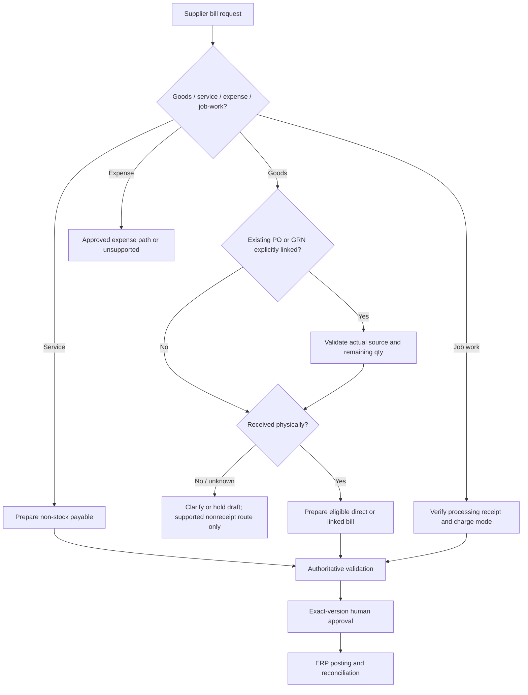

# 04 — Complete commercial knowledge and transaction paths

## Goal

Support how lens suppliers actually operate: direct supplier bill and direct dealer invoice are first-class paths. PO, quotation, GRN, SO and challan are optional source documents where the business and law permit. Existing Laravel commercial services own all financial and stock effects. A workflow may attach existing evidence instead of creating its own predecessor.

## 1. Purchase routes

| Route | Minimum verified facts | Inventory/accounting intent |
|---|---|---|
| P1 Direct goods purchase | Supplier, invoice reference/date per approved policy, exact SKU/power, UOM, qty, unit cost, actual receiving location and receipt status, tax | If actual receipt confirmed and authoritative direct-post path supports it: receive goods and post payable once |
| P2 GRN-first | Existing posted eligible GRN + invoice; optional PO | Invoice clears appropriate receipt accrual; no second stock receipt |
| P3 PO-linked with receipt on bill | Existing eligible PO + received quantity + confirmed receipt; no GRN only if domain policy supports | Consume order balance and receive/bill once |
| P4 Formal procurement | Optional supplier quotation → approved PO → actual receipt → bill | Each separately approved; partial quantities and pending balance |
| P5 Invoice before goods | Valid supplier invoice but receipt not confirmed | Only approved non-receipt AP/accrual route if implemented; else hold draft with pending receipt. No invented GRN, no stock increment |
| P6 Catalog service | Supplier, valid service product, rate, location context, tax | Non-stock payable; no goods receipt |
| P7 Expense payable | Approved GL expense classification, invoice and tax | Dedicated expense-only AP domain route needed; currently runbook says unsupported; no dummy SKU |
| P8 Job work | Our material dispatch and verified returned/eligible service receipt | Existing `JobWorkService::serviceBill`; approved charge mode/costing |

Draft direct goods and service processes already exist. Extend `PurchaseDocumentClassifier`, guided input router, `PurchaseOrderRequirementsProvider`, `PurchaseBillRequirementsProvider`, `GoodsReceivedNoteRequirementsProvider`, `PurchaseBillPreviewAdapter`, `PurchaseBillCommandAdapter`, `PurchaseBillMatchAudit` and authoritative services. Confirm classifier called on enabled paths; explicit user-selected type/linked document beats keyword guess. “Bill” alone ambiguous between purchase and sale. “No PO” is not an error. If user attaches supplier invoice, read its actual contents and ask whether goods physically received if needed. Do not assume attachment equals receipt. In direct route keep PO and GRN null, do not auto-resolve unrelated open PO. If user provides link, validate company/branch/FY, supplier, destination, posted/not reversed, open qty, SKU/power and source line. Reject mismatch; do not silently remove invalid link to continue as direct.

### Matching and duplicate protection

Use `OrderLifecycleService::remaining/prepareConsumer`, `MaterialDocumentService`, UOM conversion, actual stock identity, eligible source line and domain locks. Compare ordered, received, rejected, returned, already billed, remaining eligible quantities in canonical base units. Price, discount, tax and round-off compare using domain money representation. Do not hard-code tolerances; approved company policy and statutory constraints, named override reason and approver. Existing match audit advisory; make the authoritative domain gate enforce policy, display audit as explanation only. Support split GRNs and multi-invoice consumption where domain supports; if existing schema one GRN, no fake multi-link. Duplicate supplier invoices check normalized references per legitimate company/supplier/FY or policy scope; concurrency unique constraint or lock; verify manual UI and AI path share invariant. Reversal/rebilling must retain link and original evidence, not delete posted history.

## 2. Sales routes

| Route | Minimum verified facts | Expected effects |
|---|---|---|
| S1 Direct dealer invoice | Customer, exact stock identity, qty/UOM, agreed price/tax, source warehouse and dispatch status | Authoritative direct sales stock issue and invoice posting, if actual route permits |
| S2 Sales order | Customer, promised date, requested lens lines, source, rate | Commitment/allocation as implemented, no AR or revenue until invoice |
| S3 SO→invoice | Eligible source lines, remaining fulfillment, actual physical evidence or direct issue policy | Consume only eligible outstanding qty; issue stock once |
| S4 SO→DC→invoice | Posted dispatch, eligible unbilled lines, same customer | Dispatch records stock, invoice settles dispatch; no second issue |
| S5 DC-first | Real dispatch and later invoice; optional order | Verify domain support and document links |
| S6 Service sale | Customer, service item and work evidence when required | Service revenue only, no owned stock issue |
| S7 Quotation | Customer, rate/validity; optional | No ledger/stock posting; quote conversion only under approval |
| S8 Advance/settlement | Actual payment, method, account, reference, amount, open item or deposit | Separate approved receipt, no fabricated paid status |
| S9 Return/remake | Original line and power, returned qty, physical QC disposition | Reverse eligible accounting/stock using domain; replacement separate |

`sales_order.create.v1`, `sales_invoice.create.v1`, `delivery_challan.create.v1`, `quotation.create.v1`, `payment_receipt.create.v1` exist. `CommercialDocumentAdapter` uses `CommercialPricing`, `OrderLifecycleService`, `CommercialApplicationService`, and dispatch logic. Add dedicated knowledge definitions (file 02), scoped sales fact readers, guided customer resolution and route selection. Do not assume customer payment occurred because invoice is cash sale or because user says “collect” without actual payment evidence. For payment/advance use appropriate existing accounting capability if supported. Determine whether dealer credit check belongs at order, dispatch and/or bill based on actual `CreditControlService` and approved policy; enforce in domain at final posting, not LLM. Price list, scheme, quantity-break, free goods and margin overrides deterministic; source and effective date visible. If an order requests 50 pairs but only 30 available, preserve outstanding 20 only if policy allows partial/backorder. No automatic substitute power or warehouse.

## 3. Optical data round-trip in the four transactions

The current AI schemas omit optical headers and per-line Rx fields. The `CommercialDocumentAdapter` constructs an allowlisted payload without optical headers. Extend in place, one shared optical fragment based on profile and action, no unrestricted attributes_json. Map to existing native fields or approved document extensions. For both purchase and sales:

| Stage | Required invariant |
|---|---|
| Text/image/audio extraction | Candidate fields; signs, decimal digits, unit, eye, raw evidence; no fabricated values |
| Task and record resolution | Stable line IDs; normalized exact optical spec and authorized identity; preserve fields through edits |
| Requirements and schema | Conditional fields by actual stock/custom profile; reject unknown authority fields/nested injection; no PII unless needed |
| Preview | Accurate unit/cost/price, rate basis, charge, tax and inventory effect; show linked source, pending/mismatch and exact specs |
| Proposal | Immutable canonical payload and source state includes optical identity/spec, source line, price/tax/profile/warehouse revision |
| Execution | Same reviewed payload, locked live revalidation, domain posting, no silent dropped optical fields |
| Stored records | Product, variant/batch, Rx metadata and source links mapped consistently; snapshot actual header and line charges |
| Official prints/receipt | Persisted verified document only, correct SKU and Rx, permission-based personal data redaction |
| Return/reversal | Original source line identity and exact eligible qty; no current-master substitution |

The UI fields `fitting_charge`, `tinting_cost`, `customer_order_no`, `end_user_*` already exist in inspected commercial code; decide actual accounting role of service charges. Use existing authoritative pricing/tax calculation; confirm charges included in preview, taxable basis, expected totals, persisted invoice, receipt and journal exactly once. No double count as both header charge and service line. Don't infer current rate from seeded sale-type labels; these are fixtures/presets. Review actual statutory treatment of lenses, frames, services, interstate registration, transfer and credit notes with finance owner; do not hard-code HSN/GST rates in knowledge. Distinguish unregistered party from supply type, exempt/nil-rated/zero-rated/out-of-scope and non-GST; obtain specific verified tax facts and apply existing engine. If tax profile missing, return setup proposal or block; no hidden creation inside preview.

## 4. Accounting parity checklist

Examples below are business intent, not a replacement journal algorithm. Finance signs off actual chart and valuation.

- PO/quote: no premature ledger or physical stock movement. SO allocation: no sale revenue/AR. GRN/DC: inventory/accrual entries as implemented. Bill against GRN clears eligible accrual, not duplicate inventory. Invoice against DC reconciles dispatch and recognizes appropriate revenue/AR/tax without duplicate COGS or stock movement.
- Direct received purchase and direct dispatch sale: appropriate stock effect once, matching supplier/customer open item, journal debit=credit in exact ledger units. Service invoice: no owned physical stock. Cash terms vs actual bank/cash settlement separate. Discounts, freight, rounding, landed cost, charges, tax credit eligibility and partial payments reconcile to document and ledger.
- Every posted financial record uses existing numbering, fiscal guard and idempotency. No draft receipt or synthetic official number. Reversal is existing `CommercialReversalService`/`ReturnService` with current permissions and fiscal policy; no delete/trash for posted ledgers. Adjustments and credit/debit notes preserve original tax and source references where required.

## 5. Workflow execution semantics

Keep a durable plan of optional paths and evidence, not a fixed mandatory graph. When a verified direct route is selected, mark nonexistent predecessors not applicable by route definition, not completed. When source exists, attach scoped actual receipt/document and relationship check. `BusinessWorkflowPlanner/Progress` must verify same actor/scope, action key, proposal version, actual execution receipt, linked domain source, and no cross-workflow replay. Handle external goods event as separate from approval. Correction invalidates dependent pending approvals and refreshes preview; existing posted action can only be corrected through authorized reversal or compensating action. Pause/cancel does not erase posted record. All completed workflows reconcile against authoritative ledgers/documents. Changed source state, stock, price, tax, role, or FY => fresh review; no automatic retry of uncertain commit.

## 6. Acceptance cases

C01 direct supplier bill no PO/GRN, physically received exact power, one stock receipt/payable. C02 direct bill without received goods: held draft or approved nonreceipt route, no stock. C03 GRN-first partial bill: no duplicate stock. C04 PO-linked partial direct bill without GRN only if legal domain route. C05 wrong supplier/warehouse/branch/FY/sku on source: denied; never fall back to direct. C06 duplicate supplier invoice concurrent manual/API attempt: one allowed. C07 non-stock service and expense behavior explicitly distinct. C08 direct dealer sale no SO or quote: exact stock decrement and invoice. C09 SO/DC partial invoice then second invoice: no double issue and correct remaining. C10 partial sales order/backorder: no phantom fulfillment. C11 charge and discount/tax parity with manual UI. C12 unregistered customer/supplier and tax treatment clarification. C13 source reversed between preview and commit: stale proposal rejected. C14 receipt and settlement replay: one financial effect. C15 return wrong power: blocked. C16 original invoice correction uses reversal not delete. C17 imported invoice misread negative power: corrected and reapproved. C18 non-optical bill retains legacy behavior. C19 empty or invalid unit factor blocks. C20 posted receipt not linked to workflow's actual source cannot complete step. See file 07 for execution matrix.
