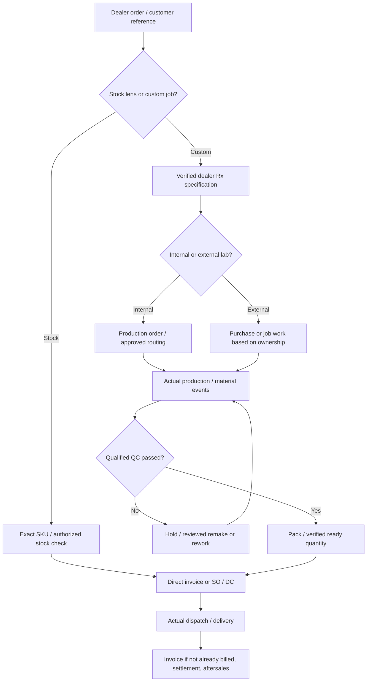

# 05 — Rx laboratory, special orders, packing, warranty and fulfillment

## Scope and decision

The current company profile supports lens manufacturing/Rx lab and optical wholesale. A supplier may sell finished stock lenses, supply semi-finished blanks, manufacture custom Rx, outsource a process, or supply services. The reviewed branch has Rx line metadata, product type, LAB/PS/INV series, lab slip and packing slip tests, but these are not proof of a separate fully working lab workflow. Reuse existing production/job-work and document services. Do not create a second manufacturing system or make an Rx job mandatory for normal stock sales. If the supplier has no lab, hide lab capabilities.

## 1. Order routing

At order intake, resolve dealer, customer order number, lens family, eye-specific Rx fields only if required, quantity and unit, approved rate, delivery date and location. Distinguish end wearer from customer; don't require end-user contact on ordinary dealer invoices. Use only verified supplier/customer instructions, no prescription diagnosis, recommendation, axis/cylinder conversion or fabricated measurements. If user says “same prescription as last time,” retrieve authorized exact prior job and request confirmation of suitability by authorized personnel; never assume reuse. If no qualified specification exists, hold for professional review. No image extraction alone can approve a prescription.

## 2. Job domain contract (extend if not supported)

Trace existing lab routes and actual order model before designing persistence. Prefer existing sales order/order-line links plus production/job-work documents. Add optical job aggregate only if existing data cannot represent distinct work state and source relationship. Proposed job facts: company/branch/FY, dealer/customer, customer order reference, job UUID and stable line, optical spec snapshot and catalog identity, ownership, source warehouse, route/version, promised date, quantities requested/accepted/failed/completed/packed/delivered/invoiced, status/revision, actual evidence refs, timestamps and operator. End-user identifiers minimized, separately scoped and encrypted where appropriate. Index tenant/job/reference/status/due-date. Unique idempotency key for create/event. Versioned event history and immutable posted references. Avoid storing clinical data in generic notes, telemetry, MCP results or notifications.

State machine: `collecting` → `spec_verified` → `awaiting_material` or `ready_for_work` → `in_process` → `awaiting_qc` → `released` → `packed` → `dispatched` → `delivered` → `reconciled`. Exceptions `on_hold`, `rework_required`, `cancelled` or `requires_reconciliation`. State transition allowed only through authorized real event. Quantities can progress partially; header status derived from line state, not a single optimistic boolean. Invoicing/payment independent axes; invoice may occur at eligible earlier or later stage. Do not tie physical delivered status to payment. Cancel after posted event requires actual reversal/return/compensation, not deleting history. No autonomous process loops or automatic remedial writes.

## 3. Internal vs external lab and ownership

Use `IndustryCatalog::PROCESSES` presets SURFACING, COATING, TINTING, FITTING only as a starting point; verify actual company process, allowed loss, routing, conversion and output identity. If internal manufacturing, use existing BOM/production material consumption and completion, WIP and costing. Raw blanks/finished SKU conversion must use approved operation, never update catalog name to convert existing stock. If purchase finished/custom lenses from supplier, treat as direct/PO goods purchase without pretending to dispatch own stock. If company-owned material sent out, reuse `JobWorkService` order/dispatch/receipt/service bill. If dealer-owned frame/material, use applicable `PrincipalJobService` customer-owned order/receive/return/service invoice. Latest branch now has corresponding principal job action definitions; verify actual domain fit and financial ownership. Never record customer property as company stock or COGS. No automatic manufacturing for a non-manufacturing profile.

Actual dispatch and returned processing quantity evidenced by domain records; shortages, rejects, scrap and charge mode require approved policy. Capitalize processing where authoritative costing supports and approved accounting requires; expense where applicable. Do not force all services into cost or all into expense. Verify partial receipts, billing against eligible quantity, loss handling, duplicate service bill and reversal. External lab purchase and service bill must not double bill the same supply.

## 4. Lab slip, packing slip and shipment

Reuse existing voucher templates; tests `OpticalsProfileAndVouchersTest` verify lab slip QR and A6 packing slip barcode, and optical invoice rendering tests exist. Do not invent official voucher number in chat. Only produce lab/packing slip using verified persisted document and authorized template; if draft print required label prominently DRAFT, no posted identity. Keep actual document series ownership/branch/FY and approved numbering. QR/barcode should encode opaque scoped job/document ref or approved payload, not personal Rx/contact data unless explicitly required and authorized. Scan requires server validation of identity, scope and eligible action; scanning itself not approval.

Packing records exact accepted lens quantities per job/line, eye/specification, SKU, shipment label and destination. Distinguish internal lab slip, packing slip, statutory delivery challan, and final invoice. A packing slip is not proof of stock issue or delivery. Use authoritative dispatch with carrier/tracking only if actual evidence; capture partial shipment, shortage, delivery/collection confirmation. Show dealer customer order number and shipment status, but redact end wearer data in outward documents according to approved template. Reprints preserve original document no and audit count; no duplicate financial posting.

## 5. Warranty, return and remake

When dealer reports wrong power/damaged lens, locate original posted invoice/job/line and exact identity. Review reason, policy/coverage, actual returned qty, condition and ownership. QC selects quarantine, usable return, scrap or supplier return using domain service. Warranty decision by approved staff; AI can suggest next steps, not approve replacement or medical suitability. Remake is linked new job and optionally zero-charge/credit/replacement only under approved policy and tax treatment. Preserve original sales/returns and cost attribution. Never automatically refund, credit or issue free stock. Handle nonreturnable custom lens policy through authoritative reviewed rules, not hardcoded generalizations. Include warranty period based on actual catalog/contract; no inferred entitlement.

## 6. Acceptance

L01 wholesale stock lens direct bill bypasses Rx job. L02 custom lens missing axis/sign or eye when required asks only missing data. L03 exact prior prescription access denied across actor/tenant. L04 internal lab production only enabled for actual branch profile; no manufacture on stock-only distributor. L05 external finished lens procurement not treated as own-material dispatch. L06 own blank processing: real dispatch, partial receipt, costing and vendor bill reconcile. L07 dealer-owned frame/material: no owned stock, processing charge only. L08 QC rejected lens cannot be released/packed; remake linked, original history intact. L09 partial shipment and invoice settle only eligible quantities, no double stock. L10 barcode scans another company or stale job denied. L11 lab/packing slip printed from verified record, no draft official number. L12 no patient contact in default B2B MCP/tool result/log. L13 warranty return wrong original power fails. L14 approved correction after dispatch requires return/reversal. L15 actual charge and lab costing parity with manual path. L16 cancellation before job processing no stock or ledger change, after posting compensating actions. All live writes require separate approval.
