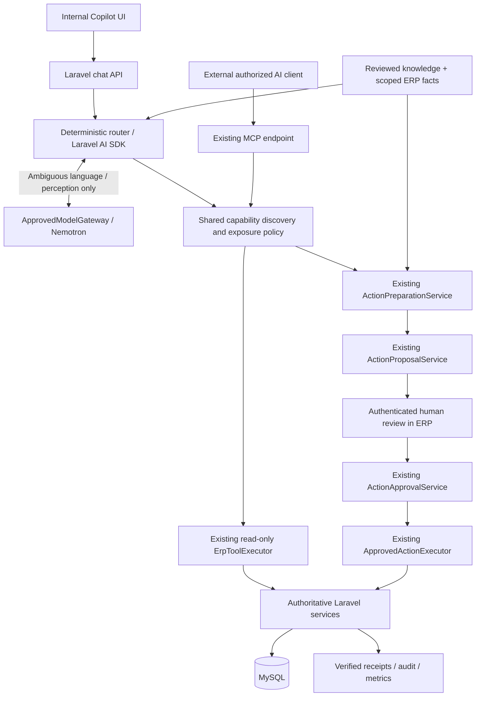

# zoloERP Pro — Unified ERP Capability and Production Readiness Pack

**Baseline checked:** 25 November 2026 | Laravel 13 / PHP 8.5 / MySQL 8.0 and 8.4

**Repository:** https://github.com/vigneshsinna/zolo-erp-pro

**Purpose:** Extend the existing shared governed action engine to support unified tool discovery, external MCP proposal preparation, completed ERP business knowledge and evidence-based production release. This is an implementation backlog, not an assertion that the work has been performed.

## 1. Read the documents in this order

| File | Outcome | Workstream |
|---|---|---|
| [01_MCP_GOVERNED_ACTION_PROPOSALS.md](01_MCP_GOVERNED_ACTION_PROPOSALS.md) | External agents can discover and prepare permitted draft actions without approval or posting privileges | U2 |
| [02_COMPLETE_SHARED_TOOL_DISCOVERY.md](02_COMPLETE_SHARED_TOOL_DISCOVERY.md) | One derived capability catalog, shared preparation path and per-interface exposure policies | U1 |
| [03_ERP_BUSINESS_KNOWLEDGE_LAYER.md](03_ERP_BUSINESS_KNOWLEDGE_LAYER.md) | Complete PR8–PR13 remediation and knowledge integration; includes original detailed specification | Existing PR roadmap |
| [04_COMPLETE_PRODUCTION_VALIDATION.md](04_COMPLETE_PRODUCTION_VALIDATION.md) | CI, security, financial, load, live model and rollout acceptance | PR14–PR16 plus U1/U2 tests |

Implement 02 before 01. Numbering follows the requested deliverables, not dependency order. U1 and U2 are **proposed workstream labels**, not GitHub PR numbers or existing branches.

## 2. Current baseline and blockers

GitHub PRs #40–#46 were rechecked on 25 November 2026: all open, draft and unmerged; their heads are unchanged from the 21 November readiness assessment. Last stack tip: `feature/ai-knowledge-07-release` at `a96af26240bc4a97e1d2dcae7db9d0b1c5f14fcd`. Do not assume these changes are on main or deployed. Original CI evidence remains tied to the same immutable heads; the CI was not rerun for this document.

- PRs #40–#44 passed the previously observed ERP acceptance gates. #45 and #46 failed operations acceptance because `PrincipalJobService` inserts `principal_job_orders.financial_year_id` into an operations test schema lacking the column. Clean migration jobs passed. Fix the fixture/upgrade coverage and FY ownership, not the isolation requirement.
- PR7 AI suite: 530 tests and 5,193 assertions passed in the earlier run; that does not establish financial, feature-on or live model correctness.
- `AiToolManifest`/`ErpToolExecutor` currently enforce read-only handlers. `PrepareAction` calls `ActionPreparationService` for proposal preparation; dedicated tools such as `PreparePurchaseOrder` also exist. These are not yet a single shared discovery catalog.
- `ActionCapabilityRegistry`, `ActionRequirementsRegistry`, `ActionSecurity`, `ActionProposalService`, `ActionApprovalService`, `ApprovedActionExecutor` already provide the action foundation. Do not create another approval or posting engine.
- The MCP server is the existing Laravel-hosted `McpController` at `/mcp/erp`. `McpClientGuard` requires a bound Sanctum bearer token, `mcp:read` and exact per-tool abilities. The configured default read allowlist is `receivables.outstanding.v1`, `inventory.stock_summary.v1`. The server and outbound MCP default off. No current MCP proposal support is claimed.
- Existing knowledge definitions are draft and workflow completion remains partial. Do not release unfinished expense-only AP or customer-owned job-work creation/receipt/return as supported features.

## 3. Target architecture

MCP is a transport/interface, not a database bridge. Read handlers remain read-only. Proposal preparation may persist drafts and audit metadata but cannot post ERP records. Only separately approved execution may change stock, accounting or business masters. Internal Copilot uses direct PHP tools without a loopback MCP HTTP call.

## 4. Proposed dependency order

| Sequence | Work | Gate |
|---|---|---|
| 1 | Existing PR8: fix operations CI, FY ownership, migrations and schema compatibility | All original suites green, including textile regression |
| 2 | U1a: derived catalog, exposure policy, schema compiler and compatibility | Existing tool names and behavior preserved; parity tests green |
| 3 | U1b: internal SDK / REST / automation discovery adapters and common preparation dispatch | No duplicated domain/approval implementation |
| 4 | Existing PR9, PR10, PR12: workflow transitions, finance contracts and reviewed knowledge | Verified vertical slice and signed review |
| 5 | Existing PR11, PR13: both job-work directions and conversational coverage | Required actions and evidence adapters complete |
| 6 | U2a: MCP guard/bindings, discovery and proposal-only transport | Scope, token, replay and no-write tests green |
| 7 | U2b: proposal status and human review handoff; MCP interoperability | Existing ERP approval path only |
| 8 | PR14–PR16: integrated security, model/credit/load tests, UI/UAT and rollout | Final integrated release evidence and signoffs |

U1 development can be parallel with PR9–PR12, but reconcile registry and schema changes before integration. MCP must not expose draft knowledge or unfinished actions. The original PR8–PR16 remain the canonical remediation numbering; do not duplicate them in new PRs.

## 5. Mandatory constraints for implementation agents

- Inspect actual repository files, branch heads and tests before modifying code. Use existing service contracts; proposed names in this pack are design suggestions, not existing classes.
- No arbitrary SQL, unrestricted reflection, tool execution from model-generated method names, direct model-to-DB access or dynamic tool registration from user input.
- No financial arithmetic, GST decision, stock check, permission calculation or deterministic matching delegated to LLM. Zero model calls/credits for deterministic operations. No unapproved model/provider fallback.
- Every mutation uses the existing domain services, current version approval, source-state revalidation, transactional idempotency and durable receipts. No hard delete of posted accounting or stock history.
- Default-off feature switches plus per-company/role/client permissions; no wildcard MCP abilities. Read and prepare modes are distinct. MCP cannot approve, execute, send messages or reverse records in this release.
- Use real MySQL concurrency and integration tests, and report actual commands, CI run URLs, results and skips. Never use green unit tests to claim production acceptance.
- Do not merge or deploy automatically as part of implementing these specifications. Provide a PR-by-PR Markdown report, scope, changed files, test evidence, blockers, migration and rollback instructions.

## 6. Sources

Repository baseline: https://github.com/vigneshsinna/zolo-erp-pro/tree/a96af26240bc4a97e1d2dcae7db9d0b1c5f14fcd

Prior assessment: `ZOLOERP_BUSINESS_KNOWLEDGE_PRODUCTION_READINESS.md`, dated 21 November 2026, reproduced in document 03 as a preserved reference. Source contracts checked for this pack: `McpController`, `McpClientGuard`, `AiToolManifest`, `PrepareAction`, `ActionDefinition`, both action registries and `config/ai_infrastructure.php` / `config/ai_business_knowledge.php`. The repository source and PR status were inspected, not a live deployed environment.
