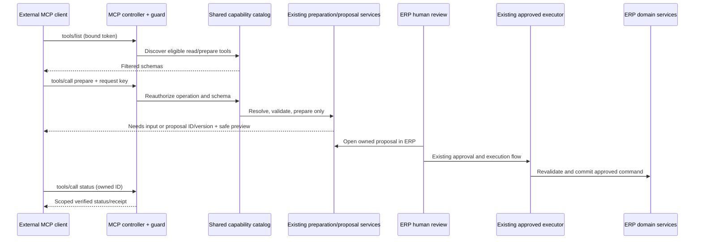

# 01 — MCP Governed Action Proposals

**Workstream:** U2a/U2b | **Dependency:** U1 shared discovery, PR8 CI repair, reviewed eligible vertical slice | **Priority:** P0 security, P1 external feature

## Goal and scope

Extend the existing `/mcp/erp` server to permit selected external AI clients to prepare governed proposals and inspect their status. No MCP client can approve, execute, reverse, pay, send, post or write arbitrary ERP records. The human completes the existing review workflow inside zoloERP. Preserve all existing read tools and clients.

Current source: `routes/ai-infrastructure.php`, `app/Ai/Infrastructure/McpController.php`, `McpClientGuard.php`, `config/ai_infrastructure.php`, `AiToolManifest`, `ErpToolExecutor`, `PrepareAction`, `ActionPreparationService`, `ActionProposalService`, `ActionApprovalService`, `ApprovedActionExecutor`. `ErpToolExecutor` deliberately rejects non-read handlers; **do not weaken it**. `McpController` currently accepts selected JSON-RPC methods and reviewed protocol versions; it exposes only read tools. The existing guard binds an active Sanctum token to actor/company/branch/FY and intersects permitted names, binding tools, configured allowlist and `mcp:tool:<key>` abilities.

## Architecture



## 1. Proposed exposed capabilities

Start small: existing read capabilities plus a reviewed purchase-order preparation and status slice. Expand to goods receipts, goods/service bills, supplier/customer creation and job-work preparation **only** after per-capability domain review and tests. No generic action-key escape hatch from MCP. Use stable canonical keys and provider-compatible aliases registered through document 02. Illustrative external aliases (verify collisions before finalizing):

| Tool alias | Capability / operation | ERP side effects |
|---|---|---|
| Existing read aliases | Existing manifest read keys | None; audit only |
| `erp_purchase_order_prepare` | `purchase_order.create.v1` / prepare | Draft/task/proposal metadata only |
| `erp_proposal_status` | Owned proposal/task read | None; audit only |
| `erp_purchase_bill_prepare` | `purchase_bill.create.v1` / prepare (later) | Draft metadata only |

No `approve`, `execute`, `approve_and_execute`, `send`, `reverse`, raw database or arbitrary HTTP capability. A plan cannot grant permissions. A proposal from MCP must be governed exactly like an internal proposal, not a weaker external draft.

## 2. Security and credential model

Implement an explicit operation-mode distinction in the shared catalog: `read`, `prepare`, `status`. Keep `mcp:read` and its existing semantics for old clients. Proposed new token ability `mcp:prepare` plus exact `mcp:tool:<canonical-action-key>`; status uses its own reviewed ability/allowlist and ownership checks. Final strings are proposed and must be checked against current auth contracts. Existing `mcp:read` tokens must never inherit prepare privileges.

- Require both global MCP switch and new default-off `AI_MCP_GOVERNED_PROPOSALS_ENABLED`, active per-company opt-in and exact per-client operation/action allowlist. Require existing action foundation gate and normal business permissions. Do not require global posting execution to be on merely to prepare.
- Extend `ai_mcp_client_bindings` additively if needed with explicit allowed operation modes, allowed actions, credential/client identifier, expiry and revocation metadata; old bindings default to read only. Bind to a real actor or formally supported service principal; never silently impersonate a user. Actor must remain authorized and active.
- Reject wildcard token scopes; bind server-side actor, company, branch, financial year and tool policy; never accept these authority fields from arguments, nested JSON or `_meta`. Revalidate memberships, active FY/branch rules, action-specific permissions, feature gates and token expiry/revocation on each call. Use exact origins where applicable, HTTPS, existing Sanctum, throttling and body/response bounds. Avoid bearer tokens in logs or approval links.
- No pre-company setup, admin-only bootstrap, opening balances, journals, payment disbursement, statutory submission or arbitrary outbound MCP for initial rollout. Do not infer that a user has approval authority from possession of an MCP token.
- Discovery and invocation share policy but invocation must independently enforce it. Revocation between `tools/list` and `tools/call` must deny. Unknown and unauthorized names return bounded generic errors without leaking registry entries.

## 3. Preparation contract

Use the common structured `ActionPreparationService::prepare` path from U1. A client submits business fields only, an optional owned task reference and a required stable client request identifier for non-read preparation. Example illustrative request after negotiation and discovery (actual schema generated from reviewed PO requirements, not this example):

```json
{"jsonrpc":"2.0","id":"call-1","method":"tools/call","params":{"name":"erp_purchase_order_prepare","arguments":{"client_request_id":"b4d80594-43ba-4b1d-b17b-4f74a5f33201","inputs":{"supplier_query":"ABC Traders","warehouse_query":"Erode","items":[{"product_query":"Linen","qty":"100","net_unit_cost":"120.00","uom":"MTR"}]}}}}
```

Normalize decimal strings without silently rounding beyond domain rules. Enforce closed nested schema, field length, line limits, supported business fields and exact action key mapping. Keep missing-field draft schema distinct from complete command schema. Apply deterministic supplier/product/warehouse resolution; return only scoped candidate choices and required fields; never invent IDs or approve a tax override. A prepared response may contain `status`, `task_id`, `task_revision`, `proposal_id`, `proposal_version`, `expires_at`, `requires_approval`, safe display fields, bounded warnings and field errors. Use `needs_input`, `proposal_created`, `conflict`, `forbidden`, `unavailable`, `error` or appropriate existing mapped statuses; no `posted` unless verified execution status is being read. Preserve existing error conventions at the transport boundary.

### Request idempotency and revision

Add a durable preparation-request deduplication record if existing task/proposal services cannot provide atomic replay. Key by binding/client, actor, company, branch, FY, capability and client request ID; unique index. Store normalized request hash, task/proposal identifiers, state and minimal replay metadata. Same request key + same payload returns the same current task/proposal reference; same key + changed payload returns conflict. Do not use JSON-RPC `id` as a durable idempotency key. For continuation, require the expected task revision and same action, scope and owner; changed payload uses a new request key. Handle concurrent retries with unique-key claim, row locks/CAS and recovery of an in-progress preparation; no duplicate proposals or orphan task writes. A new request ID must not authorize duplicate supplier invoice posting; domain-level duplicate checks still apply later.

When material inputs change, call the existing correction/versioning flow and invalidate old approval; never mutate a sealed payload directly. Return a conflict on stale task/proposal version. Preserve legitimate separate line items and distinguish omitted from explicitly cleared fields. Protect status queries against enumerating IDs.

## 4. Human review and status handoff

Return a relative first-party review route or server-generated canonical ERP URL after validating that route exists; never accept an arbitrary return URL or embed tokens. The review center authenticates a human through the existing ERP approval controls, resolves exact proposal version and verifies permission/scope. The MCP request may create draft state but does not count as human approval. No new approval endpoint, no duplicate signature path, no approval via chat transcript. `ActionApprovalService` and `ApprovedActionExecutor` retain HMAC/signature, expiry, idempotency and source snapshot gates. The status capability reads only owned/explicitly delegated proposals; do not expose other actors' proposals just because the company matches. Distinguish approved, executing, completed, uncertain, rejected, cancelled and expired. Return receipt ID only after verifying current-version domain execution receipt and applicable read permissions.

## 5. Transport implementation

Keep current reviewed JSON-RPC methods, negotiation and backwards-compatible read contract. Extend `tools/list` and `tools/call` using U1 channel-specific catalog; preserve old read dispatch through `ErpToolExecutor` and add a narrow preparation dispatch adapter. Test both supported existing protocol versions (2025-11-25 and 2025-06-18), initialize, ping, notifications, invalid method, malformed JSON, oversized requests, unsupported version and client disconnect. Use protocol-compliant error results; HTTP/auth failures remain distinct from business validation. No dependency change to `laravel/mcp` is required by this specification; evaluate adoption separately only if it can preserve all current guard/interop contracts. Do not migrate transports at the same time as core governance unless necessary.

Audit client binding ID, canonical action key, mode, actor/scope, correlation ID, request hash, task/proposal ID/version, decision, latency and sanitized failure code. No raw invoice contents, credentials, GSTIN/bank data, hidden prompts or full tool arguments in general logs. Bound per-client concurrency, request rate, response size and input size; use redacted status/audit metrics. No LLM required for structured MCP prepare/status. Never call external provider on an auth rejection.

## 6. Implementation PRs

### U2a — Auth, discovery and prepare-only adapter
- Review existing bindings and token issuer/revocation paths; add operation-grant schema migration and explicit policy tests.
- Introduce MCP proposal flag/tenant allowlist; connect catalog, prepare dispatcher and request dedupe. Register only reviewed PO preparation; existing read allowlist unchanged.
- Extend MCP tests to prove deny-by-default, hidden/forbidden tools and concurrent duplicate draft protection.

### U2b — Status, review handoff, interoperability and UAT
- Add narrowly scoped task/proposal status retrieval with redacted receipt. Connect review center link and trace external origin.
- Verify approval only via existing ERP paths; test modification, stale approval, revoked token, worker failure and end-to-end ledger parity for an approved PO.
- Add external client protocol fixtures, documentation for issuing/revoking tokens, rate limit and emergency disable runbooks. Expand capabilities only through reviewed per-action release PRs.

## 7. Mandatory acceptance cases

| ID | Test | Expected |
|---|---|---|
| M01 | Old read-only client lists/calls tools | Same read schemas/results; no prepare |
| M02 | Server disabled, proposal flag disabled, no tenant opt-in | No new prepare capability or invocation |
| M03 | Read-only, wildcard, expired, revoked or wrong-binding token | Denied; no domain or draft write |
| M04 | Valid token lacks exact action grant or business permission | Hidden in list and denied in call |
| M05 | Revocation after discovery | Call denied independently |
| M06 | Other tenant/branch/FY/actor task or proposal ID | No disclosure or mutation |
| M07 | Scope fields nested in items or `_meta` | Rejected/ignored only as defined; authority unchanged |
| M08 | Malformed, huge, unknown or unsupported input | Bounded error, no unsafe calls |
| M09 | Missing supplier/UOM/warehouse | Owned clarification only |
| M10 | Valid PO preparation | Draft proposal only; zero PO/stock/ledger writes |
| M11 | Same request replay and 20 concurrent identical calls | One preparation record/task/proposal outcome |
| M12 | Same idempotency key with different payload | Conflict; prior draft preserved |
| M13 | Correct draft with stale version | Conflict; no old approval reuse |
| M14 | MCP requests approve/execute/reverse/send | Not discoverable or callable; zero business writes |
| M15 | Authorized human approves current version in ERP | One authoritative posting; audit links source client |
| M16 | Source changes before approval/execution | Fresh preview or safe rejection; no stale posting |
| M17 | Read-only tool executor receives non-read handler | Existing rejection retained |
| M18 | Protocol init/list/call for supported versions; disconnect/retry | Contract passes, no duplicate task |
| M19 | Large result, logs and error redaction | No PII leakage, response bounded |
| M20 | Structured prepare/status and denied calls | Zero model dispatch and model credits |

Assert actual ERP table/journal/inventory counts, not only response text. Run MySQL and protocol tests with flags **on and off**, genuine token/role fixtures and two companies/branches/FYs. Record actual commands and final SHA. MCP release is NO-GO without these tests, reviewed exposure policy and credential-revocation drill.

## 8. Rollback

Turn off MCP proposal flag and per-client grant; leave existing approved read-only access only if safe. Revoke affected tokens/bindings. Stop new preparation, preserve drafts/audit and any ERP transactions already legitimately approved. Reconcile uncertain executions in existing action engine, never delete posted records. No outbound MCP changes are in scope.
