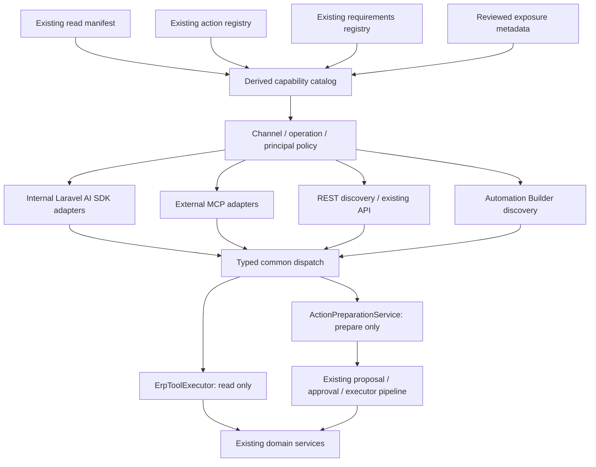

# 02 — Complete Shared ERP Tool Discovery

**Workstream:** U1a/U1b | **Depends on:** existing action foundation, PR8 green integration baseline | **Required before:** MCP governed proposals

## 1. Objective

Make each ERP capability discoverable and invocable through the appropriate interfaces without implementing a second action engine or duplicating business rules. Keep the existing registries as authoritative sources for their own contracts. Add a **derived, policy-filtered capability catalog**, not another independently maintained business-action registry.

### Current source contracts (verified at stack head)

| Component | Existing contract | Required change |
|---|---|---|
| `app/Ai/Services/AiToolManifest.php` | Explicit read registrations; closed scalar schema; stable provider name; read-only risk | Preserve; project read descriptors into shared catalog |
| `GenericSdkTool` / `ErpToolExecutor` | SDK read adapter and authorized read execution | Preserve read-only guard; share discovery policy |
| `ActionCapabilityRegistry` / `ActionDefinition` | Code-registered action key, module, risk, permissions, input schema, preview/command adapter, approval and snapshot rules | Add reviewed exposure metadata, not duplicate executor |
| `ActionRequirementsRegistry` | Required fields, resolution and completeness providers | Export normalized draft input contract; retain authoritative validation |
| `PrepareAction` | `prepare_reviewed_action` takes action key and `inputs_json`; filters requirements keys by principal; calls `ActionPreparationService` | Compatibility adapter over common prepare dispatch |
| `PreparePurchaseOrder` and other specialized SDK tools | Existing richer draft collection/preview workflows | Migrate incrementally; preserve behavior/aliases and task state |
| `McpController` / `McpClientGuard` | Bound read-only MCP discovery and execution | Consume same catalog with stricter channel policy (document 01) |
| `BusinessKnowledgeRegistry` / context reader | Draft/reviewed business metadata, scoped ERP facts | Reference capability IDs/version, never grant access |

Do not make `AiToolManifest` accept write tools. Do not register the same command independently in SDK, MCP, REST and automation. Do not treat `enabledByDefault` as an entitlement; respect existing `ActionSecurity` semantics and per-company/tool flags.

## 2. Target design

Proposed class names: `CapabilityDescriptor`, `CapabilityCatalog`, `CapabilityExposurePolicy`, `CapabilitySchemaCompiler`, `CapabilityDispatcher`, `GenericPrepareSdkTool`. These are suggested implementation units; inspect container bindings and existing equivalents before creating them. No dynamic method invocation or arbitrary reflection from client/model inputs.

## 3. Descriptor and ownership model

Use immutable typed descriptors derived at boot from registered sources; policy filtering happens per request. Each descriptor represents a **capability + operation**, rather than one tool per arbitrary PHP method. Expose only safe public metadata. Proposed fields:

| Field | Source and rule |
|---|---|
| `capability_key`, `contract_version` | Canonical registered key, stable version; unique by operation |
| `operation` | `read`, `prepare`, `status`; never agent-side approve/execute |
| `provider_aliases` | Reviewed stable per-interface aliases; preserve old names, reject collisions |
| `description`, `module`, `tags` | Safe reviewed semantics and bounded descriptions; no embedded secret or internal instruction |
| `draft_input_schema` | Closed JSON schema from requirements provider/existing preparation contract |
| `command_contract_hash` | Existing ActionDefinition input schema and reviewed contract reference; never use as agent authority |
| `result_schema` | Bounded, explicit allowed outputs for clarification/proposal/read/status |
| `risk`, `requires_human_approval` | Existing action risk/approval contract; read and prepare explicitly distinguished |
| `permissions`, `feature_dependencies` | Existing registry/provider policies; exposure may narrow but never broaden |
| `channel_modes` | Reviewed SDK/MCP/REST/automation availability; default deny |
| `knowledge_reference` | Reviewed action/process version and source integrity (if applicable) |
| `lifecycle`, `owner`, `review_reference` | Code-owned exposure review and deprecation metadata |

Store only interface-specific differences in a small reviewed exposure policy file/registration. Do not copy tax rules, requirements lists, permission strings or adapter names into multiple configs. Build a catalog integrity check that fails CI on duplicate aliases (case insensitive where applicable), missing provider/definition, incompatible schemas, unknown operation, unsupported handler, permission widening or reviewed references to retired capabilities. Existing internal legacy tools may be represented as explicit compatibility descriptors; do not promote unfinished knowledge by inventing review evidence.

### Schema compilation

- Read schema remains existing manifest's closed, bounded scalar contract. Generate equivalent SDK and MCP schemas, preserving required/default/enum/format semantics.
- Preparation schema is the **draft collection input**, not final command schema: support nested line items, quantities, UOM, optional fields, name queries, explicit clearing where supported, and task ID/revision. Required fields for final posting are enforced after resolution. Do not mark all missing fields mandatory at transport level, otherwise clarification breaks.
- Prefer typed per-action inputs rather than a broad JSON string. For legacy `inputs_json` parse bounded JSON exactly once then validate using the same prepared schema. Laravel validation rules cannot always be translated losslessly into JSON Schema; explicit provider contract metadata plus parity tests is preferable to naive conversion. Any non-representable constraint remains enforced server-side and documented. Never accept arbitrary extra fields or authority fields recursively.
- Enforce decimal precision via existing domain contracts; normalize quantities/money to exact strings for canonical action hashing. Reject NaN, malformed/scientific numbers if unsupported, overflow, duplicate JSON object keys where parser supports detection, and unexpectedly large arrays. Review null/empty-string/omitted behavior; do not lose meaningful zero values. Avoid breaking existing valid SDK inputs during migration.
- Define safe output shapes for verified facts and `needs_input`, `proposal_created`, `conflict`, `denied`, `error`, status/receipt; display data never grants execution. Preserve legacy output mappings until clients migrate.

## 4. Shared policy and invocation

Discovery = code-registered + eligible lifecycle + enabled flags + current authorized actor/context + interface entitlement + client grant (MCP) + per-action permissions. External exposure requires reviewed capability and explicit owner signoff; internal legacy tools retain their existing access contract until migrated, rather than accidentally removing production features. Apply equivalent policy checks independently at invocation, including refresh of principal and current business context. No global cache of a user's filtered catalog. Static descriptors may be cached by deploy/schema version; if permission-filtered caching is needed, include actor/company/branch/FY/channel/grant and policy revision and invalidate immediately on revocation. Unknown/denied tools return non-enumerating errors.

Dispatch strictly by operation:

- `read`: existing `ErpToolExecutor` and reviewed handler, preserving read-only limit, schema validation, audit and error redaction.
- `prepare`: existing `ActionPreparationService`, task state and resolver/requirements engine, preview and `ActionProposalService`. Draft metadata writes allowed; no domain posting. Use common proposal correction/invalidation when resuming tasks. Preserve dedicated PO behavior through compatibility adapter until tests establish parity.
- `status`: scoped owned task/proposal and execution receipt reads; no broad report permission inferred.
- Any approval or execute action stays exclusively in existing human approval and approved executor path. REST discovery is not a generic unrestricted posting endpoint. Automation Builder discovers only eligible automation capabilities under its existing autonomy policies; do not give automatic financial authority because a capability is discoverable. Existing reviewed autonomy policy handling is separate and must not be widened by this work.

All transports use a server-created `AiPrincipal`. Never use user-supplied company/branch/FY/actor as authority. Correlate run/request/action keys and sanitized outcomes; re-use existing AI telemetry and credit metering. Structured preparation and read/status calls consume zero model credits. If an internal conversation requires an LLM, use only `ApprovedModelGateway` with approved models and rate/credit controls. No model-driven discovery loop over hundreds of tools: select deterministic relevant module/action descriptors and a bounded tool list; ask a clarification if ambiguity persists. Log catalog version with tool invocation to diagnose drift.

## 5. Compatibility and migration strategy

### U1a — Catalog and integrity gates
1. Inventory all current `AiToolManifest::all()`, `ActionCapabilityRegistry::all()`, requirements providers, `ErpCopilot::tools()` and specialized SDK tools. Produce a machine-readable coverage report: canonical key, aliases, availability, schema, missing requirements, flags, risk, channel, owner. Do not infer missing implementation from name alone.
2. Implement descriptor projector and reviewed exposure metadata. Add startup/CI integrity validator with deterministic ordering and version hash. Compare list and call authorization using actual role and tenant fixtures.
3. Compile schema projections and legacy mappings. Maintain existing read MCP names, existing SDK action aliases and existing REST contracts. Use default-off `AI_SHARED_CAPABILITY_DISCOVERY_ENABLED` (proposed name) for transition; old behavior must stay unchanged when off.
4. Add parity tests and docs; no new MCP financial proposal capability in U1a.

### U1b — Common dispatch and interface adoption
1. Route generic SDK prepare and one PO vertical slice via shared dispatcher. Reuse existing `ActionPreparationService` and dedicated resolver/question/task behavior. Compare proposals (normalized payload, source hash, tax preview, approval, receipt) with old path; never compare only wording.
2. Migrate remaining supported SDK aliases incrementally, preserving entity choice, dependent master creation, attachments, partial lines, non-GST and revision correction. Preserve unsupported actions as unavailable.
3. Derive `ErpCopilot` tool listing and action guidance from reviewed descriptors, minimizing hardcoded per-tool descriptions and long prompt lists; preserve targeted business instructions and prevent model seeing secrets/hidden capabilities.
4. Expose permission-filtered catalog to REST and Automation Builder using existing routes/role guards or narrow discovery endpoint. Proposed response includes capability key, operation, safe title/description, schema, version, risk/approval, eligibility; no internal PHP adapter names or unauthorized action details. Use pagination/bounded list where needed.
5. Make MCP read discovery delegate to new policy without changing old clients; MCP prepare remains off until U2. Remove duplicate legacy routing only after full compatibility and migration gates pass. A wrapper or registry is not a duplicate transaction engine; do not create a new one.

## 6. Acceptance matrix

| ID | Verification | Required outcome |
|---|---|---|
| D01 | Register duplicate key/alias, wrong risk or unknown operation | Integrity validation fails |
| D02 | Missing action/schema/provider, unreviewed external exposure | Not exposed; CI identifies mismatch |
| D03 | Compare SDK/MCP/REST read schema for same capability | Semantic equivalence (document intended channel restrictions) |
| D04 | Nested line items, exact decimals, optional field/clear semantics | Draft accepts valid partial data, final schema enforces completion |
| D05 | Invalid unknown nested/authority keys, excessive lines | Rejected without side effects |
| D06 | Two companies, branches, FYs and roles | Discovery and invocation isolation; no broadened access |
| D07 | Flag/permission revoked after discovery | Invocation denied |
| D08 | Existing SDK names and old MCP clients with new flag off/on | Compatible behavior |
| D09 | Same PO via old and shared paths | Equivalent resolved inputs, proposal/preview and approved domain result |
| D10 | Correct draft, change supplier or qty, tax, warehouse | Revision increments, old approval unusable |
| D11 | Read tool tries non-read action; prepare tries execute | Denied; no ERP posting |
| D12 | Automation Builder discovers prepare-only capability | No unintended autonomy grant |
| D13 | 100+ registered test descriptors | Bounded tool selection/discovery, no excessive model requests |
| D14 | Structured tool call without ambiguity | Zero model invocations/credits |
| D15 | Same canonical key exposed by two channels | One underlying action/proposal/approval/command implementation |
| D16 | Feature off, retired version, cache invalidation, stale grant | Safe fallback and revocation honored |

## 7. Deliverables and rollback

Deliver unit tests for descriptors/compiler/policy and integration tests for real SDK, MCP read, REST, automation and proposal paths. Attach inventory/coverage report, compatibility diff, CI logs, test evidence, and remaining unsupported capability list. Keep original registry definitions and feature-off adapter until rollout parity is established. Roll back via channel/discovery flag and legacy adapter; preserve durable task/proposal/approval history. No production deployment until document 04 gates are met.
