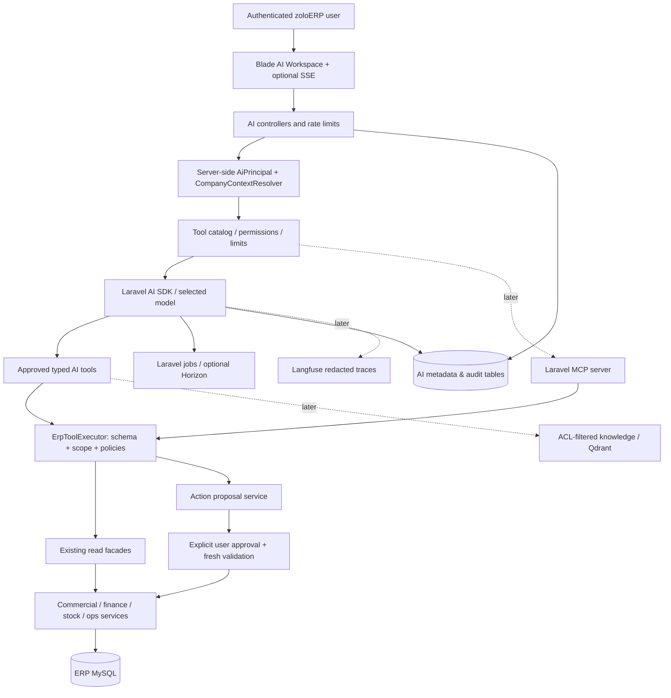

# 03 — Target system architecture and data flows

## High-level architecture

## Trust boundaries

| Boundary | Trust decision |
|---|---|
| Browser → AI API | Session/Sanctum actor authentication, CSRF for web, throttling, authorised company context |
| Laravel → model vendor | Redact payload, cap tokens, select approved provider, track usage, treat model output as untrusted |
| Model → tool invocation | Tool name allowlist, JSON schema, parameter validation, actor permissions, company/branch checks, limits |
| Tool → ERP domain service | Call **same** authoritative business owner as UI/API, never bypass its posting rules |
| Proposal → actual write | Separate user action, fresh ACL/context/business validation, immutable proposal and idempotency |
| MCP → ERP tool | Distinct bearer/OAuth auth plus same ERP tool execution guard; never use a superuser MCP token |
| Agent job → data | Rehydrate actor and company rights on execution, not job-serialized auth/roles |
| Document → model | Treat retrieved text as data only; never as instructions to grant access or invoke tools |

## Read-only question sequence

1. User selects company/branch/FY in the existing ERP interface, then asks a question.
2. API constructs `AiPrincipal` using authenticated user ID and `CompanyContextResolver::resolve()`; it does **not** accept user-supplied scope unverified.
3. Router classifies read-only request; only tools permitted to that principal are available. Before **each** tool call, `ErpToolExecutor` reauthorises the principal.
4. Tool uses a domain read facade that returns **bounded, typed, source-linked** results. Tool result carries `as_of`, scope, calculation source, row count and reconciliation status.
5. SDK formats/explains returned facts, never invents monetary values; response includes links to authorised ERP reports and uncertainty.
6. Store audit/event identifiers and minimal conversation state with retention; deny cross-user conversation access.

## Proposed write sequence (after PH2 only)

`request → classify → build draft → validate preview → persist immutable proposal → show review UI → user approves → executor revalidates actor/scope/records/period → existing domain command → idempotent receipt → audit`.

**LLMs never directly create posted sales, purchases, journals, inventory movements, payments or refunds.** The executor must be in PHP, outside model code and outside tool output text.

## Bounded execution

- Default initial read query: one agent, one model provider, 2–3 read tools and no delegation loops.
- Max request length and tool output bytes; max model steps; per-user/company token budget and rate limit.
- Each request has correlation UUID, audited tool inputs after redaction, deterministic error codes and cancellation handling.
- No unbounded web browsing, code execution, SQL, file deletion, shell or arbitrary internet fetch tools.

## Architecture deployment choice

Laravel application and MySQL remain on the existing ERP host. Managed LLM API avoids local GPU requirements. Add Redis/Horizon only once isolated queue ops are proven. Langfuse and Qdrant (if needed) should run externally or in a separately provisioned environment; do not overload the ERP's shared VPS.

## Performance and failure policy

Prefer short synchronous reads in PH1. For long reporting, create a persisted `ai_run` with status and a dedicated queue job. Model provider failures return a **safe, factual** error, not a fabricated answer. A failed action proposal does not modify ERP state. Set request timeout, run timeout, tools-per-run and per-tenant concurrency as configuration.
