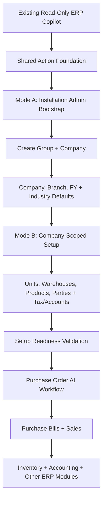
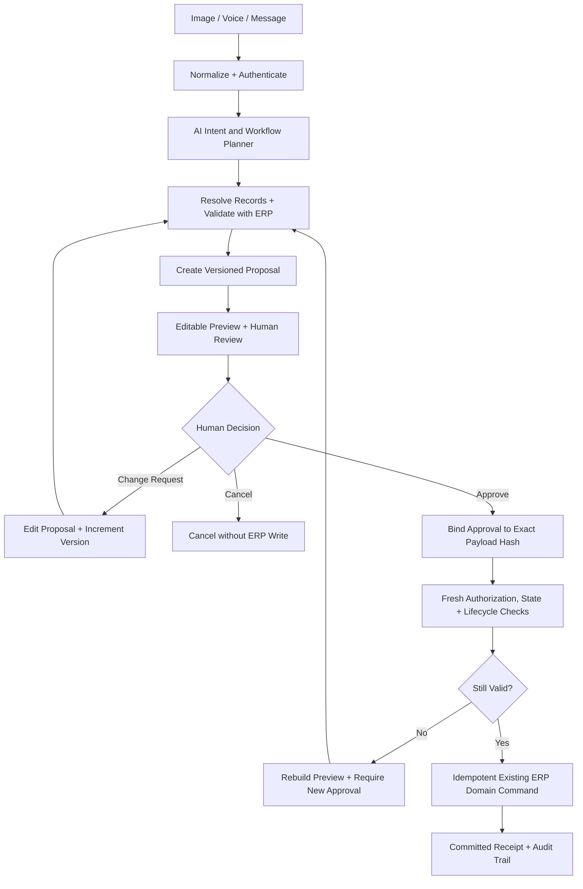

# 03 — Current vs Target Architecture and Trust Boundaries

> **Specification version:** 3.0 · **Reviewed code baseline:** `vigneshsinna/zolo-erp-pro` / `refactor/erp-copilot-stabilization` @ `14195d8b5b195f65ca1283c96794c613de88eded` (2026-11-11). **Target design, not proof of implementation.** Verify the current branch HEAD, installed packages, business-service contracts and CI evidence before executing.

**Status:** Design specification

## Architecture decision
**One user-facing AI Command Center; shared capabilities; domain agents optional; authoritative ERP commands.** The read-only Copilot is the first shipped implementation. Future action planning uses a separate, explicit workflow layer and command registry rather than transforming the Copilot's read-only `ErpToolExecutor` into an unrestricted write engine.

The user interface delivers two coordinated experiences:
1. **AI Workspace (`resources/views/backend/ai/workspace.blade.php`):** Interactive conversational surface for multi-modal intake (text, voice, documents), slot resolution, live editable previews, and iterative change requests.
2. **Action Review Center (Dedicated Interface):** Operational approval desk displaying the pending proposals queue, multi-item reviews, immutable audit history, and execution receipts.

---

## Phased Implementation Roadmap

The overall platform evolves across distinct, gated phases:



---

## Governed Intent-Proposal-Approval-Execution Lifecycle

Every non-read interaction follows an authoritative, two-phase governed execution lifecycle:



---

## Four Coordinated Architectural Planes
1. **Experience plane**: Chat, contextual assistant, dynamic clarification fact cards (`workflow.clarification.v1`), document uploads, pending approval queues, and task status across both the AI Workspace and the Action Review Center.
2. **Intelligence plane**: Models parse language, map intents to capability keys, extract slots, and generate bounded explanations. Models are strictly forbidden from deciding authorization, executing database writes, or computing financial totals.
3. **Pre-Proposal Task Orchestration plane**: Manages mutable draft state in `ai_workflow_tasks` with optimistic revision locking (`expected_revision`). Executes single-pass vectorized entity resolution (`BatchRecordResolutionService`) across Sales, Purchase, and Masters, evaluates completeness (`InputCompletenessEvaluator`), and emits consolidated clarification responses.
4. **Governed Execution plane**: Read tools via `AiToolManifest`, and governed write actions via `ActionCapabilityRegistry`. Proposals are sealed with HMAC signatures and live source-state hashes. Business writes occur solely through verified domain service execution upon explicit human approval.

---

## Read Flow (Implemented Pattern)
`user question → authenticated context → eligible tool names from manifest → SDK tool call → schema validation → live principal refresh + domain permissions → read facade → source-linked ErpToolResult → deterministic fact rendering + bounded narrative → audit`. Preserve exact ERP tool keys; provider aliases are separately declared. Business totals are calculated in PHP/SQL, never guessed by the model.

---

## Action Flow (Governed Two-Phase Protocol Across All Domains)
```text
Intake (Text/Voice/Doc)
  → Intent Extraction & Capability Mapping (sales_order, purchase_order, quotation, setup)
  → ActionRequirementsRegistry (Declarative field requirements & dynamic line schemas)
  → WorkflowTaskStateService (ai_workflow_tasks draft persistence with optimistic revision)
  → BatchRecordResolutionService (Single-pass vectorized party, warehouse, product & UOM resolution)
  → InputCompletenessEvaluator (Evaluates complete inputs; emits single clarification card if incomplete)
  → [AI Workspace Clarification Card ⟷ User Patch via PATCH /workflow-tasks/{id}/inputs]
  → [When 100% Ready] ActionProposalService (Pessimistic row lock & promotion to sealed proposal)
  → ActionPreviewAdapter (Authoritative CommercialPricing, live SHA-256 source-state hash)
  → Human Decision (Action Review Desk / AI Workspace interactive sign-off)
  → ActionApprovalService (HMAC cryptographic approval signature bound to payload hash)
  → ApprovedActionExecutor (Fresh revalidation, brief row lock, lifecycle policy check)
  → Authoritative Domain Command (PO: CommercialApplicationService, SO: OrderLifecycleService)
  → ActionReceiptMapper (Authoritative committed ERP record ID and audit trail)
```

A task pauses at required inputs, approval, external events, or failed domain validation; each transition is audited.

---

## Critical Boundaries & Non-Negotiable Invariants

1. **Two Distinct Security Modes for Initial Setup:**
   - **Mode A — Pre-Company Bootstrap:** Operates before a company, branch, or FY exists. Accessible only to verified installation administrators via a dedicated bootstrap API (`/api/v1/ai/setup/bootstrap/*`), completely isolated from tenant chat. Uses `BootstrapSetupPrincipal` (representing a strictly limited installation-admin identity, not a general superuser). Atomically executes `CompanyDirectoryService::createCompany` once to provision company, MAIN branch, first FY, main warehouse, chart of accounts, industry settings, and starter masters.
   - **Mode B — Company-Scoped Configuration:** Transitions to standard `CompanyContextResolver` and `AiPrincipal`. Subsequent setup operations (units, extra warehouses, tax registrations, products, parties) run under exact company-scoped permissions.

2. **Approval Binding & Authorization:**
   - SHA-256 alone is not an authorization mechanism. The system computes a canonical SHA-256 hash of the immutable proposal payload and cryptographically binds the approval record to the action version, authenticated approver, company, branch, financial year, and relevant source state hash.
   - The server enforces permissions independently upon submission; hash match alone never implies authorization.

3. **Short Transaction Lifetime & Preserved Domain Ownership:**
   - Database transactions must remain strictly short-lived. `DB::transaction()` must never be held open while an LLM generates tokens, gathers missing slots, or awaits human review.
   - At execution time, the executor re-validates the live state under row locks and delegates to the authoritative ERP service's existing transactional boundary. If the domain service already manages the transaction (e.g., `CompanyDirectoryService::createCompany`), its transactional ownership is preserved without conflicting nested transaction logic.

4. **Lifecycle Enforcement (No Generic Updates):**
   - AI operations must obey ERP record states (`draft`, `submitted`, `posted`, `paid`, `closed`).
   - Generic `UPDATE` operations on submitted/posted records are forbidden. The planner routes corrections through formal, ERP-sanctioned amendment, cancellation, debit/credit note, or reversal workflows.

5. **Anti-Patterns Prohibited:**
   `AI → raw SQL`, `AI → arbitrary Laravel route`, `AI → Sale::forceCreate/Purchase::forceCreate`, `AI → ledger/stock insert`, `agent A → agent B` loops for simple queries, unrestricted tool discovery, unsanitized document instructions, and auto-posting from model "confidence".
