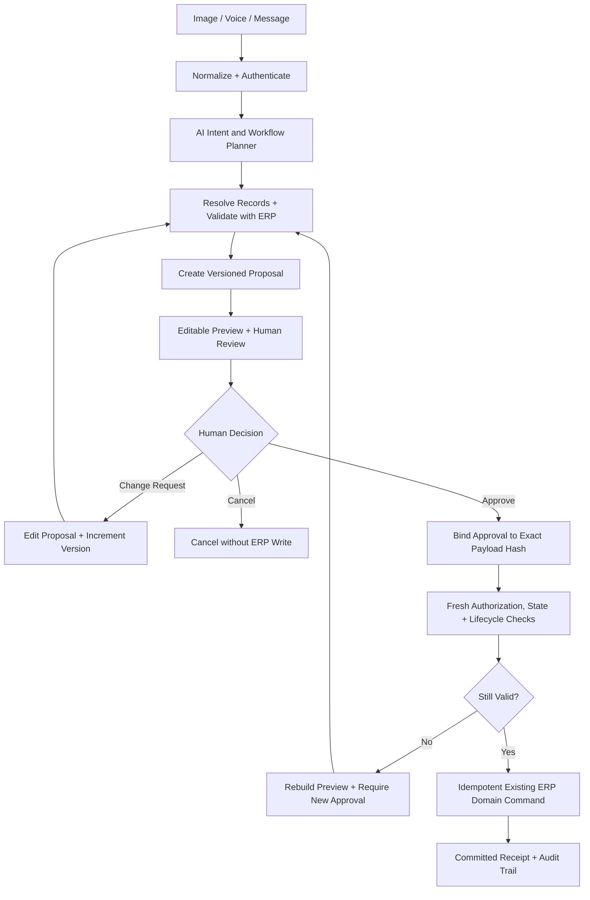

# 12 — Human Approval and Transactional Action Safety

> **Specification version:** 3.0 · **Reviewed code baseline:** `vigneshsinna/zolo-erp-pro` / `refactor/erp-copilot-stabilization` @ `14195d8b5b195f65ca1283c96794c613de88eded` (2026-11-11). **Target design, not proof of implementation.** Verify the current branch HEAD, installed packages, business-service contracts and CI evidence before executing.

**Status:** Design specification

## Stage boundary
This document specifies the **Action Foundation (PH1)**. It must not enable writes in `refactor/erp-copilot-stabilization`, where proposal endpoints are quarantined. Implement the new Action Foundation only after Copilot regression/CI sign-off and explicit new branch creation.

---

## Dual User Interfaces: Workspace & Action Review Center
Human review and approval operate across two coordinated interfaces:
1. **AI Workspace (`workspace.blade.php`):** Interactive conversational surface for multi-modal intake (text, voice, documents), slot resolution, live editable previews, and iterative change requests.
2. **Action Review Center (Dedicated Operational Desk):** Dedicated interface displaying the pending approvals queue, multi-item reviews, immutable audit history, and execution receipts.

---

## Governed Lifecycle State Machine

Every action proposal transitions through a deterministic, audit-logged state machine:



### State Definitions
| State | Description | Allowed Transitions |
|---|---|---|
| `Interpreting` | Parsing intent, normalizing input slots | `NeedsInput`, `ValidatedDraft` |
| `NeedsInput` | Missing mandatory slots (e.g., warehouse, UOM, GST mode) | `Interpreting`, `Cancelled` |
| `ValidatedDraft` | Slots resolved, validated via domain service preview | `AwaitingReview` |
| `AwaitingReview` | Editable preview presented in Workspace or Review Center | `ChangeRequest`, `AwaitingApproval`, `Cancelled` |
| `ChangeRequest` | User modified slots; increments version (vN → vN+1) | `Interpreting` (re-resolves and validates) |
| `AwaitingApproval` | Sealed immutable payload hash ready for sign-off | `Approved`, `Rejected`, `Expired`, `ChangeRequest` |
| `Approved` | Signed approval record cryptographically bound to hash | `Executing`, `Invalidated` |
| `Invalidated` | Revalidation failed (stale version, closed FY, changed state) | `AwaitingReview` (rebuilds preview) |
| `Executing` | Atomic row locks acquired; domain command invoked | `Completed`, `Failed` |
| `Completed` | Domain receipt committed; resulting ERP ID linked | Terminal state (`[*]`) |
| `Rejected` / `Cancelled` | Dismissed by user; zero ERP database mutation | Terminal state (`[*]`) |
| `Failed` | Domain service exception; safe rollback | `NeedsReview` |

---

## Cryptographic Approval Binding

**SHA-256 alone is not an authorization mechanism.**

1. **Canonical Payload Hash:** The system generates a deterministic SHA-256 hash of the canonical proposal payload, including:
   - Target business capability key (`action_key`)
   - Proposal version (`version`)
   - Normalized line items, quantities, UOM codes, rates, taxes, and totals
   - Selected entity IDs (supplier, customer, warehouse, account)
   - Scope parameters (`company_id`, `branch_id`, `financial_year_id`)
   - Source record version identifiers and dependencies (`source_state_hash`)
2. **Approval Record Binding:** The approval record explicitly binds:
   ```text
   approval_signature = HMAC_SHA256(
       payload_hash + action_key + action_version + approver_id +
       company_id + branch_id + financial_year_id + source_state_hash + timestamp,
       server_secret
   )
   ```
3. **Independent Server Authorization:** The server independently verifies the approver's active session, role, company membership, and module capabilities upon approval submission. A valid payload hash alone never grants write authority.
4. **Invalidation on Stale State:** If the proposal is edited ("Change Request"), the version increments (vN → vN+1), requiring a new hash and a fresh human approval. If the underlying ERP record or dependencies change prior to commit, the previous approval is invalidated.

---

## Short Transaction Lifetime & Preserved Domain Ownership

1. **Zero Open Transactions During Inference or Review:**
   - Database transactions must remain strictly short-lived.
   - `DB::transaction()` must **never** be held open while an LLM generates tokens, asks clarification questions, or awaits human review in the AI Workspace or Action Review Center.
2. **Execution-Time Revalidation:**
   - At the moment of execution, row locks (`lockForUpdate()`) and state re-validation are acquired inside a brief, atomic execution block.
3. **Preserved Domain Service Ownership:**
   - If an authoritative ERP service already manages its own database transaction (e.g., `CompanyDirectoryService::createCompany`, `CommercialApplicationService`), the AI executor must preserve that existing transactional boundary rather than introducing conflicting nested or parallel transaction logic.

---

## Mandatory Lifecycle Enforcement: No Generic Edits
For any action targeting an **existing** record:
- Load the authoritative domain status and valid transitions before preparing an edit, before approval, and immediately before execution.
- An editable draft may be revised only in its permitted fields.
- Submitted, confirmed, posted, paid, invoiced, received, or reversed records require a business-supported return, credit/debit note, or reversal workflow.
- Never directly update posted document rows, ledger entries, payments, or stock movements.
- When a correction requires a new document, present that document and its impacts for approval. If no supported command exists, deny with a link to the ERP workflow.
- Refer to `38_TRANSACTION_LIFECYCLE_ENFORCEMENT.md`.

---

## Autonomy Level Enforcement
The action engine operates strictly at **Levels A2 and A3**:
- **A2 (Draft Preparation):** Saves non-posted draft documents after explicit user review of affected records.
- **A3 (Transactional Submission):** Creates operational orders or executes setup creation upon exact hash-bound approval and live revalidation.
- **A4 / A5 (Unattended Posting):** **Strictly forbidden.** The model is never permitted to post financial journals, tax returns, or stock deductions without human sign-off.
