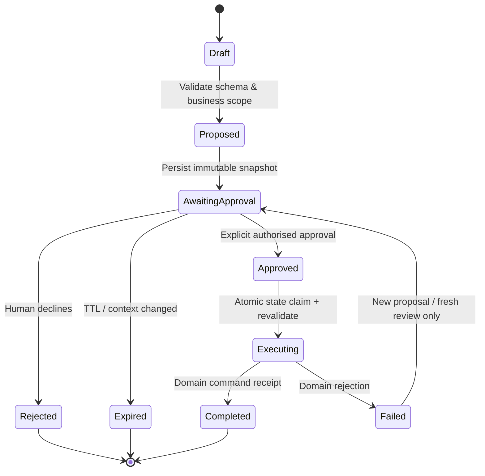

# 12 — Human-in-the-loop proposals and controlled ERP actions

**Not part of the Phase 1 read-only MVP.** This is the complete Phase 2 design. An agent may prepare an action proposal, but **only the PHP ERP application** can execute it after explicit human approval and fresh validation.

## Allowed candidate actions (in priority order)

1. Create a **draft** payment reminder (no send).
2. Create a **draft** purchase request/order (no posting or supplier notification).
3. Propose a customer follow-up task (no auto-contact).
4. Prepare a supplier invoice extraction for review, with human-edited field validation (no automatic booking).

**Excluded until separate business/security approval:** journal posting, stock adjustment, bank payments, refunds, supplier payment execution, fiscal-year close, customer-facing messages, payroll and unrestricted data edits.

## Lifecycle state machine

## Proposal content

`proposal_id UUID`, company/branch/FY and creator, `action_key`, validated immutable encrypted payload, hash, human-readable summary, affected entity IDs+versions, forecasted financial impact, permission required, expiry, risk classification, idempotency key, model-run provenance, source_refs, status/version. Validate monetary decimals, currency, dates, quantities and resource ownership before proposal is saved.

## Approval flow

1. Proposal endpoint verifies actor, scope and `ai.draft` + business draft permission.
2. Model output is a **draft preview**, never a posted record. Show exact proposed fields, affected documents, amounts, price/stock effect and warnings.
3. Approval endpoint authenticates a **fresh user interaction** and checks approval permission (and separation-of-duties if required). No approval through conversation text alone.
4. Transaction uses row locks / optimistic version to transition `AwaitingApproval → Approved → Executing` and records approver identity.
5. Executor reloads *all* current ERP records; rechecks membership, branch, feature flags, fiscal-year/posting date, credit limits, supplier status, quantities, duplicate invoice keys and any business service validations.
6. Run only the established domain command using application-defined, idempotent input. Record `ai_action_receipt` and link actual ERP entity.
7. If source record/version/period changed, mark proposal expired or require reapproval; never silently auto-modify proposal.

## Idempotency / concurrency design

- One approval URL cannot execute twice; unique `(company_id, action_key, idempotency_key)` with DB constraint.
- Queue retry must look up receipt before executing. Acquire transaction lock on proposal row; domain service should accept/propagate idempotency where supported.
- Approval transaction may reserve execution but **must not hold a DB lock during an LLM call**.
- An `approved` proposal must not depend on later LLM output; execution input is sealed.
- For a multi-step business operation, use only supported authoritative ERP atomic services or a reviewed saga with compensations, never sequential direct table writes.

## Audit and user experience

Show summary, inputs, estimated effect, validation/approval status, named approver, date/time, expiry and a route to original ERP records. All rejection reasons are visible without exposing other companies. Provide download of audit receipt for compliance if permitted.

## Negative and finance tests

Duplicate approval; changed price or stock after proposal; revoked actor; closed FY; another-company resource ID; false LLM permission claim; cancelled queued job; provider timeout; forged approval CSRF; repeated idempotency key; insufficient stock; denied credit term; partial failure. None may cause duplicate ledger movement or double payment.
