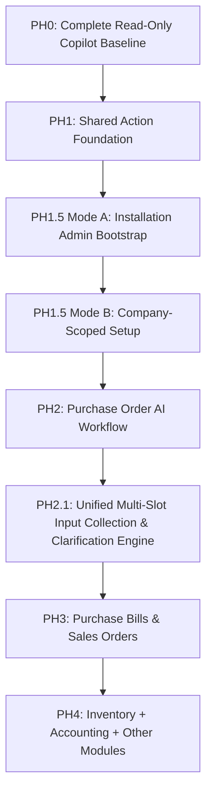

# 20 — Full Delivery Backlog and Dependency Gates

> **Specification version:** 3.0 · **Reviewed code baseline:** `vigneshsinna/zolo-erp-pro` / `refactor/erp-copilot-stabilization` @ `14195d8b5b195f65ca1283c96794c613de88eded` (2026-11-11). **Target design, not proof of implementation.** Verify the current branch HEAD, installed packages, business-service contracts and CI evidence before executing.

**Status:** Design specification

## Phased Delivery Progression
Implementation proceeds sequentially through discrete, independently testable phases. No phase may commence before the prior phase satisfies its mandatory exit gate:

---

### PH0 — Complete Read-Only Copilot Baseline (Current Branch)
| ID | Deliverable | Dependencies | Exit Gate |
|---|---|---|---|
| **CP-001** | Preserve green `DesignTokensTest` and semantic CSS tokens | Current refactor | 4/4 passed; zero inline style violations |
| **CP-002** | Preserve `ProductAliasTest` commercial lookup behavior | Current refactor | 12/12 passed; zero premature quick-create modals |
| **CP-003** | Verify financial golden parity across all 14 read facades | Domain services | Reconciliation matches GL and ageing reports 1:1 |
| **CP-004** | NVIDIA NIM provider telemetry and 35 RPM rate limiter | Approved gateway | Bounded steps, latency tracking, safe failures |
| **CP-005** | Read contracts, documentation baseline sync, release evidence | CP-001..004 | 11/11 CI jobs passing; documentation sync PR |

---

### PH1 — Shared Action Foundation (New Branch, Flags Off)
| ID | Deliverable | Dependencies | Exit Gate |
|---|---|---|---|
| **AC-001** | Action capability inventory and domain ownership map | CP-005 | Signed capability matrix; explicit risk tiers |
| **AC-002** | `ActionCapabilityRegistry` and `BusinessCommandAdapter` interface | AC-001 | Code allowlist; zero reflection-driven execution |
| **AC-003** | Intent schema, entity disambiguation, and slot manager | AC-001 | Ambiguous matches halt for user confirmation |
| **AC-004** | Versioned proposal schema (`ai_action_proposals`, `ai_action_approvals`, `ai_action_executions`) | AC-002 | Canonical payload hashing, version increments (vN → vN+1) |
| **AC-005a** | AI Workspace live preview cards and "Change Request" loop | AC-004 | In-place slot editing, real-time re-validation |
| **AC-005b** | Dedicated Action Review Center (pending queue, history, receipts) | AC-004 | Operational approval desk; multi-item sign-off |
| **AC-006** | Short-transaction execution adapter & live revalidation gate | AC-002..005 | Re-verifies live state under row locks; preserves domain service transaction ownership |
| **AC-007** | Idempotency coordinator, audit trail, and emergency killswitch | AC-006 | Zero duplicate executions; global and per-company cutoff |

---

### PH1.5 — Guided Initial Setup Agent (First Onboarding Vertical Slice)

#### Mode A: Pre-Company Bootstrap (Installation Administrator)
| ID | Deliverable | Dependencies | Exit Gate |
|---|---|---|---|
| **SU-001** | `BootstrapSetupPrincipal` & dedicated bootstrap API (`/api/v1/ai/setup/bootstrap/*`) | AC-001..007 | Pre-company context; non-admin users strictly denied |
| **SU-002** | Preview and create company group (optional) | SU-001 | Installation-admin approval; unique group code |
| **SU-003** | Preview and create company via `CompanyDirectoryService::createCompany` | SU-001..002 | Invokes service once; provisions company, MAIN branch, first FY, main warehouse, COA, industry defaults, and starter masters in single transaction |

#### Mode B: Company-Scoped Configuration & Readiness
| ID | Deliverable | Dependencies | Exit Gate |
|---|---|---|---|
| **SU-004** | Transition to `CompanyContextResolver` and verified scoped `AiPrincipal` | SU-003 | Verifies created resources; establishes tenant session |
| **SU-005** | Configure additional branches, warehouses, units, and tax registrations | SU-004 | Company-scoped adapters; row-level previews and approvals |
| **SU-006** | Product master import and customer/supplier party creation | SU-005 | Scoped duplicate resolution; zero direct database writes |
| **SU-007** | Setup readiness validation checklist and administrative activation | SU-003..006 | Admin sign-off; blocks transaction posting until checklist satisfied |

---

### PH2 — Commercial Action Vertical Slice: Purchase Order (Completed & Verified)
| ID | Deliverable | Dependencies | Exit Gate |
|---|---|---|---|
| **PO-001** | Natural-language supplier, product, UOM, and warehouse resolution | AC-003 | Correct tenant ownership, alias resolution, handles ambiguity [Verified] |
| **PO-002** | Deterministic preview calculation via `CommercialApplicationService` | PO-001 | Authoritative pricing and GST; zero LLM monetary arithmetic [Verified] |
| **PO-003** | Hash-bound approval and PO creation command | AC-004..006, PO-002 | Exactly one PO created with idempotency key and source links [Verified] |
| **PO-004** | Change request loop and Action Review Center status tracking | PO-003 | User can edit line items, re-preview, or cancel without write [Verified] |
| **PO-005** | Domain accounting and stock isolation verification | PO-001..004 | Ledger and on-hand stock remain unaffected by order creation [Verified] |

---

### PH2.1 — Unified Multi-Slot Input Collection & Clarification Engine (Active Sprint)
*Specification Reference:* [`41_UNIFIED_INPUT_COLLECTION_AND_CLARIFICATION.md`](41_UNIFIED_INPUT_COLLECTION_AND_CLARIFICATION.md)

| ID | Deliverable | Dependencies | Exit Gate |
|---|---|---|---|
| **UC-001** | Additive Schema & Task State Service (`ai_workflow_tasks`) | PO-005 | Additive migration; `company_id NOT NULL`; optimistic revision locking; 24h expiration |
| **UC-002** | Action Requirements Registry & Provider Interface | UC-001 | Dynamic line-item expansion (`requirements($context, $currentSlots)`); DTO contracts |
| **UC-003** | Single-Pass Batch Record Resolution Service | UC-002 | Set-based bulk `whereIn` queries; customer/supplier/UOM lookups; candidate caps; dirty-slot memoization |
| **UC-004** | Input Completeness Evaluator & Diagnostic Engine | UC-002..003 | 5-status field classification; zero early-exit; gates proposal readiness |
| **UC-005** | Purchase Order Multi-Slot Clarification Vertical Slice | UC-003..004 | `PreparePurchaseOrder` refactored to eliminate first-error return; consolidated `needs_input` card |
| **UC-006** | AI Workspace "Details Required" Card & REST Controller | UC-001..005 | `AiWorkflowTaskController` endpoints; batch patch submissions; HTTP 409/410/423 semantics |
| **UC-007** | Automated Verification & Cross-Tenant Regression Suite | UC-001..006 | 100% green tests on disposable MySQL; verifies multi-slot clarification, concurrency, and tenant isolation |

---

### PH3 — Purchase Receipts & Supplier Bills
| ID | Deliverable | Dependencies | Exit Gate |
|---|---|---|---|
| **PB-001** | Goods receipt recording via `OrderLifecycleService::receivePurchase` | PO-005 | Physical stock effect verified; double-entry inventory movement |
| **PB-002** | Supplier bill draft, duplicate invoice check, and GST posting | PB-001 | AP invoice posted; purchase ledger reconciled; input tax credit booked |

---

### PH4 — Sales & Collections Workflows
| ID | Deliverable | Dependencies | Exit Gate |
|---|---|---|---|
| **SL-001** | Sales Quotation and Sales Order Multi-Slot Intake & Clarification | UC-007 | `SalesOrderRequirementsProvider` & `QuotationRequirementsProvider`; batch customer & sale UOM resolution; non-blocking ATP stock warning check; `OrderLifecycleService::createSale()` execution; zero ledger mutations on order draft |
| **SL-002** | Sales Tax Invoice Proposal & Post via `SalePostingService` | SL-001 | AR ledger booked; tax liability recorded; source SO/dispatch quantity tracking; zero duplicate COGS |
| **SL-003** | Payment reminder drafts and controlled outbound sending | SL-002 | Customer consent verified; explicit sign-off per communication |

---

### PH5 — Restricted Inventory, Accounting & Manufacturing Modules
| ID | Deliverable | Dependencies | Exit Gate |
|---|---|---|---|
| **IV-001** | Warehouse stock transfers and physical stock adjustments | AC-006 | Dual-warehouse authorization; restricted adjustment approval |
| **FI-001** | Journal entry proposals and restricted ledger adjustments | AC-006 | Balanced debit/credit; period lock enforcement; dual control |
| **MF-001** | Production orders and job work outward/inward processing | AC-006 | BOM recipe validation; statutory GST Section 143(3) tracking |

---

### PH6 — Document Intelligence & Bulk Data Entry
| ID | Deliverable | Dependencies | Exit Gate |
|---|---|---|---|
| **DC-001** | Invoice/receipt document intake, quarantine, and OCR slot extraction | AC-003 | Untrusted document isolation; human review of extracted values |
| **BK-001** | Bulk spreadsheet import planner (products, opening balances) | AC-006 | Row-level validation, dry-run simulation, partial failure recovery |

---

### PH7 — Controlled Operational Autonomy & Telemetry
| ID | Deliverable | Dependencies | Exit Gate |
|---|---|---|---|
| **AU-001** | Scheduled low-stock read alerts and draft purchase order preparation | PO-003 | Opt-in scheduler; zero autonomous order submission |
| **AU-002** | Dedicated Horizon queue worker pool and failure recovery | AC-006 | High-throughput async task execution isolated from web workers |
| **EV-001** | Distributed tracing and token cost monitoring | AC-006 | Per-tenant token budget enforcement; audit export |

---

## Release Gates (All Mandatory)
* **G0 (Read-Only Baseline):** 100% green ERP CI + passing read-only Copilot regression suite.
* **G1 (Action Architecture):** Signed capability registry and domain service mapping.
* **G2 (Security & Tenancy):** Negative cross-tenant tests pass; cryptographic approval binding verified; zero unreviewed writes.
* **G3 (Setup & PO Milestone):** Mode A company bootstrap succeeds atomically via `CompanyDirectoryService`; first Purchase Order created via natural language with receipt.
* **G4 (Accounting Integrity):** Ledger balances and inventory movements reconcile 1:1 with ERP core.
* **G5 (Production Guardrails):** Global and company killswitches verified; emergency revocation tested.
