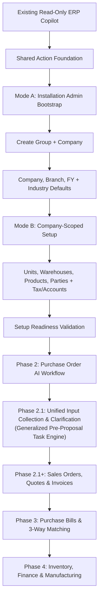
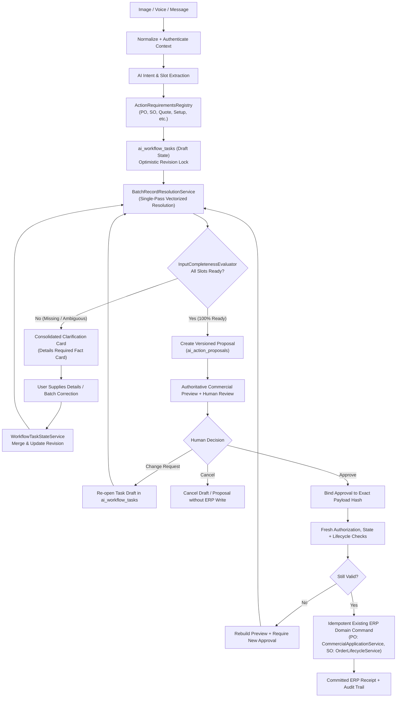

# 29 — Durable Natural-Language Workflow Orchestration and Recovery

> **Specification version:** 3.0 · **Reviewed code baseline:** `vigneshsinna/zolo-erp-pro` / `refactor/erp-copilot-stabilization` @ `14195d8b5b195f65ca1283c96794c613de88eded` (2026-11-11). **Target design, not proof of implementation.** Verify the current branch HEAD, installed packages, business-service contracts and CI evidence before executing.

**Status:** Design specification

## Orchestrator Responsibility
A multi-step natural language request is an **authoritative business workflow graph**, not an unrestricted autonomous agent loop. The orchestration engine tracks intent, typed slot extraction, entity disambiguation, live domain validation, versioned proposal state, cryptographic approval binding, and idempotent execution receipts.

---

## Phased Platform Architecture

Workflows operate within a phased progression:

---

## Governed Intent-Proposal-Approval-Execution Lifecycle

Every non-read workflow follows this strict lifecycle, incorporating the Phase 2.1 Pre-Proposal Task Collection Engine:

### Pre-Proposal Task Draft vs. Sealed Proposal Invariant
1. **Mutable Draft Phase (`ai_workflow_tasks`):** Incomplete inputs, missing line quantities, ambiguous products, or unresolved parties remain in the mutable `ai_workflow_tasks` table under optimistic concurrency (`expected_revision`). No cryptographic approval proposal is generated while any blocking issues remain.
2. **Immutable Proposal Phase (`ai_action_proposals`):** Once `InputCompletenessEvaluator` returns zero blocking issues, the draft is promoted under database transaction lock (`SELECT ... FOR UPDATE`) into a sealed proposal with HMAC cryptographic seal, authoritative `CommercialPricing` calculation, and live SHA-256 source-state hash. Post-promotion mutations on the task draft are strictly rejected (HTTP 423 Locked).
3. **Enterprise-Wide Generalization:** This lifecycle governs all transactional inputs across Sales Orders, Quotations, Sales Invoices, Purchase Orders, Goods Receipts, Supplier Bills, Inventory Transfers, and In-Flight Master Setup.

---

## Short Transaction Lifetime Guarantee
The orchestrator strictly enforces short database transaction lifetimes:
1. **Zero Open Transactions During LLM Inference or Review:**
   - Under no circumstances is `DB::transaction()` held open while an LLM generates text, extracts slots, calls external provider APIs, or waits for human review.
2. **Atomic Execution Window:**
   - Database transactions occur solely at execution time inside the approved domain command adapter.
3. **Preserved Domain Service Ownership:**
   - When the underlying ERP service (such as `CompanyDirectoryService::createCompany` or `CommercialApplicationService`) already manages a transaction, the orchestrator delegates directly to that service's boundary without creating conflicting nested transactions.

---

## Mode A to Mode B Workflow Context Transition

1. **Mode A Execution (Bootstrap Context):**
   - Initial onboarding begins under `BootstrapSetupPrincipal` via dedicated bootstrap endpoints.
   - The user selects or creates a company group and reviews the company creation preview.
   - Upon explicit approval, `CompanyDirectoryService::createCompany` executes atomically, provisioning the company, MAIN branch, first FY, main warehouse, chart of accounts, industry settings, and starter masters.
2. **Context Transition Gate:**
   - The orchestrator validates the returned company receipt.
   - The session switches from `BootstrapSetupPrincipal` to a standard, verified `CompanyContext` via `CompanyContextResolver::forActor()`.
3. **Mode B Execution (Company Context):**
   - Subsequent configuration steps (extra branches/locations, custom UOM, products, parties, tax registrations) run as standard company-scoped action tasks, each requiring individual domain permissions and human sign-off.

---

## Change Requests & Proposal Versioning

When a user reviews a proposal in the AI Workspace or Action Review Center:
- **Change Request Path:** If the user alters quantities, items, or parameters, the orchestrator transitions the proposal to `ChangeRequest`, increments the version (`vN → vN+1`), and routes back to `Resolve Records + Validate with ERP`.
- **Revalidation Failure Path:** If live revalidation fails at execution time (e.g., stale row version, stock depleted, period closed), the orchestrator marks the proposal `Invalidated`, rebuilds the preview with current ERP data, and requires a fresh human approval.

---

## Dual UI Delivery: Workspace & Action Review Center
- **AI Workspace (`workspace.blade.php`):** Interactive conversational turn handling, slot disambiguation, live fact cards, and in-place change request editing.
- **Action Review Center (Dedicated Operational Screen):** Cross-module pending approval queue, multi-item approval, audit log inspection, and execution receipts.
