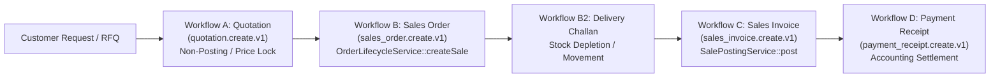
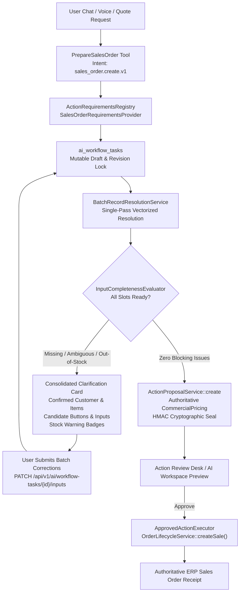

# 31 — Sales Quotation, Sales Order, Invoice and Collections

> **Specification version:** 3.1 · **Target Codebase:** `vigneshsinna/zolo-erp-pro` / `feature/ai-unified-input-clarification` (2026-11-11)  
> **Status:** Architecture Specification (Unified Input Clarification Engine Integrated)  
> **Related Specifications:** [`41_UNIFIED_INPUT_COLLECTION_AND_CLARIFICATION.md`](41_UNIFIED_INPUT_COLLECTION_AND_CLARIFICATION.md), [`28_ACTION_CAPABILITY_CATALOG.md`](28_ACTION_CAPABILITY_CATALOG.md), [`29_WORKFLOW_ORCHESTRATION.md`](29_WORKFLOW_ORCHESTRATION.md), [`38_TRANSACTION_LIFECYCLE_ENFORCEMENT.md`](38_TRANSACTION_LIFECYCLE_ENFORCEMENT.md)

---

## 1. Executive Summary & Business Objective

The Sales Operating Layer allows permitted ERP users to prepare customer quotations, sales orders, invoices, and collection entries through natural language, conversational chat, or document uploads while deterministically enforcing ERP pricing, stock allocation, credit control, statutory GST, and double-entry accounting integrity.

In accordance with Phase 2.1, all commercial sales input processing routes through the **Unified Multi-Slot Input Collection & Clarification Engine** (`ai_workflow_tasks`). The engine eliminates stop-at-first-error bottlenecks, evaluating customers, delivery warehouses, and all line items concurrently in a single batch pass, returning an interactive consolidated clarification card when details are missing or ambiguous.

### Core Architectural Invariant: Untrusted Model, Authoritative Server
- Large Language Models extract intent, customer names, line items, quantities, and user discounts.
- The model **never** calculates selling prices, tax breakdowns (CGST/SGST/IGST), or grand totals.
- The model **never** directly writes to `sales`, `sales_orders`, or financial ledgers.
- Quotations, Sales Orders, and Sales Invoices represent **distinct business lifecycle phases** with separate capabilities, risk tiers, and execution services.

---

## 2. Commercial Sales Lifecycle & Domain Boundaries



| Lifecycle Phase | Capability Key | Domain Execution Service | Inventory Effect | Ledger / GL Effect | Approval Policy |
|---|---|---|---|---|---|
| **Customer Quotation** | `quotation.create.v1` | `QuotationApplicationService` | None (Informational only) | None | Standard Sales Rep |
| **Sales Order** | `sales_order.create.v1` | `OrderLifecycleService::createSale` | Stock Allocation / Reservation | None | Sales Manager Review |
| **Sales Invoice** | `sales_invoice.create.v1` | `SalePostingService::post` / `CommercialApplicationService::create('sale')` | Stock Decrement (if unfulfilled) | Debit Accounts Receivable<br>Credit Revenue & Output Tax | Finance / Billing Admin |
| **Payment Receipt** | `payment_receipt.create.v1` | `AccountingReceiptService::settle` | None | Debit Cash/Bank<br>Credit Accounts Receivable | Accounts / Cashier |

> [!IMPORTANT]
> In `zolo-erp-pro`, `CommercialApplicationService::create('sale')` generates a **posted commercial sales invoice**, directly mutating physical stock and posting general ledger vouchers. To create an **unposted commercial Sales Order**, the AI Action Pipeline must route strictly to `OrderLifecycleService::createSale()`.

---

## 3. Unified Multi-Slot Input Collection Pipeline for Sales

All inbound sales instructions follow the unified intake pipeline established in `41_UNIFIED_INPUT_COLLECTION_AND_CLARIFICATION.md`:



---

## 4. Sales Order Declarative Requirements Provider

The `SalesOrderRequirementsProvider` implements `ActionRequirementsProviderInterface` to declare all mandatory, optional, and dynamic line requirements:

```php
namespace App\Ai\Requirements;

use App\Ai\Contracts\ActionRequirementsProviderInterface;
use App\Ai\DTOs\ActionFieldRequirement;
use App\Ai\DTOs\WorkflowTaskContext;

class SalesOrderRequirementsProvider implements ActionRequirementsProviderInterface
{
    public function actionKey(): string
    {
        return 'sales_order.create.v1';
    }

    public function requirements(WorkflowTaskContext $context, array $currentSlots = []): array
    {
        $reqs = [
            // Root Customer & Commercial Terms
            new ActionFieldRequirement(
                fieldKey: 'customer_id',
                label: 'Customer / Client',
                dataType: 'integer',
                entityType: 'customer',
                inputControl: 'entity_picker',
                isRequired: true,
                resolutionPolicy: 'batch_exact_or_candidate'
            ),
            new ActionFieldRequirement(
                fieldKey: 'warehouse_id',
                label: 'Dispatch Warehouse',
                dataType: 'integer',
                entityType: 'warehouse',
                inputControl: 'select',
                isRequired: true,
                defaultPolicy: 'branch_primary_warehouse'
            ),
            new ActionFieldRequirement(
                fieldKey: 'order_date',
                label: 'Order Date',
                dataType: 'date',
                inputControl: 'date_picker',
                isRequired: true,
                defaultPolicy: 'current_date'
            ),
            new ActionFieldRequirement(
                fieldKey: 'delivery_date',
                label: 'Requested Delivery Date',
                dataType: 'date',
                inputControl: 'date_picker',
                isRequired: false
            ),
            new ActionFieldRequirement(
                fieldKey: 'customer_reference_no',
                label: 'Customer PO / Reference #',
                dataType: 'string',
                inputControl: 'text',
                isRequired: false
            ),
        ];

        // Dynamic Line Item Expansion
        $items = $currentSlots['items'] ?? [];
        if (empty($items)) {
            $items = ['line-0' => []];
        }

        foreach (array_keys($items) as $lineId) {
            if (!empty($items[$lineId]['_destroy'])) {
                continue;
            }

            $reqs[] = new ActionFieldRequirement(
                fieldKey: "items[{$lineId}].product_id",
                label: "Product (Line {$lineId})",
                dataType: 'integer',
                entityType: 'product',
                inputControl: 'entity_picker',
                isRequired: true,
                resolutionPolicy: 'batch_exact_or_candidate'
            );

            $reqs[] = new ActionFieldRequirement(
                fieldKey: "items[{$lineId}].sale_unit_id",
                label: "Sale Unit (Line {$lineId})",
                dataType: 'integer',
                entityType: 'unit',
                inputControl: 'select',
                isRequired: true,
                defaultPolicy: 'product_sale_unit'
            );

            $reqs[] = new ActionFieldRequirement(
                fieldKey: "items[{$lineId}].qty",
                label: "Quantity (Line {$lineId})",
                dataType: 'decimal',
                inputControl: 'number',
                isRequired: true
            );

            $reqs[] = new ActionFieldRequirement(
                fieldKey: "items[{$lineId}].unit_price",
                label: "Unit Selling Price (Line {$lineId})",
                dataType: 'decimal',
                inputControl: 'number',
                isRequired: false,
                defaultPolicy: 'customer_price_list'
            );

            $reqs[] = new ActionFieldRequirement(
                fieldKey: "items[{$lineId}].discount_percent",
                label: "Discount % (Line {$lineId})",
                dataType: 'decimal',
                inputControl: 'number',
                isRequired: false,
                defaultValue: 0.00
            );
        }

        return $reqs;
    }

    public function validate(WorkflowTaskContext $context, array $resolvedInputs): array
    {
        $errors = [];
        
        // 1. Minimum items validation
        $activeLines = array_filter($resolvedInputs['items'] ?? [], fn ($i) => empty($i['_destroy']));
        if (empty($activeLines)) {
            $errors['items'] = 'At least one valid line item is required for a sales order.';
        }

        // 2. Quantity checks
        foreach ($activeLines as $lineId => $line) {
            if (isset($line['qty']) && (float) $line['qty'] <= 0) {
                $errors["items[{$lineId}].qty"] = 'Quantity must be greater than zero.';
            }
        }

        return $errors;
    }
}
```

---

## 5. Bounded Batch Resolution for Sales Entities

The `BatchRecordResolutionService` resolves all sales entities concurrently in a single pass:

1. **Customer Disambiguation (`resolveCustomer`):**
   - Query prioritized by company tenancy: `Party::where('company_id', $companyId)->where('is_customer', 1)`
   - Exact matching: GSTIN, customer code, registered phone, legal name.
   - Ambiguous queries return bounded candidate lists (maximum 5 options) with customer code, GSTIN, and credit terms.
   - Missing customer provides an explicit option to trigger in-flight customer creation (`setup.customer.create.v1`).

2. **Sales Unit of Measurement (`resolveSaleUnit`):**
   - Automatically resolves to the product master's configured `sale_unit_id` or `unit_id`.
   - If the user specifies an alternative unit (e.g. "boxes" instead of "pieces"), checks `product_unit_conversions` to ensure a deterministic conversion ratio exists.

3. **Available-to-Promise (ATP) Non-Blocking Stock Check:**
   - Evaluates physical stock minus committed reservations via `InventoryAvailabilityService`.
   - **Crucial Invariant:** Insufficient stock does **not** fail or abort the workflow task. Instead, it returns an **Advisory Stock Warning** (`issue_type: stock_warning`) allowing the user to either:
     - Proceed with backorder / partial fulfillment.
     - Switch dispatch warehouse.
     - Adjust requested quantity.

---

## 6. Detailed Sales Workflows

### Workflow A: Customer Quotation (`quotation.create.v1`)
- **Intent Trigger:** "Quote Kumar 50 cotton shirts with 5% discount, valid for 10 days."
- **Collection Engine:** Resolves customer "Kumar", matches product "cotton shirts", applies customer price tier, computes validity date (`now() + 10 days`).
- **Preview & Proposal:** Displays formal quotation preview with tax breakdown, net margins, and terms.
- **Execution:** Generates quotation record. Zero inventory or general ledger impact.

### Workflow B: Sales Order (`sales_order.create.v1`)
- **Intent Trigger:** "Book an order for ABC Textiles for 200m satin silk at ₹180 from Warehouse 2."
- **Collection Engine:**
  - Evaluates Customer "ABC Textiles", Warehouse 2, product "satin silk".
  - Runs credit check against `CreditControlService` (checks outstanding receivables + current order total against credit limit).
  - Runs ATP stock check on Warehouse 2.
- **Consolidated Clarification (if needed):** Returns single card if credit is exceeded or product variant is ambiguous.
- **Execution:** Calls `OrderLifecycleService::createSale()`. Sets order status to confirmed and allocates available stock according to company reservation policy.

### Workflow C: Sales Invoice (`sales_invoice.create.v1`)
- **Intent Trigger:** "Create tax invoice for Customer ABC against delivered SO-104."
- **Collection Engine:** Resolves source sales order `SO-104`, verifies unbilled quantities, checks delivery challan dispatch receipts.
- **Preview & Proposal:** Displays full GST statutory invoice preview (HSN codes, CGST/SGST/IGST rates, rounded grand total, credit terms).
- **Execution:** Calls `SalePostingService::post()`. Generates official sequential tax invoice number, debits Accounts Receivable, credits Revenue and GST Output accounts, and finalizes COGS/stock decrements.

### Workflow D: Collections & Payment Allocation (`payment_receipt.create.v1`)
- **Intent Trigger:** "Record ₹50,000 NEFT received from Kumar against invoice INV-2026-089."
- **Collection Engine:** Resolves customer, verifies open invoice balance via `ReadCustomerInvoices`, maps bank/cash account.
- **Execution:** Calls `AccountingReceiptService::settle()`. Reconciles invoice balance and books double-entry cash receipt voucher.

---

## 7. Action Capability Registry Mapping

| Capability Key | Schema Class | Preview Adapter | Command Adapter | Domain Service Target |
|---|---|---|---|---|
| `quotation.create.v1` | `CreateQuotationInputSchema` | `QuotationPreviewAdapter` | `QuotationCommandAdapter` | `QuotationService::create` |
| `sales_order.create.v1` | `CreateSalesOrderInputSchema` | `SalesOrderPreviewAdapter` | `SalesOrderCommandAdapter` | `OrderLifecycleService::createSale` |
| `sales_invoice.create.v1` | `CreateSalesInvoiceInputSchema` | `SalesInvoicePreviewAdapter` | `SalesInvoiceCommandAdapter` | `SalePostingService::post` |
| `payment_receipt.create.v1` | `PaymentReceiptInputSchema` | `PaymentReceiptPreviewAdapter` | `PaymentReceiptCommandAdapter` | `AccountingReceiptService::settle` |

---

## 8. Verification & Acceptance Criteria

1. **Full-Pass Resolution:** A sales prompt with an unknown customer and 3 ambiguous products returns one consolidated clarification card listing all 4 items; never halts after customer check.
2. **Dynamic Line Editing:** Supports adding (`items[new-id]`), editing (`items[id].qty`), and removing (`items[id]._destroy: true`) sales order lines with optimistic revision locking (`expected_revision`).
3. **ATP Non-Blocking:** Low or zero stock generates an advisory warning pill, not a fatal transaction error.
4. **Credit Warning Isolation:** Credit limit breaches surface as review warnings on the proposal card and require authorized manager sign-off.
5. **Zero Autonomous Posting:** Commercial orders never create unauthorized ledger postings or phantom stock decrements.
6. **Cross-Tenant Guard:** Tenancy Law 1 strictly enforced; customer and product lookup explicitly constrained by `$context->companyId`.
