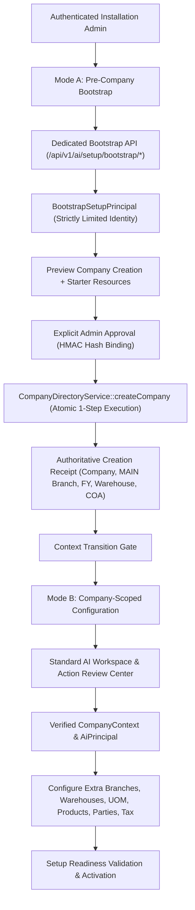

# 37 — Guided Initial ERP Setup Agent: Company to Business Readiness

> **Specification version:** 3.0 · **Reviewed code baseline:** `vigneshsinna/zolo-erp-pro` / `refactor/erp-copilot-stabilization` @ `14195d8b5b195f65ca1283c96794c613de88eded` (2026-11-11). **Proposed implementation, not currently available as an AI write capability.** Verify branch HEAD, installed SDK, actual business rules and CI before coding.

**Status:** Future Action Foundation specification; no change to read-only Copilot.

## 1. Product Goal
An authorised installation administrator should be able to instruct:

> "Set up ABC Textiles as a textile manufacturing company under our ABC Group, in Tamil Nadu, with a new financial year, warehouses, inventory units, product catalogue and suppliers. Get the ERP ready for the first bill."

The **Guided Initial Setup Agent** conducts an interactive interview, resolves mandatory fields, prepares a dependency-aware setup plan, displays an editable preview, secures explicit human approval, invokes existing ERP setup services, confirms resulting company resources, and guides the remaining master configuration.

It is an **administrative onboarding specialist**, not an unrestricted assistant with raw SQL access. It shares the existing model gateway, audit patterns, and validation infrastructure, but executes through a **dedicated bootstrap and action capability boundary**, completely separated from the read-only `AiToolManifest`.

---

## 2. Two Distinct Security Modes

To prevent weakening multi-tenant isolation, the architecture divides initial setup into two strictly separated security contexts:



### Mode A — Pre-Company Bootstrap (Installation Administrator)
- **Context:** Operates before a target company, branch, or financial year exists.
- **Access Guard:** Accessible strictly to an authenticated installation administrator (or an authorized group admin creating a company within their managed group under `CompanyDirectoryService::canManageGroup`).
- **Dedicated API:** Runs via dedicated bootstrap endpoints (`/api/v1/ai/setup/bootstrap/*`), independent of standard tenant-scoped AI chat routes.
- **Principal Security DTO:** Governed by `BootstrapSetupPrincipal`, representing a strictly limited installation-admin identity, **not** a general superuser. It contains only permitted bootstrap capability keys (`setup.group.create.v1`, `setup.company.create.v1`), actor ID, rate budgets, and task expiry.
- **Security Invariant:** Never fabricate placeholder `company_id = 0` or fake FY contexts to bypass tenant middleware.

### Mode B — Company-Scoped Configuration
- **Context:** Active business operations and post-creation master setup.
- **Transition:** Occurs strictly upon receipt of verified `CompanyDirectoryService::createCompany` execution.
- **Principal Object:** Constructed by `CompanyContextResolver::forActor()`, binding authenticated actor, exact `company_id`, `branch_id`, active `financial_year_id`, and Spatie capabilities.
- **Execution:** Every subsequent setup step (units, extra warehouses, tax registrations, products, suppliers, customers, opening balances) executes under exact company permissions and domain services.

---

## 3. What Laravel Already Provisions on Company Creation

The repository already provides an atomic, transactional company provisioning engine in `app/Services/Platform/CompanyDirectoryService.php::createCompany`. When executed, it transactionally creates:

1. **Company record** linked to an optional company group.
2. **Main branch** with system code `MAIN`.
3. **First open financial year** (validated start and end dates).
4. Membership and branch access for creator and approved group admins.
5. **Main warehouse** assigned to the main branch.
6. **Chart of accounts** and semantic ledger mappings.
7. Industry profile, permitted capabilities, and default unit presets.
8. Company profile address, PAN, GSTIN, and contact details via `CompanyProfileService`.
9. **Starter masters:** general customer group, default biller, cash/bank accounts, and document series via `installStarterMasters` and `OptechMasterSeeder`.
10. Default GST categories and compliance settings.
11. Audit row in `company_setup_audits`.

**Crucial Invariant:** The AI engine **must never** attempt to recreate these 11 resources through independent, model-driven SQL writes. The setup adapter invokes `CompanyDirectoryService::createCompany` **exactly once** in a single transaction.

---

## 4. Short Transaction Lifetime & Domain Ownership

1. **Zero Open Transactions During Inference or Review:**
   - Under no circumstances is `DB::transaction()` held open while an LLM interviews the user, parses industry details, or awaits human review in the AI Workspace.
2. **Preserved Domain Service Ownership:**
   - `CompanyDirectoryService::createCompany` already encapsulates its own database transaction (`DB::transaction(...)`). The AI execution adapter delegates directly to this service without opening redundant outer transactions, preventing connection pool exhaustion and transaction lock deadlocks.

---

## 5. Cryptographic Approval Binding

**SHA-256 alone is not an authorization mechanism.**

1. The proposal preview generates a canonical SHA-256 hash covering the target legal name, company code, industry profile, timezone, currency, and FY range.
2. The approval record binds the action version, authenticated installation admin ID, and timestamp into an HMAC signature:
   ```text
   approval_signature = HMAC_SHA256(
       payload_hash + "setup.company.create.v1" + version + actor_id + timestamp,
       server_secret
   )
   ```
3. The server independently verifies the approver's active installation-admin eligibility upon submission. Hash match alone never implies authority.
4. If the administrator edits any parameters ("Change Request"), the proposal version increments (vN → vN+1), requiring a new hash and a fresh approval.

---

## 6. Dual User Interface Delivery
- **AI Workspace (`workspace.blade.php`):** Interactive conversational onboarding, slot gathering, clarifying questions, and live editable preview cards.
- **Action Review Center:** Dedicated operational screen for pending setup approvals, company provisioning verification, and audit trail inspection.

---

## 7. Step-by-Step Setup Sequence

| Step | Security Mode | Operation | Domain Service / Method | Approval Gate |
|---|---|---|---|---|
| **S0** | Mode A | Verify installation admin | `CompanyDirectoryService::isInstallationAdmin` | Deny non-admin |
| **S1** | Mode A | Optional group creation | `CompanyDirectoryService::createGroup` | Installation admin |
| **S2** | Mode A | Company preview & creation | `CompanyDirectoryService::createCompany` | Installation admin (HMAC bound) |
| **S3** | Mode A → B | Verify created resources | Verify company, MAIN branch, FY, warehouse, COA | Automated verification |
| **S4** | Mode B | Additional branches/locations | `CompanySetupService::branch`, `location` | Company admin |
| **S5** | Mode B | GST & tax registrations | `GstSetupService`, `TaxSetupService` | Tax/Finance admin |
| **S6** | Mode B | Custom UOM & conversions | Vetted company-scoped UOM adapter | Product admin |
| **S7** | Mode B | Product catalog import | `ProductMasterService`, `ReviewedProductImport` | Product admin (Row preview) |
| **S8** | Mode B | Customers & suppliers | Scoped `CustomerCreateAdapter` / `SupplierCreateAdapter` | Party admin |
| **S9** | Mode B | Opening balances & stock | Dedicated opening-stock / balance services | Restricted Finance/Stock sign-off |
| **S10**| Mode B | Readiness sign-off | `SetupReadinessService` (Proposed) | Admin activation |

---

## 8. Failure Recovery & Idempotency
- If network failure occurs after `CompanyDirectoryService::createCompany` commits, the recovery handler queries `companies` by the authorized unique company code before attempting another create.
- A committed company is linked to the active task receipt; it is never recreated with an incremented code.
- A failure during Mode B (e.g., product import error) leaves the legal company intact and reports partial completion with actionable recovery links.
