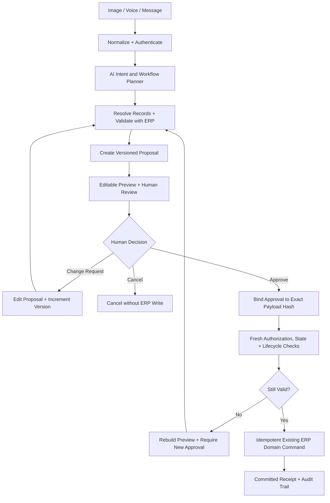

# 38 — Mandatory ERP Transaction Lifecycle and AI Edit Restrictions

> **Specification version:** 3.0 · **Reviewed code baseline:** `vigneshsinna/zolo-erp-pro` / `refactor/erp-copilot-stabilization` @ `14195d8b5b195f65ca1283c96794c613de88eded` (2026-11-11). **Proposed implementation, not currently available as an AI write capability.** Verify branch HEAD, installed SDK, actual business rules and CI before coding.

**Status:** Future Action Foundation specification; no change to read-only Copilot.

## 1. Non-Negotiable Architectural Decision

**Every AI-triggered modification must strictly comply with the existing ERP's authoritative record lifecycle, permitted status transitions, and security constraints.**

Human approval of an AI proposal does not grant authority to bypass a submitted, confirmed, posted, paid, fulfilled, closed, cancelled, or reversed document status. The model may interpret user intent, but **it cannot directly execute an `UPDATE` on a database record because the user asked it to.**



---

## 2. Distinguish the Three Kinds of Change

| Request Type | Meaning | Permitted System Behavior |
|---|---|---|
| **Edit an AI Proposal** (Pre-Approval) | User is refining a proposed draft; no ERP business record exists yet | Update confirmed fields, re-resolve records, recalculate preview, increment proposal version (`vN → vN+1`), and require **fresh human approval**. |
| **Edit an Existing ERP Draft** | A persisted business draft exists in `status = 'draft'` | Execute permitted field updates via the authorized domain draft update service; verify row version, company ownership, and Spatie capabilities. |
| **Correct a Submitted or Posted Record** | A live transaction exists with inventory, GL, or tax dependencies | **Generic SQL `UPDATE` is strictly forbidden.** Route modification through explicit, domain-supported correction workflows (Debit Note, Credit Note, Purchase Return, Reversal Journal) with separate approval. |

---

## 3. Cryptographic Approval Binding

**SHA-256 alone is not an authorization mechanism.**

1. **Canonical Payload Hash:** The system generates a canonical SHA-256 hash of the immutable proposal payload containing its business fields (quantities, rates, taxes, UOM, ledger accounts, and source record references).
2. **Cryptographic Approval Record:** The approval record binds the action version, authenticated approver ID, company ID, branch ID, financial year ID, and source state hash:
   ```text
   approval_signature = HMAC_SHA256(
       payload_hash + action_key + action_version + approver_id +
       company_id + branch_id + financial_year_id + source_state_hash + timestamp,
       server_secret
   )
   ```
3. **Independent Server Authorization:** The server independently verifies the approver's active session, role, company membership, and module capabilities upon approval submission. A valid payload hash alone never grants write authority.
4. **Invalidation on Stale State:** If the underlying ERP record or dependencies change prior to commit, the previous approval is invalidated (`Still Valid? → No`), triggering a refreshed preview and requiring a fresh approval.

---

## 4. Short Transaction Lifetime & Domain Ownership

1. **Zero Open Transactions During Inference or Review:**
   - Database transactions must remain strictly short-lived.
   - `DB::transaction()` must **never** be held open while an LLM generates tokens, asks clarification questions, or awaits human review in the AI Workspace or Action Review Center.
2. **Execution-Time Revalidation:**
   - At the moment of execution, row locks (`lockForUpdate()`) and state re-validation are acquired inside a brief, atomic execution block.
3. **Preserved Domain Service Ownership:**
   - If an authoritative ERP service already manages its own database transaction (e.g., `CompanyDirectoryService::createCompany`, `CommercialApplicationService`), the AI executor must preserve that existing transactional boundary rather than introducing conflicting nested or parallel transaction logic.

---

## 5. Dual User Interface Delivery
- **AI Workspace (`workspace.blade.php`):** Interactive conversational turns, slot gathering, clarifying questions, live preview cards, and in-place "Change Request" editing.
- **Action Review Center (Dedicated Operational Desk):** Cross-module pending approval queue, multi-item approval, audit history, and execution receipts.

---

## 6. Concrete Lifecycle Scenarios

### Example A: Update Supplier Bill Quantity
User: *"Change PB-1025 from 50 to 60 units."*
- **Unposted Draft:** Propose quantity 60 via `CommercialDraftService`; recalculate tax, total, and AP impact; show diff 50 → 60; require approval.
- **Submitted / Posted Bill:** If linked to goods receipt, payable, or tax filing, direct row mutation is rejected. The agent prepares a Purchase Debit Note or Goods Receipt Adjustment document; displays predicted GL and tax impacts; requires explicit finance approval.

### Example B: Paid Sales Invoice
User: *"Reduce the price on invoice INV-77."*
- Check payment allocations and GST returns. Do not alter invoice totals or ledger rows. Route to approved Credit Note workflow or notify the user that an accountant must initiate a formal adjustment.

### Example C: Warehouse with Active Stock
User: *"Delete the old main warehouse."*
- Check for existing stock, movements, or ledger allocations. Direct deletion is rejected. The agent suggests an inventory stock transfer or warehouse deactivation workflow if supported by `CompanySetupService`.

---

## 7. Mandatory Acceptance Test Scenarios
1. **Change Request Version Increment:** User edits an unapproved draft twice; system increments from `v1` to `v2` to `v3`; only `v3` can be approved.
2. **Approval Invalidation on Concurrent Edit:** User approves `v1`, but concurrently submits an edit `v2`; `v1` approval is marked superseded and cannot execute `v2`.
3. **Concurrent External Post:** Document is posted by another ERP user between AI preview and approval; execution fails closed with `LIFECYCLE_STATE_STALE`; rebuilds preview as a formal reversal/adjustment proposal.
4. **Closed Financial Year:** FY is closed after approval; execution revalidation denies commit and marks approval expired.
5. **Short Transaction Verification:** Query monitor proves zero open database transactions during LLM token streaming or user approval pauses.
