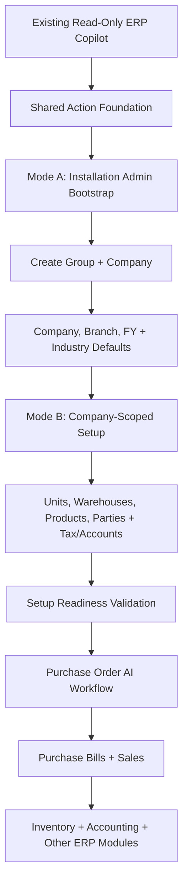

# 39 — Initial Setup Service Inventory, Capability Map and Acceptance Matrix

> **Specification version:** 3.0 · **Reviewed code baseline:** `vigneshsinna/zolo-erp-pro` / `refactor/erp-copilot-stabilization` @ `14195d8b5b195f65ca1283c96794c613de88eded` (2026-11-11). **Proposed implementation, not currently available as an AI write capability.** Verify branch HEAD, installed SDK, actual business rules and CI before coding.

**Status:** Future Action Foundation specification; no change to read-only Copilot.

## 1. Evidence Scope & Status Vocabulary

Reviewed GitHub code on `refactor/erp-copilot-stabilization` @ `14195d8b5b195f65ca1283c96794c613de88eded` (2026-11-11). The branch's GitHub Actions run 42870009218 passed all 11 jobs. **These are existing ERP services and tests, not an implemented AI Setup Agent.** Distinguish:
- **Existing ERP:** service/controller can perform action through present application path.
- **AI Proposed:** no currently approved AI write capability; requires action registry, typed adapter, audit, preview and approval.
- **Guard Gap:** existing controller may not meet strict company-scoping/idempotency/lifecycle safety expected from an AI-executed command; do not expose it directly.

---

## 2. Source-Grounded Setup Inventory

| Setup Area | Actual Code Available | Existing ERP Status | AI Adapter / Remaining Work | Expected Approval / Scope |
|---|---|---|---|---|
| Installation admin check | `CompanyDirectoryService::isInstallationAdmin` | Present | `BootstrapSetupPrincipal`, allowlisted capabilities | Mode A: Installation admin only |
| Group create | `CompanyDirectoryService::createGroup` | Present, transaction and code uniqueness | Safe proposal + duplicate/retry receipt | Mode A: Installation admin |
| Group member rights | `canManageGroup`, `addGroupAdmin` | Present | No arbitrary group-admin changes by AI | Mode A: Group admin / privileged |
| Company create | `CompanyDirectoryService::createCompany` | Present, atomic starter provisioning | Bootstrap preview and exact-once approved command | Mode A: Installation admin (HMAC bound) |
| Initial MAIN branch | Inside `createCompany` | Automatically present | Verify created branch; no second creation | Part of company creation receipt |
| First FY | Inside `createCompany`; `CompanyFinancialYearController::store` later | Present | Review FY dates/locks and subsequent year policies | Mode A: Installation admin |
| Main warehouse | Inside `createCompany` | Automatically present | Verify created main warehouse; no second creation | Part of creation receipt |
| Additional branches | `CompanySetupService::branch` | Present, admin checks and document series | Scoped adapter and preview; branch/FY assumptions | Mode B: Company admin |
| Additional warehouses | `CompanySetupService::location` | Present, company/branch/name checks | Scoped adapter and stock-safe lifecycle policy | Mode B: Company admin with branch access |
| Company profile | `CompanyProfileService::save`, `CompanySetupService::update` | Present | Business restriction checks for posted company data | Mode B: Company admin |
| Industry & subtype | `IndustryCatalog`, `IndustryProfileService`, `CapabilityService` | Present, profile presets | Read choices, show capability/unit consequences | Mode B: Company admin / industry owner |
| Units and UOM | `IndustryProfileService` default units, legacy `UnitController` CRUD | Partial | New vetted company-scoped custom UOM adapter | Mode B: Product administrator |
| Starter COA | `installChart`, `SemanticAccountResolver` | Automatically present | Verify mappings; no duplicate seeding; locked finance changes | Mode B: Company / finance admin |
| Cash/bank and starter masters | `installStarterMasters` + seeder | Automatically present when missing | Verify receipts and correct missing ones only | Mode B: Company admin |
| GST/tax registration | `GstSetupService`, `TaxSetupService` | Present | Explicit effective dates, registration, input credit and role checks | Mode B: Tax / finance admin |
| Product categories/group | Company starter defaults, category/product controllers | Present | Typed scoped category and product adapters, dedupe | Mode B: Products admin |
| Product creation | `ProductMasterService::create` | Present | Vetted transaction adapter with UOM/tax and zero opening stock by default | Mode B: Product admin |
| Product CSV review | `ReviewedProductImport::preview/commit` | Present | Safe mapping/dry-run and per-row approval/status | Mode B: Product import + add permission |
| Customers/parties | `CustomerController` | Present UI; adapter not certified | Company-scoped create/update service, exact matching, no silent email | Mode B: Customer admin |
| Suppliers/parties | `SupplierController` | Present UI; adapter not certified | Supplier validation, bank/GST privacy and no side-effect bypass | Mode B: Supplier admin |
| Opening stock | Existing inventory posting/opening processes require inspection | Not certified as Setup Agent command | Dedicated authoritative opening-stock flow, never direct qty edit | Mode B: Restricted warehouse/finance |
| Opening financial balances | Existing accounting services require mapping | Not certified as Setup Agent command | Dedicated opening-balance domain service, explicit finance signoff | Mode B: Restricted finance approval |
| Readiness/activate | No verified `SetupReadinessService`/activation gate | **Proposed** | Add checklist and admin signoff, integrate safely without breaking existing ERP | Mode B: Company admin + module owners |

---

## 3. Two-Tier Authorization Matrix

| Operation | User has no company selected (Mode A) | Group-admin but not installation admin | Ordinary company operator (Mode B) |
|---|---|---|---|
| Create company group | Installation admin only | Deny unless install admin | Deny |
| Create ungrouped company | Installation admin only | Deny unless install admin | Deny |
| Create company inside managed group | Permitted under actual managed group rights | Allowed for their managed group when backend authorises | Deny |
| Select newly created company | Validate actual membership | Validate membership and authorized group | Only if member |
| Add another branch | Requires real company scoped principal | Requires admin rights within new company | Deny unless company admin |
| Create warehouse/product/supplier | Requires real company/branch/FY and matching module permission | Same scope checks | Only their exact permitted module actions |
| Change posted bill or stock balance | Not relevant to bootstrap | No generic change | Only validated correction workflow if supported |

---

## 4. Setup Sequence and Readiness Check

| Sequence | User Question or AI Step | Security Mode | Criteria Before Continuation |
|---:|---|---|---|
| 1 | Do you want an existing or new company group? | Mode A | Installation/group permission verified; optional group selected |
| 2 | What legal/trade name, company code and location? | Mode A | Required company identity and uniqueness valid |
| 3 | Which industry and business subtype? | Mode A | Selected from actual `IndustryCatalog::SUBTYPES` |
| 4 | What base currency/timezone and FY range? | Mode A | Valid currency and timezone; first FY `end > start` |
| 5 | GST/PAN/contact and logo? | Mode A | Match registration mode; required fields validated |
| 6 | Review complete creation preview and default included resources | Mode A | No ambiguous group/legal entity/FY; explicit admin confirmation |
| 7 | Create via `CompanyDirectoryService::createCompany` exactly once | Mode A | Real company/MAIN/FY/warehouse/COA receipt and company setup audit |
| 8 | Switch to verified scoped company/branch/FY context | Mode A → B | Actor membership and branch access established |
| 9 | Add locations, UOM, tax rules, parties and products | Mode B | Permissions, duplicate checks and field rules; no silent posting |
| 10 | Review document types/series, accounting mappings and user permissions | Mode B | No unresolved required mapping; company-specific controls |
| 11 | Optional import of products/parties | Mode B | Per-row dry-run, correction, approval and idempotent commit |
| 12 | Opening balances and stock (if needed) | Mode B | Separate restricted reviewed services; **not** automatically posted |
| 13 | Setup readiness report and business signoff | Mode B | Required checks passed; report outstanding optional gaps |
| 14 | Handoff to regular ERP Command Center | Mode B | Accurate company context and enabled business modules |

---

## 5. Acceptance Test Matrix

| Test ID | Scenario | Expected Authoritative Outcome |
|---|---|---|
| **SET-001** | Installation admin creates group and new company | One group, one company, actual service receipt, correct memberships |
| **SET-002** | Group admin creates company in managed group | Allowed, correct group linked; no other-group data leak |
| **SET-003** | Group admin tries ungrouped company | Denied; zero new company |
| **SET-004** | Ordinary user asks to create company | Denied; AI offers authorized request path |
| **SET-005** | Create company with missing FY end | Clarification, no company write |
| **SET-006** | Invalid industry/subtype | Reject or clarify from actual catalog; no guessed business vertical |
| **SET-007** | First company created | MAIN branch/FY/warehouse/COA/starter masters and audit present exactly once |
| **SET-008** | Retry approval after timeout | Same company receipt, no second company/code |
| **SET-009** | Crash after company creation before UOM import | Resume in real company context; don't recreate legal entity |
| **SET-010** | Company group admin permissions change mid-task | Fresh check fails before write |
| **SET-011** | Additional branch created twice | Same code/name returns authorized existing branch or controlled conflict |
| **SET-012** | Additional warehouse duplicate name, conflicting address | Validation failure, no unintended warehouse |
| **SET-013** | Textile manufacturing profile chosen | Industry-approved units/processes/capabilities; no unsupported subtype |
| **SET-014** | FMCG company without manufacturing | Do not enable unsupported manufacturing actions |
| **SET-015** | Custom unit conversion changes after posted transaction | Lifecycle restriction; no retroactive stock corruption |
| **SET-016** | Product CSV includes invalid tax/UOM and duplicates | Preview and per-row errors; no silent bulk write |
| **SET-017** | Product creation | Company-scoped product and zero opening stock unless posted via valid opening flow |
| **SET-018** | Supplier shares name across groups/companies | Explicit scoped matching; never wrong supplier |
| **SET-019** | Company has existing chart and mappings | Preserve balances/mappings; no double seed |
| **SET-020** | GSTIN or effective period invalid | Validation and admin warning; no invalid tax registration |
| **SET-021** | Setup admin modifies company while another user posts invoice | Reload actual source state, reject stale preview/approval |
| **SET-022** | User edits pre-create proposal | New revision/version/hash; old approval cannot execute |
| **SET-023** | User asks to edit already posted supplier bill | No direct change, only supported correction command if exists |
| **SET-024** | Company switches after initial setup | New scope verified, no old company candidate IDs carried over |
| **SET-025** | Setup readiness missing mandatory accounts/permission | Show blockers, do not falsely declare ready |
| **SET-026** | Provider outage before approval | No business write |
| **SET-027** | Provider outage after company creation | Return authoritative receipt after reconnect, no duplicate |
| **SET-028** | Concurrent two-company creation approvals | Atomic idempotency claim, one business receipt |
| **SET-029** | Setup assistant tries unknown model-provided PHP method | Registry rejects; no arbitrary class/method execution |
| **SET-030** | Real company created then a later setup step fails | Company preserved, task partially complete with retry/undo guidance; no destructive rollback |
| **SET-031** | Short transaction verification | Database query log proves 0 open transactions during LLM token streaming or user review pauses |
| **SET-032** | Approval signature tampering | Manipulated actor ID or company ID in approval request rejected by server authorization regardless of matching payload hash |
| **SET-033** | Action Review Center queue inspection | Pending proposals render in Review Center; single or batch approval executes each proposal independently with discrete receipts |
