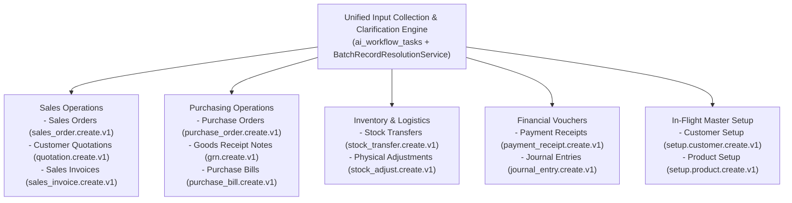

# 41 — Unified Multi-Slot Input Collection & Clarification Engine

> **Specification version:** 3.1 · **Target Codebase:** `vigneshsinna/zolo-erp-pro` / `feature/ai-unified-input-clarification` (2026-11-11)  
> **Status:** Architecture Specification (EGM Remediated)  
> **Primary Vertical Slice:** Purchase Order Multi-Slot Clarification (`purchase_order.create.v1`)  
> **Cross-Module Scope:** Generalized pre-proposal engine serving Sales Orders (`sales_order.create.v1`), Quotations (`quotation.create.v1`), Purchase Bills (`purchase_bill.create.v1`), and Master Setup  

---

## 1. Executive Summary & Objective

While Phase 2 successfully delivered the governed commercial action foundation and operational Purchase Order capability (`purchase_order.create.v1`), natural-language interactions remained bounded by early-return validation: the existing `PreparePurchaseOrder` tool stops at the first unresolved supplier or warehouse, returning immediately with `status: needs_input` before downstream products, quantities, prices, or line items are inspected.

Phase 2.1 eliminates this bottleneck by introducing a **centralized pre-proposal task collection engine**. The engine evaluates all identifiable required, optional, and conditional inputs in a single batch pass, persists incomplete inputs in a mutable draft table (`ai_workflow_tasks`), and returns a consolidated **"Details Required"** clarification card in the AI Workspace.

### Scope & Universal Applicability
The Unified Multi-Slot Input Collection & Clarification Engine is an enterprise-wide, domain-agnostic foundation. While Purchase Orders (`purchase_order.create.v1`) serve as the primary vertical slice for proving the batch resolution engine, the exact same architecture, tables (`ai_workflow_tasks`), endpoints (`/api/v1/ai/workflow-tasks/*`), and interactive clarification UI apply across all user-input workflows:



#### Multi-Domain Capability Matrix

| ERP Domain | Capability Key | Requirements Provider | Batch Entity Resolution | Domain Execution Target |
|---|---|---|---|---|
| **Purchasing** | `purchase_order.create.v1` | `PurchaseOrderRequirementsProvider` | Supplier, Default Warehouse, Products, Purchase UOM | `CommercialApplicationService::create('purchase')` (status: 4) |
| **Sales** | `sales_order.create.v1` | `SalesOrderRequirementsProvider` | Customer, Dispatch Warehouse, Products, Sale UOM, ATP Check | `OrderLifecycleService::createSale()` |
| **Sales** | `quotation.create.v1` | `QuotationRequirementsProvider` | Customer, Validity Days, Products, Sale UOM, Price Tier | `QuotationApplicationService::create()` |
| **Purchasing** | `grn.create.v1` | `GoodsReceiptRequirementsProvider` | Purchase Order Ref, Receiving Warehouse, Lines, Batch/Lot | `OrderLifecycleService::receivePurchase()` |
| **Inventory** | `stock_transfer.create.v1` | `StockTransferRequirementsProvider` | Source Warehouse, Dest Warehouse, Line Products, Available Stock | `InventoryMovementService::transfer()` |
| **Finance** | `payment_receipt.create.v1` | `PaymentReceiptRequirementsProvider` | Customer, Open Invoices, Bank/Cash Account, Payment Mode | `AccountingReceiptService::settle()` |
| **Master Setup** | `setup.product.create.v1` | `ProductMasterRequirementsProvider` | Brand, Category, Primary Unit, HSN Code, Tax Rate | `ProductMasterService::create()` |
| **Master Setup** | `setup.customer.create.v1` | `CustomerMasterRequirementsProvider` | Legal Name, GSTIN, Billing/Shipping Address, Ledger Group | `CustomerDirectoryService::create()` |

The architecture strictly maintains the foundational invariant: **Untrusted Model, Authoritative Server**. The Large Language Model extracts intent and slot candidates; server-side requirements providers and ERP domain services authoritatively decide entity validity, pricing, tax calculations, and execution.

---

## 2. The Problem & Operational Gaps

zoloERP Pro operators entering commercial documents via chat, pasted text, or structured instructions face four operational limitations:

1. **Stop-at-First-Error Bottleneck:**
   In `PreparePurchaseOrder.php`, if a supplier lookup returns no exact match, the tool immediately outputs:
   ```php
   if ($supplierRes['status'] === 'none') {
       return json_encode([
           'status' => 'needs_input',
           'missing_field' => 'supplier',
           // ...
       ]);
   }
   ```
   The warehouse and product lines remain uninspected. If the user clarifies the supplier in the next turn, the tool halts again on the warehouse, and then on ambiguous products, forcing 3 to 5 repetitive question-and-answer turns.

2. **Incomplete Multi-Line Diagnostic Evaluation:**
   Commercial orders in manufacturing, wholesale, and retail frequently contain 5 to 50 line items. Halting on line 1 conceals errors on lines 2 through 10. Operators require a complete diagnostic report of every line item in a single response.

3. **Absence of Durable Pre-Proposal Task State:**
   Prior to Phase 2.1, system state existed only as conversational messages in `ai_messages` or sealed proposals in `ai_action_proposals`. There was no intermediate, durable storage for incomplete drafts. Storing incomplete inputs in `ai_action_proposals` violates the cryptographic sealing and immutability invariants of the Action Foundation.

4. **Entity Disambiguation vs. Master Data Integrity:**
   When an input references an unknown product, customer, or unit, systems without explicit entity gates either create unverified database records (corrupting master data) or halt without actionable feedback. Operators require grounded disambiguation: selectable choices for existing records, or an explicit pathway to trigger a separate, approved master-setup workflow without losing their active draft.

---

## 3. Core Architectural Invariants

*   **Law 1 (Strict Tenancy Isolation):** Enforce `company_id BIGINT UNSIGNED NOT NULL` on all commercial workflow tasks (`ai_workflow_tasks`). Compound every query and mutation with `WHERE id = :id AND company_id = :company_id AND actor_id = :actor_id`.
*   **Law 2 (No Shared Table for Bootstrap):** Mode A Pre-Company Bootstrap tasks remain isolated under `ai_bootstrap_tasks` and `/api/v1/ai/setup/bootstrap/*`, preserving non-null `company_id` on commercial tasks.
*   **Law 3 (Zero Autonomous Master Creation):** Missing products, customers, suppliers, or units never trigger automatic database insertions. They return grounded candidate choices or route to separate, approved setup proposals.
*   **Law 4 (No Probabilistic Financial Calculations):** The LLM never calculates subtotals, tax splits, or grand totals. All financial metrics are computed by `CommercialPricing` once inputs are complete.
*   **Law 5 (Optimistic Concurrency on Drafts):** Draft mutations via `PATCH /api/v1/ai/workflow-tasks/{id}/inputs` require `expected_revision`. Stale submissions fail with HTTP 409 Conflict.
*   **Law 6 (Pessimistic Locking on Proposal Promotion):** Promoting a task via `POST /prepare-proposal` requires `expected_revision`, executes inside a database transaction with `SELECT ... FOR UPDATE` row locks, and seals the task (`status = 'proposal_created'`) against subsequent patches (HTTP 423 Locked).
*   **Law 7 (Authoritative Domain Service Routing):** Purchase Orders route to `CommercialApplicationService::create('purchase')` with status 4; Sales Orders route to `OrderLifecycleService::createSale()`.

---

## 4. End-to-End Pipeline Architecture

```text
+----------------------------------------------------------------------------------------------------+
|                                      TEXT INTAKE LAYER                                             |
|  - Conversational Chat, Pasted Text, Structured User Commands                                      |
+--------------------------------------------------+-------------------------------------------------+
                                                   |
                                                   v
+----------------------------------------------------------------------------------------------------+
|                              INTENT EXTRACTION & SLOT DISCOVERY                                    |
|  - AI SDK Tool (e.g., PreparePurchaseOrder) maps prompt to action key                              |
|  - Extracts raw slot values, stable client_line_ids, and user inputs                               |
+--------------------------------------------------+-------------------------------------------------+
                                                   |
                                                   v
+----------------------------------------------------------------------------------------------------+
|                         CAPABILITY REQUIREMENTS & CONTEXT RESOLUTION                               |
|  - Resolves authenticated CompanyContext (Company, Branch, FY) server-side                         |
|  - Loads ActionFieldRequirement rules from ActionRequirementsRegistry with current draft slots     |
+--------------------------------------------------+-------------------------------------------------+
                                                   |
                                                   v
+----------------------------------------------------------------------------------------------------+
|                            WORKFLOW TASK DRAFT PERSISTENCE (ai_workflow_tasks)                     |
|  - Creates or loads draft: UUID, action_key, actor_id, company_id (NOT NULL), branch_id, FY_id     |
|  - Tracks revision counter (1, 2, ...); enforces optimistic concurrency                            |
+--------------------------------------------------+-------------------------------------------------+
                                                   |
                                                   v
+----------------------------------------------------------------------------------------------------+
|                              BATCH RECORD RESOLUTION (SINGLE PASS)                                 |
|  - BatchRecordResolutionService executes set-based SQL WHERE IN queries:                           |
|    * Parties: Supplier or Customer (Exact ID, GSTIN, Name, Bounded Candidates max 5)               |
|    * Warehouses: Active Branch Default or Explicit Name/Code                                       |
|    * Products: Batched query across ALL line items (WHERE code IN (...) OR barcode IN (...))        |
|    * Units: Purchase unit (PO) or Sale unit (SO) per line item                                     |
|  - Dirty-slot memoization skips previously resolved clean lines                                    |
+--------------------------------------------------+-------------------------------------------------+
                                                   |
                                                   v
+----------------------------------------------------------------------------------------------------+
|                           INPUT COMPLETENESS & APPLICABILITY EVALUATOR                             |
|  - Evaluates each field: resolved, missing, invalid, ambiguous, derived                            |
|  - Checks domain validators without database mutation                                              |
+--------------------------------------------------+-------------------------------------------------+
                                                   |
                                                   +--------------------------------+
                                                   |                                |
                                    Blocking Issues Remain?                         | Zero Issues
                                                   |                                | (Ready)
                                          YES      v                                v
+--------------------------------------------------+-----+   +----------------------+--------------------+
|        CONSOLIDATED CLARIFICATION RESPONSE             |   |       ACTION PROPOSAL PROMOTION            |
|  - ClarificationResponseBuilder generates single       |   |  - Gated by expected_revision & row lock   |
|    structured payload                                  |   |  - ActionProposalService::create()         |
|  - AI Workspace displays "Details Required" Card:      |   |  - Authoritative CommercialPricing preview |
|    * Confirmed Fields Summary (Read-only)              |   |  - Live SHA-256 Source State Hash          |
|    * Ambiguous Matches (Clickable candidate pickers)   |   |  - Cryptographic HMAC Approval Seal        |
|    * Missing Inputs (Typed controls)                   |   |  - Task status transitions to sealed       |
|    * Invalid Fields (Error explanations)               |   +----------------------+--------------------+
+--------------------------+-----------------------------+                          |
                           |                                                        v
                           v                                 +--------------------------------------------+
+--------------------------------------------------------+   |        ACTION REVIEW CENTER & APPROVAL     |
|             CONSOLIDATED USER CORRECTION               |   |  - Operational Desk Review & Sign-Off      |
|  - User submits batch patch with expected_revision     |   +----------------------+---------------------+
|  - TaskCorrectionService applies atomic update,        |                          |
|    cascades invalidation to derived_default slots      |                          v
|  - Returns to BATCH RECORD RESOLUTION                  |   +--------------------------------------------+
+--------------------------------------------------------+   |       AUTHORITATIVE ERP DOMAIN EXECUTION   |
                                                             |  - Short-transaction row locking           |
                                                             |  - Live revalidation against source state  |
                                                             |  - PO: CommercialApplicationService        |
                                                             |  - SO: OrderLifecycleService::createSale   |
                                                             +--------------------------------------------+
```

---

## 5. Core Component Contracts & Data Models

### 5.1 Action Requirements Provider Interface
```php
namespace App\Ai\Contracts;

use App\Ai\DTOs\ActionFieldRequirement;
use App\Ai\DTOs\WorkflowTaskContext;

interface ActionRequirementsProviderInterface
{
    public function actionKey(): string;

    /**
     * @param array<string, mixed> $currentSlots Current draft inputs for dynamic line expansion
     * @return list<ActionFieldRequirement>
     */
    public function requirements(WorkflowTaskContext $context, array $currentSlots = []): array;

    /**
     * Deterministic domain validation of complete inputs without ERP mutation.
     *
     * @param array<string, mixed> $resolvedInputs
     * @return array<string, string> Field errors keyed by stable field path.
     */
    public function validate(WorkflowTaskContext $context, array $resolvedInputs): array;
}
```

### 5.2 Dynamic Line-Item Addressing & Mutation Protocol
*   Line items use stable client identifiers (`client_line_id`, e.g. `line-1`, `line-2`, or UUIDs).
*   Field paths: `items[client_line_id].field_name`.
*   **Mutation Protocol (`PATCH /api/v1/ai/workflow-tasks/{id}/inputs`):**
    - **Add Line**: Client provides new unique `client_line_id` with field values.
    - **Edit Line**: Client provides specific field path and updated value.
    - **Delete Line**: Client supplies `items[client_line_id]._destroy: true`.

### 5.3 Batch Record Resolution & Query Vectorization
`BatchRecordResolutionService` eliminates N+1 query storms through:
1.  **Set-Based Bulk Multi-Get**: Collects all product codes/barcodes across lines and executes a single `Product::where('company_id', $context->companyId)->where(function ($q) use ($codes) { $q->whereIn('code', $codes)->orWhereIn('barcode', $codes); })->get()` query.
2.  **Dirty-Slot Memoization**: Checks `resolution_json`. Lines whose inputs have not changed since previous evaluation are skipped.
3.  **Candidate Caps**: Ambiguous matches return at most 5 candidates with grounded metadata (ID, code, label).
4.  **Customer & Sales UOM Resolution**: Implements `resolveCustomer()` and `sale_unit_id` resolution for sales workflows.

### 5.4 Database Schema (`ai_workflow_tasks`)
```sql
CREATE TABLE ai_workflow_tasks (
    id CHAR(36) NOT NULL PRIMARY KEY,
    action_key VARCHAR(100) NOT NULL,
    actor_id BIGINT UNSIGNED NOT NULL,
    thread_id VARCHAR(120) NULL,
    company_id BIGINT UNSIGNED NOT NULL,
    branch_id BIGINT UNSIGNED NOT NULL,
    financial_year_id BIGINT UNSIGNED NOT NULL,
    status VARCHAR(30) NOT NULL DEFAULT 'collecting',
    revision INT UNSIGNED NOT NULL DEFAULT 1,
    slots_json JSON NOT NULL,
    resolution_json JSON NULL,
    issues_json JSON NULL,
    linked_proposal_id CHAR(36) NULL,
    expires_at TIMESTAMP NULL,
    created_at TIMESTAMP NULL,
    updated_at TIMESTAMP NULL,
    INDEX idx_wf_tasks_company_actor (company_id, actor_id, status),
    INDEX idx_wf_tasks_thread (thread_id),
    INDEX idx_wf_tasks_proposal (linked_proposal_id)
) ENGINE=InnoDB DEFAULT CHARSET=utf8mb4 COLLATE=utf8mb4_unicode_ci;
```

---

## 6. REST API Contract & Wire Payloads

All endpoints require `auth:sanctum`, active `company.context`, and `ai.use` permission. Every query enforces `company_id = $context->companyId AND actor_id = $actorId`.

| Method | Endpoint | Description & Access Control |
|---|---|---|
| `POST` | `/api/v1/ai/workflow-tasks` | Initiates new task draft (`action_key`, optional initial slots). |
| `GET` | `/api/v1/ai/workflow-tasks/{id}` | Returns active task state, confirmed summary, candidates, and blocking issues. |
| `PATCH` | `/api/v1/ai/workflow-tasks/{id}/inputs` | Submits batch corrections with `expected_revision`. Returns updated status, 409 Conflict, or 410 Gone. |
| `POST` | `/api/v1/ai/workflow-tasks/{id}/prepare-proposal` | Promotes `ready` task to an immutable proposal under transaction lock with `expected_revision`. |
| `POST` | `/api/v1/ai/workflow-tasks/{id}/cancel` | Cancels active draft (`status = 'cancelled'`). Zero ERP writes. |

### 6.1 Patch Payload with Line Deletion
```json
{
  "expected_revision": 2,
  "patches": {
    "supplier_id": 45,
    "items[line-1].product_id": 102,
    "items[line-2]._destroy": true,
    "items[line-3].product_id": 204,
    "items[line-3].qty": 50,
    "items[line-3].net_unit_cost": 120.00
  }
}
```

### 6.2 HTTP 409 Conflict Response
```json
{
  "error": "revision_conflict",
  "message": "Task draft was modified in another session. Refresh state before submitting corrections.",
  "server_revision": 3,
  "task": {
    "id": "9b1deb4d-3b7d-4bad-9bdd-2b0d7b3dcb6d",
    "revision": 3,
    "status": "needs_input"
  }
}
```

---

## 7. Risks & Mitigations

| Risk / Failure Mode | Severity | Mitigation Strategy |
|---|:---:|---|
| **Query Storms on Multi-Line Resolution** | High | Set-based bulk SQL queries (`WHERE code IN (...) OR barcode IN (...)`), maximum candidate cap of 5 per field, and dirty-slot memoization in `resolution_json`. |
| **Cross-Tenant Data Leakage** | Critical | Enforce `company_id BIGINT UNSIGNED NOT NULL`. Compound every query and patch with `$task->company_id === $context->companyId`. Reject unowned entity IDs at validation. |
| **Concurrent Double Promotion** | High | Require `expected_revision` on `/prepare-proposal`. Wrap promotion in `DB::transaction()` with `SELECT ... FOR UPDATE` row locking. Atomically seal task to prevent duplicate proposals. |
| **Post-Promotion Task Tampering** | Medium | Status guard on `updateInputs`: only allow updates when `status IN ('collecting', 'needs_input')`. Reject patches on promoted tasks with HTTP 423 Locked. |
| **Stale Pricing / Tax Leakage on Entity Switch** | High | Slot sourcing tags (`user_explicit` vs `derived_default`). Purge all `derived_default` pricing and tax slots whenever root party or warehouse references change. |
| **Payload Bloat on Large Orders** | Medium | Bounded candidate pickers (max 5 items). Return diagnostic summaries in primary card, deferring full catalog search to on-demand search endpoints. |

---

## 8. Detailed Implementation File Inventory

### Slice 1: Database Schema & Core Contracts
1. `[Create]` `database/migrations/2026_11_11_000002_create_ai_workflow_tasks_tables.php`
2. `[Modify]` `app/Ai/Contracts/ActionRequirementsProviderInterface.php`
3. `[Modify]` `app/Ai/DTOs/ActionFieldRequirement.php`
4. `[Modify]` `app/Ai/DTOs/WorkflowTaskContext.php`
5. `[Modify]` `app/Ai/DTOs/FieldIssue.php`
6. `[Modify]` `app/Ai/DTOs/EvaluationResult.php`
7. `[Modify]` `app/Ai/DTOs/BatchResolutionResult.php`

### Slice 2: Requirements Registry & Primary PO Provider
8. `[Modify]` `app/Ai/Registries/ActionRequirementsRegistry.php`
9. `[Modify]` `app/Ai/Requirements/PurchaseOrderRequirementsProvider.php`
10. `[Create]` `app/Ai/Requirements/SalesOrderRequirementsProvider.php`

### Slice 3: Batch Resolution & Evaluation Engine
11. `[Modify]` `app/Ai/Services/BatchRecordResolutionService.php`
12. `[Modify]` `app/Ai/Services/RecordResolutionService.php`
13. `[Modify]` `app/Ai/Services/InputCompletenessEvaluator.php`
14. `[Modify]` `app/Ai/Services/WorkflowTaskStateService.php`
15. `[Modify]` `app/Ai/Services/TaskCorrectionService.php`
16. `[Modify]` `app/Ai/Services/ClarificationResponseBuilder.php`

### Slice 4: Tool Refactoring, API Endpoints & UI Components
17. `[Modify]` `app/Ai/Tools/PreparePurchaseOrder.php`
18. `[Modify]` `app/Http/Controllers/Api/V1/AiWorkflowTaskController.php`
19. `[Modify]` `app/Http/Controllers/Api/V1/AiChatController.php`
20. `[Modify]` `app/Providers/AiServiceProvider.php`
21. `[Modify]` `routes/api.php`
22. `[Modify]` `resources/views/backend/ai/workspace.blade.php`
23. `[Create]` `public/js/ai-task-card.js`

### Slice 5: Automated Verification Test Suites
24. `[Create]` `tests/Feature/Ai/TaskEngine/WorkflowTaskStateTest.php`
25. `[Create]` `tests/Feature/Ai/TaskEngine/BatchRecordResolutionTest.php`
26. `[Create]` `tests/Feature/Ai/TaskEngine/InputCompletenessEvaluatorTest.php`
27. `[Create]` `tests/Feature/Ai/Commercial/MultiSlotPurchaseOrderWorkflowTest.php`
28. `[Create]` `tests/Feature/Ai/Commercial/MultiSlotSalesOrderWorkflowTest.php`

### Slice 6: Repository Master Architecture Documentation Updates
29. `[Modify]` `AGENTS.md`
30. `[Modify]` `SESSION_MEMORY.md`
31. `[Modify]` `docs/zoloerp-ai-agent-implementation/docs/ai/03_ARCHITECTURE.md`
32. `[Modify]` `docs/zoloerp-ai-agent-implementation/docs/ai/06_DATABASE_SCHEMA.md`
33. `[Modify]` `docs/zoloerp-ai-agent-implementation/docs/ai/20_DELIVERY_BACKLOG.md`
34. `[Modify]` `docs/zoloerp-ai-agent-implementation/docs/ai/27_INTENT_AND_RECORD_RESOLUTION.md`
35. `[Modify]` `docs/zoloerp-ai-agent-implementation/docs/ai/29_WORKFLOW_ORCHESTRATION.md`
36. `[Modify]` `docs/zoloerp-ai-agent-implementation/docs/ai/30_PURCHASE_WORKFLOWS.md`
37. `[Create]` `docs/zoloerp-ai-agent-implementation/docs/ai/41_UNIFIED_INPUT_COLLECTION_AND_CLARIFICATION.md`
