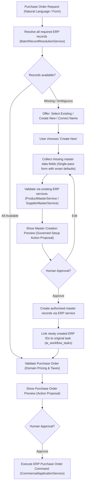
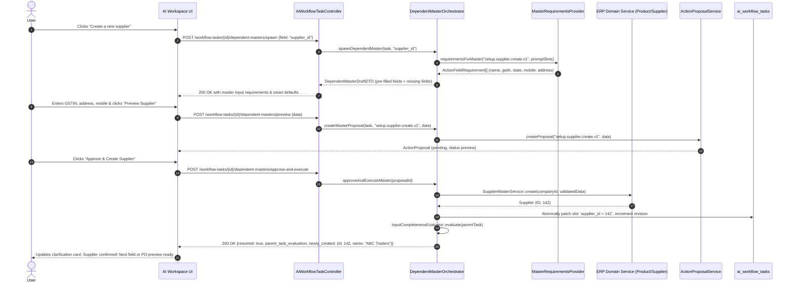

# 42 — Intelligent Dependent Master Data Creation & Workflow Resumption (Phase 2.2)

> **Specification version:** 1.0 · **Target Codebase:** `vigneshsinna/zolo-erp-pro` / `feature/ai-unified-input-clarification` (2026-11-11)  
> **Status:** Architecture Specification  
> **Parent Architecture:** Extension of Phase 2.1 ([41_UNIFIED_INPUT_COLLECTION_AND_CLARIFICATION.md](41_UNIFIED_INPUT_COLLECTION_AND_CLARIFICATION.md))  
> **Primary Vertical Slice:** Purchase Order Dependent Master Resolution (`purchase_order.create.v1` -> `setup.supplier.create.v1`, `setup.warehouse.create.v1`, `setup.product.create.v1`)  
> **Cross-Module Scope:** Universal master resolution & workflow resumption engine serving Sales Orders (`sales_order.create.v1`), Quotations (`quotation.create.v1`), Stock Transfers (`stock_transfer.create.v1`), Job Work (`jobwork.order.v1`), and Production Runs (`production.run.v1`).

---

## 1. Executive Summary & Core Tenets

Phase 2.1 introduced the **Unified Multi-Slot Input Collection & Clarification Engine**, which eliminates early-return validation by performing full-pass batch resolution over all slots, persisting incomplete inputs in `ai_workflow_tasks`, and displaying a consolidated "Details Required" card in the AI Workspace.

However, when an input references an unavailable master record (e.g., Supplier `"ABC Traders"`, Destination Warehouse `"Main Warehouse"`, or Product `"Cotton Shirt Blue"`), Phase 2.1 marks the slot as `missing` or `ambiguous` with text-only prompts. This leaves the operator with two cumbersome paths:
1. Abandon the conversation to manually navigate to ERP master screens to add the missing supplier, warehouse, or item, losing the in-flight draft context.
2. Rely on unstructured manual text re-entry.

**Phase 2.2 — Intelligent Dependent Master Data Creation & Workflow Resumption** solves this by embedding an intelligent **Three-Way Disambiguation Triad** into the existing clarification engine. Rather than introducing a separate AI agent or autonomous background writer, Phase 2.2 operates strictly within `ErpCopilot` as an extension of Phase 2.1, orchestrating existing Phase 1.5/2 setup capabilities and authoritative ERP domain services.



### Core Non-Negotiables & Invariants
1. **Extension of Phase 2.1, Not a New Independent Agent:** Operates entirely within `ErpCopilot`, leveraging `WorkflowTaskContext`, `ai_workflow_tasks`, and existing `/api/v1/ai/workflow-tasks/*` routes.
2. **Untrusted Model, Authoritative Server:** The LLM proposes pre-filled values; server-side requirements providers and ERP domain services (`ProductMasterService`, `SupplierMasterService`, `GstSetupService`) validate and enforce integrity.
3. **Strict Separation of Approvals (Two Distinct Approval Gates):**
   - **Gate 1 (Master Record Approval):** Review and approval for `setup.supplier.create.v1`, `setup.warehouse.create.v1`, or `setup.product.create.v1`. Creates master records only.
   - **Gate 2 (Commercial Transaction Approval):** Review and approval for `purchase_order.create.v1` once all slots are complete and live ERP pricing/taxation has been computed.
   - **Under NO circumstances are master creation and financial document booking collapsed into an unreviewed single write.**
4. **Automated Workflow Resumption:** Upon successful execution of a dependent master proposal, the newly generated `erp_resource_id` is automatically injected into the parent task's slots, the revision is atomically incremented, and completeness is re-evaluated.
5. **Universal Domain Reusability:** The identical triad and resumption engine governs Sales Orders, Customer Quotations, Stock Transfers, Job Work, and Manufacturing BOMs.

---

## 2. The Three-Way Disambiguation Triad

When an entity slot has status `missing` or `ambiguous`, Phase 2.2 presents three explicit options in the UI and API for that specific field:

```
┌────────────────────────────────────────────────────────────────────────┐
│ Supplier — ABC Traders                                                 │
│ [!] No matching active record found                                     │
├────────────────────────────────────────────────────────────────────────┤
│ [ 🔍 Select an existing supplier ]                                      │
│   Search active suppliers in your ERP directory                        │
│                                                                        │
│ [ ➕ Create a new supplier ]                                            │
│   New supplier setup will collect required contact, address and GST    │
│                                                                        │
│ [ ✏️ Correct the supplier name ]                                       │
│   Fix typos or re-enter search query inline                            │
└────────────────────────────────────────────────────────────────────────┘
```

### Detailed Option Semantics

| Triad Action | User Intent | Server-Side Handling & Lifecycle |
|---|---|---|
| **1. `select_existing`** | User knows the supplier exists under a different name or wants to pick from active ERP records. | Opens searchable autocomplete dropdown querying active company suppliers (`/api/v1/parties?type=supplier`). On selection, patches `supplier_id = {id}` via `PATCH /api/v1/ai/workflow-tasks/{id}/inputs`. |
| **2. `create_new`** | The entity is genuinely new to the business and must be added to master data. | Checks actor's Spatie capability (e.g. `suppliers-add`). Spawns a dependent master setup draft with pre-filled inputs extracted from the original prompt (e.g., `name = 'ABC Traders'`). Collects missing fields, previews `setup.supplier.create.v1`, and requests human approval. |
| **3. `correct_name`** | The user made a typo in their initial natural language prompt (e.g., typed `"ABC Traders"` instead of `"ABC Textiles"`). | Displays inline text field. Submitting runs `BatchRecordResolutionService` on the new query, updating the slot without creating new records. |

---

## 3. Data Flow & Master Creation Sub-Workflow

When the user selects **"Create a new [Entity]"**, the system executes the following deterministic lifecycle:



---

## 4. Authoritative Domain Service Integration

Phase 2.2 adheres strictly to **Law 2 & Law 3**: large models NEVER write directly to tables. All master creations route through existing, hardened ERP domain services:

### 4.1 Supplier Creation (`setup.supplier.create.v1`)
- **Domain Service:** `App\Services\Commercial\SupplierMasterService::create()`
- **Authoritative Checks:**
  - Company tenant scoping (`company_id`).
  - Uniqueness of Supplier code and GSTIN within company.
  - State code validation (GST rules).
  - Creation of default subledger account under Current Liabilities (`Accounts Payable`).
- **Gated Capability:** Spatie permission `suppliers-add` + `ai.use`.

### 4.2 Product Creation (`setup.product.create.v1`)
- **Domain Service:** `App\Services\ERP\ProductMasterService::create()`
- **Authoritative Checks:**
  - Validates `unit_id` belongs to tenant company.
  - Validates `category_id` and `tax_id` belong to tenant company.
  - Auto-assigns or verifies product code uniqueness (`code`).
  - Initial cost price and MRP formatting.
- **Gated Capability:** Spatie permission `products-add` + `ai.use`.

### 4.3 Warehouse Creation (`setup.warehouse.create.v1`)
- **Domain Service:** `App\Services\Inventory\WarehouseMasterService::create()`
- **Authoritative Checks:**
  - Branch ownership (`branch_id`).
  - Company ownership (`company_id`).
  - Active status flag and default storage location setup.
- **Gated Capability:** Spatie permission `warehouse-add` + `ai.use`.

---

## 5. UI/UX Interaction Specification

The AI Workspace interface (`workspace.blade.php`) is upgraded to provide an intuitive, zero-context-loss experience:

### 5.1 Card States

1. **State A: Triad Selection Card (Default for missing/ambiguous master)**
   - Displays entity label and original user search string.
   - Badge: `[No matching active record]`.
   - 3 interactive buttons:
     - `Select Existing` (toggles inline search select).
     - `Create New` (opens dependent master setup panel).
     - `Correct Name` (toggles inline text input).
   - Informational helper note describing what fields the setup will collect.

2. **State B: Inline Master Setup Drawer / Sub-Form**
   - Renders cleanly inside the clarification card.
   - Pre-fills known details: e.g. Name pre-filled as `"ABC Traders"`, Product pre-filled as `"Cotton Shirt Blue"`, Unit cost pre-filled as `₹500.00`.
   - Clear input fields for remaining requirements (e.g. GSTIN, Mobile, State, Primary Unit).
   - Action buttons:
     - `Preview & Approve Master`
     - `Cancel & Back to Options`

3. **State C: Resumption & Automatic Advancement**
   - Once the master is approved and created, a celebratory green confirmation badge appears:
     `✓ Supplier "ABC Traders" created (ID #142) and linked to this Purchase Order.`
   - The card instantly re-renders:
     - If other unresolved records exist (e.g., Warehouse, Product), the card focuses on the next unresolved entity.
     - If all records are resolved, the card automatically transitions to:
       `All requirements ready! Preparing your Purchase Order preview...`
       and immediately presents the standard Phase 2 Purchase Order Action Proposal preview!

---

## 6. Database Schema Extensions (Additive Only)

To track dependent master creation workflows without breaking existing contracts, the following columns are added via an additive migration:

```php
Schema::table('ai_workflow_tasks', function (Blueprint $table): void {
    // Tracks in-flight or completed child master proposals linked to this parent workflow task
    $table->json('dependent_masters_json')->nullable()->after('issues_json');
});
```

### JSON Structure of `dependent_masters_json`:
```json
{
  "supplier_id": {
    "action_key": "setup.supplier.create.v1",
    "status": "completed",
    "proposal_id": "8fa1b490-4a81-4eb2-a634-f8520ad51f62",
    "created_resource_id": 142,
    "created_resource_type": "supplier",
    "created_at": "2026-11-11T23:15:00Z"
  },
  "items[line-0].product_id": {
    "action_key": "setup.product.create.v1",
    "status": "collecting",
    "proposal_id": null,
    "created_resource_id": null,
    "created_resource_type": "product"
  }
}
```

---

## 7. REST API Endpoints

Mounted under `/api/v1/ai/workflow-tasks/{id}/dependent-masters`:

| Method | Endpoint | Description | Authorization |
|---|---|---|---|
| `POST` | `/{id}/dependent-masters/spawn` | Spawns a dependent master collection sub-flow for a specific field slot (e.g. `supplier_id`). Returns required master fields with smart pre-fills. | `ai.use` + master permission (`suppliers-add`) |
| `POST` | `/{id}/dependent-masters/preview` | Validates master inputs and prepares a sealed `setup.<entity>.create.v1` Action Proposal. | `ai.use` + master permission |
| `POST` | `/{id}/dependent-masters/approve-and-execute` | Approves and executes the master creation via authoritative ERP domain service, immediately resumes parent task with the new ID. | `ai.use` + `ai.action.approve` + master permission |

---

## 8. Multi-Domain Generalization Matrix

The Phase 2.2 engine is designed as a reusable platform capability that supports all core ERP modules:

| ERP Module | Primary Transaction | Missing Master Entity | Dependent Setup Capability | ERP Domain Service |
|---|---|---|---|---|
| **Purchasing** | Purchase Order (`purchase_order.create.v1`) | Supplier | `setup.supplier.create.v1` | `SupplierMasterService::create()` |
| **Purchasing** | Purchase Order (`purchase_order.create.v1`) | Destination Warehouse | `setup.warehouse.create.v1` | `WarehouseMasterService::create()` |
| **Purchasing** | Purchase Order (`purchase_order.create.v1`) | Purchased Product | `setup.product.create.v1` | `ProductMasterService::create()` |
| **Purchasing** | Purchase Order (`purchase_order.create.v1`) | Purchase Unit of Measure | `setup.unit.create.v1` | `UnitMasterService::create()` |
| **Sales** | Sales Order (`sales_order.create.v1`) | Customer | `setup.customer.create.v1` | `CustomerDirectoryService::create()` |
| **Sales** | Sales Order (`sales_order.create.v1`) | Finished Good | `setup.product.create.v1` | `ProductMasterService::create()` |
| **Inventory** | Stock Transfer (`stock_transfer.create.v1`) | Transit Warehouse | `setup.warehouse.create.v1` | `WarehouseMasterService::create()` |
| **Manufacturing**| Production Run (`production.run.v1`) | Bill of Materials (BOM) | `setup.bom.create.v1` | `BomService::create()` |
| **Job Work** | Job Work Order (`jobwork.order.v1`) | Job Worker Party | `setup.supplier.create.v1` | `SupplierMasterService::create()` |

---

## 9. Verification & Acceptance Criteria

1. **AC-1 (Triad Discovery):** When batch resolution marks an entity slot as missing, the API payload includes `resolution_options: ["select_existing", "create_new", "correct_name"]` and `can_create: bool`.
2. **AC-2 (Permission Gating):** If the user lacks `suppliers-add`, `can_create` is returned as `false` with reason `"Requires supplier creation permission"`, disabling the "Create new" button in the UI.
3. **AC-3 (Separate Approvals):** The master record MUST be approved via its own `setup.<entity>.create.v1` proposal before any voucher or transaction proposal can be approved.
4. **AC-4 (Resumption Guarantee):** Upon master execution, the parent `ai_workflow_tasks` row is updated with `supplier_id = {new_id}` within a transaction, incrementing `revision` and auto-re-evaluating completeness.
5. **AC-5 (Zero Autonomous ERP Writes):** No database records (parties, products, warehouses, or purchases) are created without explicit human approval.

