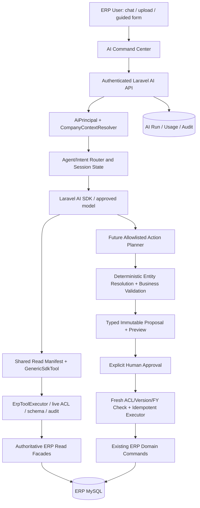

# 03 — Current vs Target Architecture and Trust Boundaries

> **Specification version:** 2.0 · **Reviewed code baseline:** `vigneshsinna/zolo-erp-pro` / `refactor/erp-copilot-stabilization` @ `6ded3715275e7ad8bd60eb7410428af03e4fc304` (2026-11-10). **Target design, not proof of implementation.** Verify the current branch HEAD, installed packages, business-service contracts and CI evidence before executing.

**Status:** Design specification

## Architecture decision
**One user-facing AI Command Center; shared capabilities; domain agents optional; authoritative ERP commands.** The read-only Copilot is the first shipped implementation. Future action planning uses a separate, explicit workflow layer and command registry rather than transforming the Copilot's read-only `ErpToolExecutor` into an unrestricted write engine.

## Three independent planes
1. **Experience plane**: chat, contextual assistant, editable cards, document uploads, task status. It must be UI-agnostic to future agents.
2. **Intelligence plane**: models understand language, choose allowlisted capabilities and generate readable explanations; not permitted to decide authorization or financial calculations.
3. **Execution plane**: read tools and, only in future phases, proposal review/approval and verified command execution using existing ERP services. Business writes cannot be produced by model text alone.

## Read flow (implemented pattern)
`user question → authenticated context → eligible tool names from manifest → SDK tool call → schema validation → live principal refresh + domain permissions → read facade → source-linked ErpToolResult → deterministic fact rendering + bounded narrative → audit`. Preserve exact ERP tool keys; provider aliases are separately declared. Business totals are calculated in PHP/SQL, never guessed by the model.

## Future action flow (not shipped)
`instruction → intent → disambiguate master data → check mandatory inputs → draft using domain rules → editable preview → explicit scope-bound approval → re-resolve actor and source versions → idempotent command → actual ERP receipt → refresh related records → final response`. A task may pause at required inputs, approval, external events, or failed domain validation; each transition is audited.

## Critical boundaries
- Browser → API: verified session/Sanctum actor, CSRF and signed/scoped identifiers.
- App → provider: consent/data processing, redacted minimum context, bounded steps and tokens.
- Model → tool: allowlisted versioned schema; no model-supplied scope authority or dynamic method lookup.
- Tool → business data: company/branch/FY, resource ACL and domain-specific permissions on **every call**.
- Proposed → posted: separate approval event (not plain chat text), immutable payload hash, fresh domain state and receipt.
- Background job → DB: rebuild principal from persistence and check membership/feature status; never replay stale serialized roles.

## Anti-patterns prohibited
`AI → raw SQL`, `AI → arbitrary Laravel route`, `AI → Sale::forceCreate/Purchase::forceCreate`, `AI → ledger/stock insert`, `agent A → agent B` loops for simple queries, unrestricted tool discovery, unsanitized document instructions, and auto-posting from model "confidence".

## One-agent vs specialist logic
The current Copilot answers cross-domain read questions. Sales Intelligence can later exist as a separate UI/agent, but it should consume the same sales read capabilities, not depend on `ErpCopilot` as a class. Only adopt multi-agent orchestration for proven complex cross-domain tasks; prefer bounded deterministic workflow coordination.

## Deployment staging
Phase A: lightweight read-only synchronous Laravel. Phase B: action planning with workflow persistence and preview behind disabled flags. Phase C: bounded action executor with explicit approvals. Phase D: queued long-running work with dedicated workers. Optional MCP/RAG/observability remain separate.
