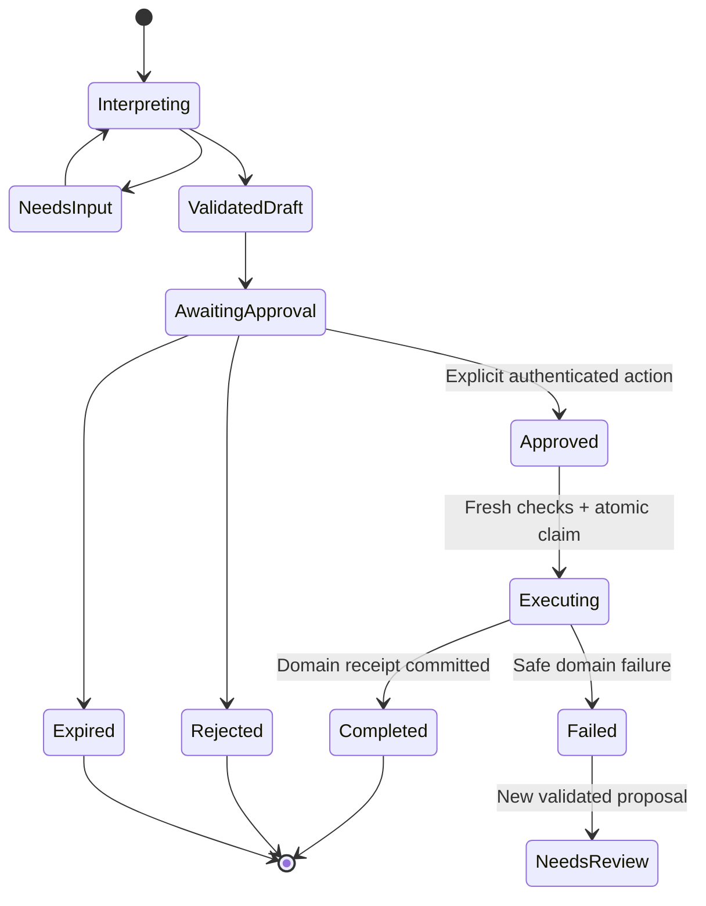

# 12 — Human Approval and Transactional Action Safety

> **Specification version:** 2.0 · **Reviewed code baseline:** `vigneshsinna/zolo-erp-pro` / `refactor/erp-copilot-stabilization` @ `6ded3715275e7ad8bd60eb7410428af03e4fc304` (2026-11-10). **Target design, not proof of implementation.** Verify the current branch HEAD, installed packages, business-service contracts and CI evidence before executing.

**Status:** Design specification

## Stage boundary
This document specifies the **next phase**. It must not enable actions in `refactor/erp-copilot-stabilization`, where proposal endpoints are deliberately quarantined. Implement a new Action Foundation only after Copilot regression/CI sign-off and explicit new branch creation.

## Action classes
`read` (no business mutation), `prepare` (transient proposed fields), `save_draft` (persist approved nonposted business draft), `controlled_write` (approved create/update/receipt), `financial_post` (high-risk posting), `external_send` (communication), `restricted` (journal/payment/refund/stock correction/payroll/close). High-risk classes require stronger policy and potentially segregation of duties. No blanket “run all” permission.

## Proposal state machine

## Business submission policy
1. Resolve exact supplier/customer/product/warehouse and live authorized source versions.
2. Construct typed business command with server-owned company/branch/FY, financial decimals, UOM, tax and date; no model-chosen business permissions.
3. Produce preview from existing service's validation/pricing, not prompt arithmetic. Include all line items, taxes, totals, GL and stock effects as applicable.
4. Seal proposal payload/hash, source state hash, action key/version, risk and TTL. User may edit, triggering new validation/hash.
5. Verify explicit approval by the authorized user for exact version, policy and record context. “Yes” as plain chat content is clarification, not financial approval.
6. Execute only via allowlisted action executor/domain command; revalidate all current business rules and user permissions.
7. Post domain receipt/record link and audit outcome. If posting succeeded but response failed, retry must discover receipt and never duplicate.

## Posting sequencing
Never instruct the model to create GL postings or stock movements as separate freeform operations after a purchase/sales transaction if ERP domain services already handle them. Enforce purchase order, goods receipt, purchase bill, sales order, dispatch, invoice and settlement as **distinct events**, with event-to-ledger/stock impacts determined by established ERP rules and configuration. Display a preview of intended effects and confirm no duplicates.

## Approval UI minimum
Editable structured form, source data provenance, status, risk badge only where meaningful, exact totals and charges, warnings, approval identity/time, expiry, cancelled/edited state, cross-document linkage and actual receipt. User must be able to reject or correct any ambiguous product/party/tax/UOM before approval.

## Negative tests
Cross-company resource; user with only read permission; stale role/branch/FY; inactive supplier; duplicate invoice; changing price/tax/stock after preview; customer credit limit; closed accounting period; two approvers at once; retry after successful POST; missing item; unsupported UOM; provider timeout; injected hidden action; partial business failure; unauthorized outbound send. **No double posting** or fabricated success permitted.

## Migration from existing legacy proposals
Preserve historical `ai_action_proposals`, approvals and execution rows, but do not resurrect `ActionProposalService` from the feature branch. Define a versioned migration, run data audit, and use new reviewed action contracts. No implicit conversion of old pending rows to executable proposals.
