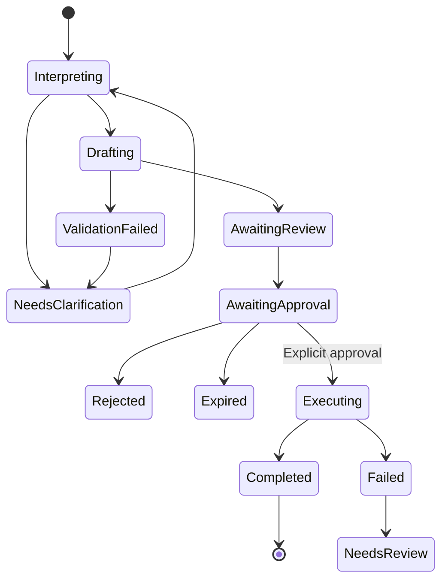

# 29 — Durable Natural-Language Workflow Orchestration and Recovery

> **Specification version:** 2.0 · **Reviewed code baseline:** `vigneshsinna/zolo-erp-pro` / `refactor/erp-copilot-stabilization` @ `6ded3715275e7ad8bd60eb7410428af03e4fc304` (2026-11-10). **Target design, not proof of implementation.** Verify the current branch HEAD, installed packages, business-service contracts and CI evidence before executing.

**Status:** Design specification

## Orchestrator responsibility
A multi-step ERP request is a **business task graph**, not a chain of agents calling one another indefinitely. The orchestration service tracks intent, typed inputs, selected entities, user clarification, action dependencies, approvals, actual domain receipts and compensating/reversal paths. Laravel state + MySQL + queued jobs are sufficient initially; adopt Neuron AI only after measured need.

## Task types and states
`AI Task` represents the user's intent and current company/branch/FY. `Task Step` is a named business action or read. `Proposal` is immutable validated input to one write. `Approval` is an explicit human decision. `Execution` performs one domain command. `Receipt` links actual ERP outcome. Distinguish task-completed from all financial effects-completed.

## Example: compound purchase instruction
"Order 100 units, receive them when they arrive, then post the supplier invoice." Break into `purchase_order.create` → `receipt.await_goods` → `purchase_receipt.record` → `supplier_invoice.await_source` → `purchase_bill.post`. The second step remains pending until actual goods arrive and a permitted user confirms quantities/batches. Each financial/stock-effect step receives its **own approval**, except where the company has an independently reviewed bounded policy. No assumption that PO alone increases stock or liability.

## Durable state transitions
Each task has `version`, `state`, `parent_id?`, `next_action`, `due_at`, `allowed_actor_ids?` and an append-only event sequence. Any new user edit invalidates the old preview hash. A transition requires expected prior state/version and enforced permission. Duplicated/out-of-order events must be harmless. A workflow cannot silently jump over mandatory approval or dependent receipt.

## Clarification, decisions and pause/resume
Asking for a missing warehouse, GST invoice number or matching product suspends task without losing confirmed fields. Save server-validated slots, provenance and selected record IDs with TTL/version. Resume only after re-resolving user and entities in current scope. Approval may take days; source snapshot expires according to business volatility. Show "waiting for you", "waiting for goods", "waiting for finance approval" distinctly.

## Deterministic plan vs LLM inference
LLM produces candidate intent and user-friendly explanations. The **trusted orchestrator** chooses approved state transitions and operation ordering from code-reviewed definitions, checks actual receipts, and determines when another step is eligible. The model cannot add unauthorized steps, change approval policy, alter payload hashes or declare an action executed.

## Retries, idempotency and partial success
- Store unique idempotency key by company+capability+canonical input/approval.
- Claim execution atomically and invoke domain command exactly once logically.
- If DB or network response fails after commit, search receipt/idempotency and reconcile before retry.
- An executed prior step remains executed if a later step fails; never fake rollback of a posted invoice. Use reviewed ERP reversal/compensation command if business user authorizes correction.
- If a step requires external delivery, capture outbox/response and recipient status separately; don't mark "sent" before delivery confirmation.
- Support manual intervention for irreversible or uncertain external effects.

## Concurrency limits
Cap model steps, read tools, active tasks per user/company, pending approvals, execution attempts and total elapsed time. Release DB locks before model calls, OCR, external requests or human approval. Use controlled queues and per-task optimistic versions. Prevent two chat tabs from editing same task unnoticed.

## Business audit and recovery
Task log records who provided which slot, candidate matches, validation result, preview version, approver identity, domain command key and actual receipt. Support audit view and resumption after server restart. An administrator can stop future steps but cannot erase previous ledger/stock effects. A task report should clearly show completed, skipped, failed and waiting operations.

## Tests
Pause for missing supplier then resume; restart worker; expire snapshot after price changes; revoke user while awaiting approval; two approvals race; partial receipt; goods short-delivered; post-commit timeout; duplicate invoice retry; company switch; cancellation before vs after commit; provider starts hallucinating success; out-of-order event replay; bulk task partially succeeds with row-specific outcomes.
