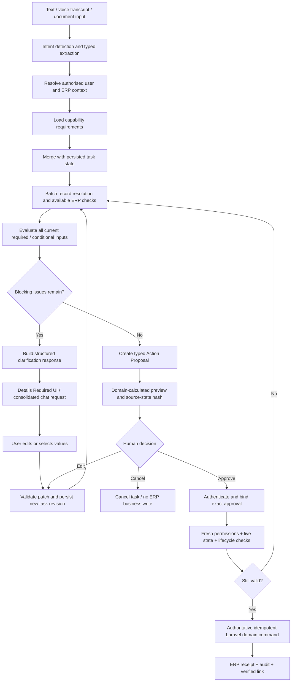

# zoloERP AI Operating Layer — Phase 2.1

## Unified Multi-Slot Input Collection & Clarification Engine

**Document type:** Implementation specification and architectural decision record  
**Status:** Proposed implementation; not a claim of completed functionality  
**Scope:** Shared AI task orchestration across Guided Setup, Purchase Orders, and future ERP capabilities  
**Primary objective:** Collect and validate *all currently identifiable* missing, invalid, and ambiguous inputs before preparing a governed ERP action proposal.  
**Repository target:** `vigneshsinna/zolo-erp-pro`  
**Dependency:** Existing read-only Copilot, Phase 1 Action Foundation, Phase 1.5 Guided Setup, and Phase 2 Purchase Order capability  
**Recommended implementation branch:** `feature/ai-unified-input-clarification` (create from the latest reviewed integration branch)

---

## 1. Problem statement

The existing `PreparePurchaseOrder` flow can stop at the first unresolved supplier, warehouse, or product and return a single `needs_input` result. This results in a repeated question-and-answer sequence even when several fields could be checked in the same pass.

**Observed example**

> Create a purchase order for 10 units of Cotton Shirt Blue from ABC Traders at ₹500 per unit. Use the Main Warehouse. Show the details before placing the order.

If `ABC Traders` is not found, the current tool may immediately return a supplier clarification. It does not necessarily finish resolving the product and warehouse before replying. Consequently, the user does not know everything that is currently needed to proceed.

The intended experience is **one consolidated clarification response per validation pass**. The AI should:

1. Understand the requested ERP action and its required, optional, and conditional inputs.
2. Extract all values supplied in the text, voice transcript, image, or other supported input.
3. Retain confirmed values from the active task.
4. Resolve *every independently resolvable* supplier, product, warehouse, unit, and related record within the user's authorised company scope.
5. Validate every field that can be checked with the available information.
6. Return all currently known missing, invalid, or ambiguous fields **together**, along with selectable matches and sensible defaults.
7. Ask additional questions only when they are genuinely dependent on a previous choice and could not have been established earlier.
8. After all prerequisites are satisfied, create a typed, versioned, governed proposal and show a preview for human approval.
9. Never create ERP master or financial records merely to resolve a missing field.

The same rules apply across ERP setup, purchasing, sales, inventory, manufacturing, accounting, and future modules.

---

## 2. Non-negotiable architectural invariants

1. **The LLM is not the source of truth.** It may extract intent, provide candidate values, and communicate clarifications. A deterministic server-side requirements evaluator and ERP domain services decide readiness, validity, permissions, pricing, tax, and execution.
2. **All clarification checks are tenant-safe.** For company-scoped actions, resolve context from the authenticated user and authorised `company_id`, `branch_id`, and `financial_year_id`, never from untrusted AI fields.
3. **Pre-company bootstrap remains isolated.** Installation-admin `BootstrapSetupPrincipal` and bootstrap routes remain separate from tenant-scoped chat and cannot be reused as a normal company-scoped action context.
4. **No ERP write before approved execution.** Task-state persistence and proposal persistence may write to AI-owned tables; they do not create, edit, or post ERP master or commercial records.
5. **The preview is authoritative and deterministic.** Use existing Laravel pricing, GST, inventory, lifecycle, permissions, and business validation services. Never use model arithmetic to establish financial totals.
6. **A revised proposal requires fresh approval.** Approval is bound to the immutable canonical payload hash, proposal version, actor, approver, tenant scope, and relevant source state.
7. **The current ERP state always wins.** Before executing an approved action, revalidate live records and required lifecycle transitions under the relevant domain-controlled transaction/locking rules.
8. **No silent master creation.** Missing products, suppliers, units, or warehouses may trigger a *separate proposed setup workflow* requiring its own review and authorisation.
9. **Ask for all currently identifiable fields at once, not all hypothetically possible fields.** Avoid asking for fields the ERP can safely derive or fields that are not yet applicable.
10. **No sensitive data leakage.** Candidate search results, task resumes, and clarification history must be restricted to the user's authorised scope and appropriately redacted.

---

## 3. Target user experience

### 3.1 Purchase Order example

**User:**

> Create a purchase order for 10 units of Cotton Shirt Blue from ABC Traders at ₹500 each. Use Main Warehouse.

**System processing:**

- Recognises `purchase_order.create.v1`.
- Extracts requested supplier name, product name, quantity, unit cost, and warehouse name.
- Determines active company/branch/FY from the authenticated ERP session.
- Searches authorised suppliers, products, and warehouses independently.
- Validates quantities, prices, FY, units, and whichever tax prerequisites can already be checked.
- Collects unresolved fields; does **not** stop after the supplier lookup.

**Illustrative consolidated response** (only report actual lookup results):

> **A few details are needed to prepare your purchase order.**
>
> **Already captured:** Quantity 10; unit cost ₹500; active company/branch/FY confirmed.
>
> **Please confirm:**
> 1. Supplier: `ABC Traders` has no unique active match. Select an existing supplier or start an approved supplier-creation request.
> 2. Product: `Cotton Shirt Blue` matched multiple products. Select the correct SKU from the available candidates.
> 3. Warehouse: `Main Warehouse` could not be uniquely resolved for the active branch. Select one of the permitted warehouses.
>
> **Will calculate automatically:** tax treatment, line totals, and grand total after the missing references are resolved.
>
> You can answer all three together. I will retain the confirmed quantity and price.

If the product and warehouse resolve uniquely, **do not ask for them**. If supplier selection reveals additional GST-specific information requirements, ask that only after the supplier is known.

### 3.2 User supplies corrections

**User:**

> Use supplier ID 45, product SKU SHIRT-BLU-M, warehouse WH-MAIN.

**System:**

- Associates the response with the correct active task.
- Maps values to field references, not arbitrary SQL or PHP method names.
- Applies a controlled task-state patch and preserves the other confirmed values.
- Re-runs dependent ERP resolution and validation.
- Generates the governed PO preview only if all blocking issues are resolved.

### 3.3 Proposed UI

The AI Workspace should display a **Details Required** card rather than an unstructured sequence of unrelated questions.

The card should include:

- **Already captured:** read-only summary of verified fields.
- **Missing fields:** text/date/number/select inputs appropriate to the requirement.
- **Ambiguous matches:** clickable choices with grounded record name, ID/code, and permitted distinguishing metadata.
- **Invalid values:** concise reason and accepted constraints.
- **Pending dependent checks:** clear explanation of what cannot yet be verified.
- **Actions:** `Continue / Validate`, `Change an existing value`, `Cancel task`.
- **Task progress:** e.g., `7 of 10 currently required fields ready`; do not show misleading percentages across conditional fields.

Submitting the card makes **one server call with all supplied corrections**. The card is regenerated from authoritative server state; it is never the sole source of truth.

---

## 4. Architecture and workflow



**Key distinction:** A *task draft* captures incomplete inputs, while an *Action Proposal* represents a fully validated, immutable, reviewable operation. Incomplete tasks must never be misrepresented as executable proposals.

---

## 5. Shared components

| Component | Purpose | Boundary |
|---|---|---|
| `ActionRequirementsRegistry` | Code-reviewed field definitions, conditional applicability, field dependencies, trusted defaults and UX metadata per capability | No LLM-supplied schemas |
| `IntentSlotExtractor` | Converts text/voice/document content into typed candidate inputs with provenance | Non-authoritative; can be model-assisted |
| `InputCompletenessEvaluator` | Determines all currently missing, invalid, ambiguous, resolved, and blocked fields | Deterministic |
| `BatchRecordResolutionService` | Performs independently possible lookups for products, suppliers, customers, warehouses, units, accounts, etc. | Company-scoped and permission-checked |
| `WorkflowTaskStateService` | Persists incomplete task state, revisions, selected candidates and provenance | AI-owned data only |
| `ClarificationResponseBuilder` | Produces one structured response covering every current blocker | Based only on validator results |
| `TaskCorrectionService` | Applies user corrections, detects conflicts and invalidates dependent values | Optimistic concurrency |
| `ActionProposalService` | Converts a complete task into the existing governed action proposal | Reuse current component |
| `ActionApprovalService` / `ApprovedActionExecutor` | Human approval, current-state validation and domain execution | Reuse existing security boundary |

**Implementation principle:** Extend the existing registries, proposal services and tools. Do not create a second approval engine or a bypass route to ERP writes.

---

## 6. Capability requirements contract

Every action capability needs a **server-authored** requirements definition. The registry should support:

- `field_path`: stable field name, including line-item paths (e.g., `items[client_line_id].product_id`).
- `data_type`: string, decimal-string, integer, date, boolean, enum, entity-reference, or list.
- `required_when`: deterministic predicate evaluated against current task and domain context.
- `allowed_sources`: user, verified ERP default, document extraction, or approved policy.
- `resolution_policy`: unique exact match, permitted fuzzy candidate list, explicit confirmation, or no auto-resolution.
- `dependencies`: fields that must be known before a check can run.
- `domain_validation`: authorised ERP validators/service calls.
- `display_label`, `help_text`, `input_control`, `options_source`: UI metadata from reviewed definitions.
- `sensitivity`: whether values must be masked or omitted in audit/chat.
- `default_policy`: explicit and safe default only when authorised (e.g., current branch warehouse if exactly one eligible match).

Suggested contract (illustrative, not existing code):

```php
interface ActionRequirementsProviderInterface
{
    public function actionKey(): string;

    /** @return list<ActionFieldRequirement> */
    public function requirements(WorkflowTaskContext $context): array;

    /** Deterministic, authoritative validations; no ERP mutation. */
    public function validate(WorkflowTaskContext $context, array $resolvedInputs): array;
}
```

Avoid duplicating Laravel `FormRequest` and `ActionInputSchemaInterface` rules unnecessarily. The Action Requirements layer can reference those schemas while adding applicability, record-resolution, dependency and UI metadata.

### 6.1 Required-field categories

| Status | Meaning | UI behavior |
|---|---|---|
| `resolved` | Unique, authorised, validated value exists | Show in confirmed summary; allow edit where permitted |
| `missing` | Currently required but no value available | Request input |
| `invalid` | Supplied value fails schema or ERP validation | Show error and accepted format/range |
| `ambiguous` | Multiple authorised records match | Show candidates and require selection |
| `unverified` | Candidate exists but cannot be trusted without confirmation | Require explicit user choice |
| `blocked_by_dependency` | Check cannot run until a prerequisite is resolved | Explain pending check; do not guess its result |
| `not_applicable` | Conditional requirement does not apply | Do not ask |
| `derived` | Value provided by a reviewed default/ERP calculation | Show its source; do not ask redundantly |

**Completeness rule:** A task is `ready_for_proposal` only when **no blocking currently applicable requirements remain** and the required domain validations have passed.

---

## 7. Full-pass evaluation (no first-error return)

### 7.1 Required behavior

- Resolve independently addressable entities in one logical pass, with bounded lookup queries.
- Record all validation errors; do not `return needs_input` inside the first supplier/product/warehouse failure.
- For line items, evaluate **every line**, not just the first line with an error.
- Distinguish warnings from blocking requirements.
- Preserve per-field provenance: user-provided, document-extracted, suggested, ERP-derived, or explicitly confirmed.
- Never treat a fuzzy name match as an approved entity selection unless the code-reviewed resolution policy permits it.
- Do not ask the user for internal IDs when the UI can show readable, authorised record choices.
- Enforce lookup result limits and return deterministic ambiguity summaries rather than huge lists.

### 7.2 Pseudocode

```php
$task = $tasks->getOwned($principal, $taskId);
$definition = $requirements->forAction($task->actionKey, $principal);
$inputs = $taskCorrections->mergeValidatedPatch($task, $userPatch);

$results = $batchResolver->resolveAllIndependentReferences(
    principal: $principal,
    definition: $definition,
    inputs: $inputs,
);

$issues = $completenessEvaluator->evaluateAll(
    definition: $definition,
    inputs: $inputs,
    resolutions: $results,
    context: $principal,
);

if ($issues->hasBlockingIssues()) {
    return $clarificationBuilder->build($task, $inputs, $results, $issues);
}

return $actionProposalService->create(
    principal: $principal,
    key: $definition->actionKey(),
    slots: $issues->validatedActionSlots(),
    threadId: $task->threadId,
);
```

In production code, enforce limits on line counts, search terms, validation work, input size, and clarification-loop attempts.

---

## 8. Persisted task state and revision handling

Incomplete tasks need durable context across chat messages, page reloads, approval edits and dependent setup workflows.

### 8.1 Proposed storage model

Use a migration for AI-owned persistence, for example `ai_workflow_tasks` and an append-only `ai_workflow_task_events` table. Determine exact naming and indexes after inspecting existing AI task/thread tables to avoid duplicate storage.

**Recommended `ai_workflow_tasks` fields**

| Field | Why needed |
|---|---|
| `id` (UUID) | Stable task identifier |
| `action_key` | Reviewed capability |
| `mode` | `company` or isolated `bootstrap` |
| `actor_id`, `thread_id` | Ownership and conversation correlation |
| `company_id`, `branch_id`, `financial_year_id` | Non-null for Mode B, null only for genuine bootstrap tasks |
| `bootstrap_task_id` | Optional link to isolated setup task, never used as tenancy bypass |
| `status` | `collecting`, `validating`, `ready`, `proposal_created`, `cancelled`, `expired` |
| `revision` | Monotonic optimistic concurrency |
| `slots_json` | Validated typed input candidates; not a free-form prompt dump |
| `resolution_json` | Resolved IDs, candidate selections, validation status |
| `issues_json` | Current missing/invalid/ambiguous issues |
| `provenance_json` | Origin and confirmation status of each value |
| `linked_proposal_id` | Only populated after a valid proposal is created |
| `expires_at`, `created_at`, `updated_at` | Expiry, lifecycle and audit |

**Events table:** record task creation, user corrections, ambiguity selection, validation results, state changes and proposal handoff. Redact secrets and sensitive documents as required.

### 8.2 Task concurrency and corrections

- Use `expected_revision` on every correction request.
- Apply one atomic compare-and-swap update; reject stale submissions with HTTP `409` and return the latest task revision.
- Use stable **client line IDs** for item arrays. Do not apply shallow `array_replace` to the entire `items` list or rely only on array positions.
- Updating a dependent field invalidates the fields and calculations that depend on it (e.g., change supplier → revisit tax context; change product → revisit UOM, tax and cost; change warehouse → revisit branch restrictions).
- Confirmed unrelated fields remain intact.
- Once an Action Proposal is created, use proposal versioning and approval rules. Do not silently mutate the already reviewed proposal based on task-state edits.
- Expired/cancelled tasks cannot create or execute proposals; a fresh task must be created or explicitly renewed under policy.

---

## 9. API contract (proposed)

These are **proposed routes**, not a claim that they currently exist. All Mode B routes must use the existing auth, `company.context`, permissions, rate limits and action feature gates.

| Method | Proposed endpoint | Behavior |
|---|---|---|
| `POST` | `/api/v1/ai/workflow-tasks` | Initiate typed collection task from an allowed intent/action |
| `GET` | `/api/v1/ai/workflow-tasks/{id}` | Return owned task summary, confirmed inputs and outstanding issues |
| `PATCH` | `/api/v1/ai/workflow-tasks/{id}/inputs` | Apply consolidated corrections with `expected_revision`; rerun evaluation |
| `POST` | `/api/v1/ai/workflow-tasks/{id}/validate` | Revalidate task state without executing ERP action |
| `POST` | `/api/v1/ai/workflow-tasks/{id}/prepare-proposal` | Create existing governed proposal only when ready |
| `POST` | `/api/v1/ai/workflow-tasks/{id}/cancel` | Cancel task without ERP business writes |

**Mode A:** Never expose company bootstrap through these generic tenant routes. Either use the existing isolated `/api/v1/ai/setup/bootstrap/...` endpoints or create a separate installation-admin task collection adapter following the same schema and validation patterns.

### 9.1 Structured clarification response

```json
{
  "status": "needs_input",
  "task_id": "<server-issued-uuid>",
  "task_revision": 3,
  "action_key": "purchase_order.create.v1",
  "confirmed_fields": [
    {"field": "items[line-a].qty", "display": "10 units", "source": "user"},
    {"field": "items[line-a].net_unit_cost", "display": "₹500.00", "source": "user"}
  ],
  "required_inputs": [
    {
      "field": "supplier_id",
      "label": "Supplier",
      "status": "missing",
      "reason": "No unique authorised match for ABC Traders",
      "control": "entity_select",
      "candidates": []
    },
    {
      "field": "items[line-a].product_id",
      "label": "Product",
      "status": "ambiguous",
      "reason": "Several active products match Cotton Shirt Blue",
      "control": "entity_select",
      "candidates": [
        {"id": 101, "label": "Cotton Shirt Blue — SKU SH-BLU-S"},
        {"id": 102, "label": "Cotton Shirt Blue — SKU SH-BLU-M"}
      ]
    }
  ],
  "pending_checks": ["Final GST calculation", "Authoritative order totals"],
  "next_action": "submit_all_corrections",
  "can_prepare_proposal": false
}
```

This example is illustrative; do not return fake candidate IDs or records in actual API responses.

### 9.2 Consolidated correction request

```json
{
  "expected_revision": 3,
  "corrections": [
    {"field": "supplier_id", "value": 45, "confirmation": "selected_existing_record"},
    {"field": "items[line-a].product_id", "value": 102, "confirmation": "selected_existing_record"}
  ]
}
```

The server must reject unknown fields, unauthorised references and attempts to supply or overwrite `actor_id`, company/branch/FY scope, approval status, payload hashes or execution IDs.

---

## 10. Purchase Order integration — immediate slice

**Existing source location:** `app/Ai/Tools/PreparePurchaseOrder.php` in the purchase-order feature branch.

The current tool returns early after its first `none` or `candidates` result during supplier, warehouse or product resolution. Change its orchestration, not its security model.

### 10.1 Required changes

1. Extract all supplier, product lines, quantity/cost inputs, warehouse and dates first.
2. Resolve supplier, warehouse and **every product line** independently where possible.
3. Collect errors/candidates under stable field paths; avoid early `needs_input` return.
4. Retain all valid values and any explicit user selections in a persisted workflow task.
5. Return one structured `needs_input` payload containing all currently identifiable blockers.
6. After corrections, re-evaluate in one batch and route only complete inputs to `ActionProposalService`.
7. Preserve existing deterministic purchase-order preview via `CommercialPricing` and existing domain/GST validation.
8. Keep the exact proposal ID and version required by `ActionApprovalService` and `ApprovedActionExecutor`.
9. Do not auto-execute a purchase order when all fields are present; always show preview and request authenticated approval.
10. Do not claim stock/ledger posting on a PO. Preserve Ordered status and actual ERP semantics.

### 10.2 Supplier and product matching

- Search only active records the actor is authorised to use.
- Prefer exact ID/code/SKU matches; fuzzy matches return choices rather than silent selection.
- Respect branch warehouse and unit-of-measure restrictions.
- If no supplier exists, offer **Select existing** or **Create supplier as separate proposed action**; never silently insert a supplier.
- Resolve every line independently and index its issues by stable line ID.
- Retain quantities and agreed prices while a user clarifies supplier or product.

### 10.3 Deterministic financial handling

When a task becomes complete, use the existing authoritative ERP pricing/tax services and show:

- Subtotal, item-level tax, tax splits where relevant, discount, shipping if supported, grand total.
- The tax/price assumptions derived from the ERP state.
- Clear indication of any user-provided price versus master cost.

At execution, the authoritative domain service must independently recheck source state, permissions, FY status, tax/pricing and lifecycle policy, and abort if approved terms no longer match. **The clarification engine does not replace those execution-time checks.**

---

## 11. Guided Setup integration

### Mode A: Pre-company bootstrap

- Keep installation-admin routes isolated and authenticated.
- Collect company/group inputs in a single consolidated pass.
- Evaluate business-vertical and company-subtype dependencies using the trusted `IndustryCatalog` and `CompanyDirectoryService` rules.
- Request missing company name, industry, financial-year dates, group choice and applicable registration details only when required.
- Do not ask for branch/warehouse details that `CompanyDirectoryService::createCompany()` safely provisions as defaults, unless the user explicitly requests custom setup.
- Reuse the existing bootstrap version, token and approval controls; do not route through ordinary tenant-scoped chat endpoints before a company exists.

### Mode B: Post-company setup

- Use authenticated company/branch/FY context for units, warehouses, products, suppliers and customers.
- Share the input-collection UI pattern, but maintain distinct per-capability requirements and permissions.
- If a requested product references an absent unit or category, offer a separate governed setup action, with dependency tracking and approval for that action.
- On completion of a prerequisite setup action, re-resolve its resulting ERP ID into the parent task rather than trusting a model-supplied ID.
- Do not let a parent task execute until its dependencies have completed successfully and its own proposal has been approved.

---

## 12. Cross-module applicability

The requirements registry should scale without relying on a global hardcoded list of required fields.

| Action | Typical required inputs or checks | Conditional examples |
|---|---|---|
| Company creation | Legal name, industry/subtype, FY dates, authorised bootstrap actor | GST registration, company-group selection |
| Company group | Group name, code, installation-admin authority | Existing company membership changes |
| Product master | Name/code, unit, permitted category, pricing context | GST/HSN, alternate units, product variants |
| Supplier/customer | Name, permitted group and contact/tax profile | GSTIN, state code, credit terms |
| Purchase order | Supplier, product lines, quantities, costs, warehouse, date | Tax override, UOM conversion, shipping |
| Purchase bill | Supplier, invoice reference/date, lines and amounts | Receipt/order linkage, reverse charge |
| Sales invoice | Customer, products, quantity, price, warehouse/date | Tax registration, credit limit, discounts |
| Inventory transfer | Source/destination, products, quantities, allowed stock | Lot/serial, stock identity, restrictions |
| Manufacturing job | Finished item, BOM/routing, quantity, location | Batch, capacity, subcontracting |
| Journal | Posting date, accounts, balanced debits/credits, narration | Cost center, tax dimension, approval tier |

For every domain, keep the existing posted-document amendment, return, reversal and adjustment rules. Clarification collection does **not** grant direct-edit permissions on posted ERP records.

---

## 13. UI and accessibility requirements

- Support editable consolidated fields inside the current AI Workspace.
- Use semantic input labels, field-level errors, and keyboard navigation.
- Show one issue per field, grouped by supplier, destination, line items, and financial context.
- Support multiple product lines; visually identify the exact line with a problem.
- Show a resolved/confirmed summary and indicate values derived from ERP defaults.
- Avoid displaying stale candidates after context or dependency changes.
- Add `Continue / Validate` and `Cancel` as meaningful actions; buttons must use authenticated APIs.
- Preserve entered corrections on recoverable validation failures.
- Announce errors and revision conflicts accessibly.
- Keep the separate Action Review Center as the approval/audit surface; the task clarification card does not itself approve or execute.
- Do not claim the existing read-only status badge represents action enablement until the UI's `AiFeatureGate::isReadOnly()` display logic is corrected.

---

## 14. Security and data protection

- Company/branch/FY are derived and revalidated on the server, not accepted from free-text slots.
- Re-authorise every entity resolution request and correction.
- Verify task ownership for all `GET`, `PATCH`, validation and proposal-handoff endpoints.
- Prevent identifier enumeration through uniform inaccessible/not-found responses.
- Apply input limits, candidate limits, pagination, query timeouts, request quotas and task TTLs.
- Never submit raw credentials, API keys, tax secrets, or full attachments to model prompts unless explicitly permitted and needed; minimise personal data.
- Sanitize and validate document-extracted text before it reaches any domain adapter.
- The model may not choose Laravel class names, PHP methods, raw SQL, permission names or direct execution routes.
- Protect user-confirmed record selections from model overwrites unless the user explicitly changes them.
- Track provenance for OCR/voice values, which may be uncertain and require confirmation.
- All decisions remain auditable without revealing sensitive master or accounting data outside scope.
- Keep global and per-company kill switches fail-closed; action approval/execution must have their own independent gate checks.

---

## 15. Acceptance criteria

### Functional

1. Given three independent missing fields, the system identifies all three in a **single response**.
2. Given a missing supplier but a valid product and warehouse, the system asks **only** for the supplier and does not restart other checks.
3. Given multiple products, the system evaluates all lines and identifies missing/ambiguous/invalid lines in the same response.
4. Given a product and warehouse with unique authorised matches, the system derives their IDs without asking for them.
5. Given a user correction, previously confirmed unaffected fields remain intact.
6. Given an unresolved supplier, a dependent tax check is marked pending, rather than falsely passed or reported as missing.
7. Given all inputs complete and valid, the system creates an Action Proposal with deterministic ERP preview and **does not execute**.
8. Given an edit to an already prepared proposal, the proposal version increases, previous approval is invalidated, and a fresh preview and approval are required.
9. Given an unauthorised cross-company candidate ID, resolution fails and no ERP record is created.
10. Given a cancelled task or expired revision, no new proposal can be created or executed.

### Security and consistency

11. Unknown schema fields and scope overrides are rejected.
12. Task correction uses optimistic concurrency; an outdated `expected_revision` returns a conflict with current state.
13. A user cannot view, patch, or reuse another actor's private task.
14. Bootstrap task collection cannot be accessed from a regular company-scoped chat session.
15. A missing master is never created automatically to satisfy a purchase or sales request.
16. Model inference never occurs while a domain database lock is held.
17. Final execution revalidates under the authoritative domain's transaction and locking boundary.
18. A stale price, tax setup, FY closure, product status or lifecycle change prevents unsupported execution and requests a new preview.
19. Repeated submission or retry cannot duplicate the same ERP transaction.
20. Every completed action has an authoritative ERP receipt, immutable approval binding and audit trail.

### UX

21. A Details Required card displays all current blockers and all confirmed values.
22. Candidate choices are human-readable, authorised and keyboard accessible.
23. The system does not show a fake `100% ready` status while dependent checks remain.
24. Validation failures preserve unaffected user inputs.
25. The card supports multi-line purchase orders and returns the exact line responsible for each issue.

---

## 16. Test matrix

| Test ID | Scenario | Expected result |
|---|---|---|
| IC-01 | Supplier and product absent; warehouse ambiguous | One response covering all three |
| IC-02 | Supplier absent, product and warehouse valid | Supplier-only clarification |
| IC-03 | Two ambiguous product lines | Both line-specific candidate sets |
| IC-04 | Unique product code and warehouse default | No redundant question |
| IC-05 | User supplies only one of two missing fields | Other field remains; previous values retained |
| IC-06 | Supplier selection changes GST applicability | Dependent check reruns, no old tax snapshot reused |
| IC-07 | Product change invalidates UOM and cost | Relevant dependent fields recalculated/reconfirmed |
| IC-08 | Missing supplier triggers separate setup workflow | No silent supplier insertion |
| IC-09 | Missing base unit in product setup | Unit setup dependency proposed, permission-checked |
| IC-10 | Unknown or prohibited input key | Validation rejection |
| IC-11 | Cross-company product or warehouse ID | Access denied; no disclosure |
| IC-12 | Expired task token | Task cannot advance |
| IC-13 | Two simultaneous corrections with same revision | One wins; one gets 409 conflict |
| IC-14 | Multi-line list edited by client line ID | No accidental line overwrites |
| IC-15 | Draft complete; no approval | Proposal only; no ERP business write |
| IC-16 | Proposal edited after review | Version change and new approval required |
| IC-17 | FY closed after preview | Execution fails closed and returns for revalidation |
| IC-18 | Product cost/GST changes after preview | New preview required |
| IC-19 | Duplicate approval or lost response | Idempotent receipt/reconciliation; no duplicate order |
| IC-20 | Normal tenant user attempts Mode A bootstrap | 403 and no bootstrap record |
| IC-21 | Voice transcript omitted item quantity | Quantity included in consolidated list |
| IC-22 | OCR provides uncertain GSTIN | Confidence/provenance retained; confirmation required |
| IC-23 | More than max allowed line items | Bounded validation error; no expensive search fan-out |
| IC-24 | AI request without `AI_ACTION_FOUNDATION_ENABLED` | Fail closed; existing read-only tools unaffected |
| IC-25 | Task canceled midway | No ERP business write; no proposal handoff |

Tests should run on disposable MySQL test databases and include tenant isolation, concurrency, migration, compatibility with existing Copilot, and UI integration coverage. Existing purchase-order, bootstrap and commercial domain tests must continue passing.

---

## 17. Implementation plan

### Step 0 — Establish current baseline

- Create a fresh feature branch from the latest reviewed integration branch.
- Inspect present `PreparePurchaseOrder`, `RecordResolutionService`, `AiChatController`, `ActionProposalService`, setup action adapters and current tests.
- Inventory current task/thread persistence and proposal schemas to avoid redundant tables.
- Run existing AI/setup/purchase tests before changes and record the baseline.

### Step 1 — Shared requirements and evaluator

- Implement `ActionRequirementsRegistry` and typed field/dependency contracts.
- Build deterministic `InputCompletenessEvaluator` and explicit issue taxonomy.
- Ensure the registry is code-registered and not editable by untrusted model outputs.

### Step 2 — Batch resolution and task persistence

- Refactor/extend `RecordResolutionService` into a batch-resolution orchestration layer.
- Add AI-owned task persistence only if no suitable scoped task table already exists.
- Implement optimistic concurrency, provenance, client line IDs and dependency invalidation.

### Step 3 — Purchase Order vertical slice

- Replace `PreparePurchaseOrder` early returns with full-pass accumulation.
- Preserve every validated field across clarification turns.
- Prepare a governed proposal only after all current blocking issues pass.
- Do not change existing commercial domain business rules or disable any safety check.

### Step 4 — Workspace experience

- Render `Details Required` cards from structured results.
- Add consolidated correction submission, candidate selectors and pending-check messages.
- Keep the existing proposal preview/approval process separate and immutable.

### Step 5 — Guided Setup and other domain coverage

- Add requirements providers for company/group bootstrap (isolated Mode A) and company-scoped units/products/suppliers/customers/warehouses.
- Verify permission checks and inter-task dependencies.
- Extend to sales/inventory/accounting only after the shared engine has completed its acceptance tests.

### Step 6 — Quality and release gates

- Run all existing and new acceptance tests, migration compatibility, tenant isolation and concurrency tests.
- Review no-new-ERP-writes-before-approval, HMAC/version integrity, source-state validation and idempotency.
- Confirm the existing read-only Copilot still behaves as before for non-action requests.
- Keep action execution disabled by default. Enable narrowly only in a development/test environment after all required gates pass.

---

## 18. Explicit non-goals for Phase 2.1

- No LLM-initiated unapproved purchase, invoice, stock or general-ledger posting.
- No blanket autonomy upgrade to unattended financial execution.
- No replacement of ERP tax, pricing or lifecycle policies.
- No direct database mutations to fill missing products, suppliers, accounts or other master records.
- No unrestricted cross-company record search.
- No requirement to build fully functional voice transcription or OCR pipelines in this slice; the engine should accept typed candidate inputs from those channels when available.
- No second approval system and no merged bootstrap/tenant security principal.

---

## 19. Definition of done

Phase 2.1 is ready to merge only when:

- [ ] A single PO request with multiple unresolved references returns one complete, structured clarification response.
- [ ] The same flow can be resumed with a consolidated correction request without re-entering existing valid inputs.
- [ ] Dynamic clarification controls work in the AI Workspace.
- [ ] The requirements/evaluator APIs are reusable by at least one setup action without bespoke first-error logic.
- [ ] No ERP business records are inserted or posted during extraction, resolution or clarification.
- [ ] All action proposals continue to require immutable, authenticated, scoped human approval.
- [ ] Existing ERP domain calculations, lifecycle checks and transaction controls are untouched or strengthened.
- [ ] Tests cover error aggregation, dependency checks, multi-line corrections, scope isolation, stale revisions and execution gating.
- [ ] The full relevant CI suite passes on the exact commit proposed for merge.
- [ ] The new feature and API behavior are documented with examples, troubleshooting and rollback instructions.

## 20. Final architecture decision

> **All zoloERP AI actions must use a shared, deterministic multi-slot requirements and clarification engine. The agent should ask for every currently identifiable missing, invalid or ambiguous input in one consolidated response, retain confirmed task state across turns, resolve authorised records with ERP services, and create a governed action proposal only after completeness and validation checks pass. Execution always remains subject to exact human approval and fresh authoritative ERP constraints.**

This is a **Phase 2.1 extension of the existing AI Action Foundation**, not a replacement for the architecture established in Phases 1, 1.5 and 2.
