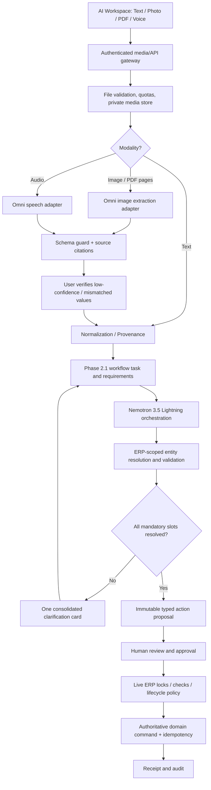

# 01 — System Architecture, Trust Boundaries, and Workflow

## 1. Target outcomes

A user can enter natural-language text, attach a photo of a supplier bill, attach a multi-page invoice PDF, record a spoken business instruction, or combine a message and media. zoloERP interprets the input, presents what was detected, collects all identifiable missing or ambiguous information in one pass, and proceeds through its ordinary governed ERP proposal approval. A user never needs to type entire bill details manually just because their original input was an image.

## 2. Component architecture



**Separation of concerns:** `OmniPerceptionClient` does not ask the ERP what to do; `ErpCopilot` does not attempt to decode raw audio; `ActionProposalService` does not trust a model's extracted numeric fields; `ApprovedActionExecutor` remains the only route for governed actions.

## 3. Boundaries

| Boundary | Input | Output | Privileges |
|---|---|---|---|
| Browser → upload | Media bytes, text, CSRF/access token, optional task | Private media ID and status | Upload, no ERP writes |
| Media → Omni | Preprocessed media + extraction prompt | Raw response | NVIDIA endpoint only; no ERP tools |
| Omni → parser | Unknown text / JSON | Validated `PerceptionResult` | Schema validation only |
| Parser → task | Normalized typed fields and provenance | `WorkflowTask` revision / unresolved slots | Tenant-scoped database writes for task state only |
| Task → action proposal | Server-validated, ERP-resolved inputs | Proposal + deterministic preview | Approved capability registry |
| Approved action → ERP | Immutable approved payload + live context | ERP reference / receipt | Authoritative service, permission, lifecycle, transaction |

## 4. Model-role separation

**Primary reasoning:** Nemotron 3.5 Lightning remains the intelligent conversation/planning layer; it may ask clarification questions and propose actions through allowlisted tools. **Perception:** Nemotron 3 Nano Omni Reasoning extracts source text and candidates. It must not choose Laravel service names, SQL, route names, tenant IDs or privileged tools. For text-only queries, the Omni call is skipped to save tokens and latency. For image+voice combined requests, produce separate input segments and merge them in the normalized task, preserving provenance and conflict markers.

## 5. State machine

```text
uploaded -> validating -> ready -> extracting -> extracted -> needs_review
  -> confirmed -> handed_off_to_task
  -> (retained_until_policy_expiry) -> deleted

failed_validation | failed_extraction | cancelled -> deleted according to policy
```

`needs_review` must not be skipped when high-impact values conflict (GSTIN, account number, unit price, invoice total, supplier identity, tax period). Low-confidence transcription can be corrected by the user without paying for a second model call.

A task is distinct from a media extraction. A media asset may be linked to one tenant-scoped workflow task, while user corrections advance the task revision. A successful OCR extraction is **not** a ready-to-execute proposal.

## 6. Data stores

- `ai_media_assets`: private file metadata, owner/scope, MIME, hash, size, state, retention deadline, no raw media in database.
- `ai_media_extractions`: normalized extraction JSON, version, model ID, provenance, confirmation state, no unredacted unnecessary secrets.
- Phase 2.1 task store: durable user intent, confirmed slots, unresolved reasons, revision and task expiry (when Phase 2.1 exists).
- Existing `ai_action_proposals`, `ai_action_approvals`, `ai_action_executions`: **unchanged ownership semantics**; store only the minimum audit evidence needed.
- Existing AI invocation/counters: reuse if compatible with purpose-specific perception invocations; do not silently bypass billing or RPM limits.

## 7. Multi-model flow examples

**Text:** “Order 10 shirts from ABC Traders” → Lightning → resolver → clarification or proposal. Omni not called.

**Image:** bill photo → Omni extraction → user confirms supplier, items and price → Lightning/Phase 2.1 identifies `purchase_bill.create` when supported → ERP checks → proposal. A photo cannot itself post a bill.

**Voice:** voice note → Omni transcript → user can edit transcript → Lightning identifies `purchase_order.create` → Phase 2.1 asks for any missing records → proposal.

**Image + text:** “Use this bill but make the quantity 6” + photo → image extraction and user text remain separate sources; the explicit user correction wins for the quantity, subject to validation.

## 8. Preconditions

Phase 2.1 task persistence and dependent-master creation are under separate phases. Phase 2.3 must expose a *stable normalized payload* before integrating those features. If they are unavailable, Phase 2.3 may display a reviewed extraction only and must not fake action readiness.
